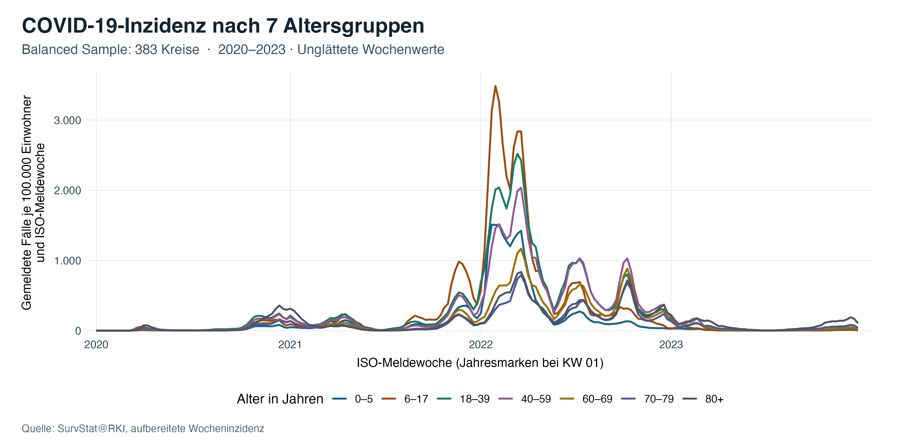
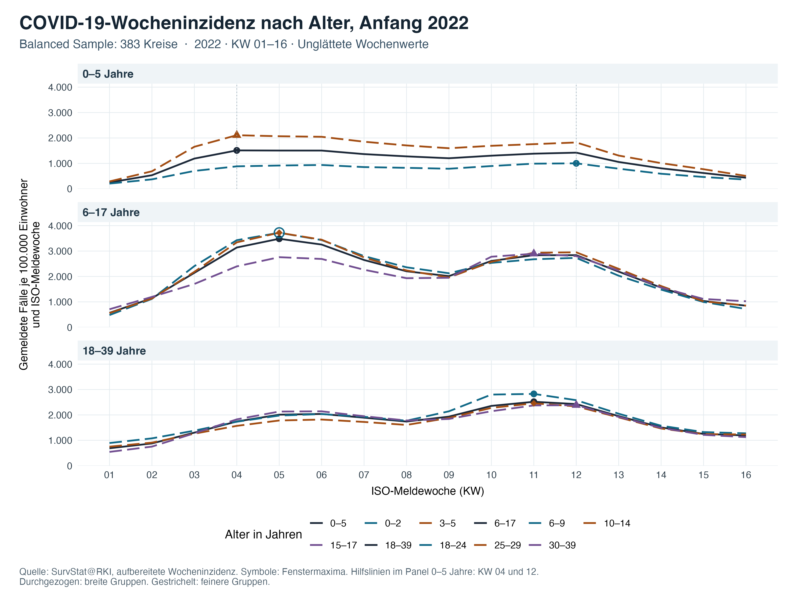

# COVID-19-Wocheninzidenz nach Altersgruppen, 2020–2023

**Thomas · Wochenbericht KW 47 · Gruppenbesprechung am 20.11.2026**

Fortgeschrittenes Praxisprojekt WS 2026/27 · LMU München · Stand 19.11.2026

*Zusammenhang zwischen Strukturmerkmalen und Inzidenzverläufen in den Altersgruppen* · Betreuung durch Finn Schmidt · Projektpartner André Klima

Andrés Vorschläge für sieben und 13 Altersgruppen sind in **zwei geprüften Datensätzen auf Ebene von Kreis, Woche und Altersgruppe** umgesetzt. Beide decken 209 ISO-Meldewochen ab. Daraus entstanden neun Abbildungen und vier Ergebnistabellen.

## Kurzvortrag für die Besprechung (etwa eine Minute)

> Ich habe für dieselben 383 Kreise die Wocheninzidenzen mit sieben und mit 13 Altersgruppen verglichen. In beiden Einteilungen erreichte jede Gruppe ihren höchsten Wert zwischen Ende Januar und Ende März 2022. Bei den 6- bis 17-Jährigen lag die Spitze in Kalenderwoche 05, bei allen vier Gruppen ab 40 Jahren in Woche 12. Was gewinnen wir durch die feinere Einteilung? Bei den unter Sechsjährigen blieb die gemeinsame Kurve von Woche 04 auf 05 fast flach. In derselben Woche stieg die Inzidenz bei den 0- bis 2-Jährigen und sank bei den 3- bis 5-Jährigen. Diese beiden Gruppen würde ich deshalb im nächsten Schritt getrennt nach Kreistyp auswerten.

## Die Altersgruppe mit der höchsten Wocheninzidenz wechselte über die Jahre

*Abb. 01 · Gemeldete Fälle je 100.000 Personen der jeweiligen Altersgruppe und ISO-Meldewoche. Alle sieben Kurven beziehen sich auf dieselben 383 Kreise.*

Die Tabelle vergleicht für jedes Jahr die sieben Altersgruppen. Sie nennt den höchsten einzelnen Wochenwert und den höchsten der sieben Gruppenmediane. Jeder Median fasst die 52 bzw. 53 Wochen einer Altersgruppe zusammen. Beide Spalten geben gemeldete Fälle je 100.000 Personen der jeweiligen Altersgruppe und Woche an.

| ISO-Jahr | Höchster Wochenwert (Alter) | Kalenderwoche | Höchster Median der Wochenwerte (Alter) |
|---|---:|:---:|---:|
| 2020 | 358,4 (80+) | 51 | 17,1 (18–39) |
| 2021 | 982,3 (6–17) | 47 | 134,2 (6–17) |
| **2022** | **3.484,1 (6–17)** | **05** | **691,6 (18–39)** |
| 2023 | 220,3 (80+) | 01 | 65,0 (80+) |

2022 erreichten die 6- bis 17-Jährigen den höchsten Einzelwert. Ihr Median über die 52 Wochen lag bei **387,9**. Bei den 18- bis 39-Jährigen lag er mit **691,6** deutlich höher. Für den Vergleich nach Kreistyp liefern Spitzenhöhe und typisches Wochenniveau damit zwei unterschiedliche Informationen.

## Was die gemeinsame Kurve der unter Sechsjährigen verdeckt

*Abb. 08 · Die durchgezogene Linie zeigt die breite Gruppe, die gestrichelten Linien ihre Teilgruppen. Die Symbole markieren den jeweils höchsten Wochenwert im dargestellten Zeitraum.*

Im **oberen Teil von Abb. 08** verläuft die durchgezogene Linie zwischen KW 04 und KW 05 nahezu waagerecht. Die Wochenwerte zeigen, was in den beiden Teilgruppen passiert ist.

| Alter | KW 04/2022 | KW 05/2022 | Veränderung je 100.000 | Woche des Gesamtmaximums |
|---|---:|---:|---:|:---:|
| 0–2 | 883,8 | 915,6 | **+31,8** | KW 12 |
| 3–5 | 2.109,1 | 2.068,2 | **−40,9** | KW 04 |
| **0–5 gesamt** | **1.510,8** | **1.505,4** | **−5,4** | **KW 04** |

In der gemeinsamen Rate trägt jede Teilgruppe entsprechend ihrer Bevölkerungsgröße bei. Der Anstieg bei den Jüngsten und der Rückgang bei den 3- bis 5-Jährigen heben sich deshalb weitgehend auf. Auch ihre Höchstwerte liegen auseinander. Die 3- bis 5-Jährigen erreichten **2.109,1** in KW 04, die 0- bis 2-Jährigen **1.001,6** in KW 12.

Im **mittleren Teil von Abb. 08** erreichten die 6- bis 9-Jährigen und die 10- bis 14-Jährigen ihr Maximum in KW 05 mit jeweils rund **3.720** Fällen je 100.000. Die 15- bis 17-Jährigen erreichten ihres sechs Wochen später, in **KW 11** mit **2.894,6**. Die Abstände beschreiben die Lage der beobachteten Maxima. Eine Zuordnung zur selben epidemiologischen Welle oder eine Aussage über die Übertragung zwischen Altersgruppen würde zusätzliche Belege erfordern.

## Die Jahresmaxima 2021 und 2022 liegen bei 383 und 400 Kreisen in denselben Wochen

Für diese beiden Jahre sind die Bevölkerungsnenner in allen 400 harmonisierten Kreisen vollständig. **In allen 40 Vergleichen** fiel das Jahresmaximum mit 383 und mit 400 Kreisen auf dieselbe Woche (7 breite und 13 feine Reihen, jeweils für zwei Jahre). Der größte Abstand zwischen zwei Raten derselben Altersgruppe und Woche trat bei den 6- bis 9-Jährigen in KW 07/2022 auf. Die Rate betrug **2.800,98** für 383 Kreise und **2.810,18** für alle 400, eine Differenz von **9,20 je 100.000**. Der Abgleich gilt für die über Kreise zusammengefassten Reihen dieser zwei Jahre. Unterschiede zwischen einzelnen Kreistypen bleiben eine eigene Forschungsfrage. [Aggregierte Wochenreihen beider Gebietsauswahlen](../data_processed/Altsgruppen_ZeitlicheEntwicklung/)

## Vorschlag für die nächste Gruppenauswertung

Für den Überblick über vier Jahre schlage ich die **sieben breiten Gruppen** vor. Für den ersten Vergleich nach Siedlungsstruktur würde ich **0–2 und 3–5 Jahre getrennt** darstellen. Sehen wir den Anstieg bei den Jüngsten und den gleichzeitigen Rückgang bei den 3- bis 5-Jährigen von KW 04 auf 05/2022 auch innerhalb der einzelnen Kreistypen? Dazu können wir je Kreistyp beide Kurven über die Wochen 01–16/2022 zeichnen. Für dieses Zeitfenster liegen vollständige Bevölkerungsnenner für alle 400 Kreise vor.

## Anhang für Rückfragen

### Alle sieben Gesamtmaxima und die zugehörigen Teilgruppen

Das Gesamtmaximum ist der höchste der **209 ungeglätteten Wochenwerte von 2020 bis 2023** für die jeweilige Altersgruppe in den 383 Kreisen. In beiden Einteilungen fallen alle Gesamtmaxima in vier Kalenderwochen des Jahres 2022.

| Breite Gruppe | Gesamtmaximum je 100.000 | KW 2022 | Feinere Gruppen mit der Woche ihres Gesamtmaximums |
|---|---:|:---:|---|
| 0–5 | 1.510,79 | 04 | 0–2 in KW 12, 3–5 in KW 04 |
| 6–17 | 3.484,07 | 05 | 6–9 und 10–14 in KW 05, 15–17 in KW 11 |
| 18–39 | 2.517,79 | 11 | 18–24 und 25–29 in KW 11, 30–39 in KW 12 |
| 40–59 | 2.034,65 | 12 | 40–49 und 50–59 in KW 12 |
| 60–69 | 1.168,02 | 12 | 60–69 in KW 12 |
| 70–79 | 790,76 | 12 | 70–79 in KW 12 |
| 80+ | 836,16 | 12 | 80+ in KW 12 |

Weitere Abbildungen zeigen alle 13 Gruppen über vier Jahre und die einzelnen Kurven der unter 40-Jährigen Anfang 2022. [Abb. 04 · Heatmap für 13 Gruppen](../results/Altsgruppen_ZeitlicheEntwicklung/04_heatmap_13_groups.png) · [Abb. 06 · Vergleich beider Einteilungen](../results/Altsgruppen_ZeitlicheEntwicklung/06_grouping_comparison.png) · [Abb. 09 · Einzelkurven Anfang 2022](../results/Altsgruppen_ZeitlicheEntwicklung/09_focused_2022_fine_groups.png)

### Daten, Prüfungen und verfügbare Ergebnisse

- **Die Wocheninzidenz** beruht auf den SurvStat-Fallzahlen für die Einzelalter 0–79 und die offene Klasse 80+. Fälle mit unbekanntem Alter wurden separat gezählt. Für jede ISO-Meldewoche (Montag bis Sonntag) und Altersgruppe wurden die Fälle über die einbezogenen Kreise summiert, durch die zugehörige jahresspezifische Bevölkerung geteilt und mit 100.000 multipliziert. Der direkte Aufbau der sieben Gruppen aus den Einzelaltern und das Zusammenfassen der 13 Gruppen ergaben übereinstimmende Fallzahlen und Inzidenzen.
- **Bei 17 Kreisen** fehlten in den Jahren 2020 oder 2023 insgesamt 29 Bevölkerungsnenner auf Ebene von Kreis, Einzelalter und Jahr. Die vierjährigen Kurven verwenden deshalb durchgehend die 383 Kreise mit vollständigen Nennern. Die abgeleiteten RKI-Bevölkerungsstände sind mit der Fortschreibung auf Basis des Zensus 2011 vereinbar. Für acht der 29 Lücken wurden historisch passende Vergleichswerte bestätigt. Die Analyse verwendet die ursprünglichen Nenner.
- **Test- und Meldepraxis** können die Höhe und Vergleichbarkeit der gemeldeten Raten beeinflussen. Der Datenimport hat leere Zellen aus historischen SurvStat-Wochenabfragen als null gespeichert. Ob diese Zellen jeweils null gemeldete Fälle bedeuten, ist fachlich noch offen.

Die Kreisdatensätze, Grafiken, Ergebnistabellen und Auswertungsskripte sind im Projekt abgelegt. [Kreisdaten für 7 Gruppen](../data_processed/Altsgruppen_ZeitlicheEntwicklung/kreis_weekly_7.rds) · [Kreisdaten für 13 Gruppen](../data_processed/Altsgruppen_ZeitlicheEntwicklung/kreis_weekly_13.rds) · [Alle Abbildungen](../results/Altsgruppen_ZeitlicheEntwicklung/) · [Ergebnistabellen](../data_processed/Altsgruppen_ZeitlicheEntwicklung/eda/tables/) · [R-Skripte](../Scripts/Altsgruppen_ZeitlicheEntwicklung/)

