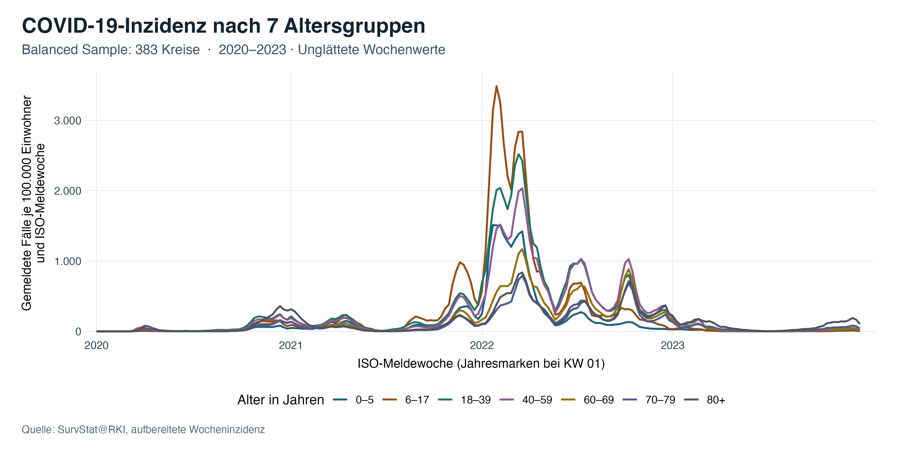
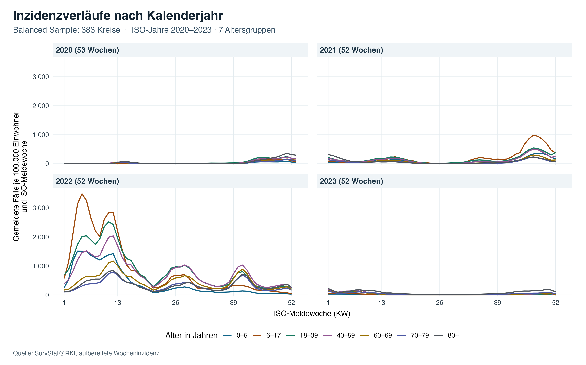
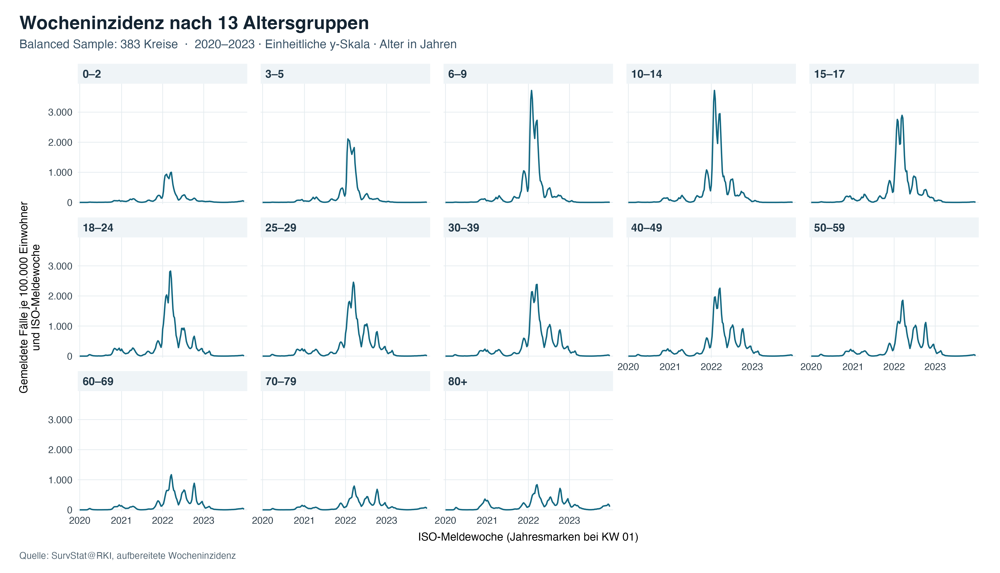
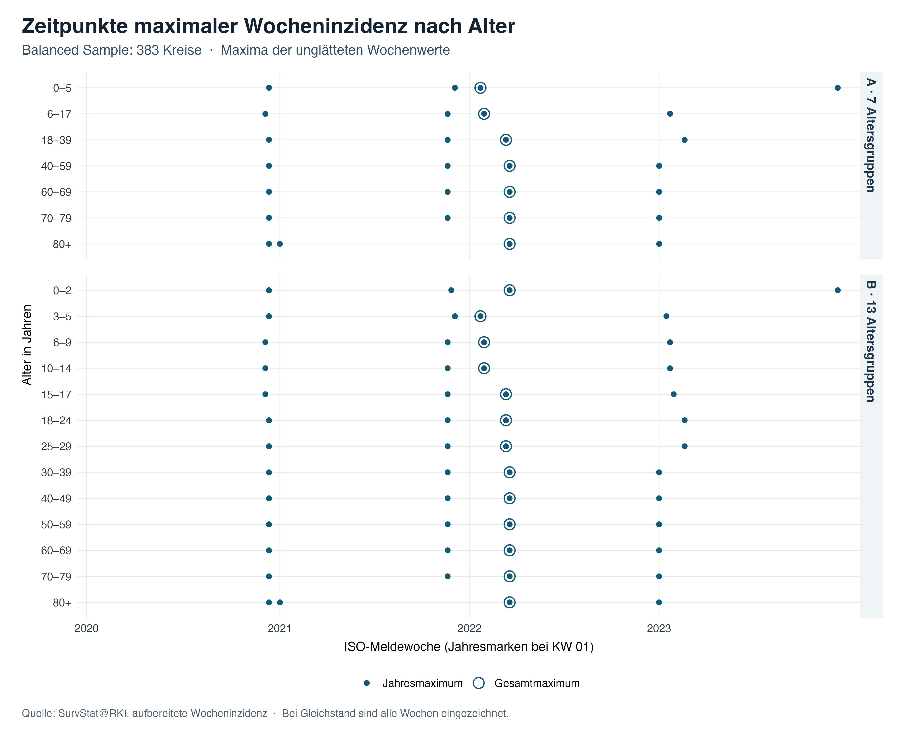
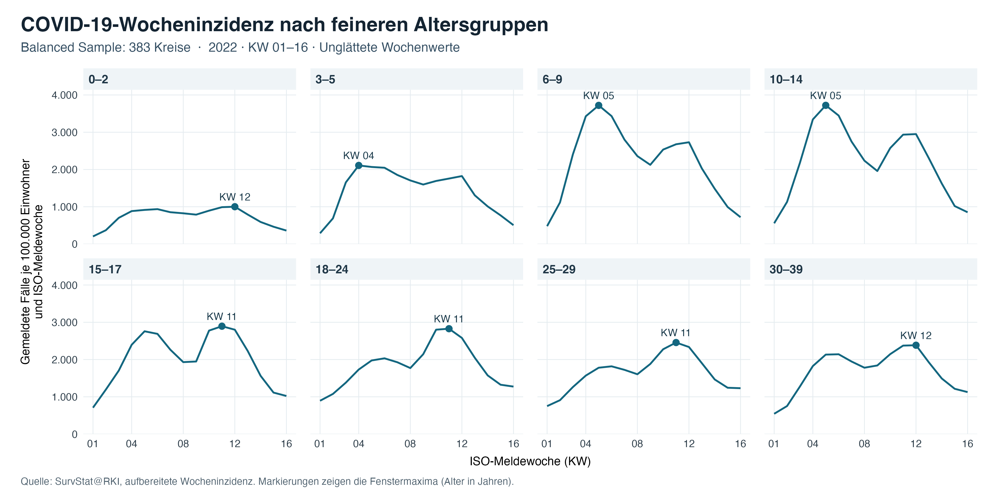
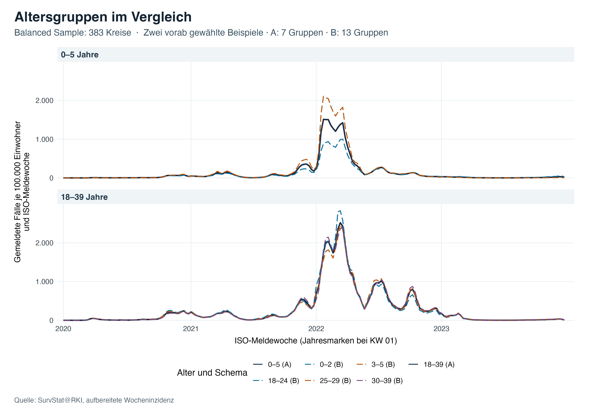

# Altersgruppenspezifische Zeitentwicklung der COVID-19-Meldeinzidenz in Deutschland (2020–2023)

*Explorative Analyse – Arbeitsfassung zur fachlichen Eigenprüfung*  
*LMU München · Fortgeschrittenes Praxisprojekt WS 2026/27 · Schritt 1: Altersgruppen × Zeit*

> **Kurzfassung.** Die berichteten COVID-19-Wocheninzidenzen weisen in den untersuchten Altersgruppen ähnliche übergeordnete Wellenmuster auf, unterscheiden sich jedoch deutlich im Niveau und beim Zeitpunkt ihrer Jahresmaxima. Die ausgeprägtesten Werte treten Anfang 2022 auf. Besonders hohe Wocheninzidenzen zeigen die Gruppen 6–9 und 10–14 Jahre. Die feinere Aufteilung macht relevante Unterschiede sichtbar, die in den zusammengefassten Gruppen 0–5 und 6–17 Jahre verborgen bleiben.

## 1. Zielsetzung und Datengrundlage (kurz)

Untersucht wird, wie sich die **gemeldete** COVID-19-Inzidenz zwischen Altersgruppen im Zeitraum 2020–2023 zeitlich entwickelt und ob eine grobe Altersaggregation wesentliche zeitliche Unterschiede verdeckt. Grundlage sind altersbezogene Wochenmeldungen aus **SurvStat@RKI**. Analysiert werden **209 ISO-Meldewochen** für einen über alle Jahre konstanten **Balanced Sample von 383 Kreisen**. Die nationale Wocheninzidenz ergibt sich je Altersgruppe aus der Summe gemeldeter Fälle geteilt durch die Summe der jeweiligen Bevölkerungsnenner, multipliziert mit 100.000. Dargestellt werden ungeglättete Wochenwerte. Verglichen werden eine Aggregation in **7** und eine in **13** Altersgruppen.

## 2. Zeitliche Entwicklung der gemeldeten Inzidenz

Die Zeitreihen zeigen in allen betrachteten Altersgruppen wiederkehrende Anstiegs- und Rückgangsphasen. Die grobe zeitliche Struktur ist weitgehend gemeinsam, während die Amplitude der Ausschläge zwischen den Gruppen variiert. Diese gemeinsame zeitliche Dynamik ist vor allem im Vergleich der 7 Altersgruppen (Abbildung 1) erkennbar.

*Abbildung 1: Gemeldete wöchentliche COVID-19-Inzidenz je 100.000 Einwohner nach 7 Altersgruppen im Balanced Sample (383 Kreise). Quelle: SurvStat@RKI; eigene Aufbereitung.*

Die kalenderjahresweise Darstellung (Abbildung 2) verdeutlicht die Unterschiede im Zeitverlauf:

- **2020:** Ein niedrigeres gemeldetes Niveau mit einem deutlichen Anstieg gegen Jahresende. Die Gruppe ab 80 Jahren nimmt in dieser Phase eine relativ hohe Position ein.
- **2021:** Mehrere Anstiegsphasen; zum Jahresende hebt sich insbesondere die Gruppe der 6–17-Jährigen ab.
- **2022:** Mit Abstand die größten gemeldeten Wocheninzidenzen im Betrachtungszeitraum; besonders ausgeprägt im ersten Quartal. Weitere, niedrigere lokale Höhepunkte treten im Verlauf des Jahres auf.
- **2023:** Deutlich niedrigere gemeldete Werte als 2022; gegen Jahresende ist bei den höheren Altersgruppen erneut ein leichter Anstieg sichtbar.

*Abbildung 2: Inzidenzverläufe nach ISO-Jahr und 7 Altersgruppen; einheitliche vertikale Skala. Quelle: SurvStat@RKI; eigene Aufbereitung.*

Damit zeigt sich, dass eine über den gesamten Zeitraum gemittelte Altersverteilung die stark **zeitabhängige Rangfolge der Altersgruppen** verschleiern würde. Besonders die Entwicklung Anfang 2022 erfordert eine zeitlich feinere Betrachtung.

## 3. Altersgruppenspezifische Unterschiede

### 3.1 Unterschiede in der Höhe der Wocheninzidenz

Anfang 2022 erreichen die Gruppen im Schulalter besonders hohe gemeldete Wocheninzidenzen. Bei feiner Aufteilung stechen **6–9** und **10–14 Jahre** mit in der Grafik ablesbaren Werten von jeweils ungefähr **3.700 Fällen je 100.000 Einwohner und Woche** hervor. Danach folgen in dieser Phase unter anderem die Gruppen **15–17** und **18–24 Jahre**, während die Inzidenzen im höheren Erwachsenenalter und insbesondere ab 60 Jahren niedriger ausfallen. Dies ist eine **deskriptive Beobachtung** der gemeldeten Inzidenz, kein Vergleich biologischer Infektionsrisiken.

*Abbildung 3: Gleiche y-Skala in allen 13 Altersgruppen erleichtert den direkten Vergleich der berichteten Peak-Höhen. Quelle: SurvStat@RKI; eigene Aufbereitung.*

### 3.2 Unterschiedliche Zeitpunkte der maximalen Wocheninzidenz

Nicht alle Altersgruppen erreichen ihre **2022-Jahresmaxima** in derselben ISO-Woche. Die Detailgrafik für KW 01–16/2022 zeigt eine **frühere Hochphase** bei 3–5 Jahren (KW 04) sowie 6–9 und 10–14 Jahren (KW 05). Dagegen treten die Fenstermaxima bei 15–17, 18–24 und 25–29 Jahren in **KW 11** und bei 0–2 beziehungsweise 30–39 Jahren in **KW 12** auf. In der Gesamtübersicht der Peaks (Abbildung 4) liegen die Maxima der Altersgruppen ab 40 Jahren ebenfalls im Umfeld von KW 12. Diese Wochen sind als **Zeitpunkte des maximalen gemeldeten Wochenwerts** zu lesen; die Verläufe enthalten mehrere lokale Hochphasen, sodass aus dieser Reihenfolge weder die Richtung einer Übertragung noch eine Verzögerung derselben Infektionswelle abgeleitet werden kann.

*Abbildung 4: Jahresmaxima (ausgefüllte Punkte) und globale Maxima 2020–2023 (umrandete Punkte) auf Basis ungeglätteter Wochenwerte. Quelle: SurvStat@RKI; eigene Aufbereitung.*

Die detaillierten Wochenpositionen aus Abbildung 5 lauten:

| Feine Altersgruppe | KW des Maximums im Fenster KW 01–16/2022 |
|:--|:--:|
| 0–2 | 12 |
| 3–5 | 04 |
| 6–9 | 05 |
| 10–14 | 05 |
| 15–17 | 11 |
| 18–24 | 11 |
| 25–29 | 11 |
| 30–39 | 12 |

*Abbildung 5: Altersgruppen 0–39 Jahre, ISO-Wochen 01–16/2022. Die markierten Punkte bezeichnen die maximalen Fensterwerte. Quelle: SurvStat@RKI; eigene Aufbereitung.*

Für exakte Peak-Höhen sowie eine vollständige tabellarische Darstellung der 7 und 13 Gruppen steht die separate Datei **`Peak_Timing_2022_Vorlaeufig.md`** zur Verfügung. Die dort aus der Grafik abgelesenen Inzidenzwerte sind ausdrücklich **approximativ**, bis sie anhand des Original-RDS berechnet und überprüft wurden.

## 4. Vergleich der Altersgruppierungen

Die Gegenüberstellung der 7er- und 13er-Einteilung zeigt, dass die Wahl der Altersgrenzen die sichtbaren zeitlichen Muster beeinflussen kann. Insbesondere sind nicht alle groben Altersgruppen hinsichtlich ihrer internen Verlaufskurven homogen.

*Abbildung 6: Vergleich ausgewählter breiter und feiner Altersgruppen über 2020–2023. Durchgezogene Kurven zeigen die breite, gestrichelte die feine Gruppierung. Quelle: SurvStat@RKI; eigene Aufbereitung.*

**0–5 Jahre.** Die Untergruppen 0–2 und 3–5 Jahre unterscheiden sich Anfang 2022 deutlich in Höhe und zeitlicher Position ihres Maximums: 3–5 Jahre erreichen ihr Maximum bereits in **KW 04**, 0–2 Jahre hingegen in **KW 12**. Die breite Gruppe 0–5 Jahre bildet einen gewichteten gemeinsamen Verlauf ab und verdeckt diese interne Differenz. Für Fragen nach der zeitlichen Dynamik im frühen Kindesalter ist daher eine feinere Einteilung sinnvoll.

**6–17 Jahre.** In den Gruppen **6–9** und **10–14 Jahre** liegen die höchsten Fensterwerte in **KW 05**, bei **15–17 Jahren** dagegen in **KW 11**. Der besonders hohe frühe Gipfel der breiten Gruppe 6–17 Jahre darf folglich nicht für alle drei Teilgruppen als identisches Zeitmuster interpretiert werden.

**18–39 Jahre.** Die Untergruppen 18–24, 25–29 und 30–39 Jahre zeigen insgesamt ähnliche größere Anstiegs- und Rückgangsphasen. Dennoch liegen die Fenstermaxima der ersten beiden Gruppen in KW 11, dasjenige der 30–39-Jährigen in KW 12; auch die Höhendifferenzen sind sichtbar. Eine Aggregation zu 18–39 Jahren ist für eine grobe Überblicksdarstellung vertretbar, kann bei Fragen zum Zeitpunkt oder zur Stärke der Peak-Werte aber Informationen verlieren.

Zusammenfassend erscheint die **7er-Einteilung** für kompakte bundesweite Übersichten nützlich. Für die **Untersuchung des Peak-Timings und innerhalb von Altersgruppen** liefert die **13er-Einteilung** wichtige zusätzliche Informationen. Damit ist nicht nachgewiesen, dass eine der beiden Gruppierungen für jedes spätere statistische Modell überlegen ist; die Wahl sollte durch die jeweilige Fragestellung geleitet werden.

## 5. Fazit und Ausblick (kurz)

Die Altersgruppen weisen eine ähnliche übergeordnete zeitliche Entwicklung der gemeldeten COVID-19-Inzidenz auf, unterscheiden sich jedoch deutlich in **Peak-Höhe, Peak-Zeitpunkt und innerer Heterogenität**. Anfang 2022 sind die Unterschiede besonders ausgeprägt: Für 6–14-Jährige liegen die höchsten Wochenwerte bereits in **KW 05**, für viele ältere Gruppen erst in **KW 11–12**. Eine feinere Altersunterteilung macht besonders im Kindes- und Jugendalter relevante Unterschiede sichtbar. Die Ergebnisse dienen als **deskriptive Grundlage** für die spätere Untersuchung, ob regionale Strukturmerkmale mit diesen Altersmustern zusammenhängen.

---

