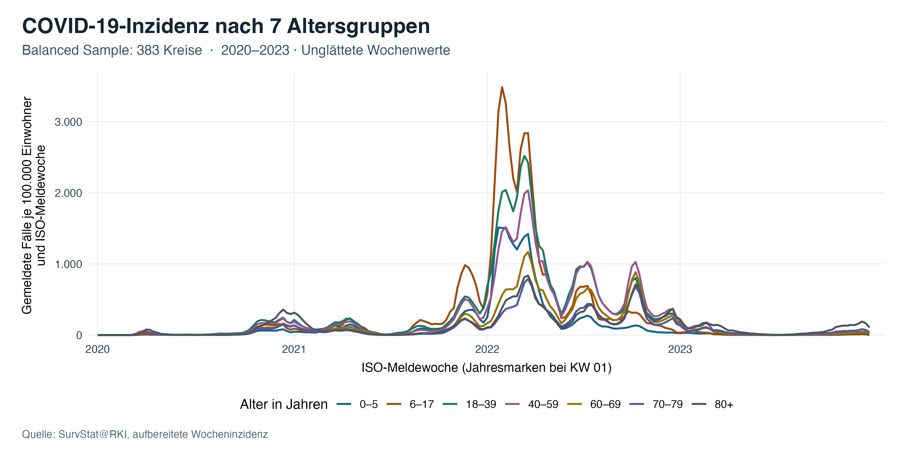
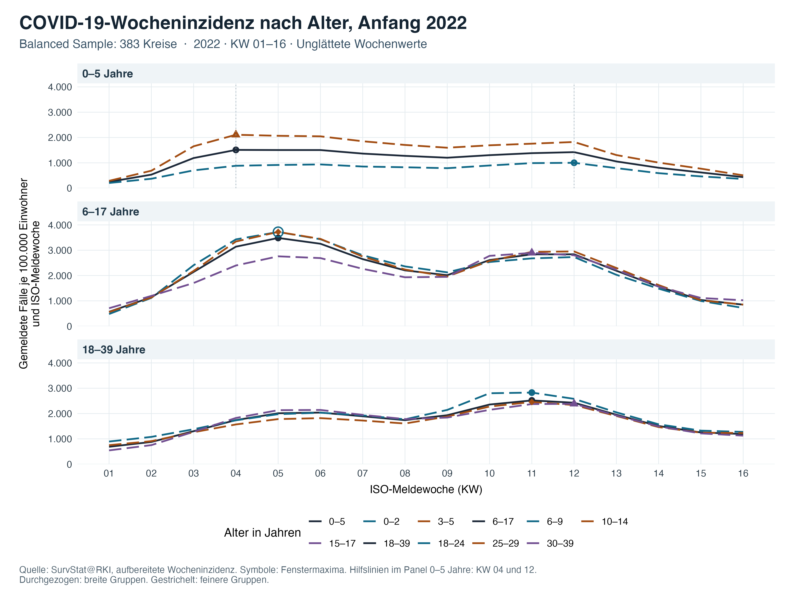
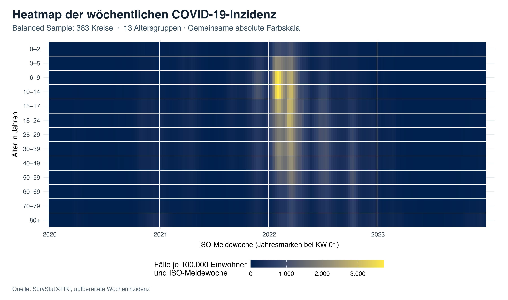

# Zeitverlauf der gemeldeten COVID-19-Inzidenz nach Altersgruppen in Deutschland, 2020–2023

**Ergebnisbericht · Fortgeschrittenes Praxisprojekt WS 2026/27 · LMU München**

Projekt *Zusammenhang zwischen Strukturmerkmalen und Inzidenzverläufen in den Altersgruppen*

Bearbeitung durch Thomas · Betreuung durch Finn Schmidt · Projektpartner André Klima · Stand 19. November 2026

## Zusammenfassung

In den 383 durchgehend auswertbaren Kreisen erreichten alle Altersgruppen ihre höchste gemeldete Wocheninzidenz in KW 04, 05, 11 oder 12 des Jahres 2022. Unter den sieben breiten Gruppen hatten die 6- bis 17-Jährigen den höchsten Einzelwert. Über die 52 Wochen des Jahres 2022 lag der Median bei den 18- bis 39-Jährigen am höchsten. Die feinere Einteilung zeigt Unterschiede, die in der gemeinsamen Alterskurve verschwinden. So stieg Anfang Februar 2022 die Inzidenz bei den 0- bis 2-Jährigen gegenüber der Vorwoche, während sie bei den 3- bis 5-Jährigen sank. Für 2021 und 2022 ergab die Auswertung aller 400 Kreise in jeder Altersreihe dieselbe Woche des Jahresmaximums wie die Auswertung der 383 Kreise.

## Fragestellung und Datengrundlage

Untersucht wurde, wie sich **Höhe und Zeitpunkt der gemeldeten Wocheninzidenzen** zwischen den Altersgruppen unterscheiden und welche dieser Unterschiede mit den beiden von André Klima vorgeschlagenen Einteilungen in sieben bzw. 13 Gruppen erkennbar sind. Grundlage sind aufbereitete SurvStat-Daten des Robert Koch-Instituts (RKI) für **209 aufeinanderfolgende ISO-Meldewochen** von 2020-W01 bis 2023-W52. Die Ausgangsdaten unterscheiden die Einzelalter 0 bis 79 und die offene Gruppe 80+. Fälle mit unbekanntem Alter werden separat gezählt.

Von 400 harmonisierten Kreisen haben **383** für alle vier Jahre vollständige Bevölkerungsnenner. Bei 17 Kreisen fehlen insgesamt 29 Kombinationen aus Kreis, Einzelalter und Jahr, davon fünf im Jahr 2020 und 24 im Jahr 2023. Die vierjährigen Kurven beziehen sich durchgehend auf dieselben 383 Kreise. Für den Vergleich mit allen 400 Kreisen stehen die vollständigen Jahre 2021 und 2022 zur Verfügung.

Für eine Altersgruppe $g$, eine ISO-Meldewoche $t$ und eine Kreisauswahl $S$ wurde die Wocheninzidenz wie folgt berechnet.

$$
I_{g,t}(S) = 100\,000\,\frac{\sum_{k\in S} C_{k,g,t}}{\sum_{k\in S} N_{k,g,y(t)}} .
$$

$C_{k,g,t}$ zählt die gemeldeten Fälle von Montag bis Sonntag. $N_{k,g,y(t)}$ ist die Bevölkerung derselben Altersgruppe im selben Kreis und ISO-Jahr. Dadurch geht jede Teilgruppe mit ihrem Bevölkerungsanteil in die gemeinsame Rate ein. Bei unvollständigem Nenner bleibt die betreffende Rate fehlend. Für die Bestimmung der Maxima wurden die ungeglätteten Wochenwerte vor dem Runden verglichen.

## Ergebnisse

### Jahresmaxima und typisches Wochenniveau

*Abb. 01 · Jede Linie zeigt die gemeldeten Fälle je 100.000 Personen einer Altersgruppe pro Woche auf derselben Skala.*

Im Jahr 2020 lag die höchste einzelne Wocheninzidenz der sieben Gruppen bei den Menschen ab 80 Jahren, 2021 und 2022 bei den 6- bis 17-Jährigen und 2023 wieder bei der Gruppe 80+. Als zweites Maß wurde für jede Gruppe der Median ihrer 52 bzw. 53 Wocheninzidenzen im jeweiligen Jahr berechnet. Er beschreibt das Niveau einer typischen Woche.

| ISO-Jahr | Alter bei höchstem Einzelwert | Wocheninzidenz | KW | Alter bei höchstem Jahresmedian | Jahresmedian |
|---|---|---:|:---:|---|---:|
| 2020 | 80+ | 358,41 | 51 | 18–39 | 17,05 |
| 2021 | 6–17 | 982,27 | 47 | 6–17 | 134,17 |
| 2022 | 6–17 | 3.484,07 | 05 | 18–39 | 691,63 |
| 2023 | 80+ | 220,35 | 01 | 80+ | 64,96 |

2022 erreichten die 0- bis 5-Jährigen ihr Maximum in KW 04, die 6- bis 17-Jährigen in KW 05, die 18- bis 39-Jährigen in KW 11 und alle vier Gruppen ab 40 Jahren in KW 12. Über das ganze Jahr lag der Median der Wochenwerte für die Gruppe 6–17 bei **387,91** und für die Gruppe 18–39 bei **691,63** je 100.000. Im Jahr 2023 betrug der Median für 80+ **64,96**, für 70–79 Jahre **29,32** je 100.000. [Deskriptive Kennzahlen nach Jahr und Altersgruppe](../data_processed/Altsgruppen_ZeitlicheEntwicklung/eda/tables/descriptive_statistics.rds)

### Unterschiede innerhalb der breiten Altersgruppen

*Abb. 08 · Durchgezogene Linien zeigen die breiten Gruppen, gestrichelte Linien ihre Teilgruppen. Die Symbole markieren den jeweils höchsten Wert innerhalb des dargestellten Zeitfensters.*

Bei den **unter Sechsjährigen** veränderte sich die gemeinsame Rate von KW 04 auf KW 05/2022 nur geringfügig. In den beiden Teilgruppen änderte sich die Inzidenz in entgegengesetzter Richtung. Alle Angaben in der Tabelle sind gemeldete Fälle je 100.000 Personen der jeweiligen Gruppe.

| Alter | KW 04/2022 | KW 05/2022 | Veränderung |
|---|---:|---:|---:|
| 0–2 | 883,8 | 915,6 | **+31,8** |
| 3–5 | 2.109,1 | 2.068,2 | **−40,9** |
| **0–5 gesamt** | 1.510,8 | 1.505,4 | **−5,4** |

Die beiden Teilgruppen erreichten auch zu unterschiedlichen Zeitpunkten ihren Höchstwert. Bei den 3- bis 5-Jährigen lag er in KW 04, bei den 0- bis 2-Jährigen acht Wochen später in KW 12. Die zusammengefasste Kurve 0–5 erreichte ihr Maximum bereits in KW 04.

Bei den **6- bis 17-Jährigen** erreichten die 6- bis 9-Jährigen und die 10- bis 14-Jährigen ihre höchste Inzidenz in KW 05. Bei den 15- bis 17-Jährigen lag sie in KW 11. Bei den **18- bis 39-Jährigen** unterschied sich auch die Höhe der Raten innerhalb derselben Woche. Der größte Abstand zwischen ihren drei Teilgruppen trat in KW 10/2022 auf. Damals entfielen auf die 18- bis 24-Jährigen **2.801,4** und auf die 30- bis 39-Jährigen **2.145,5** gemeldete Fälle je 100.000, eine Differenz von **655,9**. [Wochenwerte der verglichenen Gruppen](../data_processed/Altsgruppen_ZeitlicheEntwicklung/eda/06_grouping_comparison.rds) · [Zusammenfassung der Teilgruppenabstände](../data_processed/Altsgruppen_ZeitlicheEntwicklung/eda/tables/grouping_examples.rds)

### Vergleich der 383 Kreise mit allen 400 Kreisen

Für 2021 und 2022 wurden die Raten beider Kreisauswahlen jeweils für dieselbe Altersgruppe und Meldewoche verglichen. Zusätzlich wurde je Jahr und Gruppe geprüft, ob der höchste Wochenwert auf dieselbe KW fiel. Das traf in **allen 40 Vergleichen** zu. Die drei Altersgruppen ab 60 Jahren sind in beiden Einteilungen identisch und daher in beiden ausgewiesen.

| ISO-Jahr | Zahl der Altersgruppen | Gleiche Woche des Jahresmaximums | Größter absoluter Ratenabstand je 100.000 | Alter beim größten Abstand | KW des Abstands |
|---|---:|:---:|---:|---|:---:|
| 2021 | 7 | 7 von 7 | 2,30 | 6–17 | 47 |
| 2021 | 13 | 13 von 13 | 3,29 | 10–14 | 49 |
| 2022 | 7 | 7 von 7 | 6,07 | 6–17 | 03 |
| 2022 | 13 | 13 von 13 | 9,20 | 6–9 | 07 |

Der größte Unterschied trat bei den 6- bis 9-Jährigen in KW 07/2022 auf. Die Wocheninzidenz betrug **2.800,98** in den 383 Kreisen und **2.810,18** in allen 400 Kreisen. Der Vergleich stützt die zeitliche Einordnung der über die Kreise aggregierten Maxima für diese beiden Jahre. Die Empfindlichkeit regionaler Vergleiche gegenüber der Kreisauswahl bleibt offen. [Vergleich der Wochenraten](../data_processed/Altsgruppen_ZeitlicheEntwicklung/eda/tables/sensitivity_balanced_all400.rds)

## Anhang

### Gesamtmaxima in beiden Alterseinteilungen

Das Gesamtmaximum ist die höchste der 209 Wocheninzidenzen der jeweiligen Gruppe in den 383 Kreisen. Alle angegebenen Kalenderwochen liegen im Jahr **2022**. Die breite Gruppe steht jeweils in der ersten Zeile ihrer Teilgruppen. Die Werte geben gemeldete Fälle je 100.000 Personen und Woche an.

| 7er-Einteilung | Gesamtmaximum | KW | 13er-Einteilung | Gesamtmaximum | KW |
|---|---:|:---:|---|---:|:---:|
| 0–5 | 1.510,79 | 04 | 0–2 | 1.001,59 | 12 |
|  |  |  | 3–5 | 2.109,11 | 04 |
| 6–17 | 3.484,07 | 05 | 6–9 | 3.720,29 | 05 |
|  |  |  | 10–14 | 3.721,79 | 05 |
|  |  |  | 15–17 | 2.894,56 | 11 |
| 18–39 | 2.517,79 | 11 | 18–24 | 2.827,68 | 11 |
|  |  |  | 25–29 | 2.456,55 | 11 |
|  |  |  | 30–39 | 2.384,07 | 12 |
| 40–59 | 2.034,65 | 12 | 40–49 | 2.258,58 | 12 |
|  |  |  | 50–59 | 1.856,30 | 12 |
| 60–69 | 1.168,02 | 12 | 60–69 | 1.168,02 | 12 |
| 70–79 | 790,76 | 12 | 70–79 | 790,76 | 12 |
| 80+ | 836,16 | 12 | 80+ | 836,16 | 12 |

*Abb. 04 · Jede Zeile zeigt eine Altersgruppe. Für alle Gruppen und Wochen gilt dieselbe absolute Farbskala. Die Zahlen zu den markantesten Wochen sind in der Maximatabelle nachprüfbar.* [Tabelle der Jahres- und Gesamtmaxima](../data_processed/Altsgruppen_ZeitlicheEntwicklung/eda/tables/peak_timing.rds)
