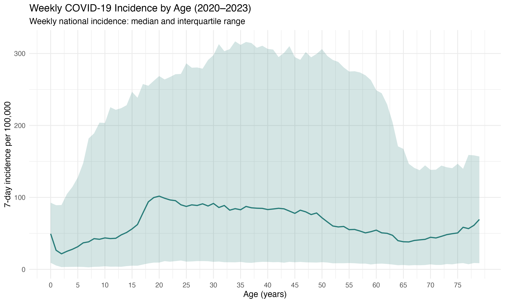
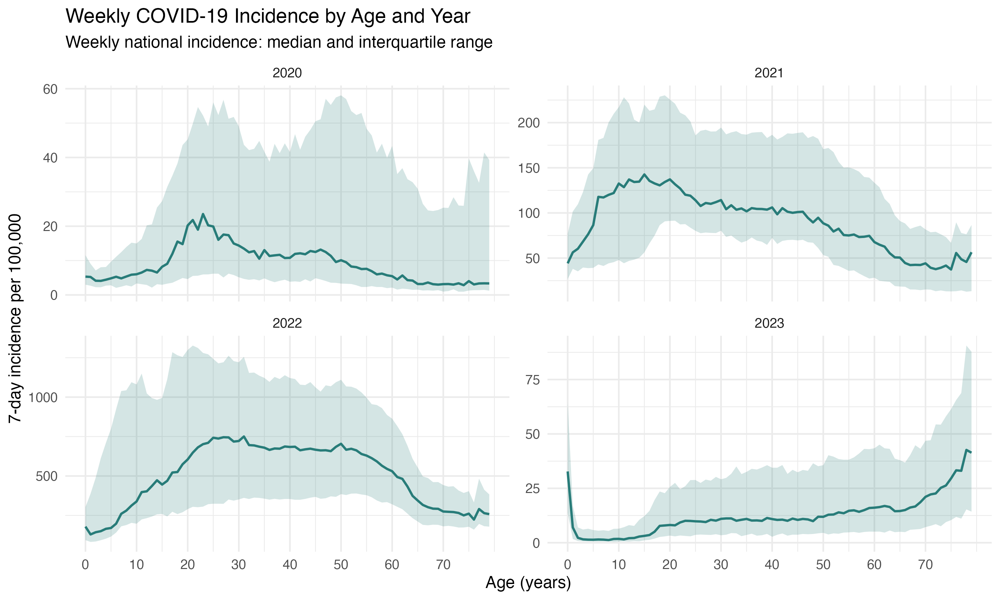
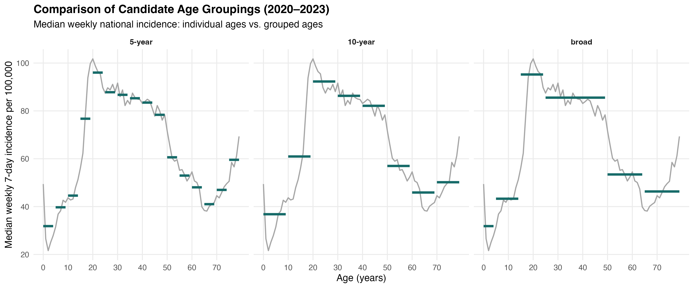
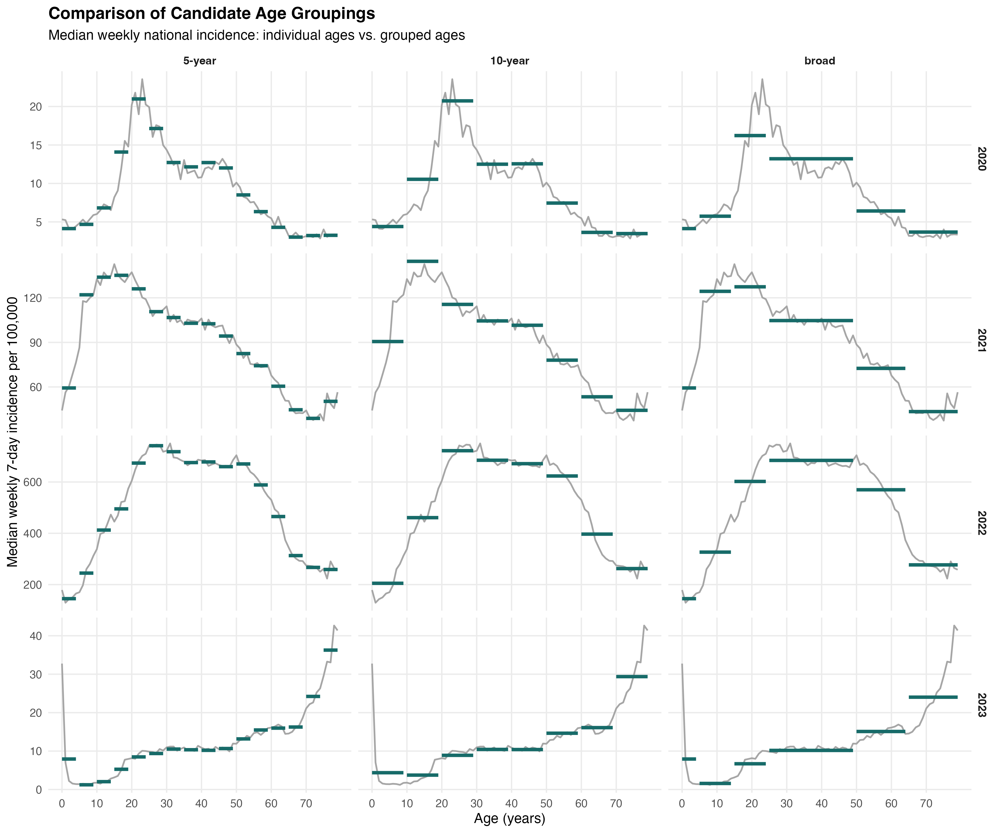

# Einzelalter und COVID-19-Inzidenz (2020–2023)

**Ziel:** Untersuchung, ob die wöchentliche 7-Tage-Inzidenz bei den 0- bis 79-Jährigen bestimmte Altersmuster zeigt.

## 1. Altersmuster über den gesamten Zeitraum

Für jedes Einzelalter wurde der Median der wöchentlichen 7-Tage-Inzidenz über alle Beobachtungen von 2020 bis 2023 berechnet.

Die Median-Kurve zeigt, dass sich die Inzidenz je nach Alter unterschiedlich verändert.

| Altersbereich | Beobachtetes Muster                          |
|---------------|----------------------------------------------|
| 0–2 Jahre     | Die Inzidenz sinkt zunächst.                 |
| 2–15 Jahre    | Die Inzidenz steigt allmählich an.           |
| 15–20 Jahre   | Die Inzidenz steigt deutlich stärker an.     |
| 20–50 Jahre   | Relativ hohes Niveau mit langsamem Rückgang. |
| 50–65 Jahre   | Deutlicherer Rückgang der Inzidenz.          |
| 65–75 Jahre   | Relativ flacher Verlauf.                     |
| 75–79 Jahre   | Die Inzidenz steigt wieder leicht an.        |

## 2. Vergleich nach Jahren

| Jahr | Hauptbeobachtung |
|----|----|
| 2020 | Deutlicher Anstieg ab etwa 15 Jahren mit einem Maximum um 20 Jahre. Danach Rückgang und ein kleiner erneuter Anstieg um 45–50 Jahre. Ab etwa 50 Jahren sinkt die Inzidenz wieder. |
| 2021 | Starker Anstieg im Kindesalter mit einem Maximum bei etwa 10–15 Jahren. Danach nimmt die Inzidenz mit zunehmendem Alter überwiegend ab, besonders ab etwa 60 Jahren. |
| 2022 | Starker Anstieg bis etwa 25–30 Jahre. Zwischen 30 und 50 Jahren bleibt die Inzidenz auf einem relativ hohen Niveau. Ab etwa 55 Jahren folgt ein deutlicher Rückgang. |
| 2023 | Auffällig hohe Inzidenz bei 0-Jährigen und sehr niedrige Werte im weiteren Kindesalter. Ab etwa 15–20 Jahren steigt die Inzidenz zunächst langsam, ab etwa 65 Jahren deutlich stärker an. |

**Gesamtbeobachtung:** Die Altersmuster unterscheiden sich zwischen den Jahren. Besonders 2023 zeigt sich im höheren Alter ein anderes Muster als in den vorherigen Jahren. Die gemeinsame Betrachtung von 2020–2023 kann daher jahresspezifische Altersmuster verdecken.

## 3. Vorschlag für eine Altersgruppierung

Auf Grundlage der beobachteten Altersmuster wird folgende Gruppierung vorgeschlagen:

| Altersgruppe | Begründung anhand der Inzidenzkurven |
|----|----|
| **0–4 Jahre** | Kleinkindalter mit einem besonderen Inzidenzmuster, insbesondere bei 0-Jährigen. |
| **5–14 Jahre** | Im Kindesalter steigt die Inzidenz häufig an, besonders deutlich im Jahr 2021. |
| **15–24 Jahre** | Übergang zum jungen Erwachsenenalter mit einem deutlichen Anstieg der Inzidenz in mehreren Jahren. |
| **25–49 Jahre** | Relativ hohes und häufig eher flaches Inzidenzniveau im Erwachsenenalter. |
| **50–64 Jahre** | In mehreren Jahren nimmt die Inzidenz in diesem Altersbereich deutlich ab. |
| **65–79 Jahre** | In den meisten Jahren eher niedrige Inzidenz, 2023 jedoch deutlicher Anstieg mit zunehmendem Alter. |
| **80+** | Wird separat beibehalten, da die Ausgangsdaten diese Altersgruppe bereits zusammenfassen. |

\*Hinweis: Die Altersgrenzen orientieren sich an den sichtbaren Veränderungen der Inzidenzkurven.

## 4. Visueller Vergleich verschiedener Altersgruppierungen

Verglichen werden **5-Jahres-Gruppen**, **10-Jahres-Gruppen** und die in Abschnitt 3 vorgeschlagene Gruppierung (**broad**).

- **Graue Linien:** Median der wöchentlichen 7-Tage-Inzidenz für jedes Einzelalter.
- **Grüne Linien:** Median der wöchentlichen 7-Tage-Inzidenz der jeweiligen Altersgruppen.

Die grünen Linien erstrecken sich über den entsprechenden Altersbereich.

#### Gesamter Zeitraum (2020–2023)

#### Vergleich nach Jahren

### Vergleich der Gruppierungen

| Gruppierung | Beobachtung |
|----|----|
| **5-Jahres-Gruppen** | Zeigen viele Details, teilen aber auch Altersbereiche mit ähnlicher Inzidenz in mehrere Gruppen auf. |
| **10-Jahres-Gruppen** | Reduzieren die Anzahl der Gruppen. Die festen Altersgrenzen passen jedoch nicht immer zu den beobachteten Veränderungen. |
| **Broad (Vorschlag aus Abschnitt 3)** | Orientiert sich an den beobachteten Altersmustern. Altersbereiche mit ähnlichem Inzidenzniveau werden breiter zusammengefasst. |

### Beobachtungen zur vorgeschlagenen Gruppierung nach Jahren

| Jahr | Beobachtung |
|----|----|
| **2020** | Der Anstieg im jungen Erwachsenenalter bleibt erkennbar. Das Maximum um 20 Jahre wird durch die Gruppe 15–24 jedoch weniger deutlich dargestellt. |
| **2021** | Das hohe Inzidenzniveau im Kindes- und Jugendalter und der anschließende Rückgang bleiben sichtbar. |
| **2022** | Der Anstieg bis zum jungen Erwachsenenalter, das hohe Niveau zwischen 25 und 49 Jahren und der spätere Rückgang bleiben erkennbar. |
| **2023** | Der Anstieg im höheren Alter bleibt sichtbar. Der stärkere Anstieg innerhalb der Gruppe 65–79 wird jedoch nicht getrennt dargestellt. |

## 5. Fazit

Gleich breite Altersgruppen bilden die beobachteten Altersmuster nicht immer vollständig ab.

Die vorgeschlagene Gruppierung orientiert sich an den beobachteten Veränderungen der Inzidenz und stellt eine mögliche Alternative zu festen 5- oder 10-Jahres-Gruppen dar.

Allerdings gehen durch die Zusammenfassung einzelne Altersunterschiede verloren.
