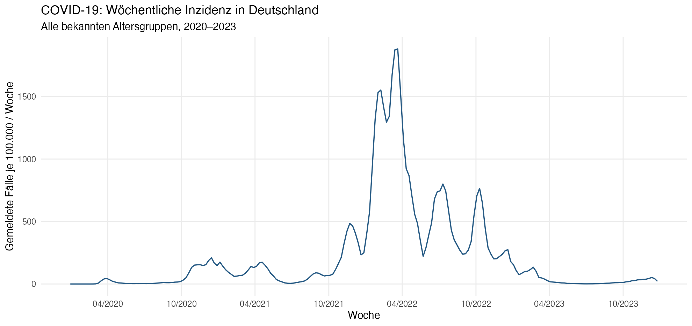
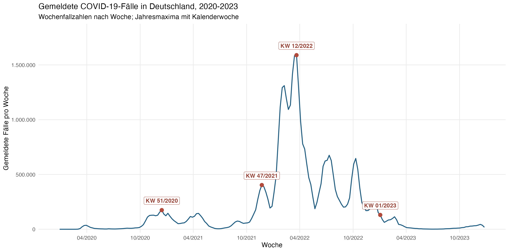
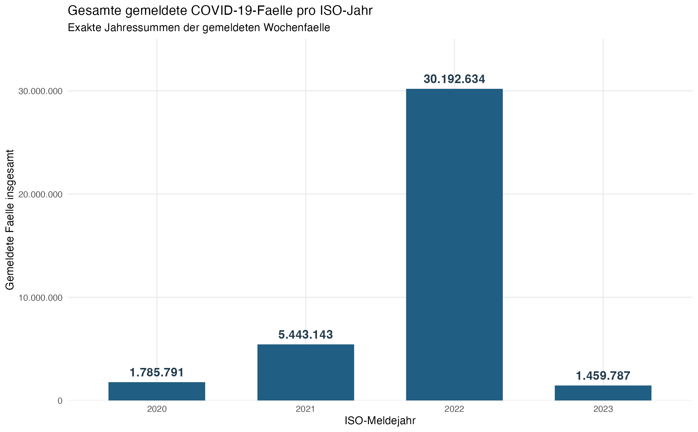
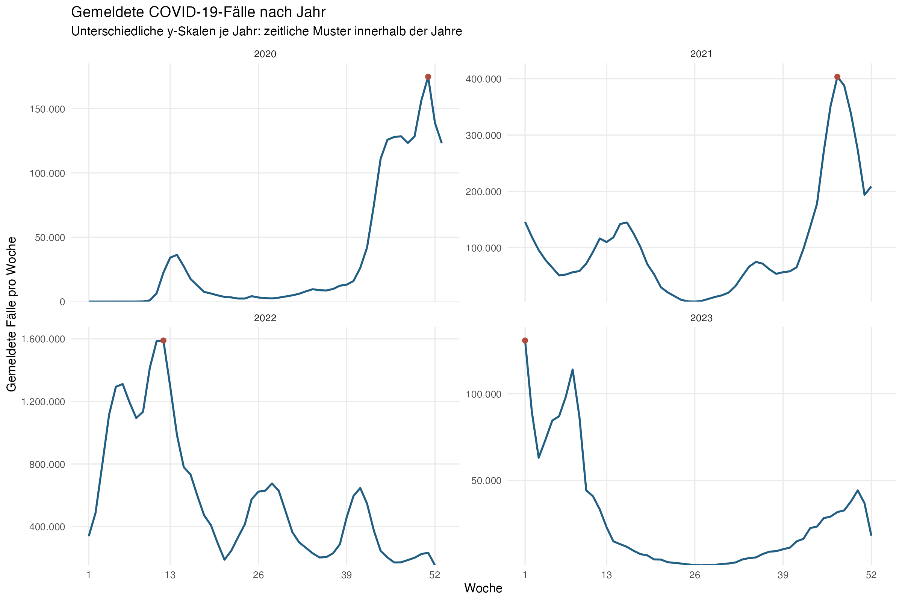
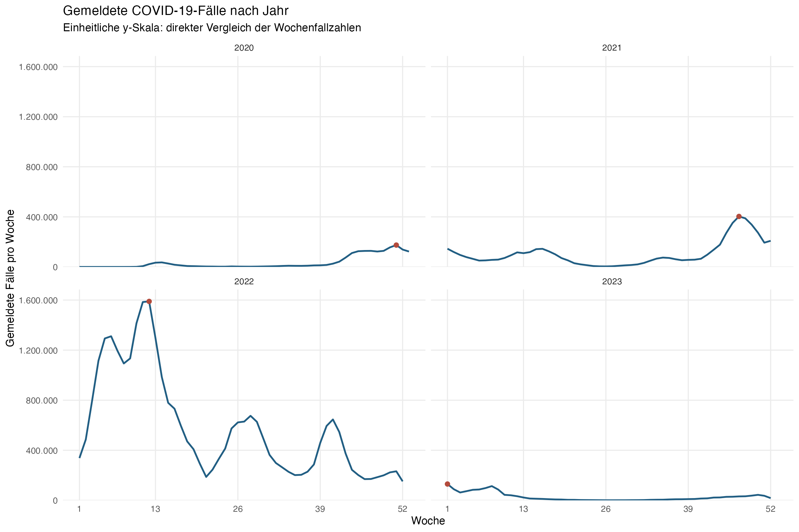
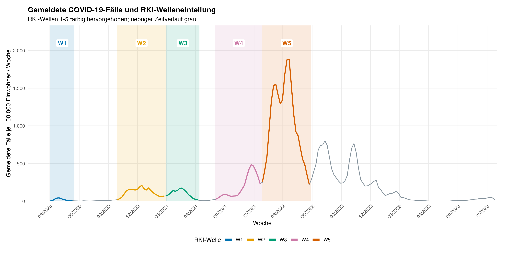
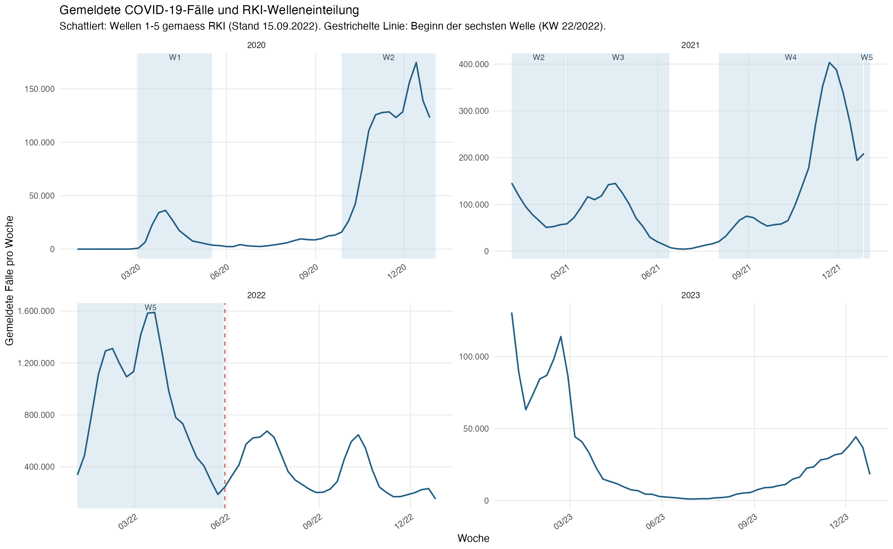

# Explorative Analyse der zeitlichen Entwicklung der COVID-19-Fälle in Deutschland (2020–2023)

**Fortgeschrittenes Praxisprojekt · LMU München · Wintersemester 2026/27**\
**Zusammenfassung für die Projektgruppe · 12.11.2026**

> **Kurzüberblick:** Ich habe den bundesweiten Verlauf der gemeldeten COVID-19-Fälle von 2020 bis 2023 untersucht. Dafür wurden die RKI-/SurvStat-Wochendaten aller 400 harmonisierten Kreise zu einer Zeitreihe mit 209 ISO-Meldewochen zusammengefasst. Die sieben Abbildungen zeigen den Unterschied zwischen Fallzahlen und Inzidenzen, die Entwicklung innerhalb und zwischen den Jahren sowie die Einordnung in die RKI-Wellen 1–5. Das auffälligste Jahr ist **2022** mit **30.192.634 gemeldeten Fällen** und einem Wochenmaximum von **1.589.134 Fällen in KW 12/2022**.

## 1. Fragestellung und Abgrenzung

**Fragestellung:** *Wie haben sich die gemeldeten COVID-19-Fallzahlen und die wöchentliche Meldeinzidenz in Deutschland zwischen 2020 und 2023 entwickelt? Welche zeitlichen Muster und Höhepunkte lassen sich erkennen?*

Diese Auswertung beschreibt die **zeitliche Entwicklung auf Bundesebene**. Unterschiede zwischen Altersgruppen, Kreistypen oder Lagekategorien sowie mögliche Einflussfaktoren sind eigene Teilaufgaben der Projektgruppe und werden hier **nicht** statistisch untersucht. Die Analyse ist **explorativ und deskriptiv**; sie liefert keine kausalen Aussagen.

## 2. Datengrundlage und Vorgehen

- **Quelle:** Robert Koch-Institut (RKI) / [SurvStat\@RKI](mailto:SurvStat@RKI){.email}, heruntergeladen mithilfe des R-Pakets `rsurvstat`.
- **Aufbereitete Daten:** insbesondere `data_processed/rki_weekly_long.rds` und für Inzidenzen die altersspezifischen RKI-Jahresbevölkerungsdaten (`rki_population_annual.rds`).
- **Räumliche Abdeckung:** 400 harmonisierte Kreise; die zwölf Berliner Bezirke wurden zu Berlin zusammengefasst.
- **Beobachtungszeitraum:** ISO-Meldejahre 2020–2023, insgesamt **209 ISO-Wochen** (2020 hat 53 ISO-Wochen). ISO-KW 01/2020 begann am 30.12.2019.
- **Zeiteinheit:** eine **ISO-Meldewoche** von Montag bis Sonntag. Die Zuordnung entspricht einer Meldezeitreihe, nicht dem individuellen Infektionszeitpunkt.

**Zwei verschiedene Kennzahlen:**

1.  **Wöchentliche Fallzahl:** Für jede Woche wurden die Fälle über sämtliche Kreise und Alterskategorien summiert, **einschließlich Fälle mit unbekanntem Alter**. Dadurch erhalten wir die bundesweite absolute Zahl gemeldeter Fälle pro Woche.
2.  **Wöchentliche Meldeinzidenz:** Die Fälle mit **bekanntem Alter** wurden mit den zugehörigen gültigen Bevölkerungsnennern zusammengeführt. Die bundesweite Rate wurde als `Summe der Fälle / Summe der entsprechenden Bevölkerung × 100.000` neu berechnet — **nicht** als ungewichteter Mittelwert der Kreis-Inzidenzen. Beobachtungen mit fehlendem bzw. ungültigem Bevölkerungsnenner wurden für diese Berechnung ausgeschlossen.

Die **wöchentliche Meldeinzidenz** bezieht sich auf eine vollständige Meldewoche. Sie ist nicht mit der täglich veröffentlichten, gleitenden 7-Tage-Inzidenz für einen beliebigen Stichtag gleichzusetzen.

## 3. Ergebnisse der sieben Abbildungen

### Abbildung 1 – Wöchentliche Inzidenz in Deutschland

Auf der X-Achse steht die Zeit (Wochenbeginn), auf der Y-Achse die **gemeldeten Fälle je 100.000 Einwohner pro Woche**. Es handelt sich um eine bevölkerungsbezogene Rate für die bekannten Altersgruppen.

Der Verlauf ist durch mehrere starke Anstiege und Rückgänge gekennzeichnet. Die höchste wöchentliche Meldeinzidenz liegt im Frühjahr 2022. Auch danach sind im Sommer und Herbst 2022 weitere deutliche lokale Anstiege erkennbar. Gegenüber 2022 fallen die gemeldeten Inzidenzwerte im Jahr 2023 sehr niedrig aus.

**Warum diese Grafik?** Sie macht die längerfristige Dynamik der Meldedaten auf einer einheitlichen Zeitachse sichtbar und ergänzt die absoluten Fallzahlen um einen Bevölkerungsbezug.

### Abbildung 2 – Absolute Wochenfallzahlen und Jahresmaxima

Die Y-Achse enthält die **absolute Zahl gemeldeter Fälle pro Woche**. Die roten Punkte markieren das Maximum innerhalb des jeweiligen ISO-Jahres; die Beschriftung nennt die Kalenderwoche.

| ISO-Jahr | Jahresmaximum (Fälle pro Woche) | Kalenderwoche  | Wochenbeginn   |
|:---------|--------------------------------:|:---------------|:---------------|
| 2020     |                         174.698 | KW 51/2020     | 14.12.2020     |
| 2021     |                         403.425 | KW 47/2021     | 22.11.2021     |
| 2022     |                   **1.589.134** | **KW 12/2022** | **21.03.2022** |
| 2023     |                         130.684 | KW 01/2023     | 02.01.2023     |

Das mit Abstand höchste Wochenmaximum des Untersuchungszeitraums liegt in **KW 12/2022**. Die roten Punkte sind **Jahresmaxima**, keine automatisch ermittelten Grenzen eigenständiger Infektionswellen.

**Warum diese Grafik?** Sie zeigt den zeitlichen Verlauf in absoluten Meldungszahlen und macht die Zeitpunkte der vier Jahresmaxima eindeutig nachvollziehbar.

### Abbildung 3 – Jahressummen der gemeldeten Fälle

**Was wird gezeigt?** Summe aller wöchentlich gemeldeten Fälle je **ISO-Meldejahr**, mit exakten Zahlen über den Balken.

| ISO-Jahr | Summe gemeldeter Fälle |
|:---------|-----------------------:|
| 2020     |              1.785.791 |
| 2021     |              5.443.143 |
| **2022** |         **30.192.634** |
| 2023     |              1.459.787 |

**2022** ist mit rund **30,2 Millionen Meldungen** das Jahr mit den meisten gemeldeten Fällen; die Zahl liegt deutlich über 2021, 2020 und 2023. Im Vergleich zum Vorjahr ist die **registrierte** Fallzahl 2023 sehr viel niedriger.

**Warum diese Grafik?** Die Jahressummen zeigen die Größenordnung der registrierten Fallzahlen; anders als die Wochenkurve beantworten sie die Frage nach dem **gesamten Meldeaufkommen pro Jahr**. Eine höhere Jahressumme bedeutet nicht automatisch eine entsprechend höhere Zahl unterschiedlicher infizierter Personen.

### Abbildung 4 – Jahresverläufe mit freien Y-Skalen

Dieselben wöchentlichen **absoluten Fallzahlen**, aufgeteilt in vier Jahresfenster. **Jedes Jahr hat einen eigenen Y-Achsenbereich** (*freie Y-Skalen*).

Auch in den Jahren mit vergleichsweise niedrigen Meldezahlen sind eigenständige zeitliche Muster sichtbar: ein Frühjahrsanstieg und ein starker Herbst-/Winteranstieg 2020; mehrere Anstiege 2021, insbesondere im Spätherbst; sehr ausgeprägte Peaks 2022; ein starker Rückgang zu Beginn 2023 mit erneutem Anstieg gegen Jahresende.

**Warum diese Grafik?** Mit den freien Skalen lassen sich **lokale Peaks und Schwankungen innerhalb jedes Jahres** besser erkennen. **Die optische Höhe der Linien darf hier zwischen verschiedenen Jahren nicht direkt verglichen werden**, weil die Y-Achsen unterschiedlich sind.

### Abbildung 5 – Jahresverläufe mit einheitlicher Y-Skala

Die **exakt gleichen Wochenfallzahlen wie in Abbildung 4**, diesmal jedoch mit **identischer Y-Skala in allen vier Teilgrafiken**.

Der Größenunterschied wird unmittelbar sichtbar: Der Jahrespeak 2022 liegt weit über den Maxima der übrigen Jahre. Die kleineren Ausschläge in 2020, 2021 und 2023 wirken auf dieser Skala entsprechend flach.

**Warum beide Abbildungen 4 und 5?** **Freie Y-Skalen** eignen sich zur Untersuchung von Mustern innerhalb eines Jahres; eine **einheitliche Y-Skala** ermöglicht den direkten Vergleich der **absoluten Höhe** über die Jahre. Die beiden Ansichten ergänzen sich und widersprechen sich nicht.

### Abbildung 6 – RKI-Wellen 1–5 auf einer durchgehenden Zeitachse

Die bundesweite **wöchentliche Meldeinzidenz (Fälle je 100.000 Einwohner)** zusammen mit **fünf farbig markierten Zeitabschnitten**, deren Grenzen aus der retrospektiven Phaseneinteilung des RKI übernommen wurden.

| RKI-Welle | Zeitraum gemäß der verwendeten Einteilung | Kennzeichnung |
|:----------|:------------------------------------------|:--------------|
| W1        | KW 10–20/2020                             | Blau          |
| W2        | KW 40/2020–08/2021                        | Gelb/Orange   |
| W3        | KW 09–23/2021                             | Grün          |
| W4        | KW 31–51/2021                             | Rosa          |
| W5        | KW 52/2021–21/2022                        | Orange        |

Besonders deutlich hebt sich die fünfte Welle im Frühjahr 2022 ab. Innerhalb dieser Phase liegen mehrere lokale Hochpunkte; **ein lokales Maximum ist nicht gleichbedeutend mit einer eigenen RKI-Welle**.

**Wichtige Einschränkung der Darstellung:** **Grau** bedeutet **„in dieser Grafik nicht als W1–W5 markiert“**, nicht „keine Pandemie“ oder „keine weiteren Wellen“. Die verwendete RKI-Publikation von September 2022 bezeichnet den Abschnitt **ab KW 22/2022 zunächst als sechste Welle**. Spätere retrospektive Darstellungen können Phasen anders benennen. Die Abbildung legt sich bewusst auf die Grenzen von W1–W5 fest und rechnet spätere Peaks **nicht** zur W5 hinzu.

### Abbildung 7 – RKI-Wellen in den vier Jahresansichten

Die RKI-Zeitabschnitte W1–W5 als **schattierte Bereiche**, diesmal auf der Grundlage von **absoluten Wochenfallzahlen**. Die vier Teilgrafiken haben unterschiedliche Y-Skalen, um die einzelnen Jahresverläufe lesbar zu halten.

Die RKI-Wellen erstrecken sich teils **über Jahresgrenzen**: W2 geht von 2020 in 2021 über, W5 von 2021 in 2022. Die rote gestrichelte Linie im Fenster 2022 markiert den **Beginn des nächsten, in der Quelle von September 2022 als W6 bezeichneten Abschnitts (KW 22/2022)**. Sie definiert **kein Ende** dieses Abschnitts.

**Warum diese Grafik?** Die Jahresansichten zeigen genauer, welche lokalen Verläufe innerhalb der RKI-Abschnitte liegen und warum **Kalenderjahr, lokaler Peak und offiziell eingeteilter Wellenzeitraum** drei unterschiedliche Konzepte sind.

## 4. Fazit

Die explorative Analyse der **209 ISO-Meldewochen von 2020 bis 2023** zeigt einen deutlich schwankenden Verlauf der gemeldeten COVID-19-Fälle in Deutschland. Statt eines gleichmäßigen Trends sind wiederholte Anstiegs- und Rückgangsphasen zu erkennen. Besonders auffällig ist das Jahr **2022**: Mit **30.192.634 gemeldeten Fällen** weist es die höchste Jahressumme auf; das Maximum der gesamten Zeitreihe liegt bei **1.589.134 Fällen in KW 12/2022**. Auch nach diesem Höchststand traten weitere lokale Anstiege auf.

Die **sieben Abbildungen** verdeutlichen unterschiedliche Aspekte derselben zeitlichen Entwicklung: Die absoluten Wochenfallzahlen zeigen das Meldeaufkommen, die wöchentliche Inzidenz berücksichtigt die Bevölkerungsgröße. **Freie Y-Skalen** machen Schwankungen innerhalb der einzelnen Jahre sichtbar, während **einheitliche Y-Skalen** einen direkten Vergleich der Fallzahlen ermöglichen. Die farblich markierten **RKI-Wellen 1–5** dienen der zeitlichen Einordnung; einzelne lokale Maxima stellen nicht automatisch eigenständige Infektionswellen dar. Die späteren, grau dargestellten Abschnitte wurden lediglich nicht diesen fünf Wellen zugeordnet.

**Die Ergebnisse beschreiben das Meldegeschehen, nicht die tatsächliche Zahl aller Infektionen oder infizierten Personen.** Änderungen der Test- und Meldepraxis sowie mögliche Meldeverzögerungen begrenzen insbesondere die Vergleichbarkeit zwischen den Jahren. Die beobachteten zeitlichen Muster lassen sich damit **deskriptiv darstellen, aber nicht allein anhand dieser Daten kausal erklären**.
