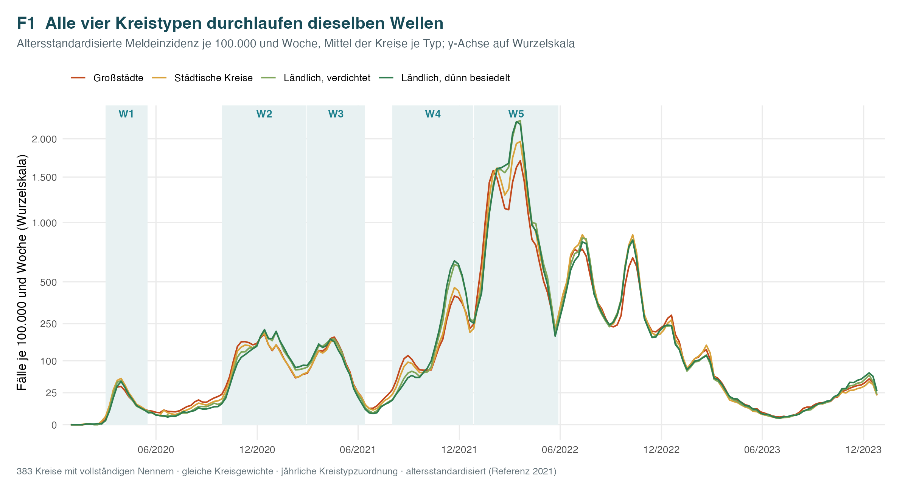
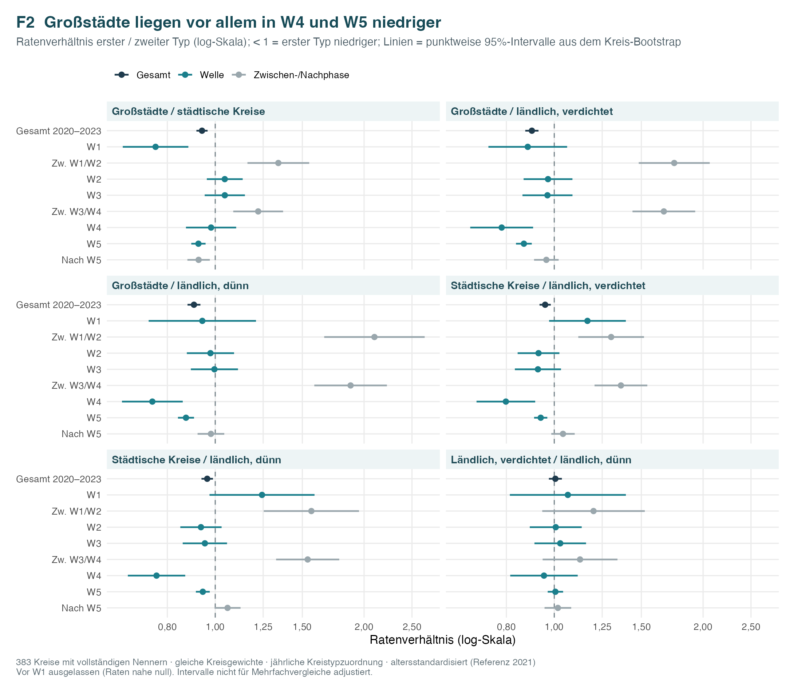
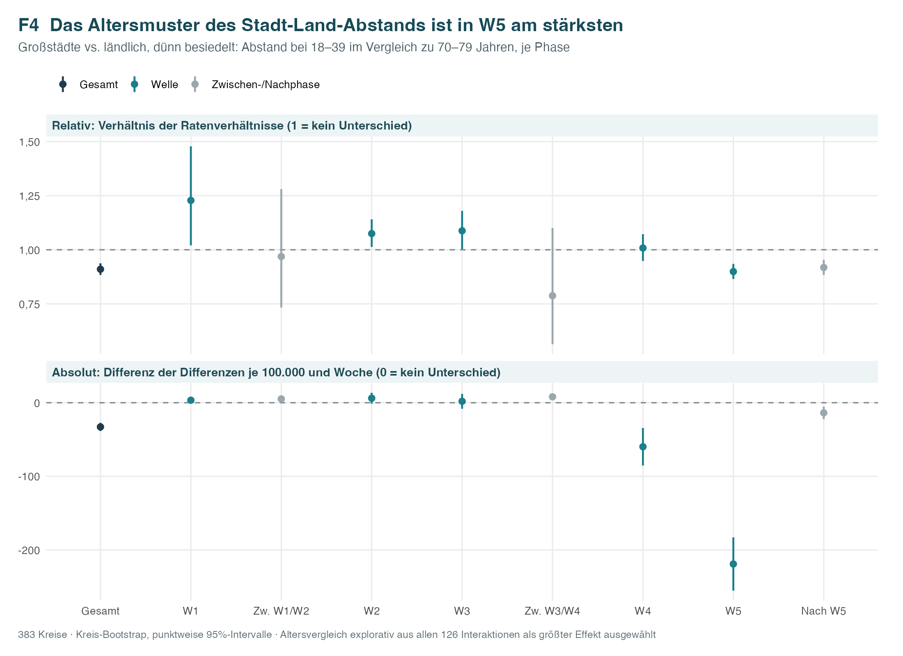
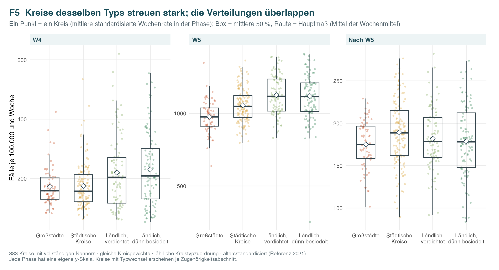

# COVID-19 nach Kreistyp, Alter und Zeit (Bericht v2)

**Deutschland · ISO-Jahre 2020–2023 · Stand: 25.11.2026**

> **Kurzantwort:** Alle vier Kreistypen durchlaufen dieselben Wellen. Großstädte haben altersstandardisiert eine um rund 9 % niedrigere Meldeinzidenz als ländliche Kreise, doch dieser Abstand entsteht fast nur in W4 und W5. Er ist bei den 18- bis 39-Jährigen am größten und in W5 am deutlichsten altersabhängig. Es handelt sich um Zusammenhänge gemeldeter Fälle, nicht um Wirkungen des Wohnorts.

Dieser Bericht ist nach den drei Forschungsfragen gegliedert. Jede Frage wird in derselben Reihenfolge beantwortet: **ansehen → messen → Unsicherheit beurteilen → Robustheit prüfen → einordnen.** Methodendetails stehen im Anhang und im [Methodenbericht](Kreistyp_Alter_Zeit_Methoden.md).

## 1 Fragestellung

| Frage | Inhalt |
|---|---|
| **F1 Stadt-Land-Unterschied** | Unterscheiden sich die vier Kreistypen nach Altersstandardisierung – und in welchen Phasen? |
| **F2 Alter** | Ist der Stadt-Land-Abstand in allen Altersgruppen gleich groß? |
| **F3 Zeit** | Ändern sich der Abstand und sein Altersmuster zwischen den Phasen? |

Berichtet werden Ratenverhältnisse (Hauptmaß) und absolute Differenzen (ergänzend), jeweils mit punktweisen 95%-Intervallen aus dem Kreis-Bootstrap.

## 2 Daten und Definitionen

- **Einheit:** gemeldete Fälle je 100.000 Personen und Woche. Die Tabellenwerte sind mittlere *Wochen*raten, keine Jahresinzidenzen.
- **Stichprobe:** 383 von 400 Kreisen mit durchgehend gültigen Altersnennern; 209 Wochen; sieben Altersgruppen (0–5, 6–17, 18–39, 40–59, 60–69, 70–79, 80+). Fehlende Nenner werden nicht als null behandelt.
- **Kreistyp:** BBSR-Typ des jeweiligen ISO-Jahres; vier Kreise wechseln den Typ.
- **Gewichtung:** innerhalb jeder Woche gleiche Kreisgewichte, danach gleiche Wochengewichte. Die Ergebnisse beschreiben also den *typischen Kreis*, nicht die Bevölkerung (dazu Abschnitt 7).
- **Altersstandardisierung:** Altersraten jedes Kreises werden mit denselben Altersanteilen gewichtet (alle 400 Kreise, 2021). Damit wird die Frage „liegt es nur an der Altersstruktur?“ ausgeschlossen.
- **Phasen:** RKI-Wellen W1–W5 einschließlich Vor-, Zwischen- und Nachphasen (9 Abschnitte, Grenzen vorab festgelegt). „Nach W5“ umfasst 83 Wochen und ist keine einzelne Welle.

**Warum standardisieren?** 2021 sind in Großstädten 30,72 % der Bevölkerung 18–39 Jahre alt, in dünn besiedelten ländlichen Kreisen 22,99 %; ab 70 Jahren sind es 15,15 % gegenüber 17,67 %. Ohne Standardisierung liegen Großstädte um 12,77 niedriger (Verhältnis 0,944), mit Standardisierung um 22,07 (0,906). Die Altersstruktur verdeckt also einen Teil des Abstands.

## 3 Hintergrund: dieselben Wellen

Die vier Kurven steigen und fallen nahezu gleichzeitig: Die Korrelation der Wochenwerte zwischen den Typen liegt bei 0,97–0,999, die der wöchentlichen Veränderungen bei 0,87–0,99. Sichtbare Abstände gibt es vor allem in W4 (Herbst 2021) und W5 (Omikron, Anfang 2022), wo die Großstädte unter den übrigen Typen bleiben.

Hohe Korrelation bedeutet gleichen Verlauf, nicht gleiche Höhe. Die folgenden Abschnitte messen deshalb die Höhenunterschiede direkt.

## 4 F1: Wo und wann unterscheiden sich die Kreistypen?

**Gesamtzeitraum:** Großstädte liegen niedriger als ländlich-dünn besiedelte Kreise (0,906; 95%-Intervall 0,879–0,933), ländlich-verdichtete Kreise (0,901) und städtische Kreise (0,940). Zwischen den übrigen drei Typen sind die Unterschiede klein (0,958; 0,963; 1,005). In der ursprünglichen Holm-korrigierten Auswertung sind nur die drei Großstadtvergleiche abgesichert.

**Nach Phasen zerfällt dieses Gesamtbild:**

| Großstädte / ländlich, dünn | Verhältnis | 95%-Intervall |
|---|---:|---:|
| W1–W3 | 0,94 · 0,98 · 1,00 | jeweils 1 eingeschlossen |
| Zwischenphasen G1 / G2 | 2,10 · 1,88 | 1,66–2,65 · 1,59–2,22 |
| **W4** | **0,746** | 0,648–0,859 |
| **W5** | **0,873** | 0,841–0,906 |
| Nach W5 | 0,980 | 0,921–1,043 |

- **Der Gesamtabstand ist im Kern ein W4/W5-Abstand.** Auf der absoluten Skala stammen rund 95 % der Gesamtdifferenz (−22,07) aus diesen beiden Wellen. Das Vierjahresmittel ist daher kein guter Einzelwert.
- **In W4 trennt sich „städtisch“ von „ländlich“:** Auch städtische Kreise liegen deutlich unter den ländlichen Typen (0,761 bzw. 0,798), Großstädte und städtische Kreise aber kaum voneinander (0,981).
- **In den Zwischenphasen ist es umgekehrt:** Großstädte liegen relativ fast doppelt so hoch, absolut aber nur um etwa 5 Fälle je 100.000 und Woche. Bei sehr niedrigen Raten wirken Verhältnisse groß.

## 5 F2: Ist der Abstand in allen Altersgruppen gleich?

Zwei Fragen sind zu trennen: Die **Alterszusammensetzung** (wie viele Menschen in welcher Altersgruppe leben) wurde in Abschnitt 2 durch Standardisierung herausgenommen. Die **Altersinteraktion** fragt, ob der Stadt-Land-Abstand *innerhalb* der Altersgruppen unterschiedlich groß ist.

Für Großstädte gegenüber ländlich-dünn besiedelten Kreisen ist der Abstand bei den 18- bis 39-Jährigen am größten (0,879; 0,853–0,905) und bei den 70- bis 79-Jährigen am kleinsten (0,966; 0,924–1,010). Das Verhältnis dieser beiden Verhältnisse beträgt **0,910** (0,884–0,937), absolut −32,8 Fälle je 100.000 und Woche. Dasselbe Muster – junge Erwachsene mit dem größten Abstand – zeigen alle drei Großstadtvergleiche. Zwischen den beiden ländlichen Typen gibt es in keiner Altersgruppe einen erkennbaren Abstand.

Dieser Altersvergleich wurde als größter aus 126 Interaktionen ausgewählt und ist daher explorativ.

## 6 F3: Ändert sich das Altersmuster über die Zeit?

Das Altersmuster aus Abschnitt 5 ist keine feste Eigenschaft, sondern hängt von der Phase ab:

- **W5:** Junge Erwachsene in Großstädten liegen relativ deutlich niedriger als ältere (0,899; 0,865–0,935; absolut −219).
- **Nach W5:** Das relative Muster bleibt ähnlich (0,918; 0,884–0,954), absolut klein (−14).
- **W4:** Absolut groß (−60), relativ aber kein Unterschied (1,008; 0,948–1,072). Hier ist der Stadt-Land-Abstand in allen Altersgruppen etwa gleich *prozentual*, nur bei hohen Raten der Jüngeren in Fällen größer.
- **W1–W3:** Die Richtung ist eher umgekehrt (1,23; 1,08; 1,09), mit breiten Intervallen.

Die Skala entscheidet also über die Aussage: „Der Abstand ist bei Jüngeren größer“ gilt für W4 absolut, für W5 auf beiden Skalen und nach W5 relativ.

## 7 Wie robust und wie einheitlich sind die Ergebnisse?

**Streuung innerhalb der Typen:** In W4 liegt der Median der Großstädte bei 158 gegenüber 208 in ländlich-dünnen Kreisen, die mittleren 50 % überlappen aber stark (130–204 gegenüber 131–301). Ein einzelner ländlicher Kreis liegt also nicht automatisch höher als eine Großstadt. Nach W5 sind die Mediane fast gleich (175 gegenüber 178).

**Andere Berechnungsweisen:** Für Großstädte gegenüber ländlich-dünnen Kreisen ergibt sich im Gesamtzeitraum 0,906 (Hauptanalyse), 0,932 (Mediane statt Mittelwerte), 0,909 (alle verfügbaren Kreiswochen) und 0,886 (bevölkerungsgewichtet). Die Vergleiche von Großstädten mit beiden ländlichen Typen bleiben im Gesamtzeitraum, in W4 und in W5 unter allen Varianten unter 1. Nur Großstädte gegenüber städtischen Kreisen in W4 kippt bei Bevölkerungsgewichtung auf 1,04 – dieser Vergleich ist also nicht robust.

Die bevölkerungsgewichtete Variante wurde neu berechnet; eine Kontrollrechnung mit gleichen Gewichten reproduziert die Hauptanalyse exakt (Abweichung < 10⁻¹⁴).

## 8 Einordnung und Grenzen

**Mögliche Erklärungen** – hier nicht getrennt identifiziert:

- unterschiedliche Test- und Meldepraxis, besonders während Omikron (W5) und mit veränderten Testangeboten 2022;
- zeitlich versetzte regionale Epidemieverläufe;
- Unterschiede im Verhalten oder in der Exposition junger Erwachsener zwischen Stadt und Land.

**Grenzen:**

- Gemeldete Fälle sind nicht alle Infektionen; Änderungen der Testpraxis betreffen genau die Phasen mit den größten Abständen.
- Die Altersnenner sind aus RKI-Daten rekonstruiert und noch nicht mit der amtlichen Bevölkerungsstatistik abgeglichen; 17 Kreise fehlen; Fälle ohne Altersangabe sind nicht enthalten.
- Jährliche Typzuordnung bedeutet wechselnde Zusammensetzung der Gruppen.
- Der Kreis-Bootstrap berücksichtigt Abhängigkeit innerhalb eines Kreises, nicht räumliche Abhängigkeit zwischen benachbarten Kreisen.
- Die 383 Kreise sind keine Zufallsstichprobe; die Inferenz ist explorativ. Aussagen gelten für Kreise, nicht für Einzelpersonen.

## 9 Fazit

1. **F1:** Großstädte haben altersstandardisiert niedrigere Meldeinzidenzen als ländliche Kreise (rund 9–10 %). Dieser Abstand entsteht fast nur in W4 und W5; in den übrigen Wellen sind die Typen kaum unterscheidbar.
2. **F2:** Der Abstand ist bei 18- bis 39-Jährigen am größten und bei 70- bis 79-Jährigen am kleinsten. Das ist eine Altersinteraktion, keine Folge der Altersstruktur.
3. **F3:** Dieses Altersmuster ist in W5 am stärksten und hängt in W4 von der Skala ab. Die Antwort auf „wann“ und „für wen“ muss daher immer Phase und Skala nennen.

## Anhang

- **Methoden:** [Methodenbericht](Kreistyp_Alter_Zeit_Methoden.md) – Kreis-Bootstrap (1.999 Ziehungen), Holm-Familien, Validierung.
- **Alle Vergleiche:** `results/Kreistyp_Alter_Zeit/pairwise_contrasts.csv`, `age_interactions.csv`, `age_period_interactions.csv`.
- **Sensitivität Bevölkerungsgewicht:** `results/Kreistyp_Alter_Zeit/bericht_v2/sensitivitaet_bevoelkerungsgewicht.csv`.
- **Weitere Abbildungen:** Altersanteile (03), Wochenabstände je Altersgruppe (08), Monatsblick nach W5 (12), Zeitreihenkorrelationen (19–21).
- **Reproduktion:** `run_analysis.R` → `erweiterte_analyse.R` → `bericht_v2.R` (alle in `Scripts/Kreistyp_Alter_Zeit/`).
- **Noch offen:** Regressionsmodell als Vergleichsschätzung (Platzierung im Bericht noch zu entscheiden); Abgleich mit amtlichen Bevölkerungszahlen; Anteil der Fälle ohne Altersangabe je Typ.
