# COVID-19: Kreistyp, Altersgruppe und Zeit (Bericht v2.4)

**Deutschland · ISO-Jahre 2020–2023 · Stand: 2026-11-26**

::: {.takeaway}
**Kurzantwort**

**Vorgehen:** Zuerst entfernt die Altersstandardisierung den Einfluss der unterschiedlichen Altersstruktur der Kreise. Danach beantworten wir drei Fragen nacheinander: **Gibt es einen Unterschied → in welchen Altersgruppen → in welchen Phasen?** Zum Schluss prüfen wir, ob die Ergebnisse auch mit anderen Berechnungsweisen halten.

1. **Hintergrund:** Alle vier Kreistypen erlebten dieselben Wellen; die Wochenraten verlaufen fast synchron (Großstädte und dünn besiedelte ländliche Kreise: r = 0,972). Verglichen wird also, wer *innerhalb derselben Welle* höher oder niedriger liegt.
2. **Frage 1 (Unterschied):** Nach Altersstandardisierung liegen Großstädte rund 9 % unter dünn besiedelten ländlichen Kreisen (Verhältnis 0,906; 95 %-Intervall 0,879–0,933) und rund 10 % unter ländlichen Kreisen mit Verdichtungsansätzen. Zwischen den beiden ländlichen Typen gibt es kaum einen Unterschied (1,005). Die Standardisierung *vergrößert* die Lücke: Großstädte haben mehr junge Erwachsene mit hohen Raten, was ihren Rohwert nach oben drückt.
3. **Wann:** Etwa 95 % der Gesamtlücke entstehen in W4 (Delta, Großstädte rund 25 % niedriger) und W5 (Omikron, rund 13 % niedriger, aber größte absolute Differenz). In W1–W3 und nach W5 ist kaum ein Unterschied erkennbar.
4. **Frage 2 (Alter):** Die Lücke ist bei 18–39 Jahren am größten (Verhältnis 0,879) und bei älteren Gruppen kleiner. Das ist eine **Altersinteraktion**: Innerhalb gleicher Altersgruppen ist der Stadt-Land-Unterschied verschieden groß – unabhängig von der Altersstruktur.
5. **Frage 3 (Zeit):** In W4 liegen Großstädte in allen Altersgruppen rund 15–35 % niedriger, ohne klares Altersmuster. In W5 konzentriert sich die Lücke auf Jüngere (18–39: −16 %, 70–79: nur −6 %).
6. **Belastbarkeit:** Die Richtung ist unter vier Berechnungsweisen stabil, aber einzelne Kreise überlappen stark. Es handelt sich um Zusammenhänge **gemeldeter Fälle**, die teilweise Test- und Meldeunterschiede widerspiegeln können – keine kausalen Effekte des Wohnorts.
:::

Der Bericht ist nach den drei Forschungsfragen gegliedert. Jede Frage folgt derselben Reihenfolge: **Daten ansehen → quantifizieren → Unsicherheit beurteilen → Robustheit prüfen → interpretieren**. Jeder Abschnitt nennt, wie die Zahlen berechnet wurden und aus welcher Ergebnisdatei sie stammen. Unter jeder Abbildung steht ein Kasten „So liest man …“.

## 1 Forschungsfragen und Lesehilfe

**Frage 1 – Stadt-Land-Unterschied:** Unterscheiden sich die vier Kreistypen nach Altersstandardisierung in der gemeldeten Inzidenz? In welchen Phasen?

- **Was wird verglichen:** Alle Kreistypen paarweise (sechs Paare); zuerst über alle 209 Wochen, dann getrennt nach Phasen (W1–W5, Zwischenphasen, nach W5).
- **Wie:** Für jedes Paar Verhältnis und Differenz; 95 %-Intervalle aus dem Kreis-Cluster-Bootstrap; Holm-Korrektur für multiples Testen.
- **Wo:** Abschnitt 5, [Abb. 8](#fig8)–[Abb. 11](#fig11).

**Frage 2 – Alter:** Ist der Stadt-Land-Unterschied innerhalb aller Altersgruppen gleich groß?

- **Was wird verglichen:** z. B. ob „Großstadt 18–39 vs. Land 18–39“ genauso weit auseinanderliegt wie „Großstadt 70–79 vs. Land 70–79“.
- **Wie:** Altersinteraktion – Verhältnis zweier Verhältnisse (relativ) bzw. Differenz zweier Differenzen (absolut).
- **Wo:** Abschnitt 6, [Abb. 12](#fig12), [Abb. 13](#fig13).

**Frage 3 – Zeit:** Verändern sich der Unterschied und sein Altersmuster zwischen den Wellen?

- **Was wird verglichen:** Altersprofile je Welle; Altersinteraktionen je Phase; Monatsverlauf nach W5.
- **Wie:** Dieselben Maße wie in Frage 2, getrennt nach Phasen.
- **Wo:** Abschnitt 7, [Abb. 14](#fig14)–[Abb. 16](#fig16).

**Zusätzlich:** Abschnitt 4 zeigt, ob die Wellen in allen Kreistypen gleichzeitig verlaufen (Hintergrund); Abschnitt 8 prüft, ob die Ergebnisse mit anderen Berechnungsweisen und auf Ebene einzelner Kreise halten (Robustheit).

**Drei Grundgrößen:**

- **Differenz A − B:** gemeldete Fälle je 100.000 Einwohner und Woche, voneinander abgezogen. Unter 0 heißt: A ist niedriger.
- **Verhältnis A / B** (Inzidenzverhältnis): Unter 1 heißt: A ist niedriger; 0,90 bedeutet 10 % niedriger. Der Bericht stellt Verhältnisse in den Vordergrund, weil sich das Inzidenzniveau zwischen Phasen und Altersgruppen um mehr als das Hundertfache unterscheidet; Differenzen ergänzen.
- **95 %-Intervall:** plausibler Bereich der Schätzung (Herleitung in [Anhang A](#app-a)).

**Farbzuordnung** (in allen Abbildungen und Tabellen gleich):

| Kreistyp | | Welle | |
|---|---|---|---|
| Großstadt | Orangerot | W1 | Dunkelrosa |
| Städtisch | Gelborange | W2 | Hellrosa |
| Ländlich verdichtet | Türkisgrün | W3 | Hellblau |
| Ländlich dünn | Dunkelgrün | W4 | Dunkelblau |
| | | W5 | Violett |
| | | Zwischenphase / nach W5 | Hellgrau / Grau |

**Kurznamen:** Großstadt = kreisfreie Großstädte; Städtisch = städtische Kreise; Ländlich verdichtet = ländliche Kreise mit Verdichtungsansätzen; Ländlich dünn = dünn besiedelte ländliche Kreise (BBSR).

Beide Paletten wurden mit dem Palettenprüfskript des dataviz-Skills getestet; benachbarte Farben sind auch bei Farbsehschwäche unterscheidbar. In Tabellen: 🔻 erster Typ niedriger, 🔺 erster Typ höher; ✅ klare Evidenz, ⚠️ Unterschied, aber nach Korrektur nicht belegt, ➖ kein erkennbarer Unterschied.

## 2 Daten und Definitionen

- **Einheit:** gemeldete Fälle je 100.000 Einwohner und Woche. Alle Tabellenwerte sind mittlere *Wochen*inzidenzen, keine Jahresinzidenzen.
- **Stichprobe:** 383 der 400 Kreise mit vollständigen altersspezifischen Nennern in allen Jahren; 209 ISO-Wochen; sieben Altersgruppen (0–5, 6–17, 18–39, 40–59, 60–69, 70–79, 80+).
- **Kreistyp:** BBSR-Typ des jeweiligen ISO-Jahres, nicht fest auf 2023; vier Kreise wechseln den Typ.
- **Gewichtung:** Innerhalb einer Woche zählt jeder Kreis gleich, danach jede Woche gleich. Die Ergebnisse beschreiben also den *typischen Kreis*, nicht die Gesamtbevölkerung (Einwohnersicht in [Abschnitt 8.2](#sec-robust)).

### 2.1 Fehlend ist nicht null – und die Sensitivitätsanalyse „verfügbare Daten“

**Zwei Fälle trennen:** 0 Fälle bei bekannter Bevölkerung → Rate = 0, eine echte Null. Fehlt dagegen der Bevölkerungsnenner, ist die Rate nicht berechenbar (NA) und darf nicht als 0 gelten.

**Hauptanalyse:** Fehlt einem Kreis in irgendeinem Jahr der Nenner einer Altersgruppe, wird er in **allen Jahren** ausgeschlossen. So vergleichen 2020–2023 stets dieselben 383 Kreise, und zeitliche Veränderungen entstehen nicht durch eine wechselnde Stichprobe. Beispiel: Flensburg fehlt 2023 der Nenner für 6–17 Jahre, daher wird der Kreis vollständig ausgeschlossen.

**Sensitivitätsanalyse „verfügbare Daten“:** Statt Kreise ganz auszuschließen, wird **wochenweise** entschieden. Ein Kreis geht in eine Woche ein, wenn alle sieben Nenner gültig sind; in Jahren mit Lücken wird er nicht verwendet. Die Zahl der Kreise je Woche schwankt daher:

| Jahr | Kreise je Woche |
|---|---:|
| 2020 | 396 |
| 2021 | 400 |
| 2022 | 400 |
| 2023 | 385 |

Die 17 in der Hauptanalyse ausgeschlossenen Kreise sind 2021 und 2022 also wieder vollständig dabei.

**Warum 383 in der Hauptanalyse, hier aber 385 für 2023?** Die beiden Zahlen zählen Verschiedenes:

| Jahr | Kreise ohne Nenner | Hauptanalyse (durchgehend vollständig) | Verfügbare Daten (wochenweise) |
|---|---:|---|---:|
| 2020 | 4 | alle 4 ausgeschlossen | 400 − 4 = 396 |
| 2021 | 0 | — | 400 |
| 2022 | 0 | — | 400 |
| 2023 | 15 | alle 15 ausgeschlossen | 400 − 15 = 385 |
| **2020–2023** | **17 verschiedene Kreise** | **400 − 17 = 383** | |

2020 fehlen 4, 2023 fehlen 15 Kreise; Holzminden und Emden fehlen in beiden Jahren. Verschiedene Kreise also 4 + 15 − 2 = 17. Die Hauptanalyse verlangt Vollständigkeit in allen vier Jahren und schließt alle 17 aus (383); die Variante „verfügbare Daten“ betrachtet nur das jeweilige Jahr, 2023 fehlen also nur 15 (385). Meist fehlt die Gruppe 6–17, vor allem in kleineren kreisfreien Städten (z. B. Flensburg, Neumünster, Ansbach).

**Warum das keine Imputation ist:** Imputation würde fehlende Bevölkerungswerte schätzen. Hier wird nichts geschätzt; die Kreise werden nur in Wochen verwendet, in denen sie berechenbar sind.

**Ergebnis:** Großstadt − Ländlich dünn beträgt in der Hauptanalyse −22,07, mit verfügbaren Daten −21,14 – nur 0,93 Unterschied. Der Ausschluss der 17 Kreise beeinflusst das Ergebnis also kaum. Eine Selektionsverzerrung ist damit aber nicht ausgeschlossen: Wie diese Kreise in den fehlenden Jahren tatsächlich lagen, sehen wir nicht.

### 2.2 Phaseneinteilung und Quelle

W1–W5 stammen aus der dritten Aktualisierung der „Retrospektiven Phaseneinteilung der COVID-19-Pandemie“ des RKI (Tolksdorf, Loenenbach, Buda, Epid. Bull. 38/2022, [Original](https://edoc.rki.de/bitstream/handle/176904/10260/EB-38-2022-Phaseneinteilung.pdf?sequence=1)). Das RKI stützt die Einteilung nicht nur auf Fallzahlen, sondern auf Testzahlen und Positivenanteil, 7-Tage-Inzidenz, ambulante akute Atemwegserkrankungen, Hospitalisierungen und Intensivbelegung, Sentinel-Surveillance und Variantenanteile. Das Projekt behält die Zwischenphasen bei; die Grenzen stehen vorab fest und werden nicht nach Signifikanz gewählt.

| Bericht | RKI-Phase | Zeitraum | Wochen |
|---|---|---|---:|
| Vor W1 | um Phase 0 (sporadische Fälle) | 30.12.2019–01.03.2020 | 9 |
| W1 | Phase 1: erste Welle | 02.03.–17.05.2020 | 11 |
| Zw. W1/W2 | Phase 2: Sommerplateau 2020 | 18.05.–27.09.2020 | 19 |
| W2 | Phase 3: zweite Welle | 28.09.2020–28.02.2021 | 22 |
| W3 | Phase 4: dritte Welle (Alpha) | 01.03.–13.06.2021 | 15 |
| Zw. W3/W4 | Phase 5: Sommerplateau 2021 | 14.06.–01.08.2021 | 7 |
| W4 | Phase 6: vierte Welle (Delta) | 02.08.–26.12.2021 | 21 |
| W5 | Phase 7: fünfte Welle (Omikron BA.1/BA.2) | 27.12.2021–29.05.2022 | 22 |
| Nach W5 | ab Phase 8: BA.5-Welle und danach | 30.05.2022–31.12.2023 | 83 |

W steht für Welle, nicht für Woche. „Nach W5“ beginnt mit der sechsten RKI-Welle (BA.5, Sommer 2022); deren Ende war bei Veröffentlichung noch offen, daher fasst das Projekt die restliche Zeit zusammen. [Abschnitt 7.3](#sec-postw5) zerlegt sie in Monate.

## 3 Altersstandardisierung: warum und wie

### 3.1 Welcher Einfluss entfernt wird

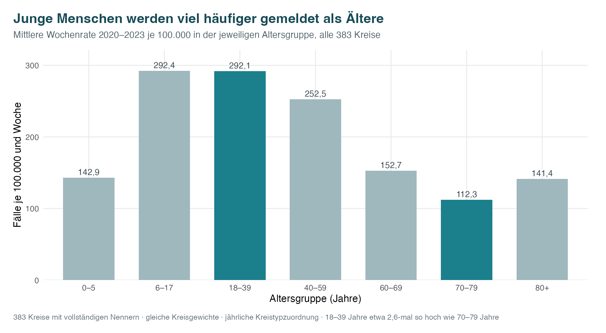

::: {.howto}
**So liest man Abb. 1:** Jeder Balken ist die mittlere Wocheninzidenz einer Altersgruppe 2020–2023 (alle 383 Kreise). 18–39 Jahre: 292,1; 70–79 Jahre: nur 112,3 – etwa das 2,6-Fache. **Ein Kreis mit vielen jungen Erwachsenen hat also eine höhere Gesamtrate, selbst wenn jede Altersgruppe dieselbe Rate wie anderswo hätte.**
:::

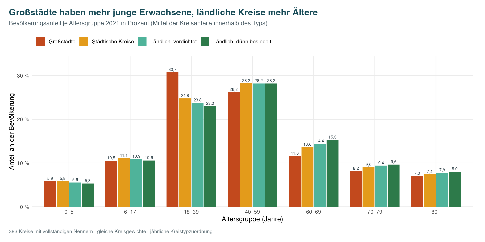

::: {.howto}
**So liest man Abb. 2:** Je Altersgruppe vier Balken – der Bevölkerungsanteil dieser Gruppe in den vier Kreistypen. In Großstädten sind 30,7 % zwischen 18 und 39, in dünn besiedelten ländlichen Kreisen nur 23,0 %; ab 60 Jahren ist es umgekehrt.
:::

**Zusammen ergibt das ein Problem:** Großstädte haben mehr junge Erwachsene ([Abb. 2](#fig2)), und junge Erwachsene haben höhere Raten ([Abb. 1](#fig1)). Beim direkten Vergleich der Gesamtraten wird die Großstadtrate durch die junge Bevölkerung **nach oben** und die Landrate durch die ältere Bevölkerung **nach unten** gezogen. Ein Teil des sichtbaren Stadt-Land-Unterschieds entstünde dann nur aus der Altersstruktur.

**Genau diesen Einfluss entfernt die Standardisierung: die unterschiedliche Altersstruktur der Kreise.** Man rechnet so, als hätten alle Kreise dieselbe Altersstruktur. Was danach bleibt, ist der Unterschied „bei gleicher Altersstruktur“.

### 3.2 Berechnung

**Rohrate** = Σ (altersspezifische Rate des Kreises × **eigener** Altersanteil des Kreises)

**Standardisierte Rate** = Σ (altersspezifische Rate des Kreises × **gemeinsamer** Altersanteil)

Der einzige Unterschied sind die Gewichte: Die altersspezifischen Raten bleiben gleich, nur die eigene Altersstruktur wird durch eine gemeinsame ersetzt.

**Schritt 1: Woher die gemeinsamen Anteile kommen.** Die Bevölkerung aller 400 Kreise 2021 wird je Altersgruppe summiert und durch die Gesamtbevölkerung geteilt:

| Altersgruppe | Bevölkerung 400 Kreise (2021) | Gemeinsamer Anteil |
|---|---:|---:|
| 0–5 | 4.791.475 | 5,756 % |
| 6–17 | 9.071.784 | 10,899 % |
| 18–39 | 21.874.710 | 26,280 % |
| 40–59 | 23.068.610 | 27,714 % |
| 60–69 | 10.961.970 | 13,170 % |
| 70–79 | 7.356.914 | 8,839 % |
| 80+ | 6.111.655 | 7,342 % |
| **Summe** | **83.237.124** | **100 %** |

Beispiel 18–39: 21.874.710 ÷ 83.237.124 = 0,2628, also 26,28 %. 2021 wurde gewählt, weil in diesem Jahr alle 400 Kreise vollständige Nenner haben.

**Schritt 2: Standardisierung je Kreis und Woche.** Beispiel München, Woche ab 07.03.2022:

| Altersgruppe | Rate München | × gemeinsamer Anteil | = Beitrag |
|---|---:|---:|---:|
| 0–5 | 903,00 | 5,756 % | 51,98 |
| 6–17 | 2.316,69 | 10,899 % | 252,49 |
| 18–39 | 2.341,60 | 26,280 % | 615,37 |
| 40–59 | 1.673,17 | 27,714 % | 463,71 |
| 60–69 | 846,28 | 13,170 % | 111,45 |
| 70–79 | 607,91 | 8,839 % | 53,73 |
| 80+ | 524,67 | 7,342 % | 38,52 |
| **Standardisierte Rate** | | | **1.587,26** |

Mit Münchens eigener Altersstruktur ergibt sich eine Rohrate von 1.702,69. Die standardisierte Rate ist niedriger, weil München mehr junge Erwachsene hat als die gemeinsame Struktur – dieser „Aufschlag“ fällt weg.

**Schritt 3: Mittelung im Kreistyp.** Je Woche wird das ungewichtete Mittel der standardisierten Raten aller Kreise eines Typs gebildet; anschließend wird über die Wochen einer Phase gemittelt.

**Warum Gewichte aus 400, Analyse mit 383 Kreisen:** Die gemeinsamen Anteile sind nur ein „gemeinsamer Maßstab“ und müssen nicht mit der Analysestichprobe übereinstimmen. Mit Anteilen aus den 383 Kreisen ändert sich Großstadt − Ländlich dünn von −22,0670 auf −22,0701; die größte Änderung unter den sechs Paaren beträgt 0,0034.

### 3.3 Vorher und nachher

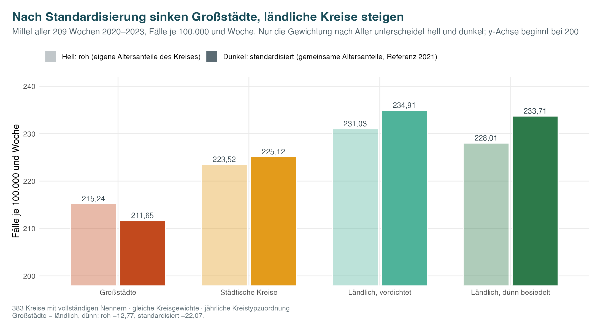

::: {.howto}
**So liest man Abb. 3:** Jeder Kreistyp hat seine Farbe; hell = Rohrate, dunkel = standardisierte Rate. Die y-Achse beginnt bei 200, damit die Unterschiede sichtbar sind. Großstädte sinken durch die Standardisierung, die drei anderen Typen steigen.
:::

**Was „2021“ in der Legende bedeutet:** Alle Balken sind **Mittelwerte über alle 209 Wochen 2020–2023**, keine Werte von 2021. „2021“ gibt nur an, aus welchem Jahr die gemeinsamen Altersanteile stammen (Schritt 1 in 3.2). Alle vier Jahre werden mit demselben Maßstab gewichtet, damit Kreise und Jahre vergleichbar sind.

| Mittlere Wocheninzidenz 2020–2023 | Roh | Standardisiert | Änderung |
|---|---:|---:|---:|
| Großstadt | 215,24 | 211,65 | −3,59 |
| Städtisch | 223,52 | 225,12 | +1,60 |
| Ländlich verdichtet | 231,03 | 234,91 | +3,88 |
| Ländlich dünn | 228,01 | 233,71 | +5,70 |

**Sechs Paare, roh und standardisiert:**

| Vergleich | Differenz roh | Verhältnis roh | Differenz std. | Verhältnis std. | Bedeutung |
|---|---:|---:|---:|---:|---|
| Großstadt − Städtisch | −8,28 | 0,963 | −13,47 | 0,940 | 🔻 Lücke größer |
| Großstadt − Ländlich verdichtet | −15,79 | 0,932 | −23,27 | 0,901 | 🔻 Lücke größer |
| Großstadt − Ländlich dünn | −12,77 | 0,944 | −22,07 | 0,906 | 🔻 Lücke größer |
| Städtisch − Ländlich verdichtet | −7,51 | 0,967 | −9,79 | 0,958 | 🔻 etwas größer |
| Städtisch − Ländlich dünn | −4,49 | 0,980 | −8,59 | 0,963 | 🔻 Lücke größer |
| Ländlich verdichtet − Ländlich dünn | +3,02 | 1,013 | +1,20 | 1,005 | ➖ Lücke kleiner |

::: {.takeaway}
**Interpretation:** Bei jedem Vergleich „stärker urban vs. weniger urban“ wird die Lücke durch die Standardisierung größer. Beispiel Großstadt vs. Ländlich dünn: roh 0,944 (5,6 % niedriger), standardisiert 0,906 (9,4 % niedriger). **Die Altersstruktur hat einen Teil des Stadt-Land-Unterschieds verdeckt:** Die junge Bevölkerung hob die Großstadtrate an. Die beiden ländlichen Typen haben ähnliche Altersstrukturen; ihr Unterschied wird kleiner.
:::

**Zwei Dinge auseinanderhalten:** Dieser Abschnitt entfernt die **Altersstruktur** (wie viele Menschen in jeder Altersgruppe leben). Abschnitt 6 untersucht die **Altersinteraktion**: ob der Stadt-Land-Unterschied *innerhalb* gleicher Altersgruppen verschieden groß ist. Das eine ist eine Frage der Gewichte, das andere eine Frage der Unterschiede innerhalb der Altersgruppen.

## 4 Hintergrund: dieselben Wellen

::: {.howto}
**So liest man Abb. 4:** Jede Linie ist die standardisierte Wocheninzidenz eines Kreistyps. Die farbigen Flächen sind die fünf RKI-Wellen, in denselben Farben wie in allen späteren Abbildungen.
:::

**Warum eine Wurzelskala:** Die Raten reichen von fast 0 bis über 2.000. Auf normaler Skala füllt der W5-Gipfel die ganze Abbildung, und W1–W3 (meist unter 100) liegen flach am Boden. Die Wurzelskala staucht große und spreizt kleine Werte, sodass ruhige Phasen und Gipfel gleichzeitig lesbar sind. Der Preis: Gleiche Abstände auf der y-Achse bedeuten nicht mehr gleiche Fallzahlen – 0 bis 100 ist etwa so hoch wie 1.500 bis 2.000.

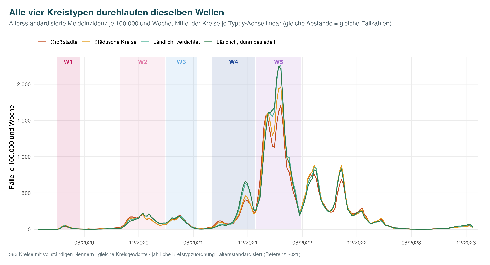

::: {.howto}
**So liest man Abb. 5:** Dieselben Daten wie Abb. 4, aber mit normaler y-Achse: gleiche Abstände = gleiche Fallzahlen. Hier sieht man sofort, wie groß die Lücke in W4 und W5 in Fällen ist; W1–W3 liegen dagegen am Boden. Beide Abbildungen ergänzen sich: Abb. 4 für die Form jeder Phase, Abb. 5 für die tatsächliche Größenordnung.
:::

### 4.1 Wie die Korrelation berechnet wird

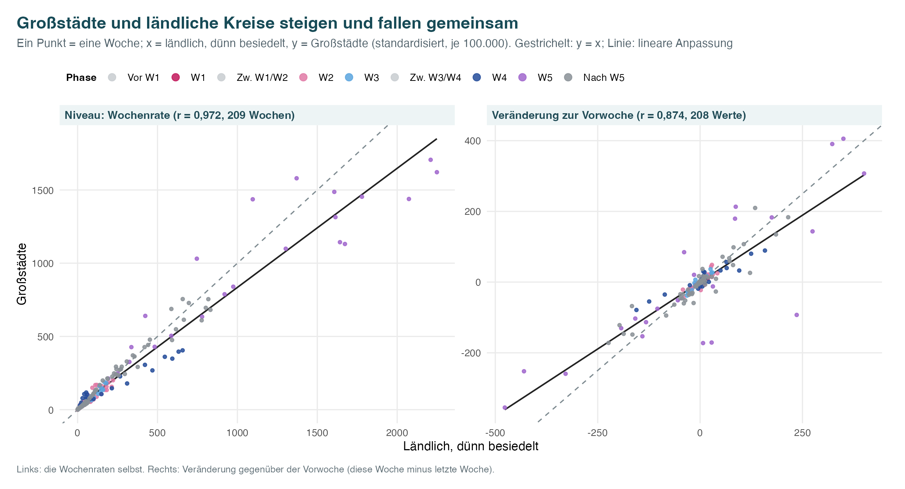

**Rechenschritte:**

1. Je Woche das Mittel der standardisierten Raten der 67 Großstädte und der rund 97 dünn besiedelten ländlichen Kreise – zwei Reihen mit je 209 Wochen.
2. **Niveaukorrelation (links):** Jede Woche ist ein Punkt (x = Land, y = Großstadt); Pearson-r über diese 209 Punkte.
3. **Veränderungskorrelation (rechts):** Zuerst **innerhalb jedes Typs** „diese Woche − Vorwoche“ (208 Werte), dann r zwischen den beiden Veränderungsreihen.

**Beide r sind weder Verhältnis noch Differenz zwischen Stadt und Land:**

- Die Niveau-r misst, ob die beiden Kurven gemeinsam steigen und fallen – auf Basis der Raten selbst.
- Die Veränderungs-r misst, ob die wöchentlichen Anstiege und Rückgänge gleichzeitig auftreten – auf Basis der Differenz zweier Wochen *im selben Typ*, nicht der Stadt-Land-Differenz.

::: {.howto}
**So liest man Abb. 6:** Punktfarbe = Welle. Gestrichelt: y = x (beide gleich), durchgezogen: lineare Anpassung. Je enger die Punkte an einer Geraden liegen, desto näher ist r an 1. Punkte unterhalb der gestrichelten Linie: In dieser Woche lag die Großstadt niedriger (links) bzw. stieg weniger (rechts). Links liegen die W5-Punkte (violett) deutlich darunter.
:::

| Vergleich | Niveau-r | Veränderungs-r |
|---|---:|---:|
| Großstadt / Städtisch | 0,993 | 0,961 |
| Großstadt / Ländlich verdichtet | 0,977 | 0,885 |
| Großstadt / Ländlich dünn | 0,972 | 0,874 |
| Städtisch / Ländlich verdichtet | 0,992 | 0,956 |
| Städtisch / Ländlich dünn | 0,988 | 0,944 |
| Ländlich verdichtet / Ländlich dünn | 0,999 | 0,985 |

**Warum zusätzlich die Veränderungs-r:** Die Niveau-r wird von wenigen großen Wellen bestimmt (die Punkte oben rechts); laufen die großen Wellen gleichzeitig, ist r automatisch hoch. Die Veränderungs-r ist strenger: Sie fragt, ob Anstiege und Rückgänge Woche für Woche zusammenfallen. Zwischen Großstadt und Land liegt sie niedriger (0,874) als zwischen den beiden ländlichen Typen (0,985) – der Rhythmus der Großstädte weicht also etwas ab.

### 4.2 Drei häufige Missverständnisse

**① Hohe Korrelation heißt nicht gleiches Niveau.** Zwei erfundene Beispiele:

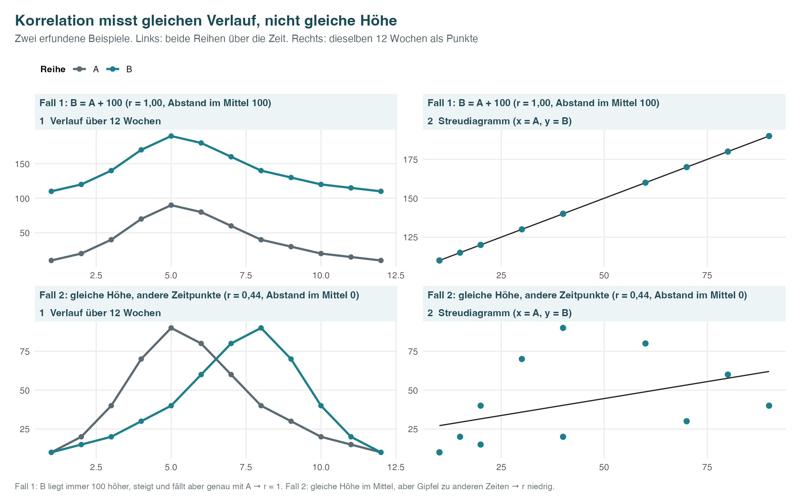

::: {.howto}
**So liest man Abb. 7:** Oben Beispiel 1, unten Beispiel 2; links der Verlauf über 12 Wochen, rechts dieselben 12 Wochen als Streudiagramm (x = A, y = B).

- **Beispiel 1 (r = 1):** B liegt immer 100 über A, steigt und fällt aber exakt mit A. Die Punkte liegen auf einer Geraden, also r = 1 – obwohl die Kurven stets 100 auseinanderliegen. **Hohe Korrelation, verschiedenes Niveau.**
- **Beispiel 2 (r = 0,44):** Beide Kurven sind gleich hoch (mittlere Differenz 0), aber die Gipfel liegen in verschiedenen Wochen. Die Punkte streuen, r = 0,44. **Gleiches Niveau, niedrige Korrelation.**
:::

**Übertragen auf das Projekt:** Großstadt und Land verhalten sich wie Beispiel 1: fast gleicher Verlauf (r = 0,97), aber in W4 und W5 liegt die Großstadtkurve durchgehend darunter. Ein hohes r sagt also nur, dass alle dieselben Wellen erlebten; *wie viel* niedriger die Großstädte liegen, zeigen erst Differenzen und Verhältnisse in Abschnitt 5.

**② Warum keine p-Werte für die Korrelation.** Der übliche Test nimmt 209 unabhängige Beobachtungen an. In Pandemiedaten bestimmt aber die Vorwoche die aktuelle Woche fast vollständig: Die Autokorrelation erster Ordnung der Großstadtraten beträgt 0,973, die der Veränderungen noch 0,699. Die 209 Wochen enthalten also viel weniger unabhängige Information, und Standard-p-Werte wären zu optimistisch.

**③ Was der Block-Bootstrap macht.** Um grob einzuschätzen, wie stabil die Veränderungs-r ist, wird die Reihe in Blöcke von 8 aufeinanderfolgenden Wochen geteilt (Abhängigkeiten innerhalb eines Blocks bleiben erhalten), die Blöcke werden zufällig neu zusammengesetzt und r neu berechnet – 1.999-mal. Für Großstadt / Ländlich dünn liegen die mittleren 95 % bei 0,784–0,963. Auch bei vertauschten Zeitabschnitten bleibt r hoch; „gemeinsames Steigen und Fallen“ ist stabil. Da sich der Pandemierhythmus über die Zeit ändert, ist dieser Bereich kein strenges Konfidenzintervall, sondern nur ein Anhaltspunkt.

## 5 Frage 1: Wann und wo unterscheiden sich die Kreistypen?

### 5.1 Gesamtzeitraum und Phasen: sechs Paare

**Berechnung:** Für eine Phase wird zuerst je Woche der Typmittelwert berechnet, dann über alle Wochen der Phase gemittelt („mittlere Wocheninzidenz der Phase“); das Verhältnis zweier Typen ist der Quotient. Die 95 %-Intervalle stammen aus dem [Kreis-Cluster-Bootstrap](#app-a).

::: {.howto}
**So liest man Abb. 8:** Sechs Felder für sechs Paare (erster / zweiter Typ). Jede Zeile ist eine Phase in ihrer Wellenfarbe. Punkt = Verhältnis; Linie = 95 %-Intervall, also der Bereich, in dem das wahre Verhältnis unter Berücksichtigung des Stichprobenfehlers plausibel liegt; senkrechte gestrichelte Linie = 1 (gleich hoch).

- **Linie ganz links der 1:** Der gesamte plausible Bereich liegt unter 1; der erste Typ ist eindeutig niedriger.
- **Linie kreuzt die 1:** Es ist nicht klar, welcher Typ höher liegt.
:::

**Was Holm-p bedeutet:** Ein p-Wert misst, wie wahrscheinlich eine so große Lücke wäre, wenn es in Wahrheit keinen Unterschied gäbe; je kleiner, desto weniger zufällig. Wir testen sehr viel auf einmal (z. B. 108 Tests im Gesamtzeitraum) – je mehr Tests, desto eher findet sich zufällig ein kleiner p-Wert. Die Holm-Korrektur vergrößert jeden p-Wert entsprechend der Testzahl; erst wenn er danach unter 0,05 liegt, gilt das Ergebnis als belegt. Details in [Anhang B](#app-b).

**Gesamtzeitraum (2020–2023):**

| Vergleich | Differenz std. | Verhältnis | 95 %-Intervall | Holm-p | Bedeutung |
|---|---:|---:|---|---:|---|
| Großstadt / Städtisch | −13,47 | 0,940 | 0,916–0,965 | <0,001 | 🔻✅ rund 6 % niedriger |
| Großstadt / Ländlich verdichtet | −23,27 | 0,901 | 0,874–0,929 | <0,001 | 🔻✅ rund 10 % niedriger |
| Großstadt / Ländlich dünn | −22,07 | 0,906 | 0,879–0,933 | <0,001 | 🔻✅ rund 9 % niedriger |
| Städtisch / Ländlich verdichtet | −9,79 | 0,958 | 0,934–0,984 | 0,096 | 🔻⚠️ rund 4 % niedriger; Intervall ohne 1, nach Korrektur nicht belegt |
| Städtisch / Ländlich dünn | −8,59 | 0,963 | 0,938–0,989 | 0,326 | 🔻⚠️ rund 4 % niedriger; nicht belegt |
| Ländlich verdichtet / Ländlich dünn | +1,20 | 1,005 | 0,975–1,036 | 1,000 | ➖ fast gleich |

„Nicht belegt“ heißt nicht „gleich“, sondern: Nach so vielen Vergleichen ist die Lücke nicht groß genug, um Zufall auszuschließen.

### 5.2 Warum der Fokus auf Großstadt vs. Ländlich dünn

- **Es ist der Vergleich der Extreme.** Die vier BBSR-Typen sind nach Urbanisierungsgrad geordnet; Großstädte und dünn besiedelte ländliche Kreise liegen an beiden Enden, der Unterschied ist dort am klarsten.
- **Warum nicht gegen den Bundesdurchschnitt:** Der Durchschnitt enthält die Großstädte selbst („Vergleich mit sich selbst“), und er hängt von der Zahl der Kreise je Typ ab (129 städtische Kreise, nur 67 Großstädte). Paarvergleiche sind klarer.
- **Die anderen Paare gehen nicht verloren:** Alle sechs stehen in [Abb. 8](#fig8) und der Tabelle oben. Der Vergleich mit ländlich verdichteten Kreisen ergibt fast dasselbe (0,901); die Wahl des ländlichen Typs ändert das Ergebnis nicht.

### 5.3 Nach Phasen: Großstadt vs. Ländlich dünn

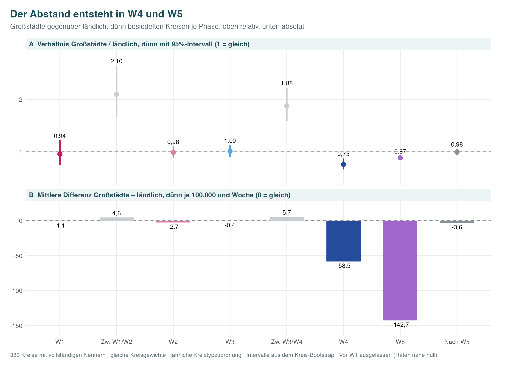

::: {.howto}
**So liest man Abb. 9:** Oben Verhältnis und 95 %-Intervall je Phase (1 = gleich), unten die mittlere Differenz (0 = gleich), in Wellenfarben. Auf einen Blick: Nur in W4 und W5 liegt der Punkt klar unter 1 und der Balken klar unter 0.
:::

| Phase | Verhältnis | 95 %-Intervall | mittl. Differenz | Wochen mit Großstadt niedriger | Bedeutung |
|---|---:|---|---:|---:|---|
| W1 | 0,942 | 0,733–1,209 | −1,05 | 54,5 % | ➖ sehr breites Intervall |
| Zw. W1/W2 | 2,099 | 1,661–2,652 | +4,61 | 0 % | 🔺 etwa doppelt, aber nur ~5 Fälle mehr |
| W2 | 0,978 | 0,876–1,092 | −2,67 | 54,5 % | ➖ fast gleich |
| W3 | 0,996 | 0,893–1,112 | −0,41 | 40,0 % | ➖ fast gleich |
| Zw. W3/W4 | 1,878 | 1,586–2,224 | +5,67 | 0 % | 🔺 höher, absolut sehr klein |
| **W4** | **0,746** | **0,648–0,859** | **−58,47** | **57,1 %** | 🔻✅ **rund 25 % niedriger** |
| **W5** | **0,873** | **0,841–0,906** | **−142,69** | **68,2 %** | 🔻✅ **rund 13 % niedriger, größte Differenz** |
| Nach W5 | 0,980 | 0,921–1,043 | −3,56 | 37,3 % | ➖ insgesamt nah, monatlich schwankend (7.3) |

::: {.takeaway}
**Drei Ergebnisse:**

1. **Die Gesamtlücke ist im Kern eine W4/W5-Lücke.** Summiert man „mittlere Differenz × Wochen“ über alle Phasen und teilt durch 209, erhält man die Gesamtdifferenz −22,07; rund 95 % davon stammen aus W4 und W5.
2. **Die Zwischenphasen zeigen das Gegenteil, sind aber unwichtig:** Das Verhältnis ist etwa doppelt so hoch, die Raten waren aber so niedrig, dass es absolut nur rund 5 Fälle mehr sind. Bei kleinen Nennern werden Verhältnisse aufgebläht.
3. **Phasenmittel ist nicht jede Woche:** W5 hat die größte mittlere Lücke, aber nur in 68,2 % der Wochen liegt die Großstadt niedriger (Grund im nächsten Abschnitt).
:::

### 5.4 W4 und W5 Woche für Woche

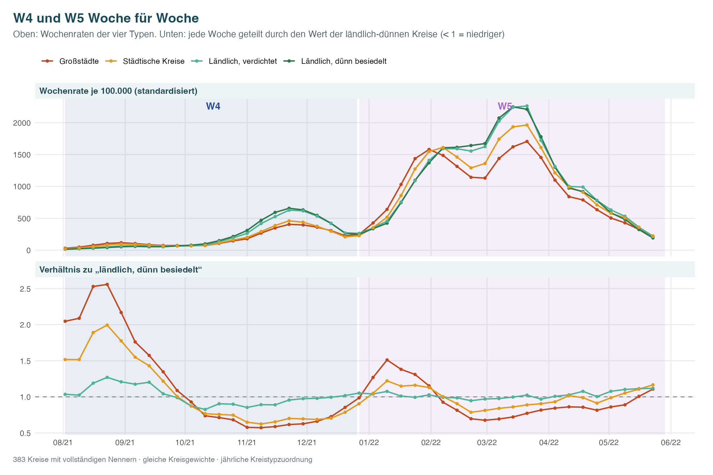

::: {.howto}
**So liest man Abb. 10:** Oben die Wocheninzidenz der vier Typen von August 2021 bis Mai 2022; unten jeder Wochenwert geteilt durch den Wert der dünn besiedelten ländlichen Kreise derselben Woche (unter 1 = niedriger als Land). Dunkelblaue Fläche = W4, violette Fläche = W5.

- **W4:** Zu Beginn (Aug.–Sep. 2021, noch niedrige Raten) liegen Großstädte sogar höher, in einzelnen Wochen beim 2,5-Fachen. Von Oktober bis Dezember steigt das Land rasch, die Großstädte fallen auf etwa das 0,6-Fache. Die städtischen Kreise (gelborange) verlaufen fast wie die Großstädte – **W4 ist ein Stadt-Land-Unterschied**, nicht nur ein Großstadteffekt.
- **W5:** In den ersten Wochen (Januar 2022) steigen die Großstädte zuerst und liegen kurz höher (etwa 1,5-fach); ab Februar holt das Land auf und überholt, im Gipfel (Feb.–März) liegen die Großstädte bei etwa dem 0,7-Fachen. Deshalb nur 68,2 % der Wochen niedriger.
:::

Beide Wellen folgen dem Muster „Stadt steigt zuerst, Land später höher“. Das passt zur Deutung „Ausbreitung von der Stadt aufs Land“, kann hier aber nicht belegt werden.

### 5.5 W4 und W5 nach Alter: Verhältnis und Differenz

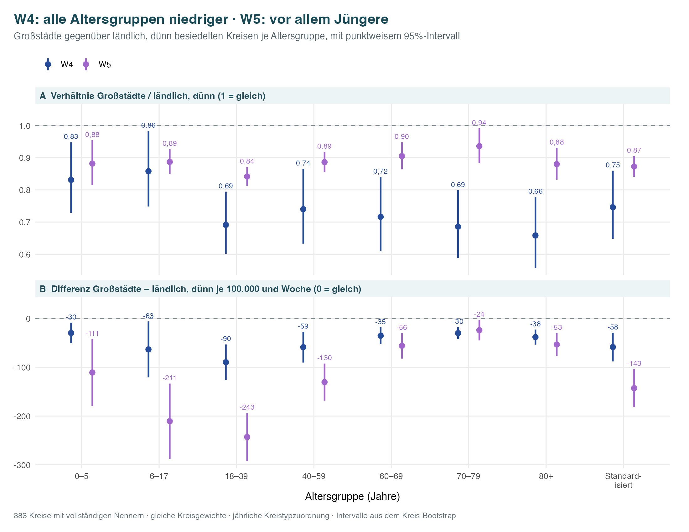

::: {.howto}
**So liest man Abb. 11:** Je Altersgruppe zwei Punkte, dunkelblau W4, violett W5, mit 95 %-Intervall. Oben (A) das Verhältnis (1 = gleich), unten (B) die Differenz (0 = gleich). Ganz rechts der standardisierte Gesamtwert.
:::

| Großstadt vs Ländlich dünn | 0–5 | 6–17 | 18–39 | 40–59 | 60–69 | 70–79 | 80+ |
|---|---:|---:|---:|---:|---:|---:|---:|
| W4 Verhältnis | 0,83 | 0,86 | 0,69 | 0,74 | 0,72 | 0,69 | 0,66 |
| W5 Verhältnis | 0,88 | 0,89 | **0,84** | 0,89 | 0,91 | **0,94** | 0,88 |
| W4 Differenz | −30 | −63 | −90 | −59 | −35 | −30 | −38 |
| W5 Differenz | −111 | −211 | **−243** | −130 | −56 | **−24** | −53 |

::: {.takeaway}
**Interpretation:**

- **W4:** Verhältnisse in allen Altersgruppen 0,66–0,86 – die Großstädte liegen **in jeder Altersgruppe rund 15–35 % niedriger**, ohne klares Altersmuster.
- **W5:** 18–39 Jahre 0,84 (16 % niedriger), 70–79 Jahre 0,94 (nur 6 %). **Die Lücke konzentriert sich auf Jüngere.**
:::

**Warum Verhältnis vor Differenz:** Differenzen wachsen mit dem Inzidenzniveau. In W5 wirkt die Differenz bei 6–17 Jahren (−211) viel größer als bei 0–5 (−111), die Verhältnisse sind aber fast gleich (0,89 und 0,88): In beiden Gruppen liegen Großstädte rund 11 % niedriger; 6–17-Jährige haben nur höhere Raten, sodass derselbe Prozentsatz mehr Fällen entspricht. Das Verhältnis beantwortet „relativ wie viel niedriger“, die Differenz „wie viele Fälle weniger“ – beide sind nützlich und werden gezeigt.

## 6 Frage 2: Ist die Lücke in allen Altersgruppen gleich groß?

Abschnitt 3 hat den Einfluss der **Altersstruktur** entfernt. Hier geht es um etwas anderes: Ist der Stadt-Land-Unterschied **innerhalb derselben Altersgruppe** überall gleich groß? Wenn junge Großstädter 12 % unter jungen Landbewohnern liegen, ältere Großstädter aber nur 3 % unter älteren Landbewohnern, dann „hängt die Lücke vom Alter ab“ – eine **Altersinteraktion**. Sie hat nichts damit zu tun, wie viele Menschen in jeder Altersgruppe leben.

### 6.1 Berechnung der Altersinteraktion

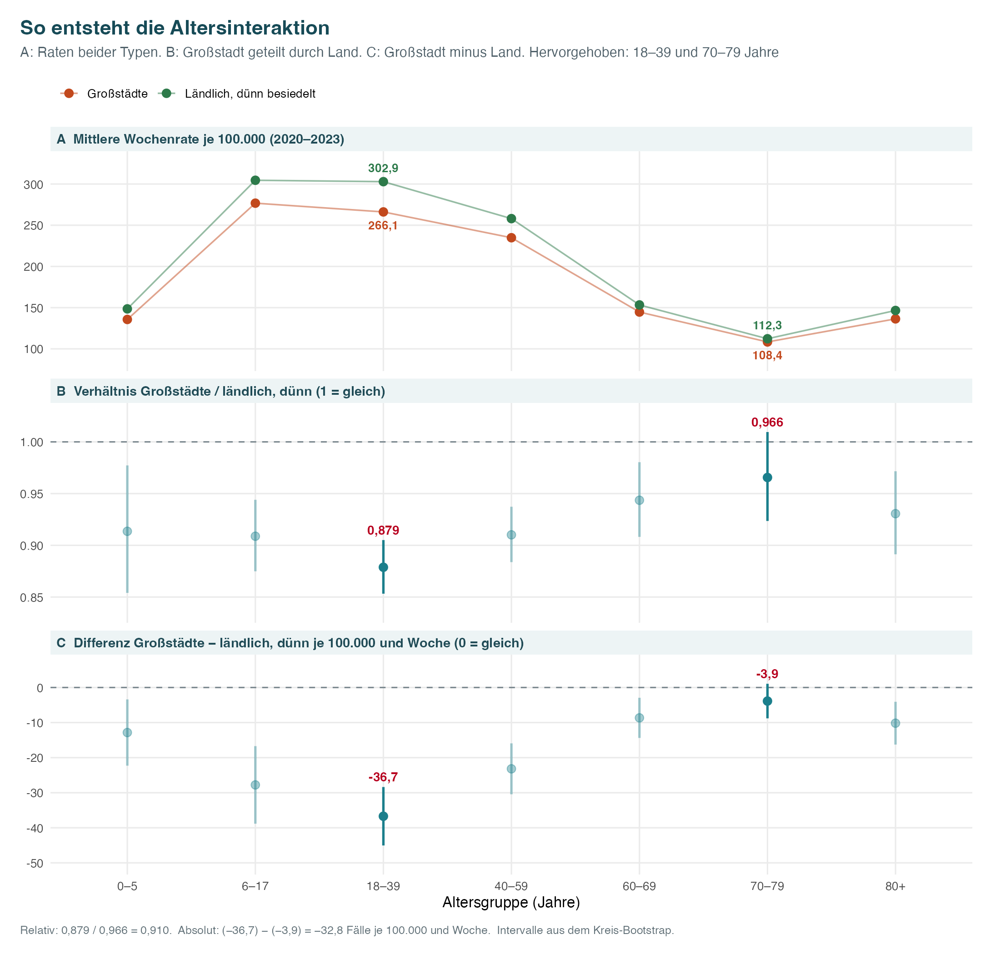

::: {.howto}
**So liest man Abb. 12:**

- **A:** Mittlere Wocheninzidenz je Altersgruppe, orangerot = Großstädte, dunkelgrün = dünn besiedelte ländliche Kreise.
- **B:** Quotient (Verhältnis), 1 = gleich.
- **C:** Differenz, 0 = gleich.
:::

Die senkrechten Linien in B und C sind 95 %-Intervalle; rote Zahlen markieren die zwei entscheidenden Altersgruppen.

| Altersgruppe | Großstadt | Ländlich dünn | Differenz | Verhältnis |
|---|---:|---:|---:|---:|
| 0–5 | 135,69 | 148,53 | −12,84 | 0,914 |
| 6–17 | 276,76 | 304,54 | −27,78 | 0,909 |
| **18–39** | **266,14** | **302,85** | **−36,71** | **0,879** |
| 40–59 | 234,84 | 258,02 | −23,18 | 0,910 |
| 60–69 | 144,66 | 153,32 | −8,66 | 0,944 |
| **70–79** | **108,40** | **112,27** | **−3,86** | **0,966** |
| 80+ | 136,40 | 146,57 | −10,17 | 0,931 |

**Die Interaktion in drei Schritten:**

1. **Lücke je Altersgruppe:** 18–39: Differenz −36,71, Verhältnis 0,879; 70–79: Differenz −3,86, Verhältnis 0,966.
2. **Absolute Interaktion = Differenz der Differenzen:** −36,71 − (−3,86) = **−32,84**. Sie beantwortet: Um wie viele Fälle je 100.000 und Woche ist der Vorsprung der Großstädte bei Jüngeren größer als bei Älteren? Rund 33 Fälle. 0 hieße: gleich viele Fälle weniger in beiden Gruppen.
3. **Relative Interaktion = Verhältnis der Verhältnisse:** 0,879 ÷ 0,966 = **0,910** (95 %-Intervall 0,884–0,937). 1 hieße: gleicher prozentualer Abstand in beiden Gruppen.

**Wie 0,910 zu lesen ist:** Nicht „Junge infizieren sich 9 % seltener als Alte“, sondern: Der relative Vorsprung der Großstädte ist bei Jüngeren rund 9 % größer als bei Älteren – bei 18–39 rund 12,1 % niedriger, bei 70–79 nur rund 3,4 %.

**Warum auch ein Quotient ein Intervall hat:** Das Verhältnis ist kein feststehender Wert, sondern aus genau diesen 383 Kreisen berechnet. Mit einer anderen, gleichartigen Auswahl von Kreisen ergäbe sich ein etwas anderer Wert. Der [Kreis-Cluster-Bootstrap](#app-a) simuliert genau das: 1.999-mal werden 383 Kreise mit Zurücklegen gezogen und das Verhältnis neu berechnet; die mittleren 95 % bilden das Intervall. Für 18–39 liegt es bei 0,853–0,905 – vollständig unter 1, also kein Zufall. Für 70–79 liegt es bei 0,924–1,010 und berührt die 1; bei Älteren kann die Lücke nahe null sein.

### 6.2 Alle Paare im Überblick

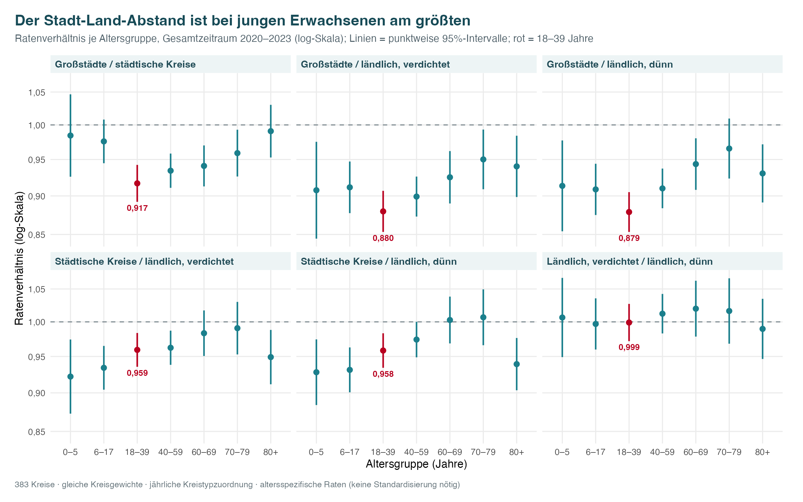

::: {.howto}
**So liest man Abb. 13:** Jedes Feld ist ein Paar; x = Altersgruppe, y = Verhältnis (1 = gleich). Rot = 18–39 Jahre mit Zahlenwert.
:::

::: {.takeaway}
**Interpretation:** In allen drei Großstadtvergleichen (obere Reihe) hat 18–39 das niedrigste Verhältnis (0,917; 0,880; 0,879). Gleich gegen welchen Typ: Der „Jüngeren-Vorsprung“ der Großstädte ist am größten. Ohne Großstadt fehlt dieses Muster; zwischen den beiden ländlichen Typen (unten rechts) liegen alle Altersgruppen nahe 1.
:::

### 6.3 Konsistentes Muster – aber explorativ

Sechs Paare × 21 Altersgruppenpaare = 126 Interaktionen je Skala. Die fünf größten absoluten Interaktionen:

| Rang | Paar | Altersvergleich | Absolute Interaktion |
|---:|---|---|---:|
| 1 | Großstadt / Ländlich dünn | 18–39 vs. 70–79 | −32,84 |
| 2 | Großstadt / Ländlich verdichtet | 18–39 vs. 70–79 | −30,73 |
| 3 | Großstadt / Ländlich dünn | 18–39 vs. 60–69 | −28,06 |
| 4 | Großstadt / Ländlich verdichtet | 18–39 vs. 80+ | −27,76 |
| 5 | Großstadt / Ländlich dünn | 18–39 vs. 80+ | −26,54 |

**Warum ein konsistentes Muster:** Alle fünf sind „Großstadt vs. Land“ und alle „18–39 vs. ältere Gruppe“. Wäre es Zufall, stünden oben beliebige Kombinationen von Typen und Altersgruppen; hier zeigen alle auf dasselbe: „junge Erwachsene in Großstädten relativ niedriger“. Auf relativer Skala ist Platz 1 ebenfalls Großstadt / Ländlich dünn, 18–39 vs. 70–79 (0,910).

**Warum trotzdem explorativ:** Wir haben 126 Interaktionen berechnet und dann die größten herausgegriffen. Das Maximum vieler Werte ist durch Zufall oft überhöht (wie der höchste Wurf, wenn 126 Personen je einmal würfeln). Platz 1 ist daher nicht automatisch der sicherste Befund; das Muster sollte in anderen Daten oder Zeiträumen bestätigt werden.

## 7 Frage 3: Ändert sich das Altersmuster über die Zeit?

### 7.1 Altersprofile je Welle

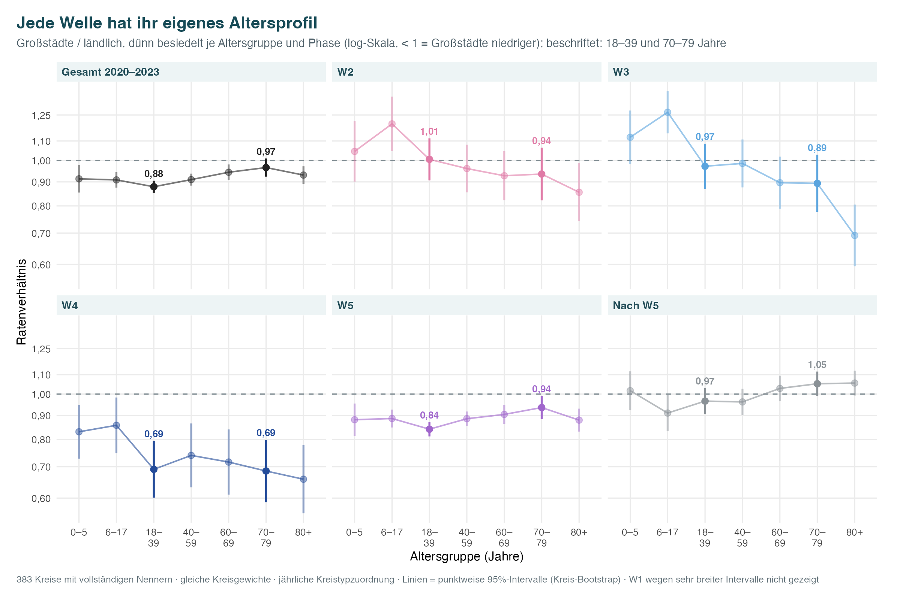

::: {.howto}
**So liest man Abb. 14:** Ein Feld je Phase in Wellenfarbe. x = Altersgruppe, y = Verhältnis Großstadt / Ländlich dünn (log. Skala), gestrichelt = 1. Jeder Punkt mit 95 %-Intervall; 18–39 und 70–79 sind hervorgehoben und beschriftet. Zwei Dinge ansehen:

- **Höhe der Linie:** unter der gestrichelten Linie = Großstädte insgesamt niedriger.
- **Neigung der Linie:** flach = gleiche Lücke in allen Altersgruppen; geneigt = Lücke ändert sich mit dem Alter (Altersinteraktion).
:::

**Je Phase:**

- **Gesamtzeitraum:** 18–39 am niedrigsten (0,88), zu den Älteren hin steigend (0,97); leicht geneigt.
- **W2, W3:** umgekehrte Richtung – bei 6–17 liegen Großstädte sogar höher (1,20; 1,27), ältere Gruppen niedriger (W3, 80+: 0,69).
- **W4:** Die ganze Linie liegt tief (0,66–0,86) und eher flach: Alle Altersgruppen niedriger, Lücke ähnlich groß.
- **W5:** 18–39 am niedrigsten (0,84), zu den Älteren steigend (0,94), deutlich geneigt: Lücke konzentriert sich auf Jüngere.
- **Nach W5:** nahe 1, ältere Gruppen leicht darüber.

### 7.2 Altersinteraktionen der Phasen in einer Abbildung

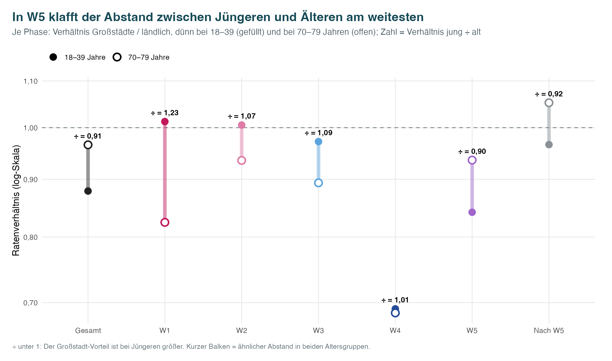

::: {.howto}
**So liest man Abb. 15:** Je Phase ein senkrechter Balken; gefüllter Punkt = Verhältnis bei 18–39, offener Punkt = bei 70–79 (jeweils Großstadt / Ländlich dünn). Die Zahl „÷ = …“ ist der Quotient beider, also die relative Interaktion.

- **Gefüllt unten, offen oben, langer Balken:** Die Lücke ist bei Jüngeren größer, ÷ < 1.
- **Kurzer Balken:** ähnliche Lücke in beiden Gruppen, ÷ ≈ 1.
- **Gefüllt oben:** umgekehrt, die Lücke ist bei Jüngeren kleiner, ÷ > 1.
:::

::: {.takeaway}
**Ergebnis:** W5 hat den längsten Balken mit gefülltem Punkt unten (÷ = 0,90); in W4 fallen beide Punkte fast zusammen (÷ = 1,01), obwohl beide tief liegen; in W1–W3 liegt der gefüllte Punkt oben (÷ > 1).
:::

**Relative und absolute Interaktion noch einmal:**

- **Relativ** (÷) vergleicht prozentuale Abstände: um wie viel Prozent die Großstadt bei Jüngeren bzw. Älteren niedriger liegt.
- **Absolut** vergleicht Fallzahlen: wie viele Fälle weniger bei Jüngeren bzw. Älteren.

Beide können auseinanderfallen. In W4 ist die absolute Interaktion −60 (bei Jüngeren mehr Fälle weniger), die relative aber ≈ 1 (gleicher Prozentsatz): Alle Altersgruppen liegen rund 30 % niedriger, nur entsprechen 30 % bei den höheren Raten der Jüngeren mehr Fällen (siehe [Abb. 11](#fig11)).

| Phase | Absolute Interaktion | Holm-p | Relative Interaktion | 95 %-Intervall | Holm-p |
|---|---:|---:|---:|---|---:|
| W1 | 3,43 | 1,000 | 1,228 | 1,020–1,478 | 1,000 |
| Zw. W1/W2 | 5,16 | <0,001 | 0,969 | 0,733–1,280 | 1,000 |
| W2 | 6,15 | 1,000 | 1,075 | 1,013–1,141 | 1,000 |
| W3 | 1,95 | 1,000 | 1,088 | 1,003–1,180 | 1,000 |
| Zw. W3/W4 | 8,04 | <0,001 | 0,788 | 0,563–1,101 | 1,000 |
| W4 | −59,77 | 0,009 | 1,008 | 0,948–1,072 | 1,000 |
| W5 | −219,16 | <0,001 | 0,899 | 0,865–0,935 | <0,001 |
| Nach W5 | −13,79 | 1,000 | 0,918 | 0,884–0,954 | 0,022 |

**Warum auch hier Holm-Korrektur:** Die phasenspezifischen Altersinteraktionen umfassen 2.268 Tests (6 Paare × 21 Altersgruppenpaare × 9 Phasen × 2 Skalen). Selbst wenn nirgends ein Unterschied bestünde, wären bei 5 % rund 113 zufällig „signifikant“. Die Holm-Korrektur filtert diese Zufallstreffer. In W2 und W3 schließen die Intervalle die 1 zwar aus, nach Korrektur ist p aber 1 – bei so vielen Tests ist ein Unterschied dieser Größe gut mit Zufall vereinbar.

::: {.takeaway}
**Ergebnis:**

- **W5** zeigt auf beiden Skalen Evidenz: Die Stadt-Land-Lücke ist bei Jüngeren klar größer als bei Älteren.
- **W4** nur auf der absoluten Skala; prozentual sind die Altersgruppen ähnlich.
- **Nach W5** nur auf der relativen Skala (p = 0,022).
- **Direkter Vergleich W4 vs. W5:** Änderung der absoluten Interaktion +159,39 (Holm-p < 0,001), der relativen 1,121 (Holm-p = 1). Aus „W5 signifikant, W4 nicht“ folgt noch kein Unterschied – dafür braucht es diesen direkten Vergleich.
:::

### 7.3 Die 83 Wochen nach W5 {#sec-postw5}

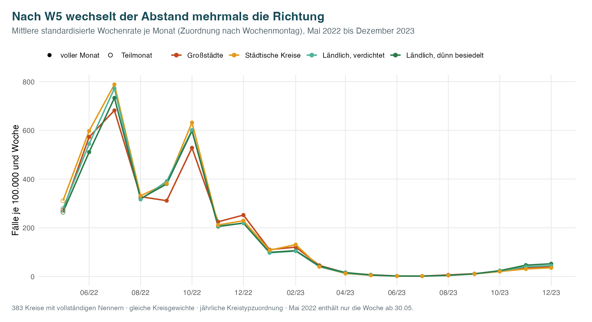

::: {.howto}
**So liest man Abb. 16:** Eine Linie je Kreistyp, ein Punkt je Monat (offene Punkte = unvollständige Monate). Der Gipfel Juni–Juli 2022 ist die sechste RKI-Welle (BA.5); im Oktober folgt ein Herbstgipfel.
:::

| Monat | Großstadt | Ländlich dünn | Differenz | Bedeutung |
|---|---:|---:|---:|---|
| Juni 2022 | 572,79 | 510,62 | +62,18 | BA.5-Beginn, Großstadt steigt zuerst |
| Juli 2022 | 681,74 | 733,07 | −51,33 | Gipfel, Land höher |
| Sep. 2022 | 311,28 | 379,87 | −68,59 | Großstadt niedriger |
| Okt. 2022 | 528,12 | 597,99 | −69,87 | Herbstgipfel, Großstadt niedriger |
| Dez. 2022 | 252,20 | 219,42 | +32,78 | Großstadt höher |
| Feb. 2023 | 120,45 | 106,10 | +14,35 | Großstadt höher |
| Nov. 2023 | 36,10 | 46,64 | −10,54 | Großstadt niedriger |

::: {.takeaway}
**Ergebnis:** „Nach W5“ hat insgesamt ein Verhältnis von 0,980 und wirkt fast ohne Lücke; tatsächlich wechselt die Richtung mehrfach, und Plus und Minus heben sich auf. Auch die BA.5-Welle folgt dem Muster „Stadt zuerst, Land später höher“. Monate werden nach dem Montag der Woche zugeordnet; Mai 2022 enthält nur die Woche ab 30. Mai.
:::

## 8 Wie robust und wie einheitlich sind die Ergebnisse?

### 8.1 Unterschiede zwischen Kreisen desselben Typs

**Berechnung:** Je Kreis das Mittel seiner standardisierten Wochenraten in der Phase – ein Punkt je Kreis.

::: {.howto}
**So liest man Abb. 17:** Box = mittlere 50 % der Kreise, Strich = Median, weiße Raute = Typmittel der Hauptanalyse, grün gepunktet = Median der dünn besiedelten ländlichen Kreise. Jede Phase hat ihre eigene y-Skala.
:::

| Phase | Typ | Kreise | Median | mittlere 50 % | Min.–Max. |
|---|---|---:|---:|---|---|
| W4 | Großstadt | 67 | 158,4 | 129,9–204,4 | 82,7–424,6 |
| W4 | Ländlich dünn | 97 | 208,4 | 130,6–300,5 | 53,4–554,6 |
| W5 | Großstadt | 67 | 975,9 | 911,4–1.037,6 | 637,6–1.347,8 |
| W5 | Ländlich dünn | 97 | 1.114,9 | 1.013,2–1.209,8 | 252,6–1.410,5 |
| Nach W5 | Großstadt | 67 | 175,0 | 158,4–196,6 | 101,6–229,2 |
| Nach W5 | Ländlich dünn | 96 | 178,1 | 147,5–212,3 | 83,6–273,8 |

**Zwei anschaulichere Kennzahlen:**

| Phase | Anteil der Großstadt-Kreise über dem Landmedian | P(zufällige Großstadt < zufälliger Landkreis) |
|---|---:|---:|
| W4 | 22,4 % | 62,3 % |
| W5 | 7,5 % | 77,5 % |
| Nach W5 | 47,8 % | 52,0 % |

Ohne Unterschied lägen beide Werte bei etwa 50 %. Die 77,5 % in W5 heißen: Zieht man zufällig eine Großstadt und einen dünn besiedelten Landkreis, liegt die Großstadt in rund drei von vier Fällen niedriger.

::: {.takeaway}
**Ergebnis:** W5 trennt am klarsten; nur 5 der 67 Großstädte liegen über dem Landmedian. In W4 ist der Medianabstand groß, die Landkreise streuen aber stark, sodass eine zufällige Großstadt nur mit 62 % niedriger liegt. Nach W5 kaum Unterschied. „Großstädte niedriger“ gilt also im Mittel; ein einzelner Landkreis liegt nicht zwingend über einer bestimmten Großstadt.
:::

### 8.2 Hält das Ergebnis mit anderer Berechnung? {#sec-robust}

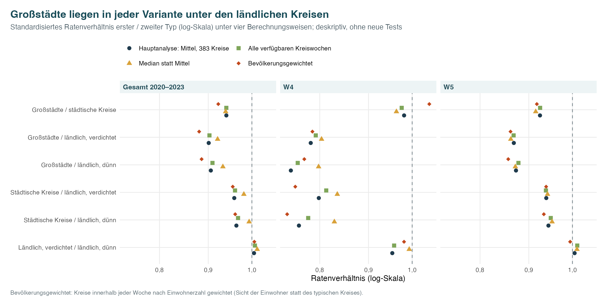

**Die vier Varianten unterscheiden sich nur darin, wie der wöchentliche Typwert gebildet wird:**

| Variante | Wöchentlicher Typwert | Datenquelle | Beantwortete Frage |
|---|---|---|---|
| Hauptanalyse | arithm. Mittel der standardisierten Raten der 383 Kreise | `weekly_district_rates.csv` (mean) | typischer Kreis |
| Median | Median der 383 Kreise | dieselbe (median) | getrieben von wenigen Extremkreisen? |
| Alle verfügbaren Kreis-Wochen | Mittel aller Kreise mit gültigem Nenner in der Woche (s. 2.1) | `sensitivity_available_annual_types.csv` | Verzerrung durch Ausschluss der 17 Kreise? |
| Bevölkerungsgewichtet | Σ (Einwohner × Rate) ÷ Σ Einwohner | Rohdaten `kreis_weekly_age_kreistyp_2020_2023.rds` | Lage der durchschnittlichen Einwohnerin |

**Gemeinsame Folgeschritte:** Mittel über alle Wochen der Phase (jede Woche gleich) → Quotient zweier Typen. Die Einwohnerzahl ist die Summe der sieben Altersgruppen des Kreises; die Kreisraten sind weiterhin mit den gemeinsamen Anteilen standardisiert.

**Kontrolle:** Mit demselben Code und Gleichgewichtung neu berechnet, weicht das Ergebnis um weniger als 10⁻¹⁴ von der Hauptanalyse ab. Standardisierung und Gruppierung stimmen also überein; Unterschiede entstehen nur durch die Gewichte.

::: {.howto}
**So liest man Abb. 18:** Jede Zeile ist ein Paar, vier Symbole für vier Varianten; drei Felder für Gesamtzeitraum, W4 und W5. Liegen alle vier Punkte links der gestrichelten Linie, ändert die Berechnungsweise die Richtung nicht.
:::

| Großstadt / Ländlich dünn | Gesamt | W4 | W5 |
|---|---:|---:|---:|
| Hauptanalyse | 0,906 | 0,746 | 0,873 |
| Median | 0,932 | 0,798 | 0,871 |
| Alle verfügbaren Kreis-Wochen | 0,909 | 0,759 | 0,878 |
| Bevölkerungsgewichtet | 0,886 | 0,771 | 0,856 |

::: {.takeaway}
**Interpretation:**

- **Stabile Richtung:** Großstädte gegenüber beiden ländlichen Typen liegen im Gesamtzeitraum, in W4 und W5 unter allen vier Varianten unter 1.
- **Median näher an 1 (0,932):** Mit dem Median liegen Großstädte nur rund 7 % niedriger statt 9 %. Vermutlich vergrößern einige Landkreise mit sehr hohen Raten den Mittelwert – passend zum langen oberen Rand der Landverteilung in [Abb. 17](#fig17).
- **Bevölkerungsgewichtet etwas größer (0,886):** Aus Sicht der Einwohner liegt die Rate in Großstädten rund 11 % unter der auf dem Land.
- **Einziger nicht robuster Wert:** W4, Großstadt / Städtisch, wechselt bevölkerungsgewichtet von 0,981 auf 1,042 – keine belastbare Aussage.
:::

## 9 Interpretation und Grenzen

**Mögliche Erklärungen** (hier nicht trennbar):

- unterschiedliches Test- und Meldeverhalten, besonders in der Omikronphase (W5) und nach den Änderungen der Teststrategie 2022;
- zeitlich versetzte Epidemieverläufe: In W4, W5 und der BA.5-Welle steigen Städte zuerst, das Land liegt später höher ([Abb. 10](#fig10), [Abb. 16](#fig16));
- Unterschiede in Verhalten oder Exposition junger Erwachsener in Stadt und Land.

**Grenzen:**

- Gemeldete Fälle sind nicht alle Infektionen; Änderungen der Teststrategie betreffen gerade die Phasen mit der größten Lücke.
- Altersnenner aus RKI-Daten rekonstruiert, noch nicht mit amtlicher Bevölkerungsstatistik abgeglichen; 17 Kreise fehlen; Fälle unbekannten Alters nicht berücksichtigt.
- Jährliche Typzuordnung: Die Zusammensetzung der Gruppen ändert sich.
- Der Kreis-Bootstrap berücksichtigt Abhängigkeiten innerhalb eines Kreises, nicht aber räumliche Korrelation benachbarter Kreise.
- Die 383 Kreise sind keine Zufallsstichprobe; Inferenz ist explorativ. Aussagen gelten auf Kreisebene, nicht für Individuen.

## 10 Fazit

| Frage | Antwort | Beleg |
|---|---|---|
| Frage 1 | Nach Altersstandardisierung liegen Großstädte rund 9–10 % unter ländlichen Kreisen – fast nur in W4 und W5. | [Abb. 8](#fig8), [Abb. 9](#fig9), [Abb. 10](#fig10); rund 95 % der Gesamtlücke aus diesen Wellen |
| Frage 2 | Die Lücke ist bei 18–39 am größten, bei 70–79 am kleinsten; das ist eine Altersinteraktion, kein Effekt der Altersstruktur. | [Abb. 12](#fig12), [Abb. 13](#fig13); relative Interaktion 0,910 |
| Frage 3 | W4: alle Altersgruppen niedriger; W5: vor allem Jüngere. Für „wann und für wen“ müssen Phase und Skala immer mit angegeben werden. | [Abb. 11](#fig11), [Abb. 14](#fig14), [Abb. 15](#fig15) |
| Robustheit | Die Richtung Großstadt vs. Land ist unter vier Varianten stabil, einzelne Kreise überlappen aber stark. | [Abb. 17](#fig17), [Abb. 18](#fig18) |

## Anhang

### Anhang A: Kreis-Cluster-Bootstrap {#app-a}

**Welches Problem er löst:** Wir beobachten nur diese 383 Kreise. Mit einer anderen, gleichartigen Auswahl wären Verhältnisse und Differenzen etwas anders. Der Bootstrap simuliert „eine andere Auswahl von Kreisen“ und zeigt, wie stark die Ergebnisse schwanken.

**Vorgehen:**

1. Aus den 383 Kreisen werden 383 **mit Zurücklegen** gezogen (manche doppelt, manche gar nicht), 1.999-mal (Seed 20261123).
2. Jeder gezogene Kreis bringt seine **gesamte** Historie mit: alle Wochen, alle Altersgruppen, die jährliche Typzuordnung. Abhängigkeiten zwischen Wochen desselben Kreises bleiben so erhalten.
3. Für jede Ziehung werden wöchentliche Typmittel und alle Vergleiche neu berechnet.
4. Die Standardabweichung der 1.999 Ergebnisse ist der Standardfehler; 95 %-Intervall = Schätzwert ± 1,96 × Standardfehler. Verhältnisse werden auf der Log-Skala berechnet und zurücktransformiert.

**Wo er verwendet wird:** alle 95 %-Intervalle in [Abb. 8](#fig8), 9, 10, 11, 12 sowie alle Intervalle und p-Werte in den Tabellen.

**Grenze:** Abhängigkeiten innerhalb eines Kreises bleiben erhalten, Kreise gelten aber als unabhängig voneinander. Benachbarte Kreise verlaufen oft ähnlich; die Intervalle können daher zu schmal sein, die Inferenz ist explorativ.

### Anhang B: Holm-Korrektur für multiples Testen {#app-b}

**Das Problem:** p < 0,05 gilt üblicherweise als „statistisch belegt“. Auch ohne jeden echten Unterschied tritt das aber in 5 % der Fälle zufällig auf. Bei einem Test ist das akzeptabel; bei 100 Tests entstehen im Mittel rund 5 rein zufällige „signifikante“ Ergebnisse.

**Holm-Verfahren:**

1. Die p-Werte einer Testfamilie aufsteigend sortieren;
2. der kleinste muss unter 0,05 ÷ Testzahl liegen, der zweitkleinste unter 0,05 ÷ (Testzahl − 1) usw.;
3. sobald einer die Schwelle verfehlt, gelten er und alle folgenden als „nicht belegt“.

„Holm-p“ im Bericht ist der umgerechnete p-Wert, direkt mit 0,05 vergleichbar.

**Kleines Beispiel (keine Projektergebnisse):** drei Tests mit p = 0,01; 0,03; 0,04.

- 0,01 × 3 = 0,03 < 0,05 → belegt;
- 0,03 × 2 = 0,06 > 0,05 → nicht belegt;
- 0,04 damit ebenfalls nicht belegt (umgerechnet 0,06).

**Testfamilien im Projekt:**

| Familie | Tests | kleinstes p muss unter |
|---|---:|---:|
| Paarvergleiche Gesamtzeitraum | 108 (6 Paare × 9 Maße × 2 Skalen) | 0,00046 |
| Altersinteraktionen Gesamtzeitraum | 252 | 0,00020 |
| Altersinteraktionen nach Phase | 2.268 | 0,000022 |

Die 95 %-Intervalle in den Abbildungen sind punktweise, nicht Holm-korrigiert. Daher kann ein Intervall die 1 ausschließen, ohne dass Holm-p signifikant ist (z. B. Städtisch / Ländlich verdichtet in 5.1).

### Anhang C: Dateien und Reproduktion

- **Alle Vergleiche:** `results/Kreistyp_Alter_Zeit/pairwise_contrasts.csv`, `age_interactions.csv`, `age_period_interactions.csv`.
- **Neu für diesen Bericht:** `results/Kreistyp_Alter_Zeit/bericht_v2/` (Abbildungen, bevölkerungsgewichtete Sensitivität, Kreisverteilungen).
- **Reihenfolge:** `run_analysis.R` → `erweiterte_analyse.R` → `alter_zeit_korrelation.R` → `bericht_v2.R` → `bericht_v2_details.R` (alle in `Scripts/Kreistyp_Alter_Zeit/`).
- **Offen:** Regressionsmodell als Vergleichsschätzung; Abgleich mit amtlichen Bevölkerungsdaten; Anteil der Fälle unbekannten Alters je Typ.
