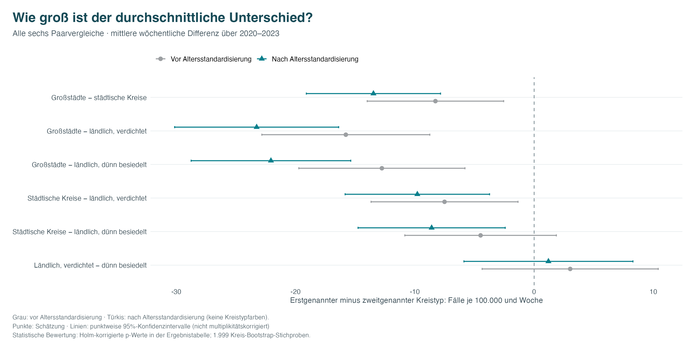
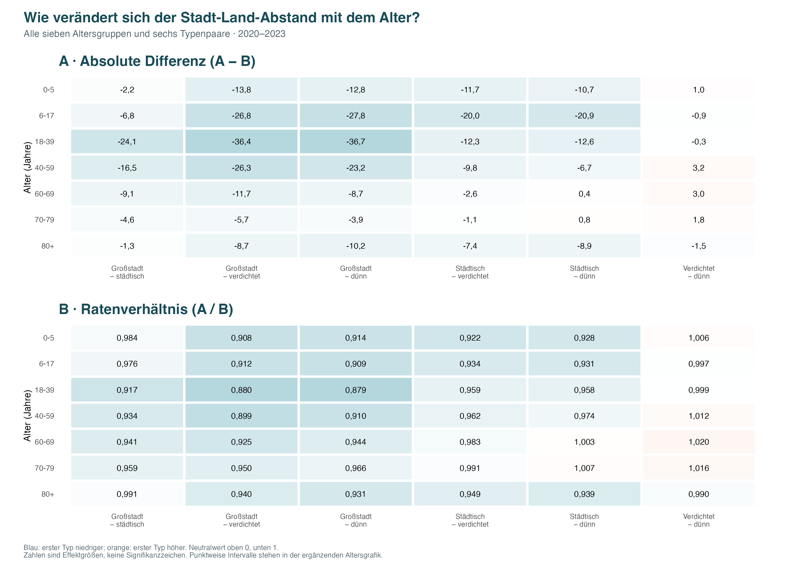
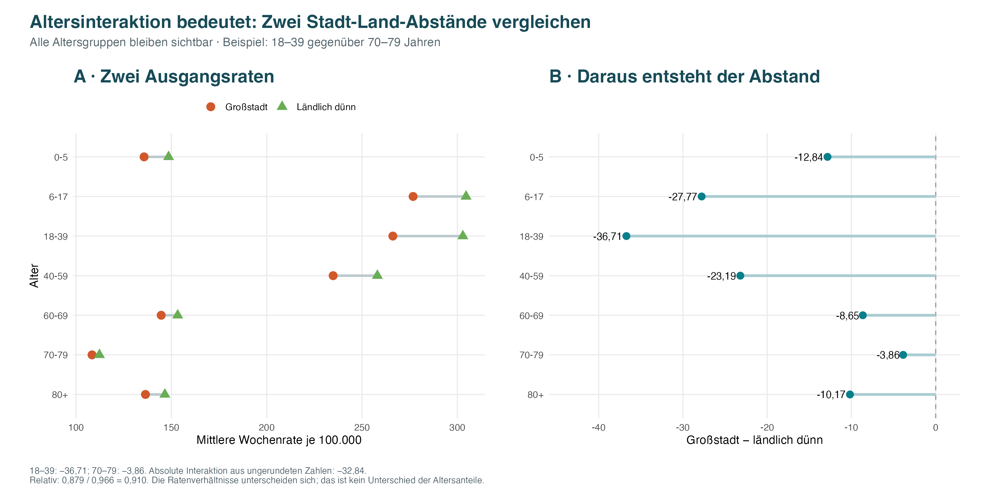
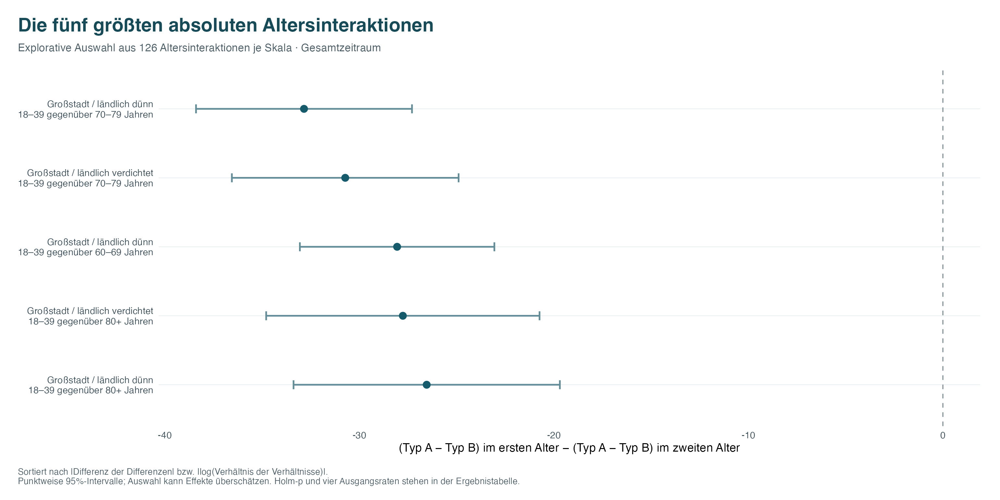
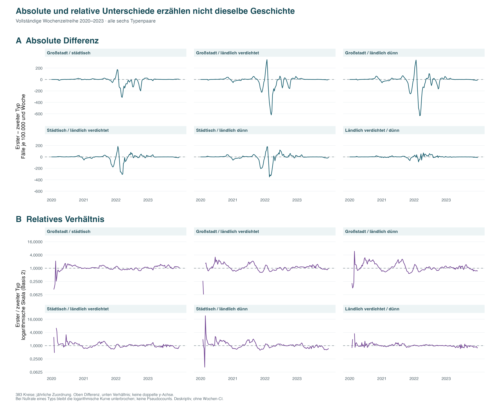
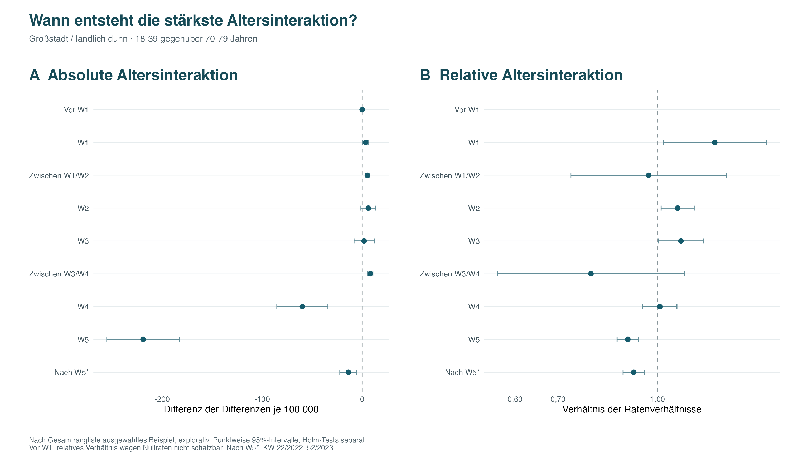
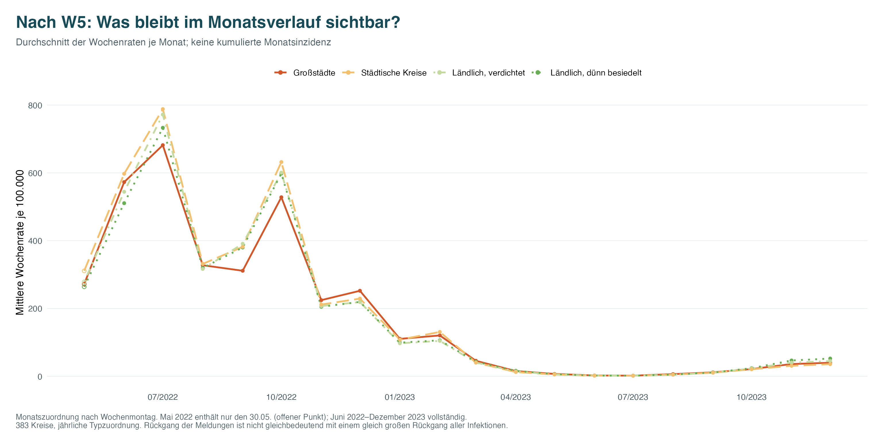
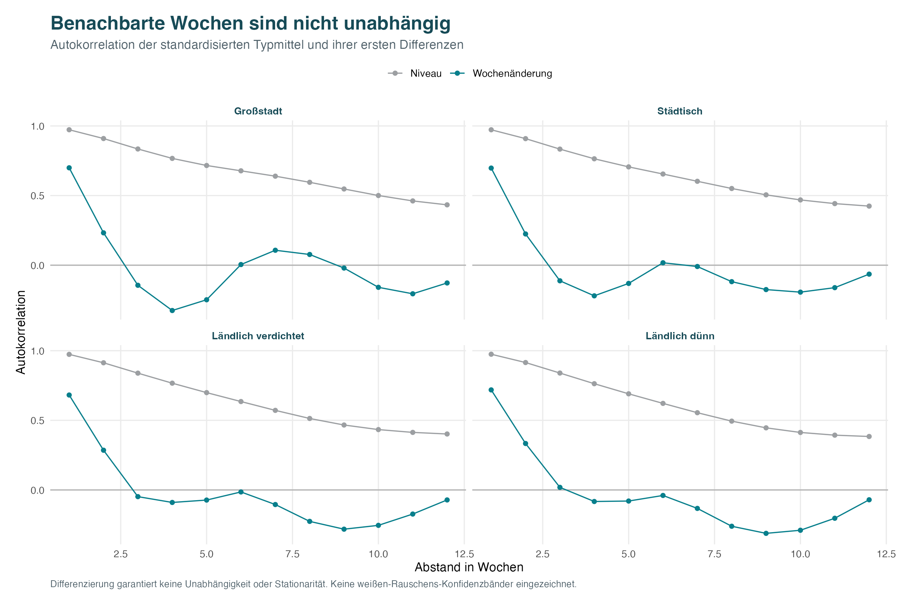
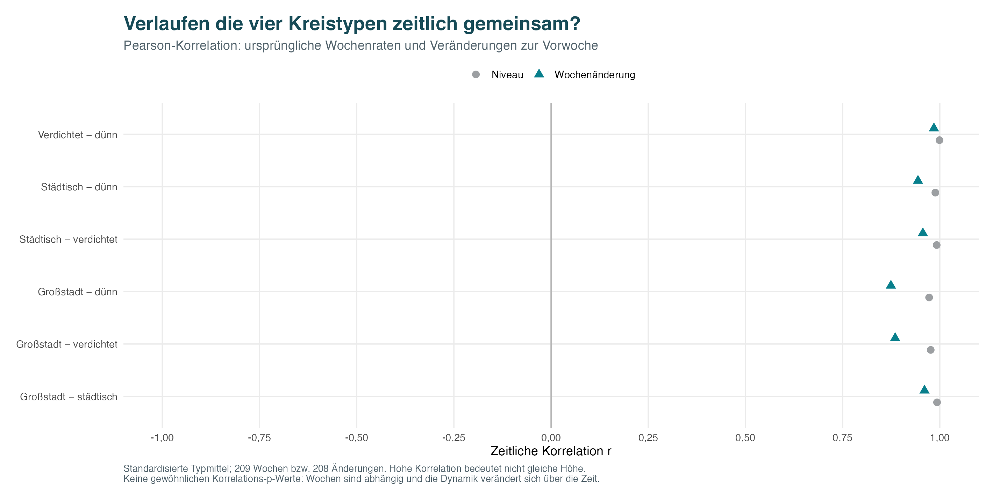
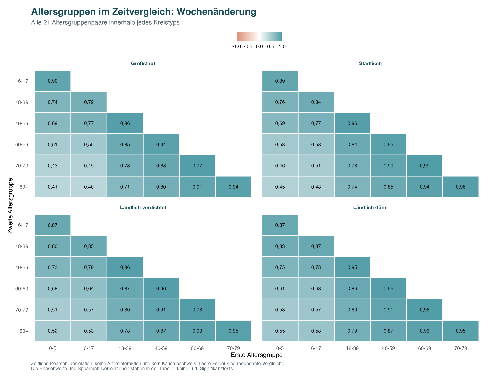

# COVID-19: Welche Unterschiede bestehen zwischen Stadt und Land?

**Deutschland · 2020–2023 · Stand: 24.11.2026**

> **Kurzantwort:** Die vier Kreistypen folgen ähnlichen Wellen. Ihre Abstände hängen jedoch von Alter und Zeitpunkt ab. Die größten absoluten Altersunterschiede konzentrieren sich auf W5. Hohe zeitliche Korrelation bedeutet dabei nicht, dass die Raten gleich hoch sind.

## 1 🎯 Was untersuchen wir?

| Frage | Analyse |
|---|---|
| Welche Kreistypen unterscheiden sich insgesamt? | Alle sechs Typenpaare: absolute Differenz und Ratenverhältnis. |
| Liegt das an unterschiedlichen Altersanteilen? | Tatsächliche und einheitliche Alterszusammensetzung vergleichen. |
| Ist der Stadt-Land-Abstand je nach Alter anders? | Alle 21 Altersvergleiche für jedes Typenpaar. |
| Wann sind die Unterschiede besonders groß? | Vollständige Wochenlinie, neun Phasen und Monatsblick nach W5. |
| Wie stabil sind die Ergebnisse? | Kreisverteilungen, Medianvergleich, Referenzgewichte und Zeitreihenkorrelationen. |

Dieser Bericht führt **„Kreistyp“** und **„Kreistyp und Altersgruppe“** zusammen. Die Kernfragen werden auf einer einheitlichen Datenbasis neu ausgewertet. Alte Medianwerte und heutige Mittelwerte sind daher nicht unmittelbar austauschbar.

### Daten und Leseschlüssel

**Hauptanalyse: 383 Kreise, 209 Wochen, sieben Altersgruppen.** Von ursprünglich 400 Kreisen fehlen bei 17 mindestens einmal gültige Altersnenner. Fehlende Werte zählen nicht als null. Die verfügbare größere Stichprobe wird zusätzlich geprüft.

- **Einheit:** gemeldete Fälle je 100.000 Personen der jeweiligen Altersgruppe und Woche.
- **Gewichtung:** innerhalb jeder Woche gleiche Kreisgewichte; danach gleiche Wochengewichte. Keine bevölkerungsgewichtete Deutschlandrate.
- **Kreistyp:** Zuordnung des jeweiligen ISO-Jahres. Kein festgeschriebener Stand von 2023.
- **Differenz A − B:** unter 0 bedeutet A niedriger. **Verhältnis A / B:** unter 1 bedeutet A niedriger; 0,90 entspricht 10 % weniger.

| Orange-Rot | Goldgelb | Hellgrün | Grün |
|---|---|---|---|
| Großstädte | Städtische Kreise | Ländlich, verdichtet | Ländlich, dünn besiedelt |

### Fehlend ist nicht null

Bei bekannter Bevölkerung und null Fällen beträgt die Rate null. Fehlt dagegen der Bevölkerungsnenner, ist die Rate nicht berechenbar (NA). Beispiel: Flensburg hat 2023 keinen vollständigen Nenner für 6–17 Jahre. Die Hauptanalyse schließt den Kreis für den gesamten Zeitraum aus, damit dieselben 383 Kreise verglichen werden. Die Sensitivität nutzt ihn in Wochen mit gültigen Nennern; für die standardisierte Rate müssen alle sieben Altersgruppen gültig sein. 2021 sind alle 400 Kreise verfügbar.

Dies ist keine Imputation. Der Vergleich Großstadt minus ländlich dünn ergibt −22,07 mit vollständiger und −21,14 mit verfügbarer Stichprobe. Das ähnliche Ergebnis beweist keine vollständige Freiheit von Auswahlverzerrung.

### Die Phasen vor der ersten Phasengrafik

| Phase | Zeitraum | Wochen |
|---|---|---:|
| Vor W1 | 30.12.2019–01.03.2020 | 9 |
| W1 | 02.03.–17.05.2020 | 11 |
| Zwischen W1/W2 | 18.05.–27.09.2020 | 19 |
| W2 | 28.09.2020–28.02.2021 | 22 |
| W3 | 01.03.–13.06.2021 | 15 |
| Zwischen W3/W4 | 14.06.–01.08.2021 | 7 |
| W4 | 02.08.–26.12.2021 | 21 |
| **W5** | **27.12.2021–29.05.2022** | **22** |
| Nach W5 | 30.05.2022–31.12.2023 | 83 |

W bedeutet Welle, nicht Woche. Die bestehende RKI-Einteilung wird einschließlich Zwischenphasen beibehalten; Grenzen werden nicht nach Signifikanz ausgewählt. Der Beginn Ende 2019 folgt der ISO-Wochenzählung.

## 2 Was verändert die Altersstandardisierung?

**So lesen:** Oben hat jeder Kreis seine tatsächlichen Altersanteile. Unten werden überall dieselben Anteile von 2021 verwendet. Beide Panels zeigen dieselben Wochen und dieselbe Skala.

| Mittlere Wochenrate 2020–2023 | Tatsächliche Altersanteile | Einheitliche Altersanteile |
|---|---:|---:|
| Großstädte | 215,24 | 211,65 |
| Städtische Kreise | 223,52 | 225,12 |
| Ländlich, verdichtet | 231,03 | 234,91 |
| Ländlich, dünn | 228,01 | 233,71 |

**Ergebnis:** Großstädte liegen gegenüber dünn besiedelten ländlichen Kreisen zunächst um **12,77**, nach Standardisierung um **22,07** niedriger. Die Alterszusammensetzung verdeckt hier einen Teil des Abstands; sie erklärt ihn nicht vollständig.

**Beispiel 2021:** In Großstädten sind durchschnittlich **30,72 %** der Bevölkerung 18–39 Jahre alt, in dünn besiedelten ländlichen Kreisen **22,99 %**. Ab 70 Jahren sind es **15,15 % gegenüber 17,67 %**.

**Zwei verschiedene Fragen:** Alterszusammensetzung fragt, wie viele Menschen zu einer Altersgruppe gehören. Altersinteraktion fragt, ob sich der Stadt-Land-Abstand *innerhalb* der Altersgruppen unterscheidet.

Die Referenzanteile stammen aus rekonstruierten RKI-Altersnennern aller 400 Kreise im Jahr 2021, nicht aus einer unabhängig bestätigten amtlichen Altersstatistik. Die rohe Rate nutzt hier die sieben bekannten Altersgruppen; der alte Gesamtbericht verwendete eine andere Gesamtbevölkerungsquelle.

### Standardisierung Schritt für Schritt

**Standardisierte Wochenrate = Summe aus Altersrate × gemeinsamem Altersanteil.** Der Referenzanteil ist die summierte Bevölkerung einer Altersgruppe aller 400 Kreise 2021 geteilt durch deren Gesamtbevölkerung in den sieben Gruppen. Zuerst wird jede Kreiswoche standardisiert, danach werden Kreise innerhalb des Typs gleich gewichtet.

**Reales Beispiel: München, Woche ab 07.03.2022.** Referenzanteile in Prozent:

| Alter | Wochenrate München | Referenzanteil | Beitrag zur standardisierten Rate |
|---|---:|---:|---:|
| 0-5 | 903,00 | 5,756 | 51,98 |
| 6-17 | 2316,69 | 10,899 | 252,49 |
| 18-39 | 2341,60 | 26,280 | 615,37 |
| 40-59 | 1673,17 | 27,714 | 463,71 |
| 60-69 | 846,28 | 13,170 | 111,45 |
| 70-79 | 607,91 | 8,839 | 53,73 |
| 80+ | 524,67 | 7,342 | 38,52 |

Für 18–39 Jahre: 2.341,6046 × 0,2627999 ≈ **615,37**. Die sieben Beiträge ergeben **1.587,26**; mit Münchens tatsächlichen Altersanteilen beträgt die rohe Rate **1.702,69**. Geändert werden die Gewichte, nicht die Altersraten. Gerechnet wird mit ungerundeten Werten.

**383 versus 400:** 383 Kreise bilden die durchgehend vollständige Analysestichprobe. Die 400 Kreise definieren ausschließlich die gemeinsame Referenz von 2021, in der alle Nenner gültig sind. Eine Standardpopulation muss nicht mit der Analysestichprobe identisch sein. Bei einer Referenz aus nur 383 Kreisen verändert sich Großstadt minus ländlich dünn von **−22,0670 auf −22,0701**; die größte Veränderung aller sechs Paare beträgt **0,0034**. Die Ergebnisse sind gegenüber dieser Referenzwahl deskriptiv stabil.

## 3 Welche Kreistypen unterscheiden sich insgesamt?

**So lesen:** Punkte zeigen mittlere Unterschiede, Linien punktweise 95%-Intervalle. Links von null liegt der erstgenannte Typ niedriger.

| Vergleich | Standardisierte Differenz | Ratenverhältnis |
|---|---:|---:|
| Großstadt – städtisch | −13,47 | 0,940 |
| Großstadt – ländlich verdichtet | −23,27 | 0,901 |
| Großstadt – ländlich dünn | −22,07 | 0,906 |
| Städtisch – ländlich verdichtet | −9,79 | 0,958 |
| Städtisch – ländlich dünn | −8,59 | 0,963 |
| Ländlich verdichtet – ländlich dünn | +1,20 | 1,005 |

**Grau = vor, Türkis = nach Altersstandardisierung.** Die Farben stehen hier für Berechnungsverfahren, nicht für Kreistypen. Pro Zeile wird dasselbe Typenpaar zweimal berechnet. Für Großstadt minus ländlich dünn verschiebt sich der Punkt von −12,77 auf −22,07; die Vereinheitlichung der Altersanteile vergrößert diesen Abstand.

Die ursprüngliche Kreis-Bootstrap-Inferenz mit Holm stützt die drei Großstadtvergleiche; die übrigen drei sind nicht ausreichend abgesichert. Großstadt gegenüber ländlich dünn entspricht **9,44 % niedrigerer Rate**, mit einem punktweisen absoluten Intervall von **−28,76 bis −15,38**.

**Warum Großstädte niedriger?** Verglichen werden Meldungen pro 100.000 und ein Vierjahresmittel, nicht Fallzahlen oder Bevölkerungsdichte. Zeitweise liegen Großstädte höher. Die Altersstruktur erklärt das Gesamtmuster nicht vollständig. Unterschiedliche Test-/Meldepraxis oder regionale Epidemieverläufe sind mögliche Erklärungen, aber hier nicht getrennt identifiziert. Eine kausale Sicherheitsbewertung folgt daraus nicht.

**Bootstrap konkret:** 383 Kreise werden 1.999-mal mit Zurücklegen gezogen. Jede Ziehung übernimmt die gesamte Wochen- und Altershistorie eines Kreises, einschließlich jährlicher Typwechsel. Anschließend werden Wochenmittel und Kontraste neu berechnet. Die Streuung der Ziehungen liefert den Standardfehler; Intervalle nutzen Normalapproximation, Verhältnisse die Log-Skala. Dies erhält Abhängigkeit innerhalb eines Kreises, nicht zwischen Kreisen; die Inferenz bleibt explorativ.

**Holm:** Viele Tests erhöhen die Chance zufälliger kleiner p-Werte. Sortierte p-Werte werden schrittweise mit 0,05/m, 0,05/(m−1) usw. verglichen. Illustratives Beispiel: 0,01 / 0,03 / 0,04 werden zu 0,03 / 0,06 / 0,06. Das sind keine Projektergebnisse. Hier umfasst die Gesamtfamilie 108 Tests (6 Paare × 9 Zielgrößen × 2 Skalen), die gesamte Altersinteraktion 252 und die phasenbezogene Altersinteraktion 2.268. Punktweise Intervalle sind nicht Holm-korrigiert.

## 4 Wie stark unterscheiden sich Kreise desselben Typs?

**So lesen:** Ein Punkt steht für einen Kreis mit seiner durchschnittlichen Wochenrate in der Phase. Die Box enthält die mittleren 50 %, die Linie ist der Median. Die weiße Raute zeigt das Hauptmaß: den Durchschnitt der wöchentlichen Typmittel.

| W4 | Großstädte | Ländlich, dünn |
|---|---:|---:|
| Median der Kreiswerte | 158,44 | 208,44 |
| Mittlere 50 % | 129,88–204,40 | 130,63–300,51 |

**Ergebnis:** Die Mediane unterscheiden sich, die Verteilungen überlappen aber stark. **Ein ländlicher Kreis liegt nicht automatisch höher als eine Großstadt.** Nach W5 liegen die Mediane mit **174,99 und 178,06** besonders nahe beieinander.

**Beachten:** Jede Phase hat eine eigene Skala. Dreiecke markieren unvollständige Typzugehörigkeiten bei einem Wechsel. Deshalb enthält W5 384 Kreis-Typ-Einträge aus 383 Kreisen. Diese Punkte bilden keine unabhängigen Stichproben für zusätzliche Tests.

## 5 Ändert sich der Stadt-Land-Abstand mit dem Alter?

**Neue Lesart:** Zeilen sind Altersgruppen, Spalten Typenpaare. Oben Differenzen, unten Verhältnisse; Blau bedeutet erster Typ niedriger. Farbe zeigt Größe, keine Signifikanz. Die Intervallgrafik bleibt im Anhang.

Links stehen die beiden Ausgangsraten für alle sieben Altersgruppen, rechts deren Abstand. Erst danach werden zwei Altersabstände miteinander verglichen.

**Ergebnis:** Ja, für konkrete Vergleiche. Besonders deutlich ist der Unterschied zwischen **18–39 und 70–79 Jahren**, wenn Großstädte mit dünn besiedelten ländlichen Kreisen verglichen werden:

| Alter | Großstadt | Ländlich, dünn | Differenz |
|---|---:|---:|---:|
| 18–39 | 266,14 | 302,85 | −36,71 |
| 70–79 | 108,40 | 112,27 | −3,86 |

Der Abstand ist bei jungen Erwachsenen **um 32,84 Fälle je 100.000 und Woche stärker negativ**. Diese Differenz der beiden Abstände ist die absolute Altersinteraktion; gerechnet wird mit ungerundeten Werten.

### Alterszusammensetzung und Interaktion konkret unterscheiden

Die 18–39-Jährigen haben in Großstädten einen höheren Bevölkerungsanteil (30,72 % statt 22,99 %) und relativ hohe Melderaten. Ein höheres Gewicht dieser Gruppe kann die rohe Rate erhöhen. Der größere Abstand nach Standardisierung ist damit vereinbar; dies ist keine kausale Zerlegung einzelner Altersbeiträge.

Innerhalb der Altersgruppen bleibt jedoch ein unterschiedlicher Stadt-Land-Abstand: −36,71 gegenüber −3,86. Das ist die Interaktion, unabhängig davon, wie viele Menschen zu diesen Altersgruppen gehören.

| Kennzahl | Bedeutung |
|---|---|
| Absolute Interaktion −32,84 | Abstand bei 18–39 minus Abstand bei 70–79; null bedeutet gleiche absolute Abstände. |
| Ratenverhältnisse 0,879 und 0,966 | Großstadt liegt innerhalb der jüngeren Gruppe etwa 12,1 %, innerhalb der älteren etwa 3,4 % niedriger. |
| Relative Interaktion 0,910 | Jüngeres Ratenverhältnis / älteres Ratenverhältnis; eins bedeutet gleiche relative Abstände. |

0,910 bedeutet nicht, dass junge Erwachsene 9 % weniger Infektionen als ältere Menschen haben. Beide Interaktionen vergleichen Stadt-Land-Abstände. Absolute und relative Interaktion können wegen unterschiedlicher Grundraten verschieden ausfallen.

### Alle Vergleiche statt einzelner ausgewählter Altersgruppen

Berechnet wurden **21 Altersvergleiche × 6 Typenpaare = 126 Interaktionen je Skala**. Die fünf größten absoluten Effekte sind:

| Rang | Typenpaar | Altersvergleich | Absolute Interaktion |
|---|---|---|---:|
| 1 | Großstadt – ländlich dünn | 18–39 vs. 70–79 | −32,84 |
| 2 | Großstadt – ländlich verdichtet | 18–39 vs. 70–79 | −30,73 |
| 3 | Großstadt – ländlich dünn | 18–39 vs. 60–69 | −28,06 |
| 4 | Großstadt – ländlich verdichtet | 18–39 vs. 80+ | −27,76 |
| 5 | Großstadt – ländlich dünn | 18–39 vs. 80+ | −26,54 |

Relativ führt ebenfalls **18–39 vs. 70–79, Großstadt gegenüber ländlich dünn**, mit **0,910**. Danach folgen städtisch/ländlich dünn für 0–5 vs. 70–79 (0,922) und 6–17 vs. 70–79 (0,925). Die vollständigen Ranglisten beider Skalen stehen im Anhang.

**Wichtig:** Größte Effekte bedeuten nicht automatisch sicherste Ergebnisse. Die Rangliste wurde aus denselben Daten ausgewählt und bleibt explorativ. Die anschließende Phasenanalyse vertieft denselben Vergleich, ohne unabhängige Bestätigung.

## 6 Wann entstehen die Unterschiede?

### 6.1 Die vollständige Wochenlinie

**So lesen:** Oben steht die Differenz, unten das Verhältnis. Ein großer absoluter Abstand muss kein großer prozentualer Abstand sein.

**Keine Auswahl einzelner Wochen:** Die Grafik zeigt alle 209 Wochen. Die folgende Tabelle fasst jede Phase vollständig zusammen, jeweils Großstadt gegenüber ländlich dünn.

| Phase | Wochen | Mittlere Differenz | Verhältnis der Phasenmittel | Wochen mit Großstadt niedriger |
|---|---:|---:|---:|---:|
| P0 | 9 | 0,00 | 1,212 | 44,4% |
| W1 | 11 | -1,05 | 0,942 | 54,5% |
| G1 | 19 | 4,61 | 2,099 | 0,0% |
| W2 | 22 | -2,67 | 0,978 | 54,5% |
| W3 | 15 | -0,41 | 0,996 | 40,0% |
| G2 | 7 | 5,67 | 1,878 | 0,0% |
| W4 | 21 | -58,47 | 0,746 | 57,1% |
| W5 | 22 | -142,69 | 0,873 | 68,2% |
| PostW5 | 83 | -3,56 | 0,980 | 37,3% |

W5 hat einen mittleren Abstand von −142,69, aber nur in 68,2 % der Wochen liegt Großstadt niedriger. Ein Phasenmittel ist keine Aussage über jede Woche. In W3 sind es nur 40 %, obwohl der Mittelwert leicht negativ ist: Auch die Größe jedes Wochenabstands zählt. Verhältnisse vor W1 sind wegen nahezu null liegender Raten wenig aussagekräftig.

Nullraten werden nicht künstlich erhöht. Nicht logarithmierbare Verhältnisse erscheinen als Lücken; kleine Raten können starke relative Ausschläge erzeugen. Die Wochenlinien sind deskriptiv, ohne wöchentliche Signifikanztests.

### 6.2 Die Altersinteraktion nach Phase

| Phase | Absolute Interaktion | Holm-p | Relative Interaktion | Holm-p |
|---|---:|---:|---:|---:|
| P0 | 0,01 | 1,000 | — | — |
| W1 | 3,43 | 1,000 | 1,228 | 1,000 |
| G1 | 5,16 | <0,001 | 0,969 | 1,000 |
| W2 | 6,15 | 1,000 | 1,075 | 1,000 |
| W3 | 1,95 | 1,000 | 1,088 | 1,000 |
| G2 | 8,04 | <0,001 | 0,788 | 1,000 |
| W4 | -59,77 | 0,009 | 1,008 | 1,000 |
| W5 | -219,16 | <0,001 | 0,899 | <0,001 |
| PostW5 | -13,79 | 1,000 | 0,918 | 0,022 |

**Interpretation über alle Phasen:** In W1–W3 sind die absoluten Wellenkontraste klein und nach Holm nicht abgesichert. G1/G2 zeigen dagegen kleine positive absolute Interaktionen. W4 zeigt −59,77 absolut, aber 1,008 relativ: unterschiedliche Fallabstände bei nahezu gleichen Ratenverhältnissen. W5 zeigt auf beiden Skalen Evidenz (−219,16; 0,899). Nach W5 ist die absolute Interaktion kleiner und korrigiert nicht abgesichert, während relativ 0,918 mit Holm-p 0,022 bleibt.

Der direkte Vergleich W4 minus W5 beträgt absolut +159,39 (Holm-p < 0,001), relativ 1,121 (Holm-p = 1). Unterschiedliche Einzelsignifikanz ersetzt diesen Test nicht. Dies sind die ursprünglichen explorativen Kreis-Bootstrap-Ergebnisse, keine räumlichen oder Panelmodellbefunde.

W1–W5 folgen der bestehenden [RKI-Einteilung](https://edoc.rki.de/bitstream/handle/176904/10260/EB-38-2022-Phaseneinteilung.pdf?sequence=1). Vor- und Zwischenphasen bleiben enthalten. „Nach W5“ ist keine einzelne Welle.

### 6.3 Was verdeckt der lange Zeitraum nach W5?

| Monat | Großstadt | Ländlich, dünn |
|---|---:|---:|
| Juli 2022 | 681,74 | 733,07 |
| Oktober 2022 | 528,12 | 597,99 |
| Februar 2023 | 120,45 | 106,10 |
| November 2023 | 36,10 | 46,64 |

**Kernaussage:** Kleiner Gesamtabstand bedeutet nicht jeden Monat kleiner Abstand. Über 83 Wochen liegen die Mittel bei 175,10 und 178,67 (Differenz −3,56). Im Juli 2022 beträgt die Differenz −51,33, im Oktober −69,87, im Februar 2023 dagegen +14,35. Gegensätzliche Abstände heben sich teilweise auf. Die Grafik zeigt alle Monate; Tabellenbeispiele dienen nur dem Lesen und begründen keine ausgewählten Monatstests.

Es sind **mittlere Wochenraten, keine Monatsinzidenzen**. Die Zuordnung folgt dem Wochenmontag. Mai 2022 enthält nur die Woche ab 30.05. und ist als Teilmonat markiert.

## 7 Hängen die Ergebnisse von Stichprobe und Mittelwert ab?

| Großstadt minus ländlich dünn, standardisiert | Differenz |
|---|---:|
| 383 vollständige Kreise, Wochenmittel | −22,07 |
| Alle verfügbaren Kreiswerte, Wochenmittel | −21,14 |
| 383 vollständige Kreise, Wochenmediane | −14,75 |

**Ergebnis:** Die Richtung bleibt gleich. Die Größe hängt stärker von Mittelwert versus Median ab als vom Ausschluss der 17 Kreise. Für städtisch gegenüber ländlich dünn schrumpft der Abstand mit Medianen von **−8,59 auf −1,45**.

Diese Vergleiche sind deskriptiv. Ein Mittel von Wochenmedianen beantwortet eine andere Frage als ein Mittel von Wochenmitteln.

## 8 📈 Zeitreihen: gemeinsame Veränderungen statt unabhängiger Wochen

Korrelation beschreibt gemeinsames Steigen und Fallen, nicht gleiche Höhe. Wenn B stets A + 100 ist, kann r = 1 sein, obwohl die Differenz immer 100 beträgt.

Für Großstädte beträgt die Lag-1-Autokorrelation der standardisierten Rate rund 0,973, nach erster Differenzierung noch 0,699. Differenzierung garantiert weder Unabhängigkeit noch Stationarität. Lineare Modelle sind dadurch nicht grundsätzlich ausgeschlossen; etwa Regression mit ARIMA-Fehlern kann Abhängigkeit berücksichtigen. Hier wird zunächst Synchronität beschrieben, ohne gewöhnliche i.i.d.-Korrelations-p-Werte und ohne Kausal- oder Prognosemodell.

### Kreistypen

| Vergleich | Niveau-r | Änderungs-r |
|---|---:|---:|
| Großstadt / städtisch | 0,993 | 0,961 |
| Großstadt / verdichtet | 0,977 | 0,885 |
| Großstadt / dünn | 0,972 | 0,874 |
| Städtisch / verdichtet | 0,992 | 0,956 |
| Städtisch / dünn | 0,988 | 0,944 |
| Verdichtet / dünn | 0,999 | 0,985 |

Alle Typen folgen ähnlichen Wellen. Auch Änderungen korrelieren stark, Großstadt und ländliche Typen jedoch weniger eng. Spearman für deren Änderungen beträgt beim Paar Großstadt/dünn 0,811. Gemeinsame Epidemiewellen und weitere gemeinsame Einflüsse bleiben mögliche Gründe. Die Tabellen enthalten zusätzlich alle Phasen; konstante Reihen erhalten keinen Korrelationswert.

Gemeinsame bewegliche Zeitblöcke von 8 Wochen (1.999 Ziehungen; Sensitivität 4/12) ergeben für Großstadt/dünn einen mittleren 95%-Bereich von etwa 0,784–0,963. Wegen zeitveränderlicher Dynamik ist dies nur eine explorative Resampling-Stabilität, kein garantiert kalibriertes Konfidenzintervall und kein Signifikanznachweis.

### Altersgruppen innerhalb jedes Typs

Je Typ werden alle 21 Alterspaare berechnet, insgesamt 84. In Großstädten korrelieren die Änderungen bei 60–69/70–79 mit 0,974 und bei 18–39/40–59 mit 0,957, bei 6–17/80+ dagegen mit 0,402. Dies beschreibt Unterschiede der zeitlichen Synchronität, keine Infektionsrichtung. Niveaukorrelationen und Rangkorrelationen ergänzen die Auswertung.

Alterskorrelation fragt nach gleichzeitigem Anstieg; Altersinteraktion fragt nach unterschiedlichen Stadt-Land-Abständen. Beide Größen sind getrennt zu interpretieren.

## 9 Aktualisiertes Fazit

| Aussage | Einordnung |
|---|---|
| Die Typen folgen ähnlichen Wellen und können trotzdem unterschiedliche Raten haben. | Hohe Niveau- und Änderungskorrelation ersetzt keinen Differenzvergleich. |
| Großstädte liegen im standardisierten Gesamtmittel niedriger. | Ursprünglicher Kreis-Bootstrap mit Holm stützt die drei Vergleiche; keine Aussage für jede Woche oder jeden Kreis. |
| Altersstruktur und Altersinteraktion sind verschieden. | Gewichte versus Unterschiede der altersspezifischen Typkontraste. Standardisierung beseitigt den Abstand nicht. |
| 400 und 383 erfüllen unterschiedliche Aufgaben. | Referenzpopulation versus vollständige Stichprobe; Wechsel der Referenz verändert Unterschiede um höchstens rund 0,0034. |
| Alter und Phase sind wichtig. | Der führende absolute Alterskontrast ist in W5 besonders groß, aber Unterschiede existieren auch außerhalb dieser Phase. |
| Das Mittel nach W5 ist allein zu grob. | Gegenläufige Monatsabstände können sich über 83 Wochen aufheben. |
| Zeitliche Korrelation ist keine Kausalität. | Autokorrelation bleibt auch nach Differenzierung; keine gewöhnlichen unabhängigen-Wochen-Tests. |

Die Raum- und Panelmodellsektion wurde aus diesem Bericht entfernt. Die verbleibende Inferenz ist der ursprüngliche explorative Kreis-Bootstrap, keine räumlich robuste Bestätigung. Meldungen sind nicht alle Infektionen; Auswahl fehlender Nenner, rekonstruierte Bevölkerung und Abhängigkeit zwischen Kreisen bleiben Grenzen.

## 10 Materialien und Reproduktion

| Material | Inhalt |
|---|---|
| [Relative Top 5](../results/Kreistyp_Alter_Zeit/11_top5_relative.png) | Ergänzende Rangliste mit ursprünglichen Intervallen |
| [Alle absoluten](../results/Kreistyp_Alter_Zeit/S01_all_interactions_absolute.png) / [alle relativen Altersinteraktionen](../results/Kreistyp_Alter_Zeit/S01_all_interactions_relative.png) | 21 Altersvergleiche je Typenpaar |
| [Vollständige Rangliste](../results/Kreistyp_Alter_Zeit/age_interaction_ranking_all.csv) | Schätzungen, Intervalle und vier Ausgangsraten |
| [Wochenwerte](../results/Kreistyp_Alter_Zeit/weekly_pairwise_scales.csv) | Beide Skalen und Ausgangsraten |
| [Kreis-Phasenwerte](../results/Kreistyp_Alter_Zeit/district_period_distribution.csv) | Verteilungen und Teilphasen |
| [Monatswerte](../results/Kreistyp_Alter_Zeit/post_w5_monthly.csv) | Nach W5, mit Wochenzahl |

Alle Abbildungen liegen als PNG und PDF vor; ergänzende Altersansichten bleiben verfügbar. Die ursprünglichen Shiny-Karten bleiben in `data_processed/Kreistyp/incidence_map_Shiny.R` und `Kreistyp_geo.R` erhalten.

Neue Materialien: [Referenzgewichte](../results/Kreistyp_Alter_Zeit/reference_400_383.csv), [Rechenbeispiel](../results/Kreistyp_Alter_Zeit/standardisation_example.csv), [alle Phasen](../results/Kreistyp_Alter_Zeit/period_difference_overview.csv), [Korrelationen](../results/Kreistyp_Alter_Zeit/time_series_correlations.csv), [Niveau-Altersgrafik](../results/Kreistyp_Alter_Zeit/20_age_time_correlation_levels.png), [Block-Resampling](../results/Kreistyp_Alter_Zeit/time_series_block_intervals.csv).

In RStudio: `Scripts/Kreistyp_Alter_Zeit/alter_zeit_korrelation.R` erzeugt die neuen Tabellen und Grafiken. Die bisherige Analyse bleibt in `run_analysis.R` und `erweiterte_analyse.R`; Raum- und Panelmodelle sind für diesen Bericht nicht auszuführen. Details und Quellen im [Methodenbericht](Kreistyp_Alter_Zeit_Methoden.md).
