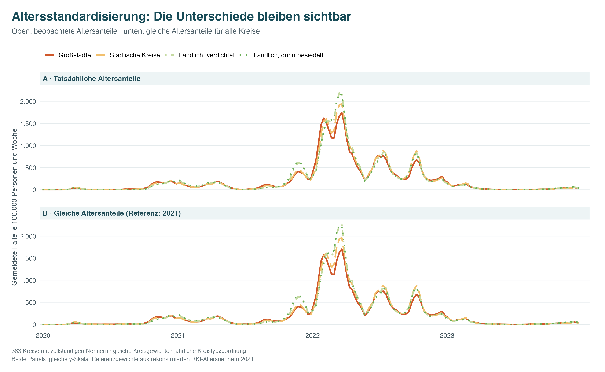
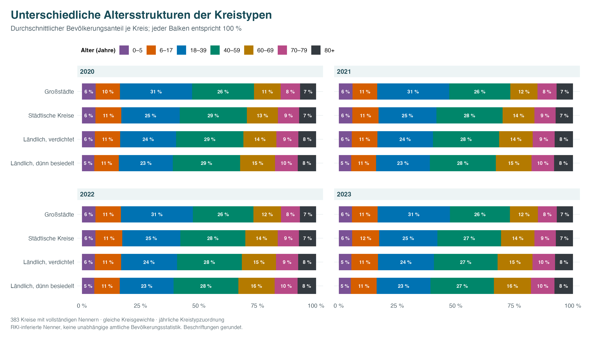
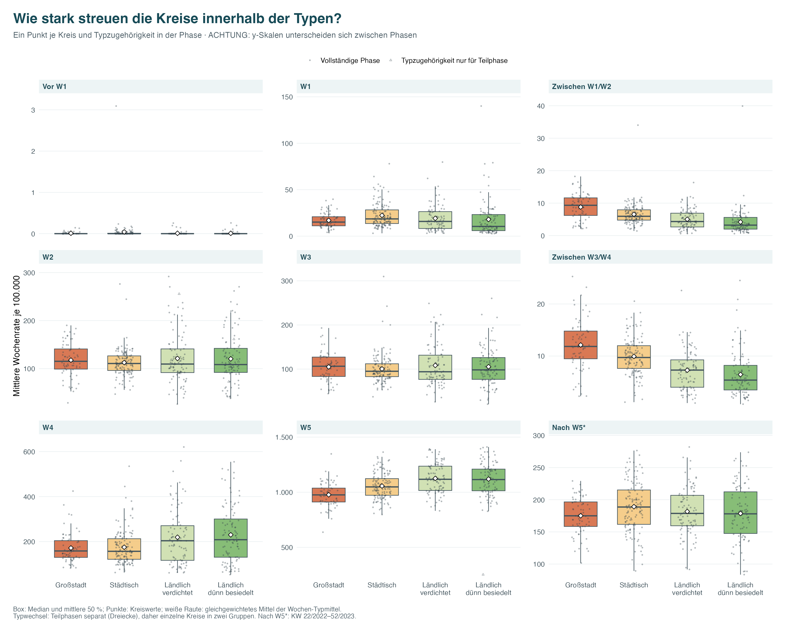
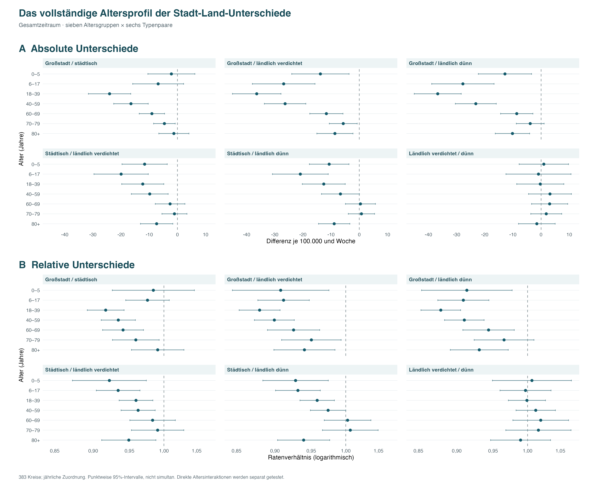
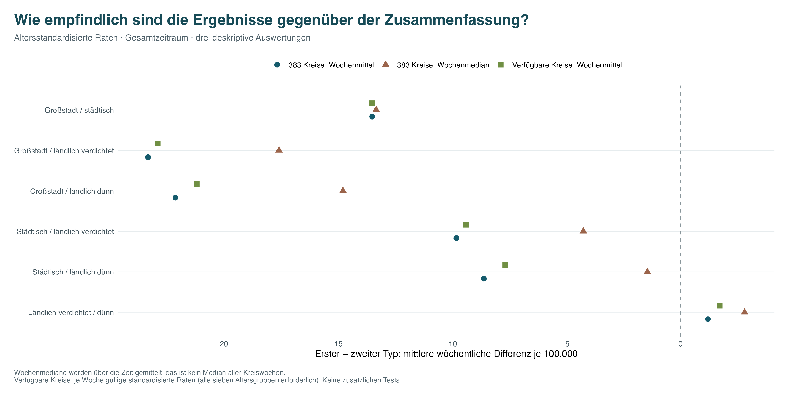
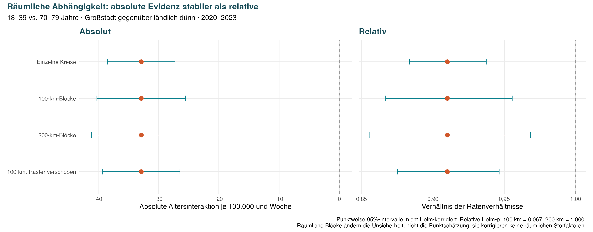
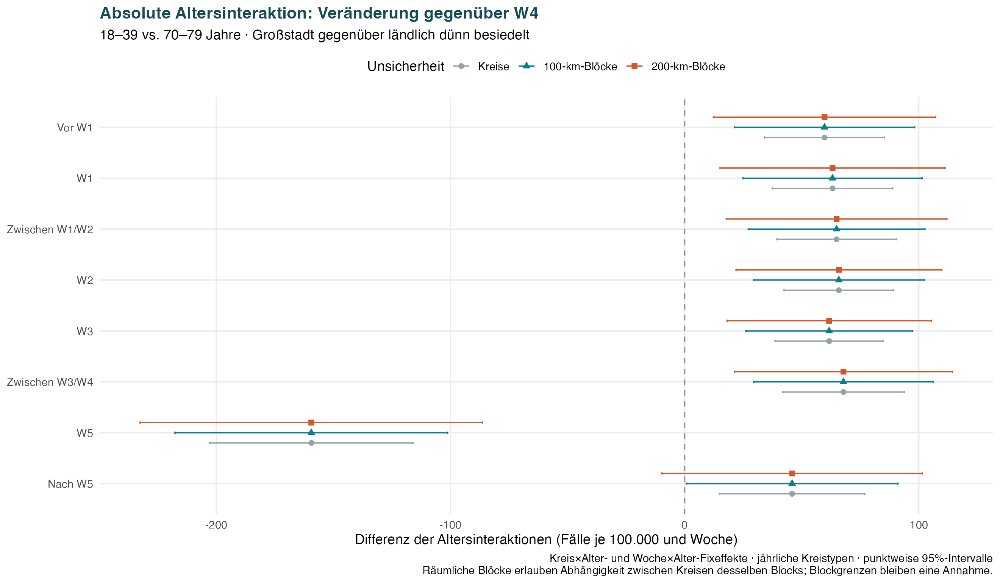
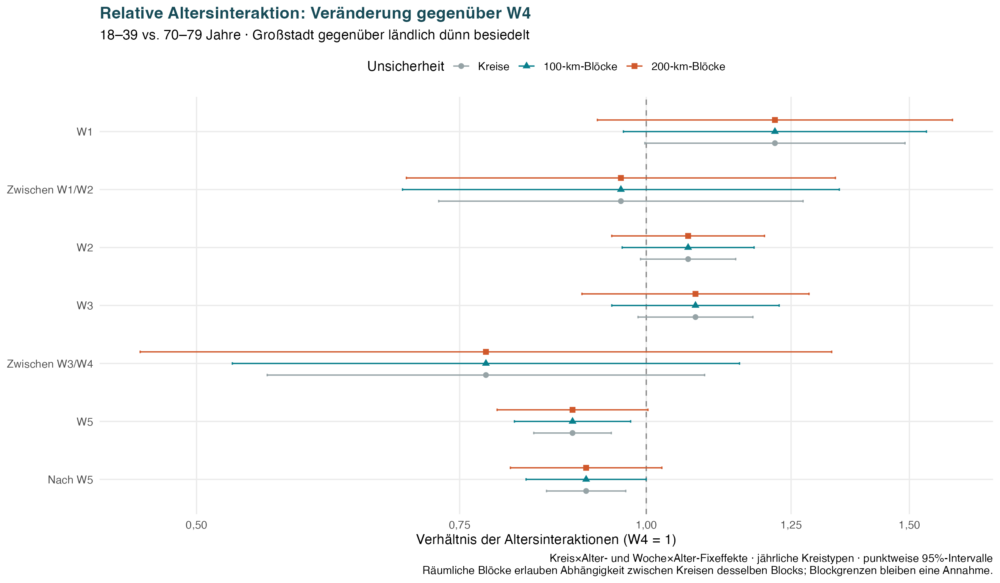

# COVID-19: Welche Unterschiede bestehen zwischen Stadt und Land?

**Deutschland · 2020–2023 · Stand: 24.11.2026**

> **Kurzantwort:** Die vier Kreistypen folgen ähnlichen Wellen. Ihre Abstände hängen jedoch von Alter und Zeitpunkt ab. Die größten absoluten Altersunterschiede konzentrieren sich auf W5. Auch mit räumlicher Unsicherheit bleibt dafür Evidenz; relative Unterschiede sind weniger eindeutig.

## 1 🎯 Was untersuchen wir?

| Frage | Analyse |
|---|---|
| Welche Kreistypen unterscheiden sich insgesamt? | Alle sechs Typenpaare: absolute Differenz und Ratenverhältnis. |
| Liegt das an unterschiedlichen Altersanteilen? | Tatsächliche und einheitliche Alterszusammensetzung vergleichen. |
| Ist der Stadt-Land-Abstand je nach Alter anders? | Alle 21 Altersvergleiche für jedes Typenpaar. |
| Wann sind die Unterschiede besonders groß? | Vollständige Wochenlinie, neun Phasen und Monatsblick nach W5. |
| Wie stabil sind die Ergebnisse? | Kreisverteilungen, Medianvergleich, räumliche Unsicherheit und Panelmodelle. |

Dieser Bericht führt **„Kreistyp“** und **„Kreistyp und Altersgruppe“** zusammen. Die Kernfragen werden auf einer einheitlichen Datenbasis neu ausgewertet. Alte Medianwerte und heutige Mittelwerte sind daher nicht unmittelbar austauschbar.

### Daten und Leseschlüssel

**Hauptanalyse: 383 Kreise, 209 Wochen, sieben Altersgruppen.** Von ursprünglich 400 Kreisen fehlen bei 17 mindestens einmal gültige Altersnenner. Fehlende Werte zählen nicht als null. Die verfügbare größere Stichprobe wird zusätzlich geprüft.

- **Einheit:** gemeldete Fälle je 100.000 Personen der jeweiligen Altersgruppe und Woche.
- **Gewichtung:** innerhalb jeder Woche gleiche Kreisgewichte; danach gleiche Wochengewichte. Keine bevölkerungsgewichtete Deutschlandrate.
- **Kreistyp:** Zuordnung des jeweiligen ISO-Jahres. Kein festgeschriebener Stand von 2023.
- **Differenz A − B:** unter 0 bedeutet A niedriger. **Verhältnis A / B:** unter 1 bedeutet A niedriger; 0,90 entspricht 10 % weniger.

| Orange-Rot | Goldgelb | Hellgrün | Grün |
|---|---|---|---|
| Großstädte | Städtische Kreise | Ländlich, verdichtet | Ländlich, dünn besiedelt |

## 2 Was verändert die Altersstandardisierung?

**So lesen:** Oben hat jeder Kreis seine tatsächlichen Altersanteile. Unten werden überall dieselben Anteile von 2021 verwendet. Beide Panels zeigen dieselben Wochen und dieselbe Skala.

| Mittlere Wochenrate 2020–2023 | Tatsächliche Altersanteile | Einheitliche Altersanteile |
|---|---:|---:|
| Großstädte | 215,24 | 211,65 |
| Städtische Kreise | 223,52 | 225,12 |
| Ländlich, verdichtet | 231,03 | 234,91 |
| Ländlich, dünn | 228,01 | 233,71 |

**Ergebnis:** Großstädte liegen gegenüber dünn besiedelten ländlichen Kreisen zunächst um **12,77**, nach Standardisierung um **22,07** niedriger. Die Alterszusammensetzung verdeckt hier einen Teil des Abstands; sie erklärt ihn nicht vollständig.

**Beispiel 2021:** In Großstädten sind durchschnittlich **30,72 %** der Bevölkerung 18–39 Jahre alt, in dünn besiedelten ländlichen Kreisen **22,99 %**. Ab 70 Jahren sind es **15,15 % gegenüber 17,67 %**.

**Zwei verschiedene Fragen:** Alterszusammensetzung fragt, wie viele Menschen zu einer Altersgruppe gehören. Altersinteraktion fragt, ob sich der Stadt-Land-Abstand *innerhalb* der Altersgruppen unterscheidet.

Die Referenzanteile stammen aus rekonstruierten RKI-Altersnennern aller 400 Kreise im Jahr 2021, nicht aus einer unabhängig bestätigten amtlichen Altersstatistik. Die rohe Rate nutzt hier die sieben bekannten Altersgruppen; der alte Gesamtbericht verwendete eine andere Gesamtbevölkerungsquelle.

## 3 Welche Kreistypen unterscheiden sich insgesamt?

**So lesen:** Punkte zeigen mittlere Unterschiede, Linien punktweise 95%-Intervalle. Links von null liegt der erstgenannte Typ niedriger.

| Vergleich | Standardisierte Differenz | Ratenverhältnis |
|---|---:|---:|
| Großstadt – städtisch | −13,47 | 0,940 |
| Großstadt – ländlich verdichtet | −23,27 | 0,901 |
| Großstadt – ländlich dünn | −22,07 | 0,906 |
| Städtisch – ländlich verdichtet | −9,79 | 0,958 |
| Städtisch – ländlich dünn | −8,59 | 0,963 |
| Ländlich verdichtet – ländlich dünn | +1,20 | 1,005 |

**Ergebnis:** Großstädte haben niedrigere mittlere Raten als die drei anderen Typen. Diese Vergleiche werden auch mit 100-km-Raumblöcken und Holm-Korrektur gestützt. Die übrigen drei Vergleiche sind dabei nicht ausreichend abgesichert. Das bedeutet nicht, dass die Typen gleich sind.

Für Großstadt gegenüber ländlich dünn entspricht der Abstand **9,44 %**. Das räumlich angepasste Intervall der absoluten Differenz beträgt **−31,10 bis −13,03**; Abb. 3 zeigt zum Vergleich die ursprünglichen Kreis-Bootstrap-Intervalle.

## 4 Wie stark unterscheiden sich Kreise desselben Typs?

**So lesen:** Ein Punkt steht für einen Kreis mit seiner durchschnittlichen Wochenrate in der Phase. Die Box enthält die mittleren 50 %, die Linie ist der Median. Die weiße Raute zeigt das Hauptmaß: den Durchschnitt der wöchentlichen Typmittel.

| W4 | Großstädte | Ländlich, dünn |
|---|---:|---:|
| Median der Kreiswerte | 158,44 | 208,44 |
| Mittlere 50 % | 129,88–204,40 | 130,63–300,51 |

**Ergebnis:** Die Mediane unterscheiden sich, die Verteilungen überlappen aber stark. **Ein ländlicher Kreis liegt nicht automatisch höher als eine Großstadt.** Nach W5 liegen die Mediane mit **174,99 und 178,06** besonders nahe beieinander.

**Beachten:** Jede Phase hat eine eigene Skala. Dreiecke markieren unvollständige Typzugehörigkeiten bei einem Wechsel. Deshalb enthält W5 384 Kreis-Typ-Einträge aus 383 Kreisen. Diese Punkte bilden keine unabhängigen Stichproben für zusätzliche Tests.

## 5 Ändert sich der Stadt-Land-Abstand mit dem Alter?

**Ergebnis:** Ja, für konkrete Vergleiche. Besonders deutlich ist der Unterschied zwischen **18–39 und 70–79 Jahren**, wenn Großstädte mit dünn besiedelten ländlichen Kreisen verglichen werden:

| Alter | Großstadt | Ländlich, dünn | Differenz |
|---|---:|---:|---:|
| 18–39 | 266,14 | 302,85 | −36,71 |
| 70–79 | 108,40 | 112,27 | −3,86 |

Der Abstand ist bei jungen Erwachsenen **um 32,84 Fälle je 100.000 und Woche stärker negativ**. Diese Differenz der beiden Abstände ist die absolute Altersinteraktion; gerechnet wird mit ungerundeten Werten.

### Alle Vergleiche statt einzelner ausgewählter Altersgruppen

Berechnet wurden **21 Altersvergleiche × 6 Typenpaare = 126 Interaktionen je Skala**. Die fünf größten absoluten Effekte sind:

| Rang | Typenpaar | Altersvergleich | Absolute Interaktion |
|---|---|---|---:|
| 1 | Großstadt – ländlich dünn | 18–39 vs. 70–79 | −32,84 |
| 2 | Großstadt – ländlich verdichtet | 18–39 vs. 70–79 | −30,73 |
| 3 | Großstadt – ländlich dünn | 18–39 vs. 60–69 | −28,06 |
| 4 | Großstadt – ländlich verdichtet | 18–39 vs. 80+ | −27,76 |
| 5 | Großstadt – ländlich dünn | 18–39 vs. 80+ | −26,54 |

Relativ führt ebenfalls **18–39 vs. 70–79, Großstadt gegenüber ländlich dünn**, mit **0,910**. Danach folgen städtisch/ländlich dünn für 0–5 vs. 70–79 (0,922) und 6–17 vs. 70–79 (0,925). Die vollständigen Ranglisten beider Skalen stehen im Anhang.

**Wichtig:** Größte Effekte bedeuten nicht automatisch sicherste Ergebnisse. Die Rangliste wurde aus denselben Daten ausgewählt und bleibt explorativ. Die folgenden Modelle vertiefen den führenden Altersvergleich; sie bestätigen ihn nicht an unabhängigen Daten.

## 6 Wann entstehen die Unterschiede?

### 6.1 Die vollständige Wochenlinie

**So lesen:** Oben steht die Differenz, unten das Verhältnis. Ein großer absoluter Abstand muss kein großer prozentualer Abstand sein.

| Großstadt gegenüber ländlich dünn | Differenz | Verhältnis | Großstadt … |
|---|---:|---:|---|
| Woche ab 22.11.2021 | −252,12 | 0,616 | 38,4 % niedriger |
| Woche ab 24.01.2022 | +340,26 | 1,310 | 31,0 % höher |
| Woche ab 07.03.2022 | −635,01 | 0,694 | 30,6 % niedriger |

**Ergebnis:** Im März 2022 ist der absolute Abstand größer als im November 2021, der relative aber kleiner. Zudem kann die Richtung wechseln. Bei 6–17-Jährigen springt der Abstand zwischen Januar und März von **+1.076,72 auf −1.344,78**; über alle Wochen liegt er nur bei **−27,77**.

Nullraten werden nicht künstlich erhöht. Nicht logarithmierbare Verhältnisse erscheinen als Lücken; kleine Raten können starke relative Ausschläge erzeugen. Die Wochenlinien sind deskriptiv, ohne wöchentliche Signifikanztests.

### 6.2 Die Altersinteraktion nach Phase

| Phase | Absolute Interaktion | Relative Interaktion |
|---|---:|---:|
| W4 | −59,77 | 1,008 |
| W5 | −219,16 | 0,899 |
| Nach W5 | −13,79 | 0,918 |

**Ergebnis:** W5 prägt den absoluten Abstand besonders stark. Nach W5 ist er deutlich kleiner. Ob die Veränderungen statistisch gestützt werden, prüfen die Modelle in Abschnitt 8 direkt; unterschiedliche Einzel-p-Werte reichen dafür nicht.

W1–W5 folgen der bestehenden [RKI-Einteilung](https://edoc.rki.de/bitstream/handle/176904/10260/EB-38-2022-Phaseneinteilung.pdf?sequence=1). Vor- und Zwischenphasen bleiben enthalten. „Nach W5“ ist keine einzelne Welle.

### 6.3 Was verdeckt der lange Zeitraum nach W5?

| Monat | Großstadt | Ländlich, dünn |
|---|---:|---:|
| Juli 2022 | 681,74 | 733,07 |
| Oktober 2022 | 528,12 | 597,99 |
| Februar 2023 | 120,45 | 106,10 |
| November 2023 | 36,10 | 46,64 |

**Ergebnis:** Auch später wechseln die Abstände und teilweise die Reihenfolge. Ein einziger Mittelwert nach W5 verdeckt diese Entwicklung.

Es sind **mittlere Wochenraten, keine Monatsinzidenzen**. Die Zuordnung folgt dem Wochenmontag. Mai 2022 enthält nur die Woche ab 30.05. und ist als Teilmonat markiert.

## 7 Hängen die Ergebnisse von Stichprobe und Mittelwert ab?

| Großstadt minus ländlich dünn, standardisiert | Differenz |
|---|---:|
| 383 vollständige Kreise, Wochenmittel | −22,07 |
| Alle verfügbaren Kreiswerte, Wochenmittel | −21,14 |
| 383 vollständige Kreise, Wochenmediane | −14,75 |

**Ergebnis:** Die Richtung bleibt gleich. Die Größe hängt stärker von Mittelwert versus Median ab als vom Ausschluss der 17 Kreise. Für städtisch gegenüber ländlich dünn schrumpft der Abstand mit Medianen von **−8,59 auf −1,45**.

Diese Vergleiche sind deskriptiv. Ein Mittel von Wochenmedianen beantwortet eine andere Frage als ein Mittel von Wochenmitteln.

## 8 🧪 Was zeigen die neuen räumlichen Prüfungen und Modelle?

### 8.1 Räumliche Unsicherheit: Wie sicher ist der Gesamtunterschied?

Benachbarte Kreise können gemeinsam betroffen sein. Deshalb behandeln wir ihre Beobachtungen nicht zwingend als unabhängig. Die Hauptprüfung verwendet **45 räumliche 100-km-Blöcke**, zusätzlich prüfen wir 200-km-Blöcke und ein verschobenes Raster.

| Führender Altersvergleich, Gesamtzeitraum | Schätzung | 95%-Intervall, 100 km | Holm-p |
|---|---:|---:|---:|
| Absolut | −32,84 | −40,20 bis −25,49 | <0,001 |
| Relativ | 0,910 | 0,867 bis 0,956 | 0,067 |

**Ergebnis:** Die absolute Interaktion bleibt gestützt. Die relative Interaktion erreicht mit 100-km-Blöcken nach Holm keine 5%-Signifikanz mehr; mit 200 km beträgt Holm-p 1,000, mit verschobenem 100-km-Raster 0,003. **Die relative Aussage hängt also stärker von der räumlichen Annahme ab.**

Die Intervalle sind punktweise, die p-Werte berücksichtigen Mehrfachvergleiche. Daher kann ein Intervall 1 ausschließen, obwohl Holm-p über 0,05 liegt. Raumblöcke ändern die Unsicherheit, korrigieren aber keine räumlichen Störfaktoren. Abhängigkeit über Blockgrenzen bleibt unberücksichtigt.

### 8.2 Panelmodelle: Verändert sich die Altersinteraktion gegenüber W4?

Die Modelle berücksichtigen für jede Altersgruppe **dauerhafte Unterschiede zwischen Kreisen** und **einen eigenen Effekt jeder Woche**. Es wird keine glatte Kurvenform erzwungen. Jährliche Typwechsel bleiben erhalten.

| Modell | Antwort |
|---|---|
| Lineares Modell auf Wochenraten | Wie stark verändert sich die absolute Altersinteraktion? |
| Poisson-Pseudolikelihood auf Wochenraten | Wie verändert sich die relative Altersinteraktion? |

Die Kreisgewichte bleiben gleich. W4 dient als gemeinsame Referenz; **alle anderen schätzbaren Phasen und alle sechs Typenpaare** werden geprüft. Eine weitgehend unveränderliche Kreistypzugehörigkeit lässt sich nicht getrennt vom Kreis-Fixeffekt als langfristiger Haupteffekt schätzen. Dafür bleiben die Gesamtvergleiche aus Abschnitt 3 zuständig.

**W5 gegenüber W4:** Für 18–39 vs. 70–79 Jahre, Großstadt gegenüber ländlich dünn, wird die absolute Interaktion **um weitere 159,44 Fälle je 100.000 und Woche negativer**. Mit 100-km-Blöcken: Intervall **−217,65 bis −101,23**, Holm-p **<0,001**. Auch mit 200-km-Blöcken bleibt Evidenz (Holm-p rund **0,03**).

**Relativ:** Der entsprechende Faktor beträgt **0,893**; mit 100-km-Blöcken liegt das Intervall bei **0,816 bis 0,976**, Holm-p bei rund **0,94**. Die relative Veränderung ist nach Korrektur somit nicht ausreichend abgesichert. Nach W5 sind die Veränderungen gegenüber W4 auf beiden Skalen nicht ausreichend abgesichert.

**Modellgrenzen:** Die Vertiefung betrifft die ausgewählten Altersgruppen 18–39 und 70–79. Sie bleibt explorativ. Die relative Modellgröße ist ein bedingter Kontrast und nicht identisch mit dem Verhältnis unbereinigter Gruppenmittel. Vor W1 enthalten mehrere Typ-Alters-Zellen ausschließlich null Fälle; diese Phase wird nur im relativen Modell ausgeschlossen. Absolute Analyse und Wochenbeschreibung behalten sie bei.

## 9 Was nehmen wir mit?

| Aussage | Einordnung |
|---|---|
| Großstädte haben im Gesamtmittel niedrigere standardisierte Raten. | Für alle drei Großstadtvergleiche gestützt, auch mit 100-km-Blöcken. |
| Alterszusammensetzung erklärt den Abstand vollständig. | Nein. Der Abstand bleibt bei einheitlichen Anteilen bestehen. |
| Der Stadt-Land-Abstand unterscheidet sich nach Alter. | Besonders klare absolute Evidenz für junge Erwachsene gegenüber älteren Gruppen. |
| W5 ist besonders wichtig. | Ja: Das Panelmodell stützt die stärkere absolute Interaktion gegenüber W4. |
| Absolute und relative Ergebnisse sagen dasselbe. | Nein. Relative Evidenz reagiert stärker auf räumliche Annahmen. |
| Der Wohnort verursacht die Unterschiede. | Nicht nachgewiesen. |

Die Daten messen **gemeldete Fälle**, nicht alle Infektionen. Testverhalten, Impfungen und weitere regionale Merkmale werden nicht getrennt erklärt. Die 383 Kreise sind keine Zufallsstichprobe; die Inferenz bleibt eine explorative Modellierung vergleichbarer Kreise. Die räumlichen Prüfungen lösen nicht alle Abhängigkeitsprobleme.

## 10 Materialien und Reproduktion

| Material | Inhalt |
|---|---|
| [Relative Top 5](../results/Kreistyp_Alter_Zeit/11_top5_relative.png) | Ergänzende Rangliste mit ursprünglichen Intervallen |
| [Alle absoluten](../results/Kreistyp_Alter_Zeit/S01_all_interactions_absolute.png) / [alle relativen Altersinteraktionen](../results/Kreistyp_Alter_Zeit/S01_all_interactions_relative.png) | 21 Altersvergleiche je Typenpaar |
| [Vollständige Rangliste](../results/Kreistyp_Alter_Zeit/age_interaction_ranking_all.csv) | Schätzungen, Intervalle und vier Ausgangsraten |
| [Wochenwerte](../results/Kreistyp_Alter_Zeit/weekly_pairwise_scales.csv) | Beide Skalen und Ausgangsraten |
| [Kreis-Phasenwerte](../results/Kreistyp_Alter_Zeit/district_period_distribution.csv) | Verteilungen und Teilphasen |
| [Monatswerte](../results/Kreistyp_Alter_Zeit/post_w5_monthly.csv) | Nach W5, mit Wochenzahl |
| [Räumliche Vergleiche](../results/Kreistyp_Alter_Zeit/spatial_contrasts.csv) | Alle Altersinteraktionen und standardisierten Typenpaare |
| [Modellkontraste](../results/Kreistyp_Alter_Zeit/panel_age_interaction_changes.csv) | Alle Phasenvergleiche gegen W4 für das ausgewählte Alterspaar |
| [Modellprüfung](../results/Kreistyp_Alter_Zeit/MODEL_VALIDATION.txt) | Konvergenz und unabhängige Zahlenprüfung |

Alle Abbildungen liegen als PNG und PDF vor; ergänzende Altersansichten bleiben verfügbar. Die ursprünglichen Shiny-Karten bleiben in `data_processed/Kreistyp/incidence_map_Shiny.R` und `Kreistyp_geo.R` erhalten.

**In RStudio:** Projekt öffnen, die gewünschte Datei in `Scripts/Kreistyp_Alter_Zeit/` öffnen und in einer eigenen Umgebung ausführen, z. B. `sys.source("Scripts/Kreistyp_Alter_Zeit/modell_raum_zeit.R", envir = new.env())`. Die neuen Modelle benötigen `fixest`; lokal ist es in `.R-library` installiert. Die Rohdaten bleiben unverändert.

Reihenfolge für die vollständige Reproduktion: `run_analysis.R` → `validate_results.R` → `erweiterte_analyse.R` → `modell_raum_zeit.R`. `abbildungen.R` aktualisiert die ursprünglichen sieben Grafiken; `build_report.py` erstellt die HTML-Leseversion. Formeln, Testfamilien und Quellen stehen im [separaten Methodenbericht](Kreistyp_Alter_Zeit_Methoden.md).
