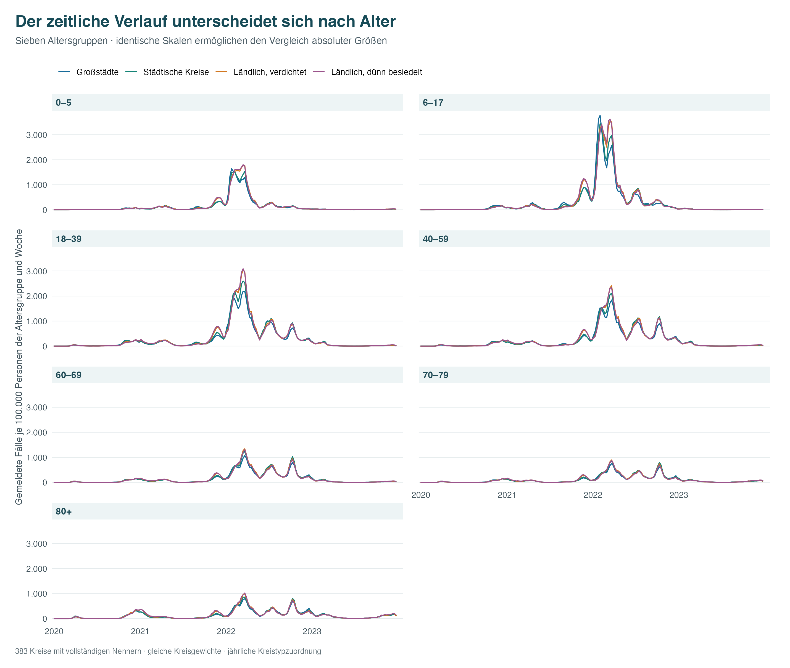
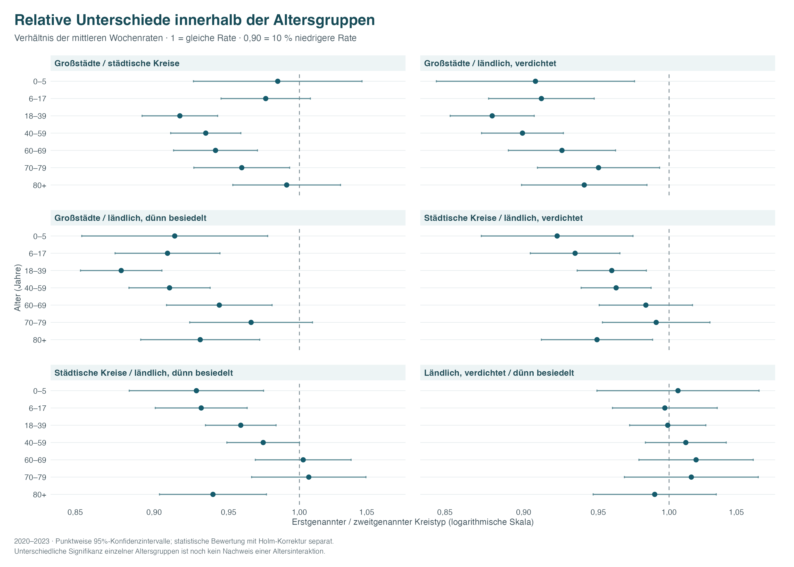
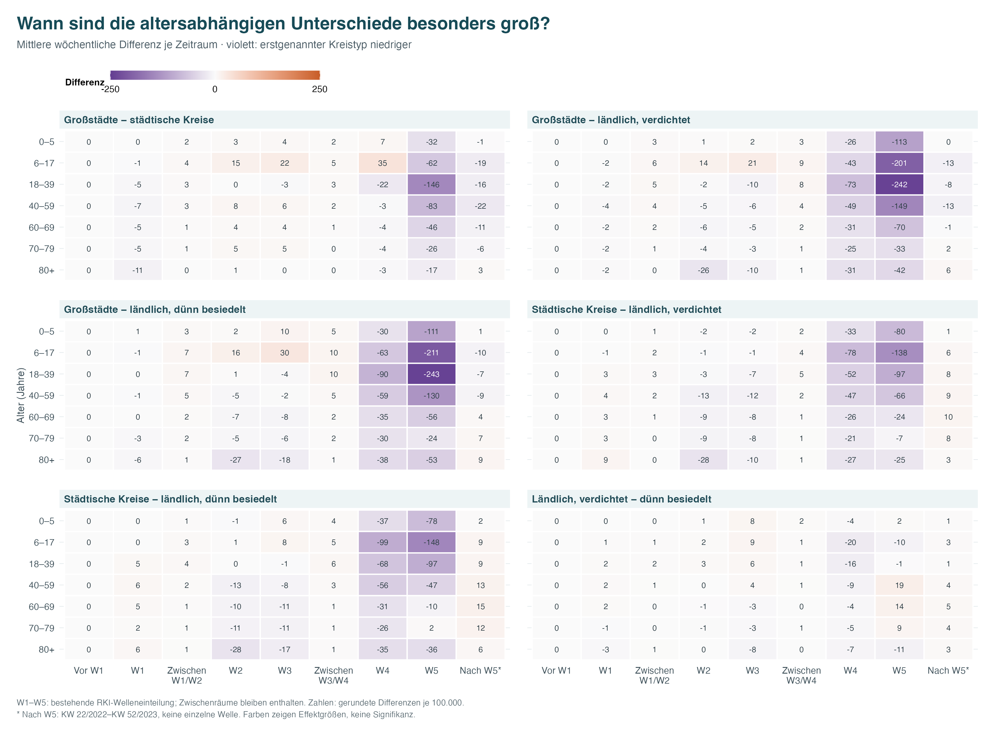
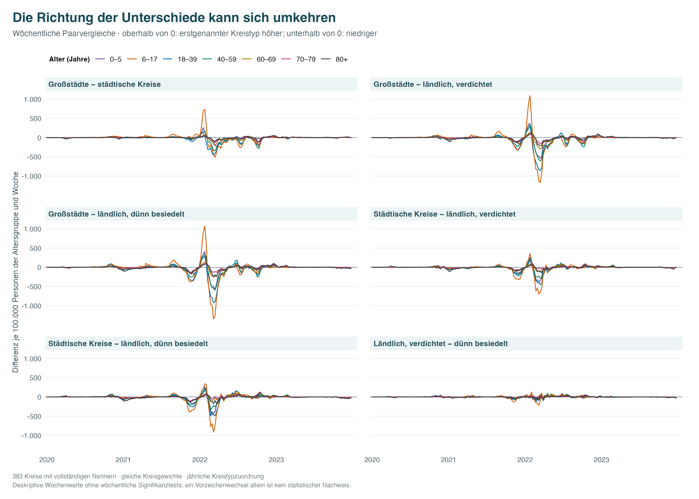

# COVID-19: Kreistyp, Alter und Zeit

**Stand: 23.11.2026 · jährliche Kreistypzuordnung · 383 Kreise · 209 Wochen**

> **Kernaussage:** Ähnliche Kurven schließen relevante Unterschiede nicht aus. Entscheidend sind Altersgruppe, Zeitpunkt und die Frage, ob wir absolute Abstände oder relative Verhältnisse vergleichen.

## 1 🎯 Was untersuchen wir?

| Frage | Zweck | Abbildungen |
|---|---|---|
| Unterscheiden sich die vier Kreistypen insgesamt, auch nach Altersstandardisierung? | Alterszusammensetzung von Unterschieden innerhalb der Altersgruppen trennen. | 1, 3, 4 |
| Ist der Unterschied zwischen zwei Kreistypen je nach Alter unterschiedlich groß oder unterschiedlich gerichtet? | Altersinteraktion direkt prüfen. | 2, 5 |
| Verändert sich dieser Unterschied im Zeitverlauf? | Gesamtdurchschnitt und zeitlich begrenzte Unterschiede auseinanderhalten. | 6, 7 |

**Alle sechs Typenpaare** werden absolut und relativ verglichen. Die Gesamtanalyse kommt zuerst, anschließend die zeitliche Einordnung.

### Zwei verschiedene Fragen zum Alter

- **Alterszusammensetzung:** Wie viel Prozent der Bevölkerung gehören zu welcher Altersgruppe? Die Altersstandardisierung rechnet alle Kreise mit denselben Altersanteilen neu.
- **Altersinteraktion:** Ist beispielsweise der Unterschied Großstadt–ländlich bei 6–17-Jährigen anders als bei 70–79-Jährigen? Dafür vergleichen wir die Unterschiede direkt miteinander.

Die Standardbevölkerung von **2021 bleibt eine gemeinsame Rechengrundlage**. Das bedeutet nicht, dass die Kreistypen auf 2021 oder 2023 festgelegt werden: **Die Zuordnung folgt für jede Woche dem jeweiligen ISO-Jahr.**

## 2 📈 Die sieben Abbildungen

### 2.1 Gesamtverlauf: Was verändert die Altersstandardisierung?

**Lesen:** Die beiden Felder vergleichen rohe und standardisierte Raten. Die vier Linien stehen für die Kreistypen. Einheit: gemeldete Fälle je 100.000 Personen pro Woche.

| Kreistyp | Roh | Altersstandardisiert |
|---|---:|---:|
| Kreisfreie Großstädte | 215,24 | 211,65 |
| Städtische Kreise | 223,52 | 225,12 |
| Ländliche Kreise mit Verdichtungsansätzen | 231,03 | 234,91 |
| Dünn besiedelte ländliche Kreise | 228,01 | 233,71 |

Die Tabelle zeigt den **Durchschnitt der 209 Wochen**, keine Jahresinzidenz. Bei Großstädten gegenüber dünn besiedelten ländlichen Kreisen wächst der Abstand nach Standardisierung von **−12,77 auf −22,07**.

**Bedeutung:** In diesem Vergleich verdeckt die unterschiedliche Alterszusammensetzung einen Teil des Abstands. Sie erklärt ihn nicht vollständig. Die ähnlichen Wellenverläufe bleiben bestehen; Altersstandardisierung entfernt keine Zeitunterschiede und keine sonstigen Einflussfaktoren.

### 2.2 Altersgruppen: Ähnliche Wellen, andere Spitzen

**Lesen:** Innerhalb jedes Altersfeldes werden dieselben vier Kreistypen verglichen. Erst dadurch ist erkennbar, welche Altersgruppen zu den Gesamtunterschieden beitragen.

Bei den **6–17-Jährigen** liegt das Maximum der Großstadtlinie in der Woche ab **31.01.2022 bei 3.772,0**. In dünn besiedelten ländlichen Kreisen liegt es in der Woche ab **14.03.2022 bei 3.624,3**.

**Bedeutung:** Nicht nur die Höhe, auch der Zeitpunkt der beobachteten Spitze unterscheidet sich. Die sechs Wochen Abstand beschreiben diese beiden Kurvenmaxima; daraus folgt noch kein allgemeiner Ausbreitungsverzug oder eine Ursache. Für eine Altersinteraktion brauchen wir zusätzlich einen direkten statistischen Vergleich.

### 2.3 Alterszusammensetzung: Wer lebt in den Kreisen?

**Lesen:** Jeder Balken ergibt 100 %. Gezeigt wird der mittlere Altersanteil eines Kreises, nicht die zusammengelegte Bevölkerung eines Kreistyps.

| Beispiel 2021 | Großstädte | Dünn besiedelte ländliche Kreise |
|---|---:|---:|
| 18–39 Jahre | 30,72 % | 22,99 % |
| 70 Jahre und älter | 15,15 % | 17,67 % |

**Bedeutung:** Die Bevölkerungsstruktur unterscheidet sich. Deshalb ist der rohe Gesamtvergleich allein unzureichend. Die Grafik zeigt aber noch nicht, ob gleichaltrige Menschen unterschiedliche Meldeinzidenzen aufweisen. Dafür dienen Abbildungen 2 und 5.

### 2.4 Gesamtunterschiede: Welche Paare unterscheiden sich?

**Lesen:** Der zuerst genannte Typ minus der zweite. **Negativ = erster Typ niedriger**, positiv = erster Typ höher. Die Striche sind punktweise 95%-Konfidenzintervalle.

| Paar, jeweils erster Typ gegenüber zweitem | Standardisierte Differenz | Ratenverhältnis | Holm-p, absolut / relativ |
|---|---:|---:|---:|
| Großstädte – städtische Kreise | −13,47 | 0,940 | 0,00024 / 0,00029 |
| Großstädte – ländliche Kreise mit Verdichtungsansätzen | −23,27 | 0,901 | <0,001 / <0,001 |
| Großstädte – dünn besiedelte ländliche Kreise | −22,07 | 0,906 | <0,001 / <0,001 |
| Städtische – ländliche Kreise mit Verdichtungsansätzen | −9,79 | 0,958 | 0,102 / 0,096 |
| Städtische – dünn besiedelte ländliche Kreise | −8,59 | 0,963 | 0,336 / 0,326 |
| Ländliche Kreise mit Verdichtungsansätzen – dünn besiedelte ländliche Kreise | +1,20 | 1,005 | 1,000 / 1,000 |

Großstädte liegen gegenüber dünn besiedelten ländlichen Kreisen im Mittel **22,07 Fälle je 100.000 und Woche niedriger**, entsprechend **9,44 % niedriger**. Das punktweise 95%-Intervall der Differenz reicht von **−28,76 bis −15,38**.

**Bedeutung:** Die Unterschiede betreffen besonders die Großstadtvergleiche. Für die übrigen drei Paare reicht die Evidenz nach der gewählten Mehrfachkorrektur nicht aus; das beweist keine Gleichheit. Diese Ergebnisse sind Vergleiche innerhalb derselben Wochen, über die Zeit gemittelt, keine kausal bereinigten Effekte.

### 2.5 Altersinteraktion: Hängt der Abstand vom Alter ab?

**Lesen:** Verhältnis = erster Typ geteilt durch zweiten. **1 = gleich, unter 1 = erster Typ niedriger.** Die Grafik zeigt relative Unterschiede; die folgenden Zahlen ergänzen die absolute Sicht.

| Großstädte gegenüber dünn besiedelten ländlichen Kreisen | Absolute Differenz | Ratenverhältnis |
|---|---:|---:|
| 6–17 Jahre | −27,77 | 0,909 |
| 70–79 Jahre | −3,86 | 0,966 |

**Direkter Interaktionstest:** −27,77 − (−3,86) = **−23,91**. Auf der absoluten Skala ist der Abstand bei 6–17-Jährigen stärker ausgeprägt; Holm-p = **0,000016**. Das Verhältnis der beiden Ratenverhältnisse beträgt **0,941**; auf dieser relativen Skala reicht die Evidenz nach Holm-Korrektur nicht aus (**p = 0,130**).

**Bedeutung:** „Die Altersinteraktion ist signifikant“ wäre zu ungenau. Hier gibt es für diesen Altersvergleich Evidenz auf der absoluten, aber nicht auf der relativen Skala nach Korrektur. Einzelne signifikante Altersgruppen und andere nicht signifikante Altersgruppen wären für sich genommen kein Interaktionsnachweis.

### 2.6 Zeiträume: Wann sind die Unterschiede groß?

**Lesen:** Jede Zelle zeigt eine mittlere wöchentliche Differenz. Violett bedeutet: der zuerst genannte Typ liegt niedriger. Die Farbe zeigt die Größe des Unterschieds, **keine Signifikanz**.

Für Großstädte gegenüber dünn besiedelten ländlichen Kreisen beträgt die standardisierte Differenz in **W4 −58,47**, in **W5 −142,69**. Relativ sind es jedoch **0,746** beziehungsweise **0,873**: W5 hat den größeren absoluten Abstand, W4 den größeren prozentualen Abstand.

In W5 beträgt der altersbezogene Abstand bei **6–17-Jährigen rund −211**, bei **70–79-Jährigen rund −24**. Das erklärt, warum die Altersfrage gerade in bestimmten Zeiträumen wichtig wird.

**Bedeutung:** Die Aussage „2022 waren die Unterschiede größer“ muss die Skala nennen. Ein direkter Vergleich der Altersinteraktion 6–17 versus 70–79 zwischen W4 und W5 ergibt auf der relativen Skala ein Verhältnis von **1,321** (Holm-p < 0,001), auf der absoluten Skala **+153,20** (Holm-p = 1,000). Auch diese Dreifachfrage ist skalenabhängig.

W1–W5 folgen der vorhandenen [RKI-Phaseneinteilung](https://edoc.rki.de/bitstream/handle/176904/10260/EB-38-2022-Phaseneinteilung.pdf?sequence=1). Zwischenphasen bleiben enthalten. **„Nach W5“ umfasst KW 22/2022 bis KW 52/2023 und ist keine einzelne Welle.** Diese lange Phase sollte noch feiner betrachtet werden.

### 2.7 Wochenunterschiede: Warum kann ein Gesamtmittel täuschen?

**Lesen:** Die Nulllinie trennt höhere von niedrigeren Werten des ersten Typs. Ein Wechsel über diese Linie bedeutet einen Richtungswechsel des beobachteten Unterschieds.

| 6–17 Jahre: Großstädte minus dünn besiedelte ländliche Kreise | Differenz je 100.000 |
|---|---:|
| Woche ab 24.01.2022 | +1.076,72 |
| Woche ab 07.03.2022 | −1.344,78 |
| Mittel über alle 209 Wochen | −27,77 |

**Bedeutung:** Positive und negative Wochenunterschiede heben sich teilweise auf. Ein kleines Gesamtmittel kann deshalb neben sehr großen zeitweisen Unterschieden bestehen. Die Grafik liefert eine deskriptive Zeitdiagnose; einzelne Wochen wurden hier nicht mit simultanen Konfidenzbändern getestet.

## 3 🔎 Wie wurden die Ergebnisse berechnet?

| Entscheidung | Umsetzung |
|---|---|
| Daten | 400 Kreise × 209 Wochen × 7 Altersgruppen; 2020–2023 nach ISO-Jahr. |
| Hauptstichprobe | 383 Kreise mit durchgehend gültigen Altersraten. 17 Kreise mit mindestens einem fehlenden Nenner ausgeschlossen; fehlend wird nicht als null behandelt. |
| Jährliche Kreistypen | Vorhandenes `kreistyp_code` des jeweiligen ISO-Jahres. Vier Kreise wechseln im Ausgangsdatensatz mindestens einmal den Typ. |
| Gewichtung | Innerhalb jeder Woche zählt jeder Kreis gleich; anschließend zählt jede Woche gleich. Keine Bevölkerungsgewichtung der Kreistypmittel. |
| Standardisierung | In jedem Kreis dieselben Altersanteile der Referenzbevölkerung 2021, danach Mittel der Kreisraten. |
| Unsicherheit | 1.999 gemeinsame Kreis-Bootstrap-Ziehungen. Ein gezogener Kreis behält alle Wochen, Altersgruppen und jährlichen Typwechsel. Normalapproximierte 95%-Intervalle; Verhältnisse auf Log-Skala. |
| Mehrfachtests | Holm-Korrektur je definierter Testfamilie. Die gezeichneten Intervalle sind punktweise, nicht Holm-adjustiert. |

**Kreise je Jahr:** Großstädte 67, städtische Kreise 129. Die beiden ländlichen Gruppen umfassen 2021 **90 und 97**, in den übrigen Jahren **91 und 96** Kreise.

Die Altersnenner wurden im bestehenden Datenprozess aus RKI-Angaben rekonstruiert. Sie sind keine unabhängig verifizierte amtliche Altersbevölkerung. Die jährliche Zuordnung verändert auch die Zusammensetzung einer Typengruppe. Ein zeitlicher Unterschied kann daher teilweise aus Gruppenwechseln entstehen; die feste 2023-Zuordnung wird nur noch als Sensitivitätsvergleich gespeichert.

**Grenzen:** Diese Analyse beschreibt Meldeinzidenzen und Zusammenhänge. Sie beweist keine Wirkung des Wohnorts. Der Kreis-Bootstrap berücksichtigt wiederholte Messungen innerhalb eines Kreises, aber keine räumliche Abhängigkeit zwischen Kreisen. Die Inferenz ist explorativ und auf ein hypothetisches Ensemble vergleichbarer Kreise bezogen; die 383 beobachteten Kreise sind keine Zufallsstichprobe aus Deutschland. Veränderungen der Erfassung lassen sich aus den Kurven allein nicht quantifizieren.

## 4 ➡️ Welche Ergänzungen bringen am meisten?

| Priorität | Neue Abbildung / Analyse | Konkreter Nutzen |
|---|---|---|
| 1 | Wochenverlauf der absoluten **und** relativen Unterschiede in getrennten Feldern | Prüfen, ob große Abstände vor allem mit hohem Inzidenzniveau zusammenfallen. Bei Nullraten keine künstlichen Verhältnisse bilden. |
| 2 | Verteilung der einzelnen Kreiswerte je Typ in ausgewählten Zeiträumen | Zeigen, ob ein Gruppenmittel viele Kreise beschreibt oder von wenigen hohen Werten geprägt wird. |
| 3 | Interaktionsgrafik mit direkten Kontrasten und Intervallen | Die eigentliche Frage „Unterscheiden sich die Altersabstände?“ sichtbar machen; absolute und relative Skala trennen. |
| 4 | „Nach W5“ als Monatsübersicht, bei weiterhin wöchentlicher Datenbasis | Spätere Unterschiede und Richtungswechsel sichtbar halten. Grenzen vor den Tests festlegen. |

Als methodische Vertiefung bietet sich anschließend ein Modell mit Kreiseffekten, flexibler Wochenentwicklung und Kreistyp–Alter–Zeit-Termen an. Vor einer Modellauswahl müssen Zielgröße, räumliche Abhängigkeit, Überdispersion und die rekonstruierten Bevölkerungsnenner geprüft werden. Die bisherigen Tabellen sind eine nachvollziehbare Ausgangsanalyse, kein Ersatz dafür.

## 5 🛠️ Passende Skills

`find-skills` wurde zur Suche verwendet. Zwei geprüfte Kandidaten:

| Skill | Einsatz im Projekt | Einordnung |
|---|---|---|
| [scientific-visualization](https://skills.sh/k-dense-ai/scientific-agent-skills/scientific-visualization) | Mehrteilige Grafiken, lesbare Skalen, Unsicherheitsdarstellung und Exportprüfung. | K-Dense; ca. 2.700 Installationen. Beispiele überwiegend Python; Gestaltungsprinzipien lassen sich auf ggplot2 übertragen. |
| [doc-coauthoring](https://skills.sh/anthropics/skills/doc-coauthoring) | Bericht Abschnitt für Abschnitt überarbeiten und Verständlichkeit für neue Leser prüfen. | Anthropic; ca. 105.300 Installationen. Kein Ersatz für statistische Prüfung. |

Suchstand: 23.11.2026; Zahlen ändern sich. Die beiden Kandidaten wurden geprüft, **nicht neu installiert**. Die bereits vorhandene `grilling`-Skill eignet sich weiterhin dazu, die nächste Forschungsentscheidung in höchstens zwei Fragen pro Runde zu klären.

Beispielaufträge nach Installation: „Prüfe mit scientific-visualization Abbildung 5 auf lesbare Skalen und klare Unsicherheitsangaben; R und deutsche Beschriftungen beibehalten.“ Oder: „Überarbeite mit doc-coauthoring die Interpretation jeder Abbildung: Frage, Datenbeispiel, Aussage, Grenze.“
