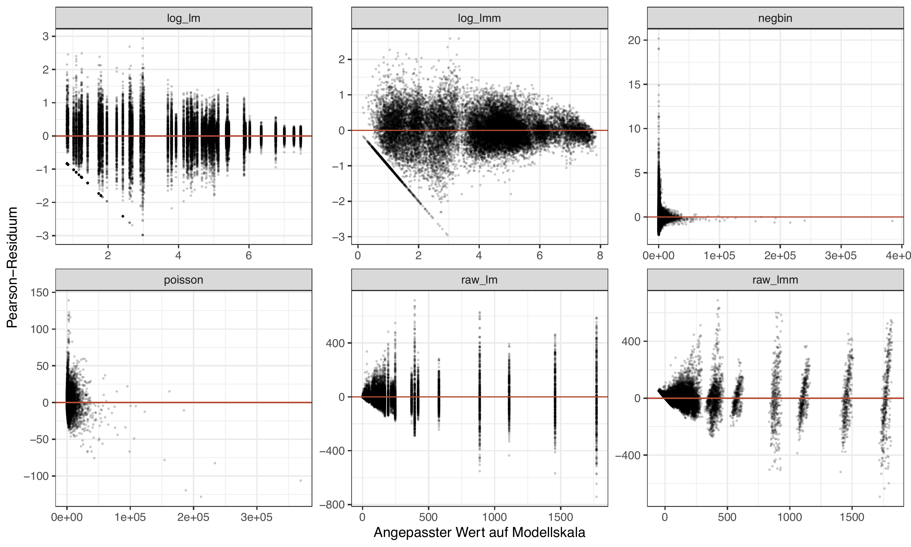
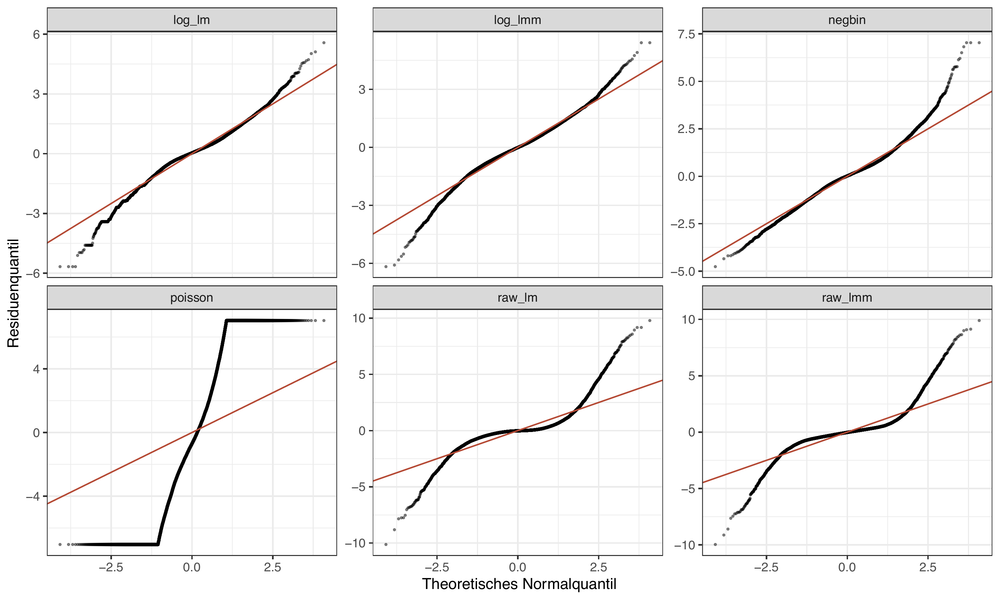
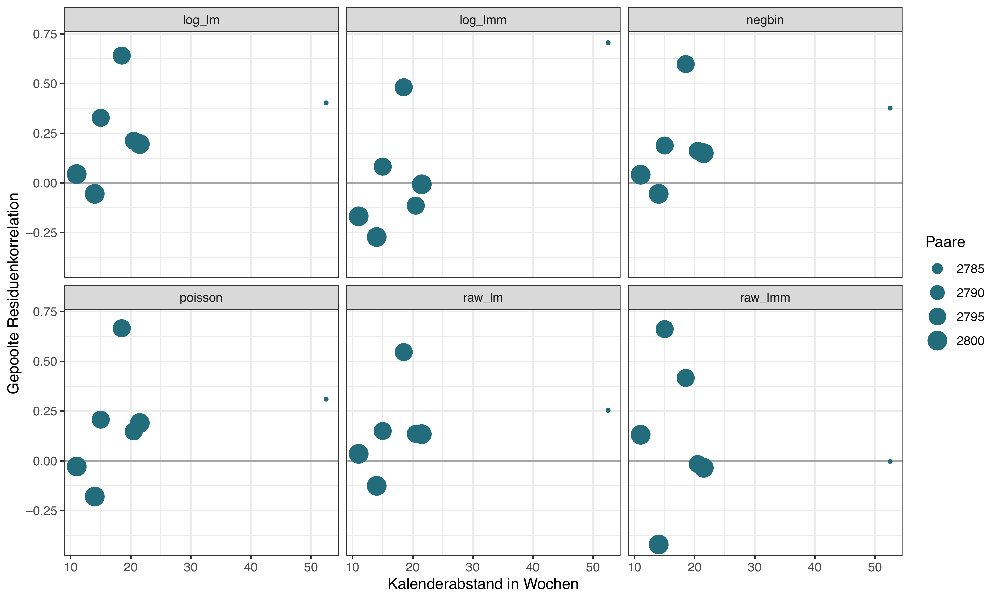
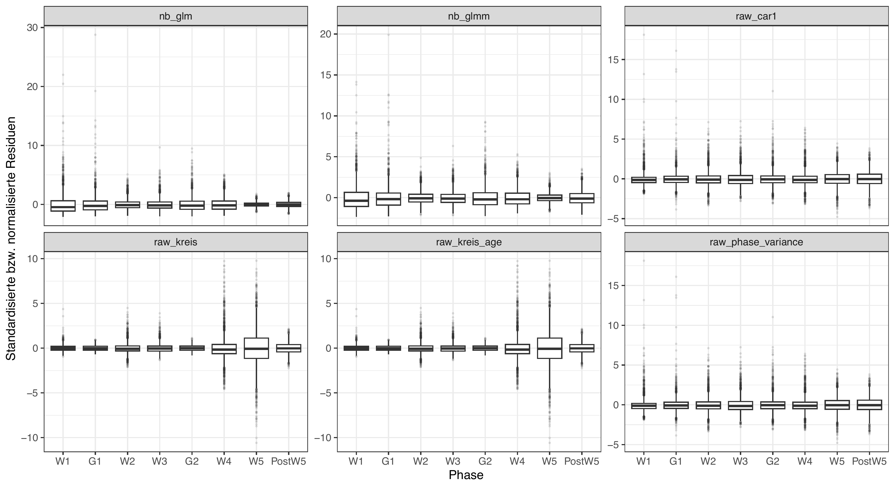
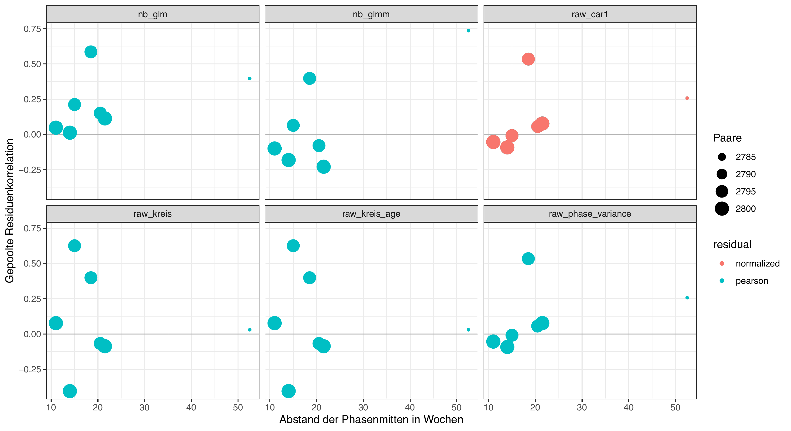
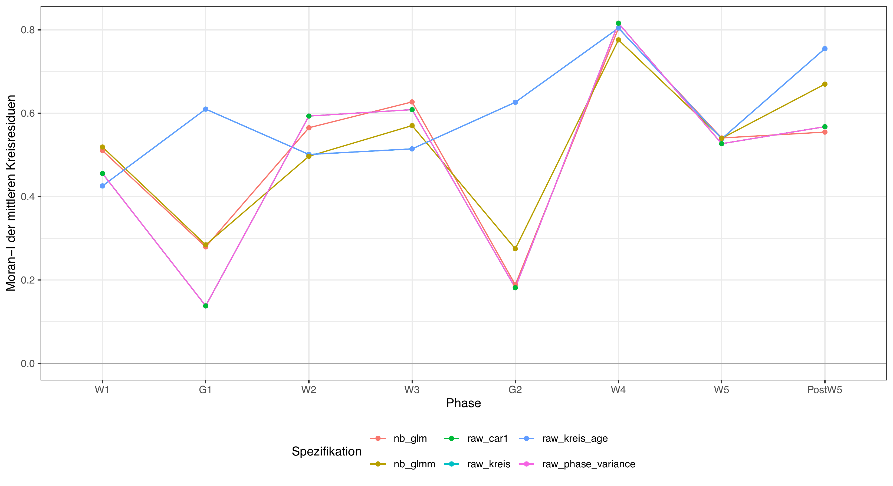
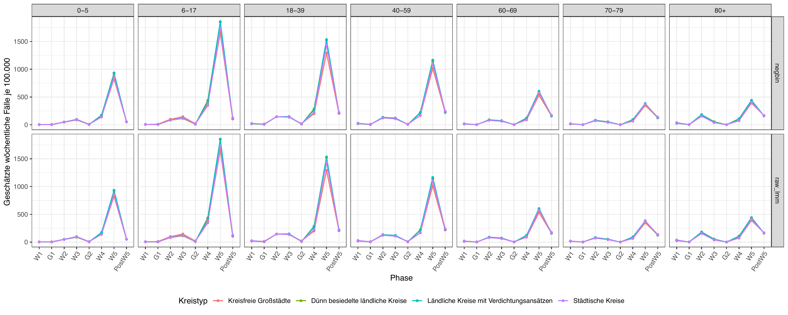
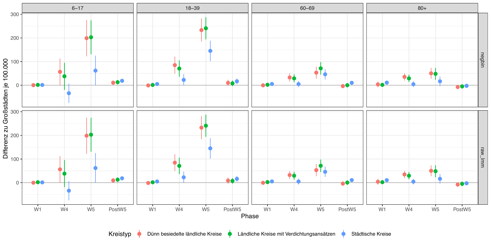
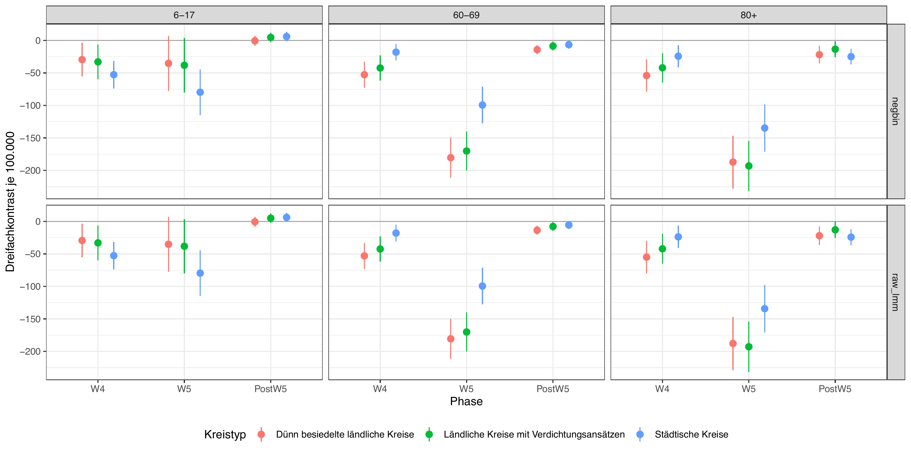
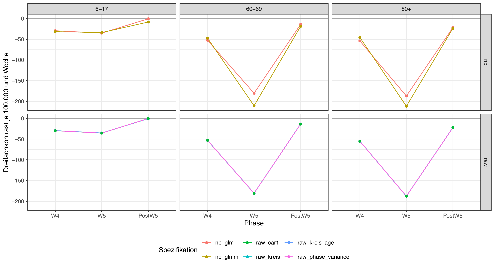

# Modellierung und erste Ergebnisse

## Kurzfassung

Ziel der Analyse ist die Untersuchung von Unterschieden in der gemeldeten COVID-19-Inzidenz zwischen Kreistypen. Im Mittelpunkt steht die Frage, ob diese Unterschiede je nach Altersgruppe und Pandemiephase variieren.

Die ersten Ergebnisse sprechen für das Negativ-Binomialmodell gegenüber Poisson, da die beobachteten Fallzahlen deutlich stärker streuen als unter einer Poisson-Verteilung erwartet. Bei den linearen gemischten Modellen (LMM) verbessert eine phasenspezifische Residualvarianz die Modellanpassung erheblich. Ausgewählte Unterschiede zwischen Kreistypen zeigen über mehrere Modellvarianten hinweg ähnliche Richtungen. Zeitliche und räumliche Abhängigkeiten sind allerdings noch nicht ausreichend berücksichtigt. **Die Ergebnisse sind deshalb vorläufig.**

## 1. Ziel und Datengrundlage

| Merkmal | Einstellung |
|---|---|
| Zeitraum | 2020–2023 |
| Kreise | 400 |
| Altersgruppen | 0–5, 6–17, 18–39, 40–59, 60–69, 70–79, 80+ |
| Pandemiephasen | W1, G1, W2, W3, G2, W4, W5, PostW5 (ohne P0) |
| Kreistyp | Dynamisch: häufigster Typ innerhalb der Phase |
| Beobachtungseinheit | Kreis × Altersgruppe × Phase |
| Modellstichprobe | 22.370 von 22.400 möglichen Beobachtungen |

Für jede Kombination aus Kreis, Altersgruppe und Phase liegt eine zusammengefasste Beobachtung vor. Dadurch lassen sich regionale Unterschiede innerhalb derselben Altersgruppe und Phase vergleichen. Alle zunächst verglichenen Modelle verwenden dieselbe Stichprobe ohne zusätzliche Gewichte. Wegen unvollständiger Bevölkerungsnenner entfallen 30 Beobachtungen. Beobachtungen mit tatsächlich null Fällen bleiben erhalten. Die Anfangsphase P0 wird nicht einbezogen; PostW5 bleibt als eine Phase zusammengefasst.

**Fazit:** Die gemeinsame Stichprobe macht die Modellvergleiche nachvollziehbarer. Unterschiede in den Ergebnissen entstehen nicht dadurch, dass einzelne Modelle andere Beobachtungen verwenden.

## 2. Welche Modellfamilien werden verglichen?

Zunächst werden sechs Modelle mit denselben erklärenden Variablen verglichen: Altersgruppe, Pandemiephase und deren Interaktion (`M0b`). Die Modelle unterscheiden sich in ihrer Zielgröße und den Annahmen über die Daten.

| Modell | Zielgröße | Verteilung / Link | Kreiszufallseffekt |
|---|---|---|---|
| `raw_lm` | Mittlere Wocheninzidenz | Normal / Identität | Nein |
| `raw_lmm` | Mittlere Wocheninzidenz | Normal / Identität | Ja |
| `log_lm` | log(1 + mittlere Wocheninzidenz) | Normal / Identität | Nein |
| `log_lmm` | log(1 + mittlere Wocheninzidenz) | Normal / Identität | Ja |
| `poisson` | Fallzahl pro Phase | Poisson / Log | Nein |
| `negbin` | Fallzahl pro Phase | Negativ-Binomial / Log | Nein |

**LM oder LMM:** Da jeder Kreis in mehreren Altersgruppen und Phasen vorkommt, können Beobachtungen desselben Kreises ähnlich sein. Ein LMM berücksichtigt unterschiedliche Ausgangsniveaus der Kreise durch einen zufälligen Intercept (`Random Intercept`).

**Originalskala oder Log-Skala:** Bei hohen Inzidenzen kann die Streuung größer sein als bei niedrigen. Eine Log-Transformation kann diesen Unterschied verringern. Die transformierten Schätzungen sind jedoch weniger direkt als absolute Inzidenzdifferenzen zu interpretieren.

**Poisson oder Negativ-Binomial:** Beide Modelle erklären Fallzahlen. Die Poisson-Verteilung setzt bei gegebenen Modellprädiktoren eine Varianz in Höhe des Mittelwerts voraus. Das Negativ-Binomialmodell lässt zusätzliche Streuung zu (`Überdispersion`).

Bei LM und LMM wird die arithmetische mittlere Wocheninzidenz modelliert. Die Zählmodelle verwenden die Fälle pro Phase und berücksichtigen die Summe der wöchentlichen Bevölkerungszahlen als `Offset` (Personenwochen). Ihre geschätzten Raten werden als Fälle je 100.000 Personenwochen dargestellt. Trotz gleicher Einheit müssen die beiden Zielgrößen bei wechselnden Bevölkerungsnennern nicht identisch sein.

**Fazit:** Die Modellfamilien beantworten verwandte Fragen, beruhen aber auf unterschiedlichen Verteilungsannahmen. Deshalb erfolgt die Bewertung anhand geeigneter Vergleiche innerhalb der jeweiligen Zielgröße und anhand von Modelldiagnostik.

## 3. Welche erklärenden Variablen werden berücksichtigt?

Die Modellhierarchie `M0a` bis `M3` beschreibt, welche Zusammenhänge untersucht werden. Sie ist von der Wahl der Modellfamilie getrennt.

| Modell | Fixed Effects (R-Syntax) | Inhaltliche Frage |
|---|---|---|
| M0a | `age_group + period` | Bestehen Alters- und Phasenunterschiede? |
| M0b | `age_group * period` | Unterscheiden sich die Phasenmuster zwischen Altersgruppen? |
| M1 | `age_group * period + kreistyp` | Bestehen darüber hinaus Unterschiede zwischen Kreistypen? |
| M2a | `age_group * period + kreistyp * period` | Ändern sich Kreistypunterschiede zwischen den Phasen? |
| M2b | `(age_group + period + kreistyp)^2` | Hängen Kreistypunterschiede zusätzlich vom Alter ab? |
| M3 | `age_group * period * kreistyp` | Variiert der Zusammenhang zwischen Kreistyp und Phase je nach Altersgruppe? |

Das Zeichen `*` schließt Haupteffekte und Interaktionen ein. Eine Interaktion bedeutet, dass der Zusammenhang einer Variablen von einer anderen abhängen kann. Beispielsweise erlaubt `kreistyp * period`, dass der Unterschied zwischen ländlichen Kreisen und Großstädten in W1 anders ausfällt als in W5. Die Dreifachinteraktion in M3 erlaubt zusätzlich altersabhängige Veränderungen dieses Unterschieds.

Als Referenzen dienen die Altersgruppe 18–39, die Phase W1 und kreisfreie Großstädte. Beim LMM wird ein Kreisintercept ergänzt; die Zählmodelle enthalten einen Expositions-Offset. Gauß-Modellvergleiche werden mit Maximum Likelihood (ML) durchgeführt.

**Fazit:** M3 bildet die vollständige inhaltliche Fragestellung ab. Ob die zusätzliche Komplexität statistisch gerechtfertigt ist, muss jedoch gesondert geprüft werden.

## 4. Erste Modellwahl

### 4.1 Modellgüte und Residuen unter M0b

| Modell | AIC | BIC |
|---|---:|---:|
| raw_lm | 255663,9 | 256120,7 |
| raw_lmm | 254148,4 | 254613,3 |
| log_lm | 34787,9 | 35244,8 |
| log_lmm | 31591,7 | 32056,6 |
| poisson | 2400677,4 | 2401126,2 |
| negbin | 266270,4 | 266727,2 |

AIC und BIC bewerten den Kompromiss zwischen Modellanpassung und Komplexität: Kleinere Werte sind günstiger. Die Zahlen dürfen hier **nicht pauschal über unterschiedliche Zielgrößen hinweg** verglichen werden. Innerhalb der jeweiligen Gauß-Zielgröße verbessert der Kreiszufallseffekt den Fit. Bei den Fallzahlmodellen fällt der Fit des Negativ-Binomialmodells deutlich günstiger aus als der von Poisson.

**Abb. 1 – Wie ist die Grafik zu lesen?** Die horizontalen Werte sind vorhergesagte Inzidenzen, die vertikalen Werte die Abweichungen zwischen Beobachtung und Vorhersage (`Residuen`). Eine gleichmäßige Streuung um null wäre für ein einfaches Gauß-Modell günstiger. Beim Raw-LMM ist die Streuung bei hohen vorhergesagten Inzidenzen deutlich größer. Die Residuen-RMS im oberen Fünftel ist 7,04-mal so hoch wie im unteren. Beim Log-LMM beträgt dieses Verhältnis 0,48. Die Transformation verändert die Streuung stark, beseitigt die Ungleichmäßigkeit aber nicht vollständig.

| Zählmodell | Pearson-Quotient (ungefähr 1 günstig) | Erwarteter Nullanteil |
|---|---:|---:|
| Poisson | 108,77 | 0,98 % |
| Negativ-Binomial | 1,26 | 1,54 % |

Der Pearson-Quotient zeigt, ob die Streuung der Fallzahlen mit der Modellannahme vereinbar ist. Der sehr hohe Poisson-Wert deutet auf starke Überdispersion hin. Negativ-Binomial liegt wesentlich näher an 1. Der beobachtete Nullanteil beträgt 2,56 %; beide Modelle unterschätzen ihn, Negativ-Binomial allerdings weniger. Gemeint sind Nullfälle über eine gesamte Phase, nicht einzelne Nullfallwochen.

**Abb. 2 – Wie ist die Grafik zu lesen?** Die QQ-Diagramme vergleichen die beobachteten Residuen mit einer theoretisch erwarteten Verteilung. Punkte nahe der Referenzlinie sprechen für eine bessere Übereinstimmung. Besonders Poisson und die Raw-Modelle weichen sichtbar ab. Auch die anderen Varianten zeigen Abweichungen an den Rändern. Für Zählmodelle werden randomisierte Quantilresiduen verwendet.

**Abb. 3 – Wie ist die Grafik zu lesen?** Die Darstellung zeigt, ob nicht erklärte Abweichungen derselben Kombination aus Kreis und Altersgruppe über verschiedene Phasen zusammenhängen. Die maximale absolute Residuenkorrelation beträgt 0,66 für Raw-LMM und 0,60 für Negativ-Binomial. Das deutet auf verbleibende zeitliche Abhängigkeit hin, die in diesen Modellen nicht ausreichend abgebildet wird.

**Fazit:** Negativ-Binomial beschreibt die Fallzahlstreuung wesentlich besser als Poisson. Für direkt interpretierbare absolute Inzidenzunterschiede bleibt das Raw-LMM interessant, benötigt jedoch eine bessere Varianzstruktur. Die Log-Modelle bleiben für diagnostische Vergleiche relevant; `expm1()` allein ergibt keine erwartete arithmetische Inzidenz.

### 4.2 Vergleich der Fixed-Effects-Modelle M0a bis M3

| Modellfamilie | Niedrigster AIC | Niedrigster BIC |
|---|---|---|
| Raw-LMM | M3 | M2a |
| Negativ-Binomial | M2b | M2a |

Zwischen M0a und M3 sinkt der AIC beim Raw-LMM um 42.612,8 und bei Negativ-Binomial um 12.369,8. Allerdings wählen AIC und BIC nicht dieselbe Modellstruktur. AIC begünstigt häufiger komplexere Modelle, während BIC zusätzliche Parameter stärker bestraft. M3 wird für die inhaltliche Untersuchung explorativ weiterverwendet, weil es die Interaktion zwischen Alter, Phase und Kreistyp vollständig zulässt. Die verbleibenden maximalen absoluten Residuenkorrelationen betragen dort 0,63 beziehungsweise 0,59.

**Fazit:** Die zusätzlichen Zusammenhänge können den Fit verbessern, aber M3 ist nicht eindeutig das statistisch beste Modell. Seine Weiterverwendung dient zunächst der vollständigen explorativen Untersuchung der Forschungsfrage.

## 5. Verbesserung der Varianz- und Abhängigkeitsstruktur

Die erste Modellrunde zeigt zwei Probleme: Die Residuen streuen nicht in allen Phasen gleich stark, und Beobachtungen sind zum Teil abhängig. Für die nächsten Vergleiche bleiben die Stichprobe und die Fixed Effects von M3 gleich. Verändert wird nur die Struktur der zufälligen Effekte beziehungsweise der Residuen.

| Modell | Änderung |
|---|---|
| `raw_kreis` | Ausgangs-LMM mit Kreisintercept |
| `raw_kreis_age` | Zusätzlicher Intercept je Kreis und Altersgruppe |
| `raw_phase_variance` | Unterschiedliche Residualvarianz je Phase |
| `raw_car1` | Zusätzlich zeitliche CAR(1)-Korrelation |
| `nb_glm` | Ausgangs-Negativ-Binomialmodell ohne Zufallseffekte |
| `nb_glmm` | Negativ-Binomialmodell mit Kreis- und Kreis-Altersgruppen-Intercepts |

| Kandidat | Vergleichsmodell | ΔAIC | ΔBIC | Status |
|---|---|---:|---:|---|
| raw_kreis_age | raw_kreis | +2,0 | +10,0 | singulär |
| raw_phase_variance | raw_kreis | −39967,2 | −39911,1 | geschätzt |
| raw_car1 | raw_phase_variance | +2,0 | +10,0 | geschätzt |
| nb_glmm | nb_glm | −3765,3 | −3749,3 | singulär |

Negative Differenzen bedeuten einen günstigeren AIC beziehungsweise BIC für den Kandidaten **gegenüber dem jeweils genannten Vergleichsmodell**. Die Werte sind daher keine gemeinsame Rangliste aller Modelle. Ein singulärer Fit bedeutet hier, dass mindestens eine zusätzliche Zufallsvarianz praktisch null geschätzt wurde. Für NB-GLMM wird die marginale Likelihood mit einer Laplace-Approximation bestimmt. Diese Vergleiche sind deskriptiv und keine regulären Likelihood-Ratio-Tests.

**Abb. 4 – Wie ist die Grafik zu lesen?** Die Grafik vergleicht die Residuenstreuung über die Phasen. Im Ausgangsmodell fällt besonders W5 durch große Abweichungen auf. Das Modell `raw_phase_variance` erlaubt für jede Phase eine eigene Residualvarianz; dadurch wird die standardisierte Streuung besser vergleichbar. Die geschätzten Residualstandardabweichungen reichen von 3,20 in G1 bis 151,18 in W5. Die Teilgrafiken verwenden unterschiedliche y-Achsenskalen, und Ausreißer verschwinden nicht.

Der deutliche Rückgang von AIC und BIC unterstützt eine phasenspezifische Residualvarianz. Ein zusätzlicher Kreis-Altersgruppen-Intercept bringt dem Gauß-Modell dagegen praktisch keine Verbesserung. Das NB-GLMM hat zwar einen günstigeren AIC und BIC als das NB-GLM, ist aber singulär: Die Kreis-Altersgruppen-Standardabweichung liegt nahezu bei null, während die Kreis-Standardabweichung auf der Logratenskala 0,22 beträgt. Aus dem besseren Fit folgt deshalb nicht, dass beide Zufallseffekte gebraucht werden.

**Fazit:** Ein LMM mit phasenspezifischer Residualvarianz ist ein sinnvoller vorläufiger Kandidat. Für die Negativ-Binomialmodelle wäre als nächster Vergleich ein einfacheres GLMM nur mit Kreisintercept sinnvoll; diese Variante wurde bisher nicht geschätzt.

## 6. Zeitliche und räumliche Abhängigkeit

### 6.1 Zeitliche Abhängigkeit

**Abb. 5 – Wie ist die Grafik zu lesen?** Die Punkte stellen den Zusammenhang zwischen Residuen aus zwei Phasen und dem zeitlichen Abstand ihrer Phasenmittelpunkte dar. Eine CAR(1)-Struktur soll stärkere Korrelationen bei kleineren Zeitabständen berücksichtigen. Im vorliegenden Vergleich bleibt die maximale absolute Residuenkorrelation vor und nach CAR(1) bei 0,53. AIC und BIC verbessern sich ebenfalls nicht.

Der geschätzte wöchentliche Korrelationsparameter beträgt ρ = 0,20. Schon beim kleinsten beobachteten Abstand von 11 Wochen entspricht dies einer modellierten Korrelation von nur ungefähr 0,00000002. Acht unterschiedlich lange Phasen liefern somit wenig Information zur Schätzung dieser zeitlichen Struktur.

**Fazit:** Die getestete CAR(1)-Variante löst das beobachtete Problem nicht. Daraus folgt ausdrücklich **nicht**, dass zeitliche Abhängigkeit fehlt; vielmehr ist diese konkrete Modellierung auf Phasenebene wenig hilfreich.

### 6.2 Räumliche Abhängigkeit

**Abb. 6 – Wie ist die Grafik zu lesen?** Moran-I zeigt, ob räumlich benachbarte Kreise ähnliche Modellresiduen aufweisen. Positive Werte deuten auf ähnliche Abweichungen in benachbarten Kreisen hin. Alle 48 untersuchten Kombinationen aus Modell und Phase weisen positive Werte zwischen 0,14 und 0,82 auf; besonders auffällig ist W4. Die Holm-adjustierten Permutations-p-Werte liegen jeweils unter 0,05.

Für die Diagnose wurden Kreisresiduen über Altersgruppen gemittelt und 1.044 polygonbasierte Nachbarschaften zwischen 400 Kreisen verwendet. Das Ergebnis hängt unter anderem von der räumlichen Nachbarschaftsdefinition und den Annahmen des Permutationstests ab. Ein Modell mit räumlicher Kovarianz wurde bislang nicht geschätzt.

**Fazit:** Die Modelle lassen räumliche Muster in den Residuen zurück. Deshalb sind Unsicherheitsangaben und Signifikanztests vorsichtig zu interpretieren: Eine Clusterung nach Kreis berücksichtigt nicht automatisch Abhängigkeit **zwischen** benachbarten Kreisen.

## 7. Ergebnisse zur inhaltlichen Forschungsfrage

### 7.1 Geschätzte Inzidenzen

**Abb. 7 – Wie ist die Grafik zu lesen?** Die Kurven zeigen modellbasierte geschätzte Wocheninzidenzen nach Kreistyp, Altersgruppe und Phase. Beide ursprünglichen M3-Modellfamilien zeigen ähnliche Muster. In W5 sind die geschätzten Inzidenzen besonders hoch, vor allem in den Gruppen 6–17 und 18–39. Da die Kreistypkurven oft nahe beieinanderliegen, sind ihre Abstände schwer allein aus dieser Grafik zu erkennen.

**Fazit:** Die Pandemiephase und Altersgruppe prägen die Höhe der geschätzten Inzidenz deutlich. Für die eigentliche Frage nach Kreistypunterschieden sind direkte Differenzen aussagekräftiger als die Kurven allein.

### 7.2 Unterschiede zwischen Kreistypen

**Abb. 8 – Wie ist die Grafik zu lesen?** Jeder Wert ist die geschätzte Inzidenz eines Kreistyps **minus** die Inzidenz kreisfreier Großstädte innerhalb derselben Altersgruppe und Phase. Die Nulllinie entspricht keinem Unterschied. Positive Werte bedeuten eine höhere, negative Werte eine niedrigere Inzidenz als in Großstädten. Die Balken sind punktweise 95-%-Konfidenzintervalle der ersten Modellrunde.

Besonders in W5 zeigen sich bei 6–17 und 18–39 Jahren größere geschätzte Unterschiede. Nach W5 fallen sie deutlich kleiner aus. Dies beschreibt modellbasierte Zusammenhänge, keine kausalen Effekte des Kreistyps.

**Fazit:** Kreistypunterschiede sind nicht in allen Phasen und Altersgruppen gleich groß. Ein einfacher, über die gesamte Pandemie gemittelter Kreistypeffekt würde diese Unterschiede nur unvollständig beschreiben.

### 7.3 Ändern sich die Unterschiede je nach Alter und Phase?

Ein `Dreifachkontrast` prüft nicht nur den Abstand eines Kreistyps zu Großstädten, sondern vergleicht dessen **Veränderung seit W1** zwischen zwei Altersgruppen. Die Altersgruppe 18–39 dient als Referenz. Mit \(D_{a,p}\) als geschätztem Kreistypabstand für Altersgruppe \(a\) und Phase \(p\) lautet der Kontrast:

$$
(D_{a,p}-D_{a,W1})-(D_{18\text{–}39,p}-D_{18\text{–}39,W1}).
$$

Ein negativer Wert bedeutet, dass der Kreistypabstand in der betrachteten Altersgruppe seit W1 weniger zugenommen oder stärker abgenommen hat als bei 18–39-Jährigen. Er bedeutet **nicht automatisch**, dass die Inzidenz dieser Altersgruppe in der betreffenden Phase niedriger ist.

**Abb. 9 – Wie ist die Grafik zu lesen?** Dargestellt sind ausgewählte Dreifachkontraste. Besonders bei 60–69 und 80+ fallen in W5 negative Werte auf. Für alle 27 ausgewählten Kontraste stimmen die Vorzeichen der beiden ursprünglichen Modelle überein; bei 15 liegen zusätzlich beide Holm-adjustierten p-Werte unter 0,05.

**Konkretes Beispiel:** Bei den über 80-Jährigen in W5 liegt die geschätzte Wocheninzidenz im ursprünglichen Raw-LMM in dünn besiedelten ländlichen Kreisen bei 440,5 und in Großstädten bei 390,2 Fällen je 100.000. Der direkte Kreistypabstand beträgt damit **+50,3** [27,2; 73,4]. Der Dreifachkontrast beträgt dagegen **−187,8** [−228,7; −146,9]. Beide Ergebnisse können gleichzeitig gelten: +50,3 beschreibt den Abstand in W5, −187,8 die relative Veränderung dieses Abstands seit W1 im Vergleich zur Referenzaltersgruppe 18–39. Die Intervalle sind punktweise 95-%-Intervalle.

**Fazit:** Die Richtung eines Dreifachkontrasts darf nicht als Richtung des aktuellen Kreistypabstands gelesen werden. Die Ergebnisse liefern explorative Hinweise darauf, dass sich regionale Unterschiede über Pandemiephasen hinweg altersabhängig verändert haben.

### 7.4 Bleiben die Ergebnisse bei Modelländerungen ähnlich?

**Abb. 10 – Wie ist die Grafik zu lesen?** Dargestellt werden dieselben ausgewählten Kontraste unter verschiedenen Modellstrukturen. Die Kurven der Gauß-Modelle liegen nahe beieinander. Beim NB-GLMM ändern sich einzelne Punktschätzungen stärker, vor allem in W5. Die Richtung der dargestellten großen negativen Kontraste bleibt jedoch ähnlich.

| M3-Modell | Kreistypabstand in W5 (80+) | Dreifachkontrast |
|---|---:|---:|
| raw_kreis | 50,3 | −187,8 |
| raw_kreis_age | 50,3 | −187,8 |
| raw_phase_variance | 50,5 | −187,8 |
| raw_car1 | 50,5 | −187,8 |
| nb_glm | 50,4 | −187,1 |
| nb_glmm | 61,5 | −211,8 |

Die Werte beziehen sich auf wöchentliche Fälle je 100.000. Im NB-GLMM werden die Raten über die Zufallseffekte gemittelt. Für die neu geschätzten Varianten liegen noch keine vergleichbaren robusten Konfidenzintervalle vor. Der Vergleich beurteilt deshalb die **Punktschätzungen**, nicht die Stabilität statistischer Signifikanz. Das singuläre NB-GLMM erfordert besondere Vorsicht.

**Fazit:** Für das dargestellte Beispiel bleiben die Richtung und die Größenordnung der Ergebnisse weitgehend ähnlich. Das ist ein Hinweis auf Robustheit der Punktschätzungen, aber noch kein Beleg für robuste statistische Inferenz.

## 8. Gesamtfazit und nächste Schritte

Die bisherigen Ergebnisse unterstützen zwei vorläufige Modellierungsentscheidungen: Das Negativ-Binomialmodell berücksichtigt die Überdispersion der Fallzahlen besser als Poisson, und beim Raw-LMM verbessert eine eigene Residualvarianz je Pandemiephase die Anpassung deutlich. Die inhaltlichen Ergebnisse deuten auf Unterschiede zwischen Kreistypen hin, die je nach Alter und Phase variieren können. Mehrere ausgewählte Kontraste zeigen unter verschiedenen Modellvarianten ähnliche Richtungen.

**Offene Punkte:** Zeitliche und räumliche Residuenabhängigkeiten sind noch nicht zufriedenstellend modelliert. Als nächste Schritte kommen ein einfacheres Negativ-Binomial-GLMM mit Kreisintercept, alternative Zeitauflösungen und Sensitivitätsanalysen zur Altersgruppierung und Kreistypdefinition infrage.

**Grenzen der Interpretation:** In der ersten Modellrunde werden kreisgeclusterte HC1-Sandwich-Standardfehler, eine t-Approximation und für NB-Differenzen die Delta-Methode verwendet. Die Holm-Korrektur gilt getrennt nach Modell und Kontrastfamilie, nicht für die dargestellten punktweisen Konfidenzintervalle. Räumliche Abhängigkeit kann die angenommene Unabhängigkeit zwischen Kreisclustern verletzen. Für neue Modellvarianten fehlt bislang vergleichbare robuste Inferenz. Das Raw-LMM kann negative Werte vorhersagen, und die Zusammensetzung dynamischer Kreistypen kann sich ändern. Alle Ergebnisse sind explorative Assoziationen und keine kausalen Aussagen.

**Gesamtfazit:** Eine endgültige Modellwahl ist noch nicht möglich. Die bisherige Analyse grenzt jedoch geeignete Modellvarianten ein und macht deutlich, welche Unsicherheiten vor einer abschließenden Interpretation untersucht werden sollten.

## Reproduzierbarkeit

Die Darstellung basiert auf `Erste_Modellierung.md`, `Varianz_und_Abhaengigkeitsstruktur.md`, den dazugehörigen Abbildungen und den Modellskripten `config.R`, `model_formulas.R`, `fit_models.R` und `run_initial_models.R`. Modellregister, Stichprobenschlüssel und gespeicherte Fits dokumentieren die bisherigen Analysen. Für diesen zusammengeführten Bericht wurden keine Modelle neu geschätzt.

**Fazit:** Der Bericht erläutert vorhandene Analysen und Ergebnisse. Er ergänzt weder neue Schätzungen noch weitere Abbildungen.
