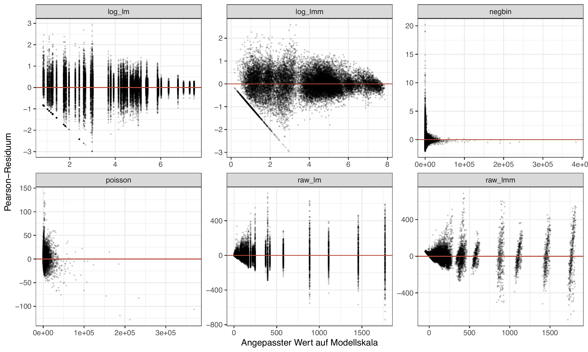
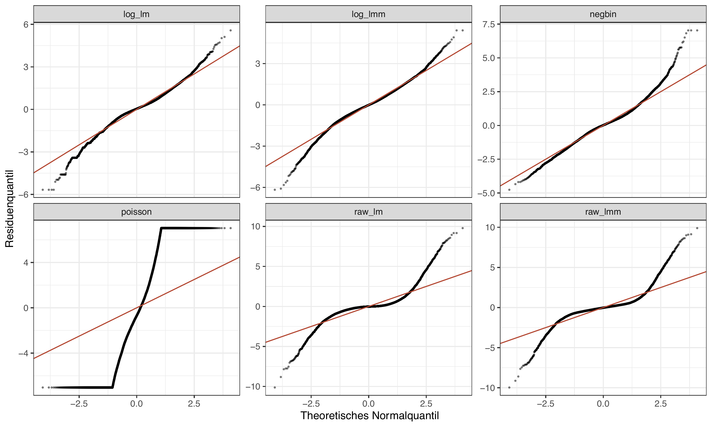
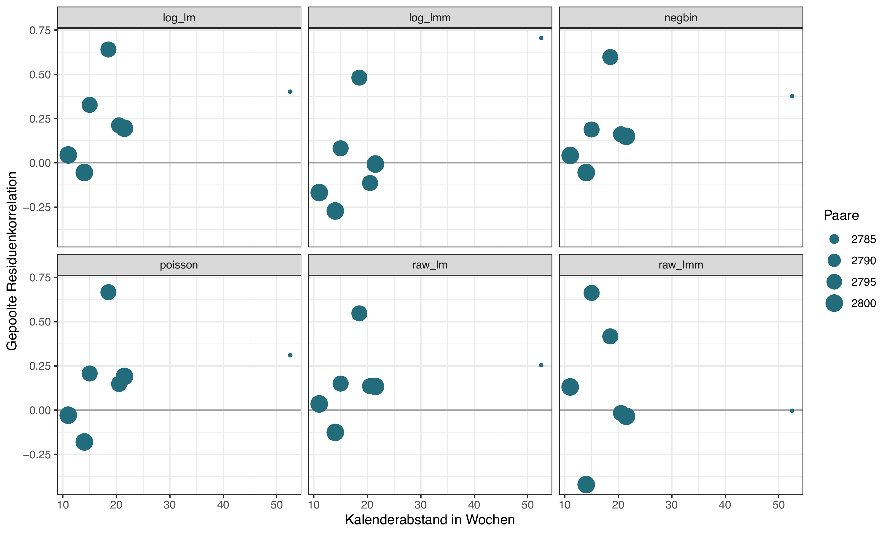
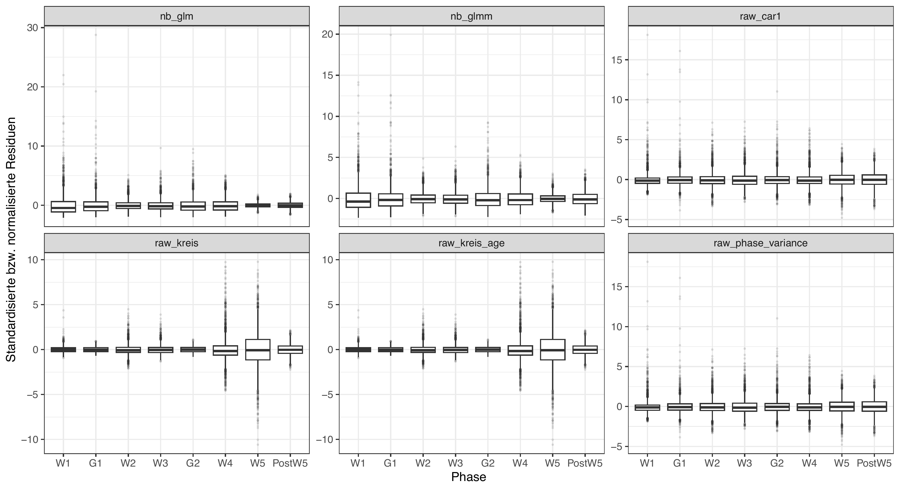
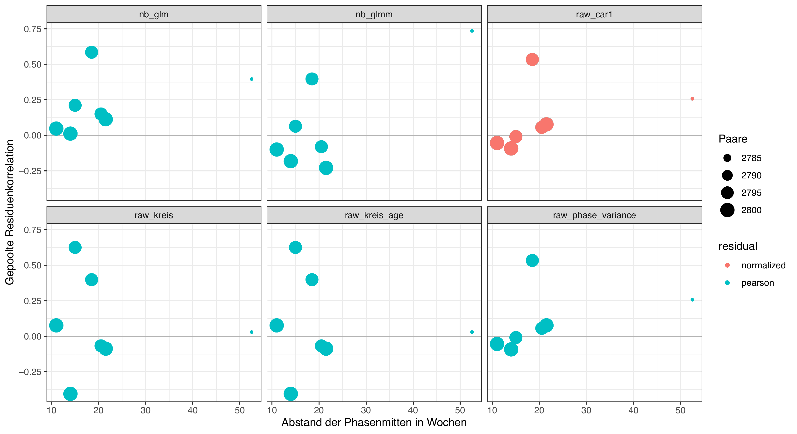
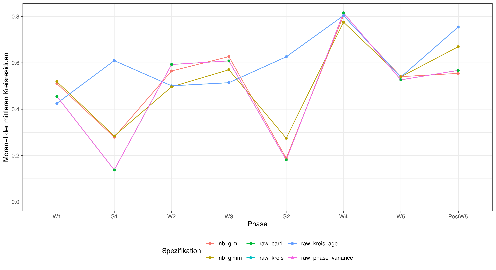
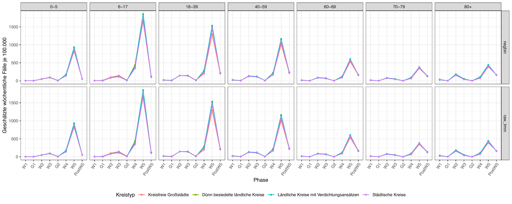
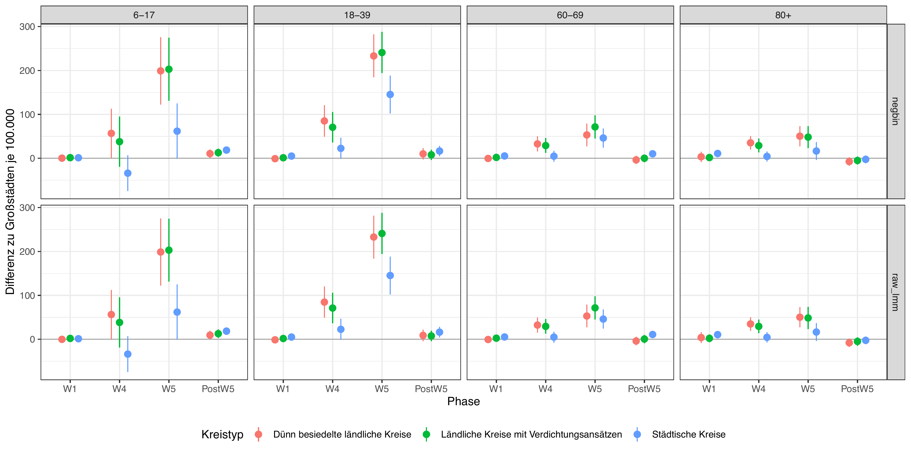
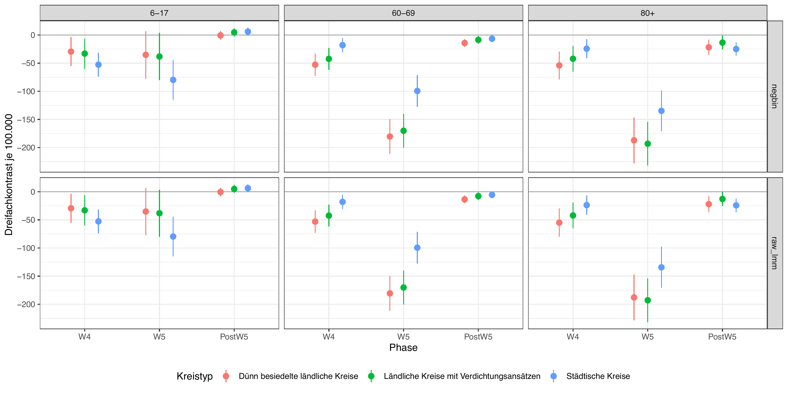
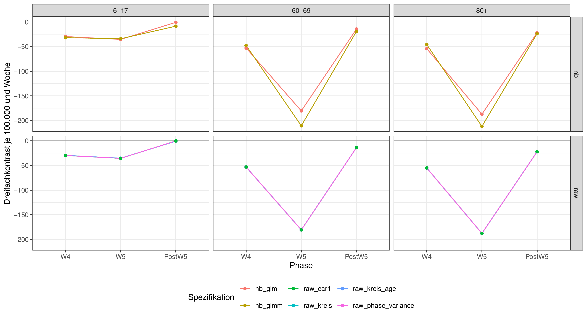

# Modellierung und erste Ergebnisse

## Kurzfassung

Wir untersuchen, ob sich die gemeldete COVID-19-Inzidenz zwischen Kreistypen unterscheidet und ob diese Unterschiede vom Alter und von der Pandemiephase abhängen.

- Das Negativ-Binomialmodell beschreibt die Streuung der Fallzahlen deutlich besser als Poisson.
- Beim linearen gemischten Modell (LMM) verbessert eine eigene Residualvarianz je Phase den Modellfit deutlich.
- Die ausgewählten Kreistyp-Kontraste bleiben bei mehreren Modellvarianten ähnlich. Zeitliche und räumliche Abhängigkeiten sind jedoch noch nicht ausreichend berücksichtigt.

## 1. Ziel und Datengrundlage

| Merkmal       | Einstellung                                   |
|---------------|-----------------------------------------------|
| Zeitraum      | 2020–2023                                     |
| Kreise        | 400                                           |
| Altersgruppen | 0–5, 6–17, 18–39, 40–59, 60–69, 70–79, 80+    |
| Phasen        | W1, G1, W2, W3, G2, W4, W5, PostW5 (ohne P0)  |
| Kreistyp      | Dynamisch: häufigster Typ innerhalb der Phase |
| Beobachtung   | Ein Kreis, eine Altersgruppe, eine Phase      |
| Stichprobe    | 22.370 von 22.400 Beobachtungen               |

Alle Modelle verwenden dieselben Beobachtungen ohne zusätzliche Gewichte. 30 Beobachtungen werden wegen unvollständiger Bevölkerungsnenner ausgeschlossen; echte Nullfälle bleiben erhalten. P0 wird ausgeschlossen, PostW5 bleibt ungeteilt.

## 2. Welche Modelle vergleichen wir?

Zunächst prüfen wir sechs Modellvarianten mit denselben erklärenden Variablen (Alter und Phase einschließlich ihrer Interaktion, M0b).

| Modell | Zielgröße | Verteilung / Link | Kreiszufallseffekt |
|------------------|------------------|------------------|------------------|
| `raw_lm` | Mittlere Wocheninzidenz | Normal / Identität | Nein |
| `raw_lmm` | Mittlere Wocheninzidenz | Normal / Identität | Ja |
| `log_lm` | log(1 + mittlere Wocheninzidenz) | Normal / Identität | Nein |
| `log_lmm` | log(1 + mittlere Wocheninzidenz) | Normal / Identität | Ja |
| `poisson` | Fallzahl der Phase | Poisson / Log | Nein |
| `negbin` | Fallzahl der Phase | Negativ-Binomial / Log | Nein |

Dahinter stehen drei Fragen:

- **LM oder LMM?** Ein LMM erlaubt jedem Kreis ein eigenes Ausgangsniveau (Random Intercept), da derselbe Kreis mehrfach beobachtet wird.
- **Original- oder Log-Skala?** Die Log-Transformation soll die ungleichmäßige Streuung der Inzidenz reduzieren.
- **Poisson oder Negativ-Binomial?** Beide modellieren Fallzahlen. Negativ-Binomial erlaubt eine größere Streuung als Poisson (Überdispersion).

Die Gauß-Modelle verwenden das arithmetische Mittel der Wocheninzidenzen. Die Zählmodelle berücksichtigen über einen Offset die Summe der wöchentlichen Bevölkerungszahlen (Personenwochen). Ihre geschätzten Raten werden auf 100.000 Personenwochen umgerechnet. Beide Zielgrößen haben dieselbe Einheit, können bei wechselnden Bevölkerungsnennern aber voneinander abweichen.

## 3. Welche erklärenden Variablen verwenden wir?

Die sechs Modellvarianten oben unterscheiden sich in Zielgröße, Verteilung und Zufallseffekten. Unabhängig davon bestimmt die folgende Modellhierarchie, welche erklärenden Variablen und Interaktionen enthalten sind.

| Modell | Fixed Effects (R-Syntax) | Frage |
|------------------------|------------------------|------------------------|
| M0a | `age_group + period` | Gibt es Alters- und Phasenunterschiede? |
| M0b | `age_group * period` | Unterscheidet sich der Phasenverlauf nach Alter? |
| M1 | `age_group * period + kreistyp` | Gibt es zusätzliche Kreistypunterschiede? |
| M2a | `age_group * period + kreistyp * period` | Ändern sich Kreistypunterschiede über die Phasen? |
| M2b | `(age_group + period + kreistyp)^2` | Unterscheiden sie sich zusätzlich nach Alter? |
| M3 | `age_group * period * kreistyp` | Ändern sich die Kreistypunterschiede je nach Alter unterschiedlich über die Phasen? |

`*` umfasst Haupteffekte und Interaktionen. Beim LMM kommt `(1 | geo_code)` hinzu, bei Zählmodellen `offset(log_exposure)`. Referenzen sind 18–39 Jahre, W1 und kreisfreie Großstädte. Gauß-Modellvergleiche verwenden Maximum Likelihood (ML).

## 4. Erste Modellwahl

### Modellgüte unter M0b

| Modell  |       AIC |       BIC |
|---------|----------:|----------:|
| raw_lm  |  255663,9 |  256120,7 |
| raw_lmm |  254148,4 |  254613,3 |
| log_lm  |   34787,9 |   35244,8 |
| log_lmm |   31591,7 |   32056,6 |
| poisson | 2400677,4 | 2401126,2 |
| negbin  |  266270,4 |  266727,2 |

Kleinere AIC- und BIC-Werte sprechen für einen besseren Kompromiss zwischen Fit und Modellkomplexität. Hier sind sie nur innerhalb derselben Zielgröße vergleichbar. Beide LMMs schneiden besser ab als die jeweiligen LMs; Negativ-Binomial schneidet besser ab als Poisson.

**Abb. 1:** Beim Raw-LMM streuen die Residuen bei hohen vorhergesagten Inzidenzen deutlich stärker als bei niedrigen. Das Verhältnis der Residuen-RMS (quadratisches Mittel der Residuen) zwischen oberem und unterem Fünftel beträgt 7,04. Beim Log-LMM beträgt es 0,48. Die Log-Transformation löst die ungleiche Streuung also nicht vollständig.

| Zählmodell | Pearson-Quotient (Idealwert ungefähr 1) | Erwarteter Nullanteil |
|--------------------|-------------------------:|-------------------------:|
| Poisson | 108,77 | 0,98 % |
| Negativ-Binomial | 1,26 | 1,54 % |

Der beobachtete Nullanteil beträgt 2,56 %. Negativ-Binomial bildet die Überdispersion wesentlich besser ab, unterschätzt aber weiterhin den Nullanteil.

**Abb. 2:** Je näher die Punkte an der Referenzgeraden liegen, desto besser passt die angenommene Residuenverteilung. Besonders Poisson und die Raw-Modelle zeigen deutliche Abweichungen. Auch bei den übrigen Modellen bleiben Abweichungen in den Randbereichen. Für Zählmodelle werden randomisierte Quantilresiduen verwendet.

**Abb. 3:** Residuen desselben Kreises und derselben Altersgruppe bleiben über Phasen hinweg korreliert. Die maximale absolute Korrelation beträgt 0,66 beim Raw-LMM und 0,60 bei Negativ-Binomial.

**Zwischenergebnis:** Wir führen das Raw-LMM wegen der direkt interpretierbaren Inzidenzunterschiede und das Negativ-Binomialmodell wegen seiner geeigneteren Fallzahlverteilung weiter. Die Log-Modelle bleiben diagnostisch, da `expm1()` allein nicht die erwartete mittlere Inzidenz liefert.

### Vergleich von M0a bis M3

| Modellvariante   | Niedrigster AIC | Niedrigster BIC |
|------------------|-----------------|-----------------|
| Raw-LMM          | M3              | M2a             |
| Negativ-Binomial | M2b             | M2a             |

Von M0a zu M3 sinkt der AIC um 42.612,8 bzw. 12.369,8. Die Kriterien bevorzugen jedoch nicht einheitlich M3. Wir verwenden M3 explorativ, weil es unsere Forschungsfrage zu Kreistyp, Alter und Phase vollständig abbildet. Auch dort bleiben Residuenkorrelationen bestehen (maximal absolut 0,63 bzw. 0,59).

## 5. Verbesserung der Modellstruktur

Die erste Runde zeigt zwei Probleme: ungleiche Residuenstreuung und Abhängigkeit zwischen Beobachtungen. Deshalb behalten wir die M3-Fixed-Effects und die Stichprobe bei und ändern nur die Varianz- und Abhängigkeitsstruktur.

| Modell | Änderung |
|------------------------------------|------------------------------------|
| `raw_kreis` | Bisheriges Raw-LMM mit Kreis-Intercept |
| `raw_kreis_age` | Zusätzlich eigener Intercept je Kreis und Altersgruppe |
| `raw_phase_variance` | Kreis-Intercept und unterschiedliche Residualvarianzen je Phase |
| `raw_car1` | Zusätzlich zeitliche CAR(1)-Korrelation |
| `nb_glm` | Bisheriges Negativ-Binomialmodell ohne Zufallseffekte |
| `nb_glmm` | Negativ-Binomialmodell mit Kreis- und Kreis-Altersgruppen-Intercepts |

| Kandidat           | Vergleich mit      |     ΔAIC |     ΔBIC | Status    |
|--------------------|--------------------|---------:|---------:|-----------|
| raw_kreis_age      | raw_kreis          |     +2,0 |    +10,0 | singulär  |
| raw_phase_variance | raw_kreis          | −39967,2 | −39911,1 | geschätzt |
| raw_car1           | raw_phase_variance |     +2,0 |    +10,0 | geschätzt |
| nb_glmm            | nb_glm             |  −3765,3 |  −3749,3 | singulär  |

Negative Differenzen sprechen für den Kandidaten. Singulär bedeutet hier, dass eine zusätzliche Zufallsvarianz praktisch null ist. Die Vergleiche erfolgen getrennt nach Modellfamilie; beim NB-GLMM wird die marginale Likelihood mittels Laplace-Approximation berechnet. Die Vergleiche sind deskriptiv, keine regulären Likelihood-Ratio-Tests.

**Abb. 4:** Beim ursprünglichen Raw-LMM (`raw_kreis`) ist die Streuung in W5 besonders groß. Mit phasenspezifischer Varianz (`raw_phase_variance`) werden die standardisierten Residuen über die Phasen vergleichbarer. Die geschätzte Residualstandardabweichung reicht von 3,20 in G1 bis 151,18 in W5. AIC und BIC verbessern sich deutlich. Ausreißer bleiben bestehen; die Teilgrafiken haben unterschiedliche y-Skalen.

Der zusätzliche Kreis-Altersgruppen-Intercept bringt im Gauß-Modell praktisch keinen Gewinn. Das NB-GLMM verbessert zwar den Fit, ist aber singulär (Kreis-Altersgruppen-SD praktisch null; Kreis-SD 0,22 auf Logratenskala). Die Verbesserung belegt nicht den Nutzen beider Zufallseffekte einzeln.

**Zwischenergebnis:** Das LMM mit phasenspezifischer Varianz ist ein sinnvoller vorläufiger Kandidat. Im Zählzweig sollte ein einfacheres NB-GLMM nur mit Kreis-Intercept noch geprüft werden; dieses Modell wurde hier nicht geschätzt.

## 6. Zeitliche und räumliche Abhängigkeit

### Zeitliche Abhängigkeit

**Abb. 5:** Die Punkte zeigen Residuenkorrelationen zwischen Phasen in Abhängigkeit vom tatsächlichen Kalenderabstand ihrer Mittelpunkte. CAR(1) soll zeitlich nähere Beobachtungen stärker korrelieren lassen. Die maximale absolute Korrelation bleibt jedoch vor und nach CAR(1) bei 0,53. Auch AIC und BIC verbessern sich nicht.

Das geschätzte wöchentliche ρ von 0,20 entspricht beim kleinsten beobachteten Abstand von 11 Wochen nur rund 0,00000002. Mit acht ungleich langen Phasen ist dieser Parameter schwach identifiziert. Die getestete CAR(1)-Struktur löst die zeitliche Abhängigkeit nicht; daraus folgt nicht, dass keine zeitliche Abhängigkeit existiert.

### Räumliche Abhängigkeit

**Abb. 6:** Moran-I misst, ob benachbarte Kreise ähnliche Residuen haben. Die Werte sind in allen Modell-Phasen-Kombinationen positiv (0,14 bis 0,82), besonders hoch in W4. Die Holm-adjustierten Permutationstests sind in allen 48 Kombinationen auffällig (p \< 0,05).

Das deutet darauf hin, dass benachbarte Kreise weiterhin ähnliche, vom Modell nicht erklärte Abweichungen aufweisen. Die Diagnose basiert auf über Altersgruppen gemittelten Kreisresiduen und polygonbasierten Nachbarschaften (1.044 Nachbarschaften, keine isolierten Kreise). Sie ist explorativ und hängt unter anderem von der Geometrie und der Austauschbarkeitsannahme ab. Ein räumliches Kovarianzmodell wurde noch nicht geschätzt.

## 7. Was zeigen die inhaltlichen Ergebnisse?

### Geschätzte Inzidenzen

**Abb. 7:** Beide ursprünglichen M3-Modelle zeigen ähnliche Verläufe. Besonders in W5 sind die Inzidenzen hoch, vor allem bei 6–17 und 18–39 Jahren. Weil die Kreistypkurven häufig nahe beieinanderliegen, betrachten wir ihre Unterschiede separat.

### Unterschiede zwischen Kreistypen

**Abb. 8:** Die Nulllinie bedeutet keinen Unterschied zu Großstädten. Positive Werte bedeuten höhere, negative niedrigere geschätzte Inzidenzen. In W5 sind die Unterschiede bei 6–17 und 18–39 besonders ausgeprägt; nach W5 fallen sie deutlich kleiner aus. Die Balken zeigen punktweise 95-%-Konfidenzintervalle der ersten Modellierungsrunde.

### Ändern sich diese Unterschiede je nach Alter?

Ein Dreifachkontrast vergleicht, wie sich der Abstand eines Kreistyps zu Großstädten seit W1 verändert hat, und zieht davon die entsprechende Veränderung bei 18–39-Jährigen ab.

$$
(D_{a,p}-D_{a,W1})-(D_{18–39,p}-D_{18–39,W1})
$$\
Dabei ist $D$ die geschätzte Inzidenzdifferenz zu Großstädten. Ein negativer Wert bedeutet eine geringere Zunahme bzw. stärkere Abnahme des Abstands als bei 18–39-Jährigen.

**Abb. 9:** Besonders bei 60–69 und 80+ sind die Dreifachkontraste in W5 negativ. Bei allen 27 ausgewählten Kontrasten stimmen die Vorzeichen der beiden ursprünglichen Modelle überein; bei 15 liegen zusätzlich beide Holm-adjustierten p-Werte unter 0,05.

**Beispiel: 80+ in W5, dünn besiedelte ländliche Kreise gegenüber Großstädten.** Im ursprünglichen Raw-LMM beträgt die geschätzte Wocheninzidenz 440,5 auf dem Land und 390,2 in Großstädten. Der Abstand ist also +50,3 [27,2; 73,4]. Der Dreifachkontrast beträgt dagegen −187,8 [−228,7; −146,9]. Das ist kein Widerspruch: Der erste Wert beschreibt den Abstand in W5, der zweite dessen relative Veränderung seit W1 gegenüber 18–39. Die Intervalle sind punktweise 95-%-Intervalle.

### Bleiben die Ergebnisse nach der Modellanpassung ähnlich?

**Abb. 10:** Die ausgewählten Gauß-Modellkurven liegen fast übereinander. Beim NB-GLMM ändern sich die Schätzungen stärker, vor allem in W5. Die grundlegende Richtung der dargestellten großen negativen Kontraste bleibt ähnlich.

| M3-Modell          | Abstand in W5 (80+) | Dreifachkontrast |
|--------------------|--------------------:|-----------------:|
| raw_kreis          |                50,3 |           −187,8 |
| raw_kreis_age      |                50,3 |           −187,8 |
| raw_phase_variance |                50,5 |           −187,8 |
| raw_car1           |                50,5 |           −187,8 |
| nb_glm             |                50,4 |           −187,1 |
| nb_glmm            |                61,5 |           −211,8 |

Alle Werte sind wöchentliche Fälle je 100.000. Das Beispiel bleibt in allen sechs Varianten qualitativ gleich. Die NB-GLMM-Raten werden über die Zufallseffekte gemittelt. Für die neuen Modelle liegen keine vergleichbaren robusten Konfidenzintervalle vor; wir vergleichen hier nur Punktschätzungen. Das singuläre NB-GLMM ist vorsichtig zu beurteilen.

## 8. Fazit und nächste Schritte

- **Modellwahl:** Negativ-Binomial bildet die Überdispersion besser ab als Poisson. Beim Raw-LMM verbessert eine phasenspezifische Residualvarianz den Fit deutlich.
- **Inhalt:** Die bisherigen Ergebnisse deuten darauf hin, dass Kreistypunterschiede von Alter und Phase abhängen. Ausgewählte Kontraste bleiben bei Änderungen der Modellstruktur ähnlich.
- **Offen:** Zeitliche und räumliche Residuenabhängigkeit bestehen fort. Ein einfacheres NB-GLMM, alternative Zeitauflösungen sowie die Sensitivität gegenüber Altersgruppierung und Kreistypdefinition sollten weiter geprüft werden.

Die erste Runde verwendet kreisgeclusterte HC1-Sandwich-Standardfehler, t-Approximation und für NB-Differenzen die Delta-Methode. Holm korrigiert p-Werte je Modell und Kontrastfamilie, nicht die dargestellten Intervalle. Räumliche Abhängigkeit kann die angenommene Unabhängigkeit der Kreiscluster verletzen. Die neuen Modelle haben noch keine vergleichbare robuste Inferenz. Das Raw-LMM kann negative Werte vorhersagen; dynamische Kreistypen können ihre Zusammensetzung ändern. Alle Ergebnisse sind explorative Assoziationen, keine kausalen Effekte. Eine endgültige Modellwahl steht noch aus.

## Reproduzierbarkeit

Grundlage sind `Erste_Modellierung.md`, `Varianz_und_Abhaengigkeitsstruktur.md`, die zugehörigen Abbildungen und die Modellskripte `config.R`, `model_formulas.R`, `fit_models.R` und `run_initial_models.R`. Modellregister, Stichprobenschlüssel und gespeicherte Fits dokumentieren die Analysen. Für diesen zusammengeführten Bericht wurden keine Modelle neu geschätzt.
