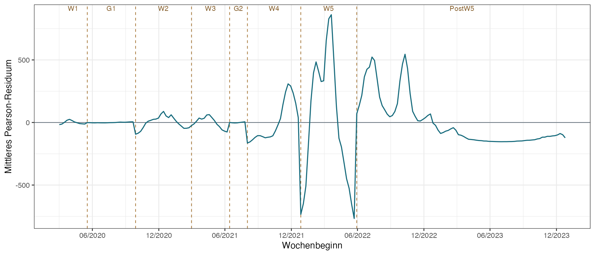
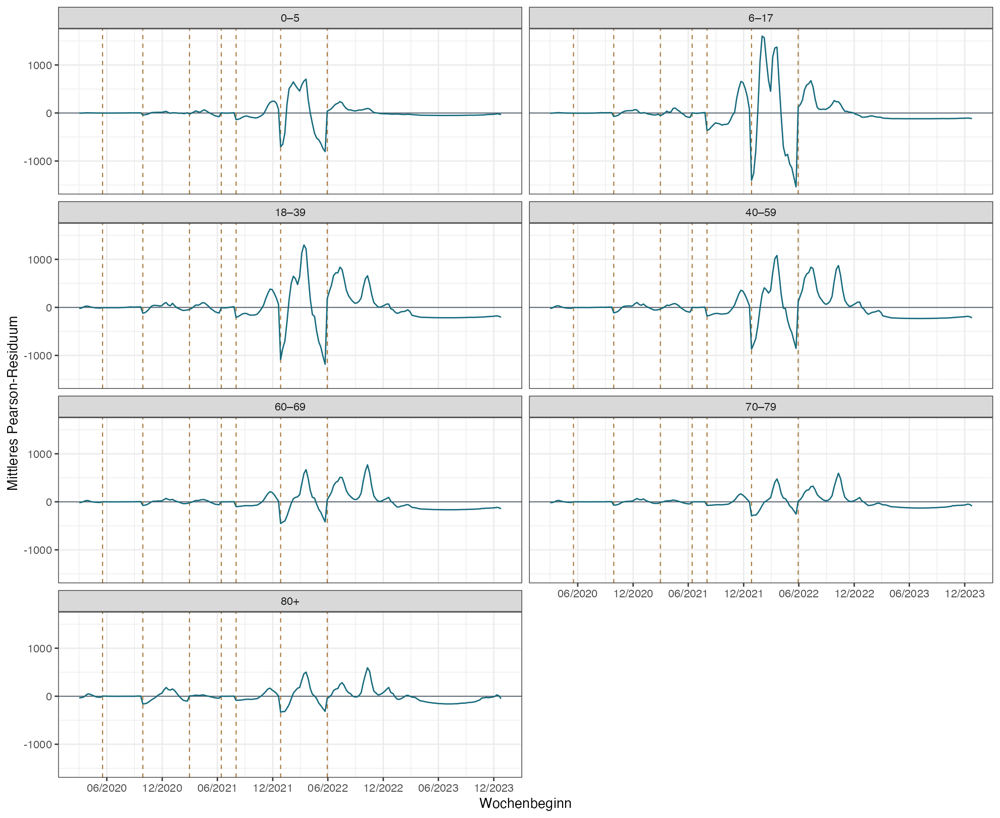
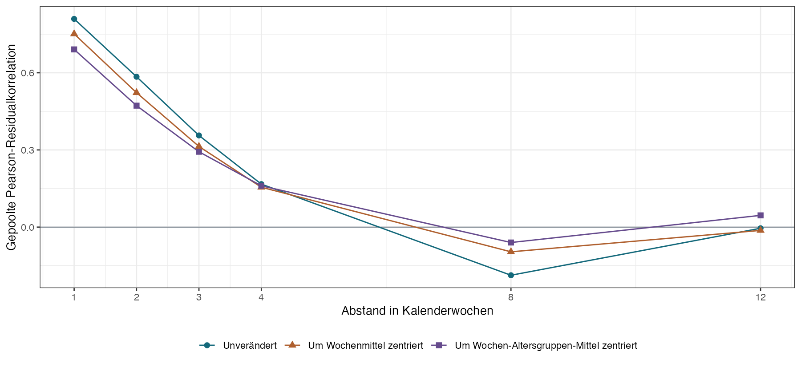

# Residualdiagnostik des wöchentlichen M3-Modells

## Fragestellung

Wie viel der beobachteten Autokorrelation innerhalb von Kreis und Altersgruppe geht mit gemeinsamen wöchentlichen Abweichungen einher, und welche Hinweise ergeben sich daraus für eine AR(1)-Struktur?

## Vorgehen

Die Diagnose verwendet die bedingten Pearson-Residuen des gespeicherten wöchentlichen M3-Gauß-LMM mit Phasen-Fixed-Effects und Kreiszufallsinterzept. Die Stichprobe umfasst 558.888 Beobachtungen in 200 Wochen. Je Woche gehen 2.782 bis 2.800 Kreis-Altersgruppen-Beobachtungen mit gleichem Gewicht in das Gesamtmittel ein. Die Alterskurven verwenden analog das Mittel über die verfügbaren Kreise.

Für die ACF wurden innerhalb derselben Kreis-Altersgruppen-Reihe Beobachtungen im exakten Abstand von 1, 2, 3, 4, 8 oder 12 Kalenderwochen gepaart. Je Abstand wurden die Paare über die Reihen gepoolt. Dieselben Paare wurden für die ursprünglichen Residuen, nach Abzug des gemeinsamen Wochenmittels und nach Abzug des jeweiligen Wochen-Altersgruppen-Mittels verwendet.

<details>
<summary>Berechnung in R reproduzieren</summary>

Vom Projektverzeichnis aus ausführen. Die beiden Mittelwerttabellen liefern die Zeitreihen für die ersten beiden Abbildungen. Die Phasengrenzen stehen in `period_definitions$start`. Die dritte Abbildung verwendet die drei ACF-Reihen.

```r
source("Scripts/Modellierung/fit_models.R")
stopifnot(requireNamespace("lme4", quietly = TRUE))
r <- readRDS("results/Modellierung/Weekly/weekly_m3_baseline.rds")
m <- r$fits$M3$model
stopifnot(identical(rownames(model.frame(m)), rownames(r$sample_keys)))
x <- as.data.table(r$sample_keys)
x[, phase := as.character(model.frame(m)$period)]
x[, e := as.numeric(residuals(m, type = "pearson"))]
weekly <- x[, .(mean = mean(e), n = .N), by = .(week_start, phase)]
age_week <- x[, .(mean = mean(e), n = .N), by = .(week_start, phase, age_group)]
cor(dcast(age_week, week_start ~ age_group, value.var = "mean")[, -1L])
x[, week := e - mean(e), by = week_start]
x[, week_age := e - mean(e), by = .(week_start, age_group)]
x[, `:=`(.model_time = elapsed_weeks(week_start),
         .model_series = interaction(geo_code, age_group, drop = TRUE))]
lapply(x[, .(e, week, week_age)], residual_acf, data = x, lags = r$model_spec$acf_lags)
```

</details>

## Ergebnisse

**Gesamtverlauf.** Positive Werte zeigen Wochen, in denen das Modell die Inzidenz im Mittel unterschätzt. Die gestrichelten Linien markieren Phasenwechsel. Mehrwöchige Abweichungen treten auch innerhalb der Phasen auf. In W5 liegt das höchste Wochenmittel bei **+861,4** am 21.03.2022 und das niedrigste bei **−767,2** am 23.05.2022. Ein einziger Phaseneffekt kann diesen Verlauf innerhalb von W5 nur unvollständig abbilden. [Wochenmittel als CSV](../../results/Modellierung/Weekly/weekly_mean_pearson.csv)



**Verlauf nach Alter.** Die gemeinsame y-Achse macht Unterschiede in der Stärke der Ausschläge sichtbar. In **149 von 200 Wochen** hatten alle sieben Altersmittel dasselbe Vorzeichen. Die 21 paarweisen Korrelationen der Alterskurven lagen zwischen **0,538 und 0,992** (Median **0,876**). Die Spitzen fallen jedoch auf unterschiedliche Wochen. Bei 6–17 Jahren lag das Maximum am 31.01.2022 bei **+1.600,5**. Alle drei Gruppen ab 60 Jahren erreichten ihr Maximum am 10.10.2022. [Wochenmittel nach Alter](../../results/Modellierung/Weekly/weekly_mean_pearson_by_age.csv) · [Korrelationen der Alterskurven](../../results/Modellierung/Weekly/weekly_pearson_age_correlations.csv)



**ACF vor und nach Zentrierung.** Der Abstand zwischen den Kurven zeigt, wie sich die gepoolte ACF nach Abzug gemeinsamer Wochenabweichungen verändert. Die Korrelation bei einer Woche sinkt von **0,809** auf **0,751** nach Abzug des Wochenmittels und auf **0,691** nach Abzug des Wochen-Altersgruppen-Mittels. Die Varianz der einzelnen Residuen sinkt dabei um **50,6 %** bzw. **68,9 %**. Nach der altersgruppenspezifischen Zentrierung bleibt die ACF nach acht Wochen negativ (**−0,060**). [ACF und Paarzahlen als CSV](../../results/Modellierung/Weekly/weekly_pearson_acf_centered.csv)



## Schlussfolgerung

Gemeinsame Wochenmuster tragen zur gemessenen Autokorrelation bei. Der verbleibende Wert von **0,691** bei einer Woche zeigt weiterhin starke kurzfristige Abhängigkeit innerhalb von Kreis und Altersgruppe. Die Zentrierung ist eine deskriptive Diagnose mit aus denselben Daten geschätzten Mittelwerten. Aus ihr lässt sich keine eindeutige Aufteilung in gemeinsame und kreisspezifische Ursachen ableiten.

Ein stationärer AR(1)-Prozess mit positivem Parameter lässt eine geometrisch abklingende, durchgehend positive ACF erwarten. Die negative Korrelation nach acht Wochen spricht gegen eine vollständige Beschreibung durch ein solches Modell. Bei einem späteren Vergleich ist daher zuerst zu prüfen, wie viel Abhängigkeit eine feinere Modellierung des Wochenmittels auf derselben Stichprobe auffängt und welche ACF danach verbleibt. Die Wahl der endgültigen Kovarianzstruktur bleibt offen.
