# Modellauswahl: Arbeitsstand und Modellvorschlag A1

**Stand: 26.11.2026** · Teilprojekt „Modellauswahl“ im Gruppen-Repo · **Arbeitsstand, kein beschlossenes Modell:** A1 ist ein Vorschlag. Welches Modell wir verwenden, entscheidet die Gruppe; das gewählte Modell stellen wir in der Zwischenpräsentation (04.12.2026) vor. Alle Ergebnisse sind vorläufig (Kovariatensatz offen, noch nicht mit Finn abgestimmt).

> **Wozu dieses Dokument?** Es zeigt allen in der Gruppe, wo dieser Teil steht: was gemacht wurde, welche Probleme aufgetreten sind, **welche gelöst und welche offen sind**, welche Modelle gerechnet wurden und warum derzeit A1 vorgeschlagen wird. Es ist die Grundlage für die gemeinsame Modellentscheidung.
>
> **Abschnitt 0 (ca. drei Seiten) reicht für die Diskussion.** Die Abschnitte 1–17 sind das ausführliche Archiv mit allen Belegen, Abbildungen und Vergleichen, auch den Wegen, die nicht funktioniert haben (damit sie niemand ein zweites Mal geht). Jede Aussage verweist auf das Skript, die Tabelle oder die Abbildung, aus der sie stammt.
>
> **Sprachgebrauch:** „A1“ bzw. „Hauptmodell A1“ heißt in diesem Dokument immer **vorgeschlagenes** Hauptmodell. Datei- und Skriptnamen wie `22_main_model_tmb.R` oder `fig27_hauptmodell_…` stammen aus der Arbeitsphase und bedeuten keine Entscheidung. „m1“ ist das Ausgangsmodell (56 getrennte Modelle), nicht A1.
>
> Noch ausführlicher (Zwischenstände, technische Details): [`phase1_datenaudit.md`](phase1_datenaudit.md), [`phase2_deskriptiv.md`](phase2_deskriptiv.md), [`phase3_modelle.md`](phase3_modelle.md) (Teil 1–12). Diese drei Dateien sind die laufend geführte Arbeitsdokumentation; dieses Dokument fasst sie zusammen.

## Inhalt

0. [Für die Gruppe: Stand in Kürze](#0-für-die-gruppe-stand-in-kürze)
   - [0.1 Was in diesem Teil gemacht wurde](#01-was-in-diesem-teil-gemacht-wurde) · [0.2 Wie es zum Vorschlag A1 kam](#02-wie-es-zum-vorschlag-a1-kam) · [0.3 Vorläufiges Ergebnis](#03-vorläufiges-ergebnis) · [0.4 Was gelöst ist und was offen ist](#04-was-gelöst-ist-und-was-offen-ist) · [0.5 Was die Gruppe entscheiden muss](#05-was-die-gruppe-entscheiden-muss)
1. [Fragestellung und was A1 beantwortet](#1-fragestellung-und-was-a1-beantwortet)
2. [Chronologie der Arbeitsschritte und Festlegungen](#2-chronologie-der-arbeitsschritte-und-festlegungen)
3. [Ordner, Dateien, Ausführen und Reproduzierbarkeit](#3-ordner-dateien-ausführen-und-reproduzierbarkeit)
4. [Daten und Aufbereitung](#4-daten-und-aufbereitung)
5. [Zeitliche Einheit: Wellen statt Wochen](#5-zeitliche-einheit-wellen-statt-wochen)
6. [Deskriptive Befunde](#6-deskriptive-befunde)
7. [Urbanisierungsmaß: Kreistyp statt Lage, Dichte, Kreisart oder Cluster](#7-urbanisierungsmaß-kreistyp-statt-lage-dichte-kreisart-oder-cluster)
8. [Der Weg zum Modellvorschlag A1 (Stufe 1–6)](#8-der-weg-zum-modellvorschlag-a1-stufe-16)
9. [Der Modellvorschlag A1 Schritt für Schritt](#9-der-modellvorschlag-a1-schritt-für-schritt)
10. [Ergebnisse von A1 (vorläufig)](#10-ergebnisse-von-a1-vorläufig)
11. [Modellgüte, Robustheit und Alternativen (Option D, Option III)](#11-modellgüte-robustheit-und-alternativen-option-d-option-iii)
12. [Kovariaten: offene Baustelle](#12-kovariaten-offene-baustelle)
13. [Was nicht funktioniert hat](#13-was-nicht-funktioniert-hat)
14. [Annahmen und Einschränkungen](#14-annahmen-und-einschränkungen)
15. [Offene Fragen](#15-offene-fragen)
16. [Glossar](#16-glossar)
17. [Anhang: Abbildungen, Tabellen, Skripte](#17-anhang-abbildungen-tabellen-skripte)

---

## 0. Für die Gruppe: Stand in Kürze

> **Ablauf:** Die Gruppe liest diesen Stand → entscheidet Modell und Kovariatensatz ([0.5](#05-was-die-gruppe-entscheiden-muss)) → das gewählte Modell wird in der Zwischenpräsentation am 04.12.2026 vorgestellt. **Bis dahin ist nichts beschlossen.**

### 0.1 Was in diesem Teil gemacht wurde

Untersucht wurde für jede der acht Wellen, ob der Zusammenhang zwischen dem BBSR-Kreistyp und der gemeldeten COVID-19-Inzidenz je nach Altersgruppe unterschiedlich ausfällt. Dazu wurden zunächst getrennte Modelle je Welle und Altersgruppe gerechnet, anschließend die sieben Altersgruppen je Welle in einem Modell zusammengeführt und die Varianzannahmen geprüft. Als Hauptmodell wird **A1** vorgeschlagen, weil es die Abhängigkeit der Altersgruppen innerhalb eines Kreises und ihre unterschiedlich starke Streuung berücksichtigt. Mit dem aktuellen Kovariatensatz zeigen sich in W3 bis W6 in allen geprüften Spezifikationen Unterschiede zwischen den Altersgruppen (auch mit räumlichem Effekt und mit zwei Kreis-Faktoren), in W2 in drei von vier. Die Einordnung von W2 und W8 hängt von der Modellspezifikation ab. Modell und Kovariatensatz legen wir gemeinsam fest.

**Umfang dieses Teilprojekts:** Datenaufbereitung (COVID-Fälle, Bevölkerung, Strukturmerkmale), Welleneinteilung, deskriptive Auswertung, Vergleich der Urbanisierungsmaße, Modellanpassung und Diagnose, drei Alternativen (Option D, Option III, A1 mit zwei Kreis-Faktoren). Alles ist mit den Skripten in `Scripts/modellauswahl/` reproduzierbar ([Abschnitt 3](#3-ordner-dateien-ausführen-und-reproduzierbarkeit)).

| | |
|---|---|
| **Frage** | Hängen regionale Strukturmerkmale – vor allem der Urbanisierungsgrad – mit der gemeldeten COVID-19-Inzidenz zusammen, und **unterscheidet sich dieser Zusammenhang zwischen den Altersgruppen**? ([1](#1-fragestellung-und-was-a1-beantwortet)) |
| **Einheit** | 400 Kreise × 7 Altersgruppen × 8 Wellen (W1–W8, März 2020 bis März 2023) |
| **Zielgröße** | gemeldete Fälle je Kreis × Altersgruppe × Welle, Offset log(Bevölkerung) → kumulative Inzidenz der Welle |
| **Urbanisierung** | BBSR-Siedlungsstruktureller Kreistyp (4 Stufen, Referenz kreisfreie Großstadt) |
| **Vorschlag A1** | je Welle ein negativ-binomiales GLMM über alle 7 Altersgruppen; Kreistyp, Bundesland und Kovariaten **altersspezifisch**; ein Kreis-Faktor mit Ladung je Altersgruppe; **eigenes θ je Altersgruppe** (`glmmTMB`) |
| **Haupttest** | Wald-Test „Kreistyp-Effekt in allen Altersgruppen gleich“ (18 Kontraste) je Welle, Holm über 8 Wellen |

### 0.2 Wie es zum Vorschlag A1 kam

Jede Stufe hat ein Problem der vorigen gelöst. Die meisten Ansätze werden weiter verwendet; die Spalte „Rolle jetzt“ sagt, wofür.

| Stufe | Ansatz | Was sich gezeigt hat | Rolle jetzt | Details |
|---|---|---|---|---|
| – | Poisson (Lehrbeispiel W5, 18–39) | Pearson-Dispersion **192**; der Standardfehler des Typ-4-Koeffizienten ist mit NB rund **14-mal** so groß wie mit Poisson | Begründung für das negativ-binomiale Modell | [9, Schritt 2](#schritt-2-überdispersion--negativ-binomial) |
| 1 | **m1:** 56 getrennte NB-Modelle (Welle × Altersgruppe) | liefert alle Kreistyp-Effekte; aber die 7 Modelle einer Welle teilen dieselben 400 Kreise und ihre Kovarianz fehlt → „unterscheidet sich der Effekt zwischen den Altersgruppen?“ wird mit den vorliegenden getrennten Fits **nicht direkt getestet** (möglich wäre es z. B. mit einem gestapelten Modell oder Kreis-Bootstrap) | **Ausgangsmodell:** Mustersuche; Prüfung von Nenner, fehlenden Altersangaben, Altersschema, Lage, Dichte, Kovariaten | [Stufe 1](#stufe-1-getrennte-nb-modelle-je-welle--altersgruppe-m1-teil-1) |
| 2 | GAM mit Einzelalter 0–79 | Effekt ohne feste Altersgrenzen; dieselben Muster | **Ergänzung** (Wunsch von Dr. Klima) | [Stufe 2](#stufe-2-gam-mit-einzelalter-ergänzung-teil-2) |
| 3 | m1 + räumlicher Effekt (MRF) | Residuen von m1 räumlich autokorreliert (Moran's I Median 0,20); Kreistyp-Effekte bleiben stabil (r = 0,95) | **Diagnose, Sensitivität** | [Stufe 3](#stufe-3-räumliche-struktur-teil-4) |
| 4 | ein Modell je Welle für alle 7 Altersgruppen, **gemeinsames θ**, Kreis-Effekt + MRF | Kreistyp × Alter erstmals direkt getestet; aber ein θ passt nicht: Pearson-Dispersion 0–5 bis **3,41** (W5), 80+ in allen acht Wellen über 1,6 → KI genau bei der Kernaussage zu schmal | **Sensitivität** (räumlicher Effekt); vom 21. bis 24.11. der Arbeitsvorschlag | [Stufe 4](#stufe-4-ein-gemeinsames-modell-aller-altersgruppen-gemeinsames-θ--mrf-teil-5) |
| 5 | θ je Altersgruppe **und** Raumeffekt mit `mgcv`/`glmmTMB` (A2, A1s) | zu langsam bzw. Hessematrix nicht positiv definit | **abgebrochen**; später mit INLA gelöst (Option III) | [Stufe 5](#stufe-5-θ-je-altersgruppe-und-raumeffekt--was-nicht-ging) |
| 6 | **A1:** wie Stufe 4, aber θ je Altersgruppe und Kreis-Faktor mit Ladung je Altersgruppe, ohne MRF | Dispersion passt (W5, 0–5: 3,41 → **0,99**); die Altersgruppen eines Kreises bleiben verbunden → Test möglich | **Vorschlag Hauptmodell** | [9](#9-der-modellvorschlag-a1-schritt-für-schritt), [10](#10-ergebnisse-von-a1-vorläufig) |
| – | Option III: A1 + räumlicher Kreis-Faktor (BYM2, INLA) | dieselben Muster; Tests gleich außer W8 | **Sensitivität** (Raum), mögliche Alternative | [11.3](#113-option-iii-a1-mit-räumlichem-kreis-effekt-inla) |
| – | **A1 mit zwei Kreis-Faktoren** („Rang 2“, Skript 25) | nach A1 korrelieren die Residuen benachbarter Altersgruppen desselben Kreises noch (z. B. 0–5 mit 6–17 bis 0,71); mit zwei Faktoren AIC in allen Wellen um 228–421 besser, Kreistyp-Effekte fast gleich (r = 0,998); Tests gleich außer W2 (lokale Optima) und W8 | **Kandidat**, offen für die Gruppenentscheidung | [11.5](#115-kandidat-a1-mit-zwei-kreis-faktoren-rang-2) |
| – | Option D: ein Modell über alle 8 Wellen | prüft „ändert sich das Altersmuster über die Wellen?“ in **einem** Test (p ≈ 10⁻¹⁶); Bundesland dort teils zufällig → andere Adjustierung als A1 | **Option** für die Frage nach den Verläufen | [11.4](#114-option-d-ein-modell-über-alle-wellen) |
| – | Ankunftszeit (Kaplan-Meier, Cox) | Unterschiede liegen im Niveau, kaum im Zeitpunkt; stark schwellenabhängig | **Ergänzung** (Anhang) | [5.3](#53-was-dabei-verloren-geht-und-wie-wir-es-geprüft-haben) |
| – | datengetriebene Clustertypologie | keine Clusterstruktur; schlechter als gar kein Raummaß | **verworfen** | [7.5](#75-datengetriebene-typologie-clusteranalyse--verworfen) |

**Warum gerade A1:** Das gemeinsame θ hat die Streuung genau in den beiden Gruppen unterschätzt, auf die es ankommt (0–5 und 80+). Ein eigenes θ je Altersgruppe ändert die Standardfehler um 15–30 %, der räumliche Effekt nur um 1–3 % ([Stufe 5](#stufe-5-θ-je-altersgruppe-und-raumeffekt--was-nicht-ging)). A1 behebt das größere Problem und behält den gemeinsamen Test über die Altersgruppen. **Preis:** In A1 bleibt räumliche Autokorrelation in den Kreis-Residuen (Moran's I 0,04–0,24, signifikant in W2–W8). Option III modelliert sie; die Schlüsse ändern sich dort nur bei W8. **Offen** ist außerdem, ob ein zweiter Kreis-Faktor nötig ist: Er passt deutlich besser (AIC), ändert die Kreistyp-Effekte aber kaum ([11.5](#115-kandidat-a1-mit-zwei-kreis-faktoren-rang-2)).

Alle gerechneten Ansätze und Sackgassen im Detail: [Abschnitt 8](#8-der-weg-zum-modellvorschlag-a1-stufe-16) und [Abschnitt 13](#13-was-nicht-funktioniert-hat).

### 0.3 Vorläufiges Ergebnis

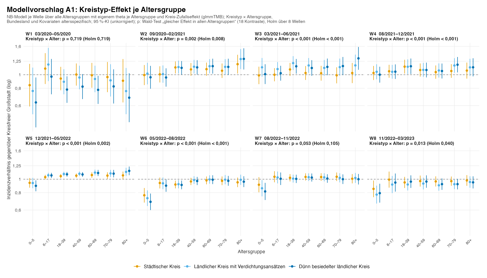

**Lesebeispiel W5:** Bei gleichem Bundesland und gleichen Kovariaten hat ein dünn besiedelter Kreis gegenüber einer Großstadt bei den 0–5-Jährigen ein Inzidenzverhältnis (IRR) von **0,90** (10 % niedriger), bei 80+ von **1,15** (15 % höher). Genau das meint „der Zusammenhang unterscheidet sich zwischen den Altersgruppen“. Die Striche sind unkorrigierte 95 %-KI **einzelner** IRR; der Test in der Panel-Überschrift prüft für alle drei Kreistypen gemeinsam, ob der Effekt in allen Altersgruppen gleich ist (18 Kontraste). Die Punktschätzer veranschaulichen das Muster. Als einzelner, **explorativer** Kontrast ist bisher nur 80+ gegen 0–5 berechnet: In W5 ist das Verhältnis der beiden IRR (Typ 4) **1,28 [1,16; 1,41]** (unkorrigiertes 95 %-KI, A1). Das ist ein eigener Kontrast und nicht Teil des Haupttests mit 18 Kontrasten; andere Paare sind nicht getestet ([10](#10-ergebnisse-von-a1-vorläufig)). Ausführliche Leseanleitung: [Abschnitt 10](#10-ergebnisse-von-a1-vorläufig).

**Test Kreistyp × Alter je Welle, Holm-korrigiert, in vier Spezifikationen** ([`main_tests.csv`](../../results/modellauswahl/tables/main_tests.csv), [`inla_tests.csv`](../../results/modellauswahl/tables/inla_tests.csv), [`rank2_tests.csv`](../../results/modellauswahl/tables/rank2_tests.csv); INLA seriell gerechnet, [3.3](#33-reproduzierbarkeit-geprüft)):

| Welle | A1 (`glmmTMB`) | A1 in INLA, ohne Raumeffekt | A1 + BYM2 (Option III) | A1 mit zwei Kreis-Faktoren (Rang 2) |
|---|---:|---:|---:|---:|
| W1 | 0,72 | 0,78 | 0,72 | 0,56 |
| W2 | 0,0081 | 0,023 | 0,011 | 0,12¹ |
| W3 | 2,5·10⁻⁷ | 5,1·10⁻⁶ | 9,4·10⁻⁷ | 7,1·10⁻⁶ |
| W4 | 4,3·10⁻⁵ | 8,0·10⁻⁵ | 3,5·10⁻⁴ | 4,1·10⁻⁵ |
| W5 | 0,0021 | 0,0037 | 0,011 | 0,0015 |
| W6 | 3,7·10⁻¹¹ | 1,0·10⁻¹⁰ | 1,4·10⁻¹⁰ | 1,3·10⁻¹¹ |
| W7 | 0,11 | 0,16 | 0,13 | 0,12 |
| W8 | **0,040** | **0,075** | **0,13** | **0,024** |

¹ Mit zwei Kreis-Faktoren hat W2 zwei lokale Optima (Abstand der Loglikelihood 15). Die bessere Lösung ergibt 0,12, die andere (Standardstart von `glmmTMB`) 0,017 ([11.5](#115-kandidat-a1-mit-zwei-kreis-faktoren-rang-2)).

- **W3–W6:** in allen vier Spezifikationen unter 5 %.
- **W1 und W7:** in keiner.
- **W2:** in A1 und in beiden INLA-Varianten unter 5 %, mit zwei Kreis-Faktoren nicht (0,12; dort abhängig vom lokalen Optimum).
- **W8:** Schon der Wechsel des Schätzverfahrens (INLA, gerundete Fallzahlen, Test aus Posterior-Ziehungen) hebt p über 5 % (0,075), der Raumeffekt noch weiter (0,13); mit zwei Kreis-Faktoren liegt p darunter (0,024). Laut einer externen Prüfung hängt W8 auch vom genauen Wellenende ab.
- Vorschlag: **W2 und W8 als „spezifikationsabhängig“** berichten, nicht als signifikant.

**Was man inhaltlich sieht** (Details in [10](#10-ergebnisse-von-a1-vorläufig)):
- Kleine Kinder (0–5) haben in dünn besiedelten Kreisen in W1 und W5–W8 eine niedrigere Inzidenz als in Großstädten (IRR 0,63–0,90).
- Erwachsene und Ältere liegen in ländlichen Kreisen in W2–W4 höher (80+ in W2/W3: 1,30/1,31).
- Typ 2–4 liegen in 47 von 56 Zellen (Welle × Altersgruppe) auf **derselben Seite** der Großstadt. Eine strikt geordnete Abstufung Großstadt < Typ 2 < Typ 3 < Typ 4 (bzw. umgekehrt) gibt es aber nur in 17 von 56 Zellen ([`main_kt_coef.csv`](../../results/modellauswahl/tables/main_kt_coef.csv), Punktschätzer). Es ist also eher „gleiche Richtung“ als ein sauberer Stadt–Land-Gradient.
- Alles gilt **mit dem aktuellen, vorläufigen Kovariatensatz** (SGB-II, Anteil 65+, Tourismus); siehe 0.4.

### 0.4 Was gelöst ist und was offen ist

| Thema | Stand | Was gemacht wurde / was fehlt | Details |
|---|---|---|---|
| Kreis-Verknüpfung (44 doppelte Namen, Berliner Bezirke, Eisenach) | **gelöst** | Verknüpfung nur über AGS; Berlin zusammengefasst; Eisenach in den Wartburgkreis | [4.1](#41-covid-daten-rki-von-dr-klima), [4.3](#43-strukturmerkmale-genesis-bbsr) |
| Fälle ohne Altersangabe (einzelne Kreise bis 16 %) | **gelöst** | proportional verteilt; Sensitivität: log-IRR ändern sich um höchstens 0,009 | [4.1](#41-covid-daten-rki-von-dr-klima) |
| Bevölkerungsnenner (RKI vs. GENESIS, Bruch ab 2022) | **gelöst** | RKI-Nenner; GENESIS als Sensitivität (höchstens 0,016) | [4.2](#42-bevölkerung-rki--oder-genesis-nenner) |
| Überdispersion | **gelöst** | negativ-binomiales Modell | [9](#schritt-2-überdispersion--negativ-binomial) |
| Abhängigkeit der Altersgruppen eines Kreises (Kernfrage direkt testen) | **gelöst in A1** | Kreis-Faktor mit Ladung je Altersgruppe | [9, Schritt 6](#schritt-6-ein-modell-für-alle-altersgruppen--der-kreis-faktor) |
| unterschiedliche Streuung je Altersgruppe | **gelöst in A1** | θ je Altersgruppe (W5, 0–5: Dispersion 3,41 → 0,99) | [9, Schritt 7](#schritt-7-eigenes-θ-je-altersgruppe) |
| Konvergenz von A1 | **gelöst** | mehr Iterationen; θ(40–59) in W4–W6 auf 10⁴ festgehalten (numerische Obergrenze, nicht „Poisson“; Effekte ±0,001) | [9, Schritt 7](#schritt-7-eigenes-θ-je-altersgruppe) |
| räumliche Autokorrelation | **teilweise** | in A1 nicht modelliert; Option III modelliert sie (Schlüsse gleich außer W8); ein altersspezifischer Rest (Kinder) bleibt auch dort | [11.3](#113-option-iii-a1-mit-räumlichem-kreis-effekt-inla) |
| Restkorrelation benachbarter Altersgruppen desselben Kreises nach A1 (z. B. 0–5 mit 6–17 bis 0,71) | **teilweise** | laut externer Prüfung für A1 in W2 weit außerhalb der Simulationsreferenz (0,71 gegenüber −0,11 bis 0,08). Kandidat mit zwei Kreis-Faktoren gerechnet: AIC deutlich besser, Kreistyp-Effekte fast gleich, Test in W2 und W8 anders; ob nötig, entscheidet die Gruppe | [11.5](#115-kandidat-a1-mit-zwei-kreis-faktoren-rang-2) |
| Reproduzierbarkeit von Option III (INLA) | **weitgehend gelöst** | mit mehreren Rechenfäden änderten sich DIC/WAIC stark zwischen identischen Läufen. Seit 26.11. seriell (`INLA_THREADS=1:1`) mit festem Seed je Welle × Modell. Ein zweiter serieller Lauf war in 5 von 8 Wellen identisch; in W1, W3, W8 wich das DIC um bis zu 50 ab (Testschlüsse, φ und Vorzeichen des DIC/WAIC-Vergleichs gleich). Der DIC/WAIC-Vergleich BYM2 vs. iid ist ohnehin nicht eindeutig → nicht für die Modellwahl verwenden | [3.3](#33-reproduzierbarkeit-geprüft), [11.3](#113-option-iii-a1-mit-räumlichem-kreis-effekt-inla) |
| niedrige Pearson-Dispersion bei 40–59 (0,31–0,56) | **zu prüfen** | plausible Erklärung (Kreis-Faktor wird vor allem aus dieser Gruppe geschätzt), aber noch nicht mit simulierten Residuen geprüft | [11.1](#111-passt-a1-zu-den-daten) |
| LR-Test „θ je Altersgruppe“ bei festgehaltenem θ (W4–W6) | **zu beachten** | die LR-Werte zeigen die Verbesserung; die χ²₆-Verteilung ist am Rand nur näherungsweise gültig | [11.1](#111-passt-a1-zu-den-daten) |
| Wellen statt Wochen | **Vorschlag, zur Bestätigung durch die Gruppe** | Effekt wechselt zwischen den Wellen das Vorzeichen; wochenweise in W1 41 % Zellen ohne Fall; Timing geprüft | [5](#5-zeitliche-einheit-wellen-statt-wochen) |
| Kreistyp als Urbanisierungsmaß (statt Lage, Kreisart, Cluster) | **Vorschlag, zur Bestätigung durch die Gruppe** | Lage misst Zentralität, „sehr peripher“ nur 18 Kreise, mit dem Kreistyp kollinear | [7](#7-urbanisierungsmaß-kreistyp-statt-lage-dichte-kreisart-oder-cluster) |
| Bundesland statt Ost/West; grobes Altersschema | **Vorschlag, zur Bestätigung durch die Gruppe** | Ost/West ist Confounder und zu grob; feines Schema bringt nachweisbar nichts (Test konservativ) | [6.4](#64-kontrolle-des-bundeslands), [4.4](#44-altersgruppen-grob-statt-fein) |
| **Kovariatensatz** | **offen – wichtigster Punkt** | drei vorläufige Merkmale ohne begründete Auswahl; in m1 korrelieren die Kreistyp-Effekte mit denen aus allen 26 Merkmalen nur mit **r = 0,68** (signifikant 54 → 24); für A1 noch nicht geprüft | [12](#12-kovariaten-offene-baustelle) |
| Kreistyp oder Dichte | **offen** | lineare Dichte passt in 5 von 8 Wellen besser; die Muster sind gleich | [7.3](#73-warum-kreistyp-und-nicht-bevölkerungsdichte) |
| Verläufe über die Wellen | **offen** | A1 vergleicht die Wellen nur beschreibend; Option D testet formal | [11.4](#114-option-d-ein-modell-über-alle-wellen) |
| Bundesland fest oder zufällig | **offen** | im Vorgängermodell unkritisch (r = 0,99); in Option D wichtig (54 → 33 Signifikanzen) | [11.4](#114-option-d-ein-modell-über-alle-wellen) |
| Strukturwerte enthalten Pandemiejahre | **offen** | Mittel 2020–2023; Werte von 2019 wären sauberer | [4.3](#43-strukturmerkmale-genesis-bbsr) |

### 0.5 Was die Gruppe entscheiden muss

**Vor der Zwischenpräsentation**, in dieser Reihenfolge. Die Modelle beantworten verschiedene Fragen und stehen deshalb nicht alle auf einer Liste.
1. **Hauptanalyse innerhalb einer Welle: A1 oder Rang 2?** Beide schätzen je Welle, ob sich der Kreistyp-Effekt zwischen den Altersgruppen unterscheidet. Rang 2 passt nach AIC deutlich besser, ändert die Kreistyp-Effekte aber kaum und hat lokale Optima (W2) ([11.5](#115-kandidat-a1-mit-zwei-kreis-faktoren-rang-2)). Das nicht gewählte Modell wird Sensitivitätsanalyse.
2. **Verläufe über die Wellen: Option D für die formale Antwort?** Option D beantwortet eine andere Frage: Ändert sich das Altersmuster über die Wellen (ein Test, p ≈ 10⁻¹⁶)? Zu entscheiden ist, ob wir diese Frage formal mit D beantworten oder nur beschreibend über die acht Wellenmodelle ([11.4](#114-option-d-ein-modell-über-alle-wellen)).
3. **Raumeffekt: wie Option III berichten?** Option III ist die räumliche Sensitivitätsanalyse zu A1: gleiche Schlüsse außer W8, DIC/WAIC ohne klares Bild ([11.3](#113-option-iii-a1-mit-räumlichem-kreis-effekt-inla)). Zu entscheiden ist, ob sie im Anhang steht oder im Hauptteil.
4. **Festlegungen bestätigen:** Wellen statt Wochen (vgl. das Wochenmodell in [`reports/Modellwahl.md`](../Modellwahl.md)), Kreistyp statt Dichte, Bundesland fest.

**Die zwei inhaltlichen Schwerpunkte der Diskussion:**
1. **Kovariatensatz:** Welche Merkmale sind Confounder? Vorschlag: über einen DAG festlegen statt über CV/AIC; danach A1 mit wenigen inhaltlich begründeten Kovariatensätzen vergleichen ([12](#12-kovariaten-offene-baustelle)).
2. **Verläufe über die Wellen:** Reicht der beschreibende Vergleich der acht Wellenmodelle, oder braucht es den formalen Test aus Option D? Wie berichten wir W2 und W8?

Weitere Fragen (auch an Finn): [Abschnitt 15](#15-offene-fragen).

---

## 1. Fragestellung und was A1 beantwortet

### 1.1 Hauptfragestellung (Protokoll der Erstbesprechung, 29.10.2026)

> Wie hängen regionale Strukturmerkmale mit den zeitlichen Verläufen der gemeldeten COVID-19-Inzidenz zusammen, und unterscheiden sich diese Zusammenhänge zwischen den Altersgruppen?

Aus dem Protokoll:
- Der Schwerpunkt liegt auf den **altersgruppenspezifischen Unterschieden** in diesen Zusammenhängen; von besonderem Interesse ist der **Urbanisierungsgrad**. Weitere demografische und sozioökonomische Merkmale können berücksichtigt werden.
- Konkrete Hypothesen und Modellansätze sind **nicht** vorgegeben. Operationalisierung des Urbanisierungsgrads, Modellansatz und die Wahl „vollständige Zeitverläufe oder einzelne Wellen“ liegen bei der Gruppe.
- Eine feste Einteilung der Altersgruppen ist nicht vorgegeben; auch eine Modellierung ohne Gruppenbildung ist möglich.
- Daten: wöchentliche gemeldete Fälle, Inzidenzen und Bezugsbevölkerung je Kreis, Einzelalter 0–79 und 80+; Zeitraum 2020–2023; nur öffentliche, aggregierte Daten.

Dr. Klima hat am 12.11.2026 die Altersgruppen (grob 7, fein 13) und eine nicht abschließende Liste von Strukturmerkmalen geschickt und ausdrücklich auch Ansätze ohne feste Altersgruppen gewünscht.

### 1.2 Teilfragen, wie wir sie umgesetzt haben

| Nr. | Teilfrage | Wo beantwortet |
|---|---|---|
| F1 | Unterscheidet sich die Inzidenz zwischen Kreistypen, **adjustiert** für Bundesland und Strukturmerkmale – je Welle und Altersgruppe? | A1: Kreistyp-Koeffizienten (IRR), [Abschnitt 10](#10-ergebnisse-von-a1-vorläufig) |
| F2 | **Ist dieser Unterschied in allen Altersgruppen gleich?** (Kern der Fragestellung) | A1: Wald-Test Kreistyp × Alter je Welle, Holm |
| F3 | Ändert sich das Muster **über die Wellen** („Verläufe“)? | A1: Vergleich der 8 Wellenmodelle (beschreibend); formal in [Option D](#114-option-d-ein-modell-über-alle-wellen) |
| F4 | Wie sieht der Effekt **ohne feste Altersgrenzen** aus? | GAM mit Einzelalter 0–79 ([Stufe 2](#stufe-2-gam-mit-einzelalter-ergänzung-teil-2)) |
| F5 | Kommt eine Welle in ländlichen Kreisen **später** an? | Kaplan-Meier/Cox ([5.3](#53-was-dabei-verloren-geht-und-wie-wir-es-geprüft-haben)), nur ergänzend |
| F6 | Welche weiteren Strukturmerkmale gehören ins Modell? | offen ([Abschnitt 12](#12-kovariaten-offene-baustelle)) |

### 1.3 Was A1 beantwortet – und was nicht

| beantwortet | beantwortet **nicht** |
|---|---|
| ob sich der Kreistyp-Effekt zwischen Altersgruppen unterscheidet (je Welle, ein Test mit 18 Kontrasten, Holm über 8 Wellen) | **Ursachen** (z. B. Schultests, Kitas, Pflegeheime): ökologische Analyse auf Kreisebene, Aussagen über Kreise, nicht Personen |
| Richtung und Größe des Effekts je Kreistyp × Altersgruppe × Welle (IRR gegenüber Großstadt, **im selben Bundesland** und **bei gleichen Kovariaten**) | Infektionen: modelliert wird die **gemeldete** Inzidenz (Testumfang und Teststrategien ändern sich nach Zeit und Alter) |
| wo die Unterschiede zwischen Altersgruppen am deutlichsten sichtbar sind (Punktschätzer: 0–5 vs. Erwachsene, 80+ in W2/W3; explorativ berechnet ist nur der Kontrast 80+ gegen 0–5) | ob sich das Muster **zwischen** den Wellen signifikant ändert (nur durch Vergleich der Abbildungen → Option D) |
| ob der Kreistyp überhaupt mit der Inzidenz zusammenhängt, nur über die einzelnen Koeffizienten (der Haupttest prüft nur *Unterschiede zwischen Altersgruppen*; hätten alle Altersgruppen IRR 1,2, wäre er nicht signifikant) | Timing innerhalb einer Welle (→ Ankunftszeit-Analyse) |

---

## 2. Chronologie der Arbeitsschritte und Festlegungen

| Datum | Schritt / Festlegung | Grund | Wo |
|---|---|---|---|
| 29.10.2026 | Erstbesprechung: Fragestellung, Daten von Dr. Klima (RKI, Kreis × Einzelalter × Woche) | – | Protokoll |
| bis 12.11. | Datenaudit: 400 Kreise (Berlin zusammengefasst), Verknüpfung nur über AGS, Zeitraum 2020–2023 (209 Wochen) | Strukturdaten für Berlin nur als Ganzes; 44 doppelte Kreisnamen | [Phase 1](phase1_datenaudit.md) |
| 12.11. | Dr. Klima schickt Altersgruppen (grob 7, fein 13) und Strukturmerkmale | – | Mail |
| bis 21.11. | Strukturmerkmale aufbereitet (GENESIS, BBSR); Eisenach-Problem gelöst; RKI- vs. GENESIS-Bevölkerung geprüft (Bruch ab 2022) → RKI-Nenner + Sensitivität | – | Skripte 03–06 |
| 21.11. | **Fälle ohne Altersangabe proportional verteilt** | in einzelnen Kreisen bis 16 % der Fälle ohne Alter | 02, 14 |
| 21.11. | **RKI-Wellengrenzen** statt datengetriebener Minima; Winter 2022/23 als eigene Welle **W8** | begründbar, Literatur; 76 % der Restphasen-Fälle im Winter | 08 |
| 21.11. | **Ost/West → Bundesland**; Dichte-Quartile gestrichen; **Kreistyp als Hauptmaß**, Dichte als Robustheit, Lage als Zusatz, Kreisart nur deskriptiv | Kollinearität, Interpretierbarkeit, Länder-Konfundierung | 09 |
| 21.11. | beide Altersschemata gerechnet → **grobes Schema** für die Hauptdarstellung | fein ändert nichts, grob genauer | 15 |
| 21.11. | getrennte NB-Modelle (m0–m3), GAM mit Einzelalter, räumliche Analyse (Moran's I, MRF), gemeinsames Modell aller Altersgruppen mit MRF als **Arbeitsvorschlag**; PCA/CV, Ankunftszeit, Cluster | – | 12, 13, 16–21 |
| 24.11. | Prüfung der Anpassung: **gemeinsames θ passt nicht** (0–5, 80+) → **neuer Vorschlag A1 mit θ je Altersgruppe** (`glmmTMB`), MRF-Modell wird Sensitivität | KI bei der Kernaussage zu schmal | 22 |
| 24.11. | GAM-Adjustierung an A1 angeglichen (Bundesland und Kovariaten altersspezifisch) | Übereinstimmung GAM ↔ Gruppenmodelle nur r = 0,70–0,74 | 13, 18 |
| 24.11. | Eisenach in `04_clean_structural.R` ausdrücklich mit Wartburgkreis zusammengelegt (vorher stillschweigend herausgefallen; Ergebnisse unverändert) | Sauberkeit, Kreistyp-Anzahl 102 statt 103 | 04 |
| 25.11. | **Option D** (ein Modell über alle Wellen) und **Option III** (A1 + räumlicher BYM2-Effekt, INLA) als Diskussionsoptionen umgesetzt | „Verläufe“ formal testen; θ je Gruppe und Raumeffekt zusammen | 23, 24 |
| 26.11. | Übernahme ins Gruppen-Repo; dieses Dokument als Grundlage für die Modellentscheidung der Gruppe | Gruppe kennt die Modelle und Probleme noch nicht | dieses Dokument |
| 26.11. | Nach einer zweiten externen Prüfung: Kontrolle der RKI-Inzidenz mit den Fällen mit Altersangabe; `BOOT_B` im Pipeline-Lauf Pflicht; fig05 mit Pseudo-log-Achse; **INLA seriell** (weitgehend reproduzierbar); **Kandidat A1 mit zwei Kreis-Faktoren** (Skript 25) | Bootstrap-Bänder waren in einem Standardlauf still ersetzt worden; DIC/WAIC nicht reproduzierbar; Restkorrelation benachbarter Altersgruppen nach A1 | 02, 11, 13, 24, 25, `run_all.R` |
| offen | **Modellentscheidung der Gruppe**, danach Vorstellung in der Zwischenpräsentation (04.12.2026) | – | [0.5](#05-was-die-gruppe-entscheiden-muss) |

---

## 3. Ordner, Dateien, Ausführen und Reproduzierbarkeit

### 3.1 Ordner

Alles liegt in Unterordnern `modellauswahl/`; die übrigen Ordner des Gruppen-Repos bleiben unberührt.

| Ordner im Gruppen-Repo | Inhalt |
|---|---|
| [`Scripts/modellauswahl/`](../../Scripts/modellauswahl/) | R-Skripte 01–25, `00_setup.R` (Pfade, Konstanten, Hilfsfunktionen, Formeln), `00_theme.R` (Abbildungsstil), `run_all.R` (Pipeline) |
| [`data_processed/modellauswahl/`](../../data_processed/modellauswahl/) | bereinigte Daten und gespeicherte Modelle (`.rds`), von den Skripten erzeugt |
| [`results/modellauswahl/figures/`](../../results/modellauswahl/figures/) | Abbildungen fig01–fig29 (grob, teils zusätzlich `_fine`) |
| [`results/modellauswahl/tables/`](../../results/modellauswahl/tables/) | alle Ergebnistabellen (`.csv`) |
| [`reports/modellauswahl/`](./) | dieses Dokument und die Arbeitsdokumentation Phase 1–3 |
| `data_raw/`, `data_geo/` | Rohdaten werden **gemeinsam** genutzt (Byte für Byte identisch mit den Dateien, die schon im Repo liegen; geprüft 26.11.2026); Kreisgrenzen aus `data_geo/landkreise_simplify200.geojson` (BKG VG250, vereinfacht; „© GeoBasis-DE / BKG (Daten verändert)“) |

Die Skripte sind gegenüber der ursprünglichen Arbeitskopie **nur in den Pfaden** angepasst (`Scripts/modellauswahl/`, `data_processed/modellauswahl/`, `results/modellauswahl/`, `data_geo/`). Dazu kommen Beschriftungen („Modellvorschlag A1“ bzw. „Ausgangsmodell m1“ statt „Hauptmodell“). Außerdem rendert `run_all.R --release` hier keine Quarto-Dokumente, weil die Folien nur im Arbeitsordner liegen.

### 3.2 Ausführen

Aus dem Wurzelordner des Gruppen-Repos:

```bash
BOOT_B=0   Rscript Scripts/modellauswahl/run_all.R      # gesamte Pipeline, GAM ohne Bootstrap (ca. 1–1,5 Stunden)
BOOT_B=100 Rscript Scripts/modellauswahl/run_all.R      # gesamte Pipeline mit Kreis-Bootstrap wie in den Abbildungen (zusätzlich ca. 20 min)
BOOT_B=100 Rscript Scripts/modellauswahl/run_all.R 08   # ab Skript 08 (z. B. nach geänderten Wellengrenzen; BOOT_B nötig, weil 13 mitläuft)
Rscript Scripts/modellauswahl/run_all.R 11              # nur die Abbildungen
Rscript Scripts/modellauswahl/22_main_model_tmb.R       # nur A1 (ca. 3–4 min); Abbildungen danach mit run_all.R 11
Rscript Scripts/modellauswahl/run_all.R 22              # A1, Option D, Option III, Rang 2, danach alle Abbildungen
Rscript Scripts/modellauswahl/run_all.R --release       # Abgabelauf: alles ab 01, BOOT_B = 100, INLA Pflicht
```

- Jedes Skript läuft in einem eigenen R-Prozess; Abbruch beim ersten Fehler.
- Laufzeiten: Skript 23 (Option D) ca. 20–35 min, 24 (INLA, seriell) ca. 5–15 min, 25 (Rang 2) ca. 25 min, 13 mit Bootstrap ca. 20 min.
- **`BOOT_B` ist Pflicht, sobald `13_gam_age.R` mitläuft** (sonst Abbruch). `BOOT_B=0` ersetzt die gespeicherten Bootstrap-Bänder durch modellbasierte (deutlich zu schmal); `BOOT_B=100` reproduziert die veröffentlichten Bänder. Hintergrund: Ein Standardlauf hatte die Bootstrap-Intervalle früher stillschweigend ersetzt (externe Prüfung 26.11.2026).
- **INLA (Skript 24) rechnet seriell** (`INLA_THREADS=1:1`, Standard) und ist so weitgehend reproduzierbar (siehe 3.3). Mit mehreren Rechenfäden (z. B. `INLA_THREADS=4:1`) ist es schneller, aber DIC/WAIC ändern sich zwischen identischen Läufen.
- Skript 25: Zahl der Startwerte über `R2_STARTS` (Standard 5).
- Pakete: data.table, ggplot2, scales, ragg, MASS, sandwich, mgcv, sf, survival, cluster, glmmTMB; für Skript 24 zusätzlich INLA (nicht auf CRAN: `install.packages("INLA", repos = c(getOption("repos"), INLA = "https://inla.r-inla-download.org/R/stable"))`) und sn. Ohne INLA überspringt `run_all.R` das Skript 24 (mit `--release` Abbruch).
- Protokoll des letzten Laufs: [`results/modellauswahl/session_info.txt`](../../results/modellauswahl/session_info.txt) – Modus, Git-Stand, gelaufene und übersprungene Skripte, Bootstrap, INLA-Rechenfäden, Startwerte von Skript 25, R- und Paketversionen.

### 3.3 Reproduzierbarkeit (geprüft)

- **24.11.2026:** In einem leeren Ordner, nur mit `scripts/` und `data_raw/`, lief die damalige Pipeline (21 Skripte, ca. 5 Minuten) vollständig durch. 49 von 50 Tabellen waren **Byte für Byte identisch**; die 50. (`gam_age_curves.csv`) hatte identische Schätzer und unterschied sich nur durch die fehlenden Bootstrap-Spalten (ohne `BOOT_B`) und die Zeilenfolge.
- **26.11.2026 (im Gruppen-Repo):** Alle 27 Skripte lassen sich parsen; `00_setup.R` findet alle Ordner, liest Kovariaten (400 Kreise) und GENESIS-Dateien. `15_compare_schemes.R` und `21_cluster_typology.R` liefen aus dem Gruppen-Repo und erzeugten **dieselben Tabellen Byte für Byte**.
- **26.11.2026, Wiederholungslauf von A1, Option D und Option III im Gruppen-Repo** (`run_all.R 22`, 44 Minuten; Versionen in `session_info.txt`):
  - **A1 (Skript 22) und Option D (Skript 23): alle Tabellen und gespeicherten Modelle Byte für Byte identisch.**
  - **Option III (Skript 24, INLA), damals mit mehreren Rechenfäden: nicht exakt reproduzierbar.** Testschlüsse und Koeffizienten blieben gleich (Abweichung ≤ 0,02). Das DIC derselben Spezifikation änderte sich aber um bis zu 220 Punkte, und der Vergleich BYM2 vs. iid hatte in 5 von 8 Wellen ein anderes Vorzeichen.
- **26.11.2026, Korrektur nach der zweiten externen Prüfung** (im Arbeitsordner gerechnet und übernommen):
  - INLA rechnet jetzt **seriell** (`INLA_THREADS=1:1`).
  - Vor den Posterior-Ziehungen wird je Welle × Modell ein eigener R-Seed gesetzt, weil `inla.posterior.sample` die Hyperparameter-Konfigurationen mit dem R-Zufallsgenerator wählt.
  - Im Arbeitsordner waren zwei serielle Läufe identisch. Mit mehreren Rechenfäden lag das DIC von W5/BYM2 in zwei Läufen bei 37.634 bzw. 37.787.
  - Gegenüber den früheren (mehrfädigen) Werten: Koeffizienten praktisch gleich (BYM2 r = 0,9999, max. Abweichung 0,009), Holm ähnlich, aber der DIC/WAIC-Vergleich BYM2 vs. iid sieht anders aus ([11.3](#113-option-iii-a1-mit-räumlichem-kreis-effekt-inla)).
  - **Alle INLA-Zahlen in diesem Bericht stammen aus dem seriellen Lauf.**
  - Ebenfalls übernommen: `BOOT_B=100`-Lauf von Skript 13 mit Protokoll der Bootstrap-Wiederholungen (Tabellen Byte für Byte gleich), fig05 neu, Skript 25 (Rang 2, 11.5).
- **26.11.2026 abends, Kontrolllauf im Gruppen-Repo** (`run_all.R 24`: Skripte 24, 25 und 11, 27 Minuten; Protokoll in `session_info.txt`). Die `modellauswahl`-Dateien waren dabei noch nicht committet; deshalb steht dort „Git-Stand d993bd9 (sauber)“.
  - **Rang 2 (Skript 25):** alle Tabellen und `rank2_models.rds` Byte für Byte identisch mit dem Arbeitsordner.
  - **Abbildungen:** fig05, fig13 und fig14 identisch mit dem Arbeitsordner. fig11, fig15, fig18, fig19, fig27 und fig29 unterscheiden sich nur durch die Beschriftungen im Gruppen-Repo („A1“, „Ausgangsmodell m1“).
  - **INLA (Skript 24, seriell):** 5 von 8 Wellen identisch. In W1, W3 und W8 wich das DIC um bis zu 50 ab (z. B. W8-`iid` Holm 0,075 → 0,082). Testschlüsse, φ und das Vorzeichen des DIC/WAIC-Vergleichs blieben gleich. Seriell ist INLA also **weitgehend, aber nicht vollständig** reproduzierbar; die Ursache ist offen.
  - **Im Repo stehen die INLA-Ergebnisse aus dem Arbeitsordner** (Stand 26.11.2026). Sie passen zu allen Zahlen in diesem Bericht; fig29 ist mit ihnen gezeichnet.

---

## 4. Daten und Aufbereitung

Skripte [`01_kreis_key.R`](../../Scripts/modellauswahl/01_kreis_key.R) bis [`07_agegroups.R`](../../Scripts/modellauswahl/07_agegroups.R); Details in [`phase1_datenaudit.md`](phase1_datenaudit.md).

### 4.1 COVID-Daten (RKI, von Dr. Klima)

| Thema | Entscheidung | Begründung / Prüfung |
|---|---|---|
| Gebietsstand | **400 Kreise**; die 12 Berliner Bezirke (AGS 11001–11012) zu einem Kreis 11000 zusammengefasst (Fälle und Bevölkerung addiert, Inzidenz neu berechnet) | Strukturdaten gibt es für Berlin nur als Ganzes |
| Verknüpfung | immer über den 5-stelligen AGS, nie über den Namen | 44 Kreisnamen kommen doppelt vor (z. B. Stadt/Landkreis Ansbach) |
| Zeitraum | 2020–2023 laut Protokoll: 209 Wochen (30.12.2019–25.12.2023; 2020 hat 53 Wochen); 2024 abgeschnitten | |
| Ergebnis | [`covid_long.rds`](../../data_processed/modellauswahl/covid_long.rds): 400 Kreise × 81 Altersjahre (0–79, 80+) × 209 Wochen = **6.771.600 Zeilen** | Kontrolle gegen die gelieferte RKI-Inzidenz mit den Fällen **mit** Altersangabe (die RKI-Inzidenz enthält die Fälle ohne Alter nicht): Das Skript prüft **Quantile**, nicht jede Zelle: 1., 50. und 99. Perzentil des Verhältnisses eigene/RKI-Inzidenz liegen bei 0,99986 / 1,00000 / 1,00014, und `02_clean_covid.R` bricht ab, wenn eines davon um mehr als 0,1 % von 1 abweicht. Einzelne Zellen können stärker abweichen: Von 3.584.203 vergleichbaren Zellen sind es 378 (0,01 %) mit mehr als 0,1 %, höchstens 0,46 %, keine mit mehr als 1 % (nachgerechnet am 26.11.2026). Die Wirkung der verteilten Fälle ohne Alter wird getrennt ausgegeben (Kontrolle verschärft am 26.11.2026, Daten unverändert) |
| Fallzahlen | 38,85 Mio. Fälle mit Altersangabe (2020: 1,78 Mio.; 2021: 5,44 Mio.; **2022: 30,17 Mio.**; 2023: 1,46 Mio.); keine negativen Fallzahlen | |
| **Fälle ohne Altersangabe** | 33.042 Fälle (0,085 %) je Kreis × Woche **proportional** nach der Altersverteilung der Fälle mit bekanntem Alter derselben Kreis-Woche verteilt; Rohwerte in `covid_age_unknown.rds`; 2 Fälle in Kreis-Wochen ohne bekannte Fälle bleiben unverteilt | national selten, aber stark konzentriert: Vechta W5 16 %, Leer W5 10 %, Herne W3 5 % der Fälle. Ohne Verteilung wären die altersspezifischen Inzidenzen dieser Kreise unterschätzt |
| Sensitivität | ohne Verteilung ([`14_sens_age_unknown.R`](../../Scripts/modellauswahl/14_sens_age_unknown.R), m1, 168 Kreistyp-Koeffizienten): log-IRR ändern sich im Mittel um 0,0008 (max. 0,0088, W5); Signifikanz ändert sich bei 2 Grenzfällen | → unkritisch |
| Fehlende Bevölkerung | 29 Zellen Kreis × Einzelalter × Jahr (alle mit 0 Fällen) aus Nachbarjahren interpoliert | |
| Folge der Verteilung | Fallzahlen sind nicht mehr ganzzahlig → `glm.nb` warnt „non-integer x“ (nur in der AIC-Berechnung des Poisson-Startfits; Koeffizienten, θ und AIC des NB-Modells nutzen die stetige Log-Likelihood und sind nicht betroffen; geprüft). Die Warnung wird mit `quiet_nonint()` gezielt unterdrückt. INLA verlangt ganze Zahlen → dort gerundet | |

### 4.2 Bevölkerung: RKI- oder GENESIS-Nenner?

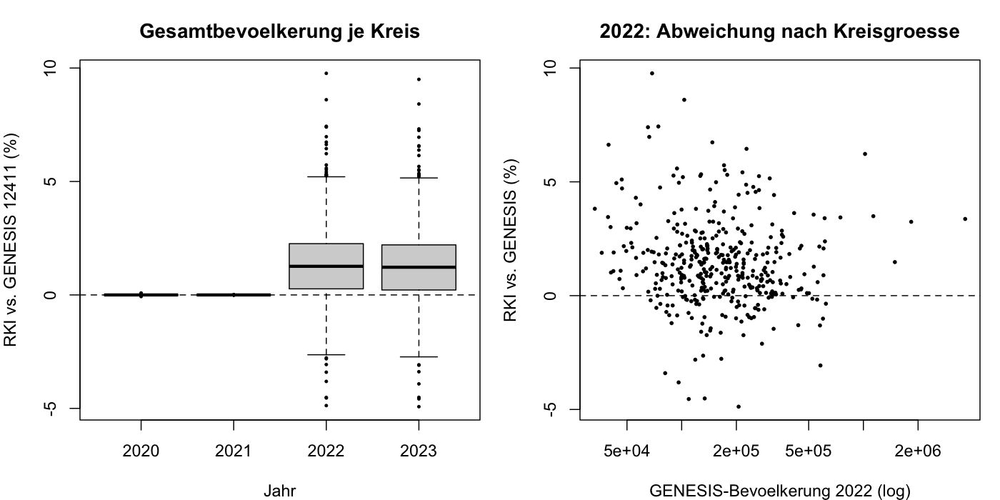

**Was die Abbildung zeigt:** die relative Abweichung der RKI-Bevölkerung von GENESIS 12411 je Kreis. Für 2020/2021 stimmen beide **exakt** überein (0,00 %). **Ab 2022 gibt es einen Bruch:** RKI 84,36 vs. GENESIS 83,12 Mio. (+1,5 %), 2023 84,67 vs. 83,46 Mio.; auf Kreisebene −4,9 % bis +9,8 % (5.–95. Perzentil −1,2 % bis +5,1 %), 71 Kreise weichen um mehr als 3 % ab – am stärksten Universitäts- und Mittelstädte (Landshut +9,8 %, Trier +8,6 %, Bamberg, Kempten, Regensburg, Halle, Köln). Die RKI-Werte wachsen 2021→2022 im Median um 1,3 %, die GENESIS-Werte nicht. Das passt zur Zensus-2022-Revision in GENESIS, während die RKI-Nenner auf der alten Fortschreibung beruhen (Vermutung, nicht überprüft).

**Entscheidung:** Hauptanalyse mit **RKI-Nennern** (passend zu den gelieferten Inzidenzen), Sensitivität mit GENESIS-skalierten Nennern ([`06_pop_sensitivity.R`](../../Scripts/modellauswahl/06_pop_sensitivity.R): je Kreis × GENESIS-Altersgruppe × Jahr auf GENESIS skaliert; Faktoren 2022 Median 0,986, Zellen 0,80–1,18).

Wirkung auf die kumulative Inzidenz je Kreis × Altersgruppe (Median der relativen Änderung; Rangkorrelation beider Varianten):

| Altersgruppe | 2022 Änderung | 2022 ρ | 2023 Änderung | 2023 ρ |
|---|---|---|---|---|
| 0–5 | +2,8 % | 0,994 | +2,5 % | 0,999 |
| 6–17 | +1,8 % | 0,990 | +1,9 % | 0,999 |
| 18–39 | +2,2 % | 0,975 | +2,0 % | 0,997 |
| 40–59 | +0,7 % | 0,985 | +0,6 % | 0,997 |
| 60–69 | +0,5 % | 0,993 | +0,5 % | 0,997 |
| 70–79 | +0,6 % | 0,994 | +0,6 % | 0,996 |
| 80+ | +1,3 % | 0,993 | +1,4 % | 0,996 |

**Wirkung im Modell:** log-IRR ändern sich im Mittel um 0,002 (max. 0,016) – der Nenner ist **unkritisch**. Quellen: [`05_check_population.R`](../../Scripts/modellauswahl/05_check_population.R), [`pop_check_*.csv`](../../results/modellauswahl/tables/pop_check_national.csv), [`pop_sensitivity_impact.csv`](../../results/modellauswahl/tables/pop_sensitivity_impact.csv).

### 4.3 Strukturmerkmale (GENESIS, BBSR)

[`03_audit_structural.R`](../../Scripts/modellauswahl/03_audit_structural.R) (Abdeckung, [`variable_audit.csv`](../../results/modellauswahl/tables/variable_audit.csv)), [`04_clean_structural.R`](../../Scripts/modellauswahl/04_clean_structural.R) (Indikatoren je Kreis × Jahr und Mittelwert 2020–2023). Alle Raten verwenden die RKI-Bezugsbevölkerung (gleicher Nenner wie die Inzidenz).

| Gruppe | Indikatoren | Quelle (GENESIS) | Hinweise |
|---|---|---|---|
| Altersstruktur | Anteile 0–5, 6–17, 18–39, 40–59, 60–69, 70–79, 80+, 65+ | RKI-Einzeljahre | passend zu Klimas Altersgruppen |
| Dichte | Fläche, Einwohner je km² | 11111 | |
| Soziales | SGB-II je 1.000, Grundsicherung im Alter je 1.000 (65+), Hilfe zum Lebensunterhalt, Asylbewerberleistungen | 22811 | nur nach Leistungsart, ohne Alter/Geschlecht. SGB-II = Empfänger je 1.000 Einwohner, **keine** offizielle SGB-II-Quote |
| Arbeit | Arbeitslose je 100 (15–64), jung (15–24), Anteil Langzeit, Anteil Ausländer | 13211 | keine offizielle Quote (Nenner Bevölkerung) |
| Öffentlicher Dienst | Vollzeitäquivalente je 1.000 | 74111 | Hamburg, Bremen, Bremerhaven, Berlin immer NA |
| Pflege | Pflegeheimplätze, -personal, Pflegedienstpersonal je 1.000 (65+) | 22411 | **nur 2021 und 2023** |
| Kita | Plätze, pädagogisches Personal je 1.000 (0–13) | 22541 | Stichtag 1. März |
| Schutzsuchende | je 1.000 | 12531 | ca. 10 Kreise NA je Jahr (u. a. ganzes Saarland) |
| Tourismus | Übernachtungen je Einwohner, Betriebe je 100.000 | 45412 | **2020: 25 Kreise NA**; Gästebetten durchgehend „-“, nicht verwendet |
| Schule | Anteil ohne Abschluss, mit Hochschulreife | 21111 | nach Schulort, nicht Wohnort |
| Pendler | Ein-, Auspendler, Saldo je 1.000 | 19321 | nur 2021–2023, Gemeindeebene; belastbar vor allem der Saldo |
| Typologie | Kreisart (SK/LK), BBSR-Kreistyp, BBSR-Lage | BBSR 2020 | Latin-1, 401 Zeilen (Eisenach) |

Stolpersteine, die jeder kennen sollte, der mit diesen Dateien arbeitet:

1. **Hamburg und Berlin** stehen in vielen GENESIS-Dateien nur als Bundesland (`DLAND` 02/11), nicht als Kreis; Berliner Bezirke dort **nicht** zusätzlich verwenden (Doppelzählung). Kreis-Zeilen haben Vorrang vor Bundesland-Zeilen.
2. **Pendler-Dateien** sind auf Gemeindeebene: Kreis-AGS = Stellen 2–6 des Codes (`P081165004046` → `08116`); bis 55 % unbekannte Zellen bei den Auspendlern auf Gemeindeebene; keine Pendlerströme, nur Summen.
3. **Wertsymbole:** `-` = genau 0; `.`, `x`, `/`, `...` = unbekannt/gesperrt (NA, **nicht** 0).
4. **Eisenach:** 2020 in GENESIS und in den BBSR-Dateien noch eigener Kreis (16056), in den RKI-Daten schon im Wartburgkreis (16063) → alle 2020er Werte und die Fläche zusammengelegt (sonst Raten dort um ca. 25 % verzerrt). Beide haben dieselbe BBSR-Kategorie (Kreistyp 4, Lage 3). Kurzbericht im Gruppen-Repo: [`Prüfbericht_Eisenach_Wartburgkreis_Kurzfassung.md`](../Prüfbericht_Eisenach_Wartburgkreis_Kurzfassung.md).
5. **Tourismus 2020** fehlt für 25 Kreise; ihr Mittel stammt nur aus 2021–2023 und ist **systematisch zu hoch** (2020 war das Tiefjahr: Median 2,19 vs. 2,35–3,62 Übernachtungen je Einwohner).
6. **Zeitkonstanz:** Strukturmerkmale gehen als **Mittelwert 2020–2023** ein. Die Niveaus ändern sich in der Pandemie (Tourismus 2,19 → 3,62; Schutzsuchende springen 2022 mit den Geflüchteten aus der Ukraine), die **Rangfolge der Kreise kaum**:

   | Merkmal | ρ 2020 vs. 2023 | ρ 2021 vs. 2023 | ρ 2022 vs. 2023 |
   |---|---|---|---|
   | SGB-II je 1.000 | 0,986 | 0,991 | 0,991 |
   | Anteil 65+ | 0,988 | 0,993 | 0,998 |
   | Übernachtungen je Einwohner | 0,967 | 0,974 | 0,994 |
   | Arbeitslose je 100 | 0,975 | 0,981 | 0,985 |
   | Schutzsuchende je 1.000 | 0,936 | 0,945 | 0,974 |
   | **Asylbewerberleistungen je 1.000** | **0,455** | 0,536 | 0,696 |

   **Vorsicht (korrigiert 26.11.2026):** Die z-Standardisierung ist eine lineare Umrechnung. Sie entfernt eine gemeinsame Niveauverschiebung, die **Abstände** zwischen den Kreisen bleiben aber erhalten, und das Modell rechnet mit diesen Werten, nicht nur mit der Rangfolge. Eine hohe Rangkorrelation zeigt deshalb nur, dass die **Reihenfolge** stabil ist. Für die drei Kovariaten von A1 sind auch die z-Werte selbst stabil (nachgerechnet am 26.11.2026 aus `struct_kreis_year.rds`; Skript nicht im Repo):

   | Kovariate | Pearson-r der z-Werte 2020 vs. 2023 | \|Δz\| 2020 vs. 2023: Median (95 %-Quantil) | \|Δz\| Maximum | Kreise mit \|Δz\| > 0,5 | Median \|Δz\| 2023 vs. Mittel 2020–2023 |
   |---|---:|---|---:|---:|---:|
   | SGB-II je 1.000 | 0,989 | 0,08 (0,25) | 1,55 | 3 von 400 | 0,04 |
   | Anteil 65+ | 0,991 | 0,09 (0,25) | 0,51 | 1 von 400 | 0,05 |
   | log(Übernachtungen je Einwohner) | 0,977 | 0,12 (0,44) | 0,84 | 12 von 375 | 0,07 |

   → Der Mittelwert 2020–2023 ist für diese drei Kovariaten vertretbar: Bei etwa 95 % der vergleichbaren Kreise ändert sich der z-Wert zwischen 2020 und 2023 um weniger als 0,25 Standardabweichungen (Tourismus: weniger als 0,44). Einzelne Kreise verschieben sich aber deutlich stärker; das Maximum liegt bei SGB-II bei 1,55 SD (Städteregion Aachen, 05334), bei Tourismus bei 0,84 SD (Frankfurt (Oder), 12053), bei 65+ bei 0,51 SD (Chemnitz, 14511). Für Tourismus sind nur 375 Kreise vergleichbar (2020 fehlt für 25). Instabile Merkmale (Asylbewerberleistungen, Schutzsuchende) sind nicht in A1. Sauberer wären Werte **vor** der Pandemie (2019) – offen.

7. Region Hannover und Städteregion Aachen haben kein LK/SK-Präfix und wurden als Landkreis gesetzt.
8. Noch **nicht vorhanden**: Lohn/Einkommen (73111), Bodennutzung (33111), Zensus-Raster, IAB-Maßnahmentabelle.

Ergebnis: [`struct_kreis_year.rds`](../../data_processed/modellauswahl/struct_kreis_year.rds) (1.600 Zeilen) und [`struct_kreis_const.rds`](../../data_processed/modellauswahl/struct_kreis_const.rds) (400 Zeilen, inkl. Kreistyp, Lage, Kreisart, Mittelwerte mit Endung `_mean`). Fehlende Werte: [`struct_na_summary.csv`](../../results/modellauswahl/tables/struct_na_summary.csv). Kein Kreis wird wegen fehlender Werte ausgeschlossen.

### 4.4 Altersgruppen: grob statt fein

Beide Schemata von Dr. Klima werden aus den Einzeljahren gebildet ([`07_agegroups.R`](../../Scripts/modellauswahl/07_agegroups.R), Summenprüfung mit `stopifnot`):
- **grob:** 0–5, 6–17, 18–39, 40–59, 60–69, 70–79, 80+;
- **fein:** 0–2, 3–5, 6–9, 10–14, 15–17, 18–24, 25–29, 30–39, 40–49, 50–59, 60–69, 70–79, 80+.

Die feinen Gruppen sind Teilmengen der groben; 60–69, 70–79, 80+ sind gleich (Kontrolle: ihre 72 Koeffizienten sind in beiden Schemata identisch). Bis Skript 15 wurde alles mit beiden gerechnet (Dateien mit `_fine`).

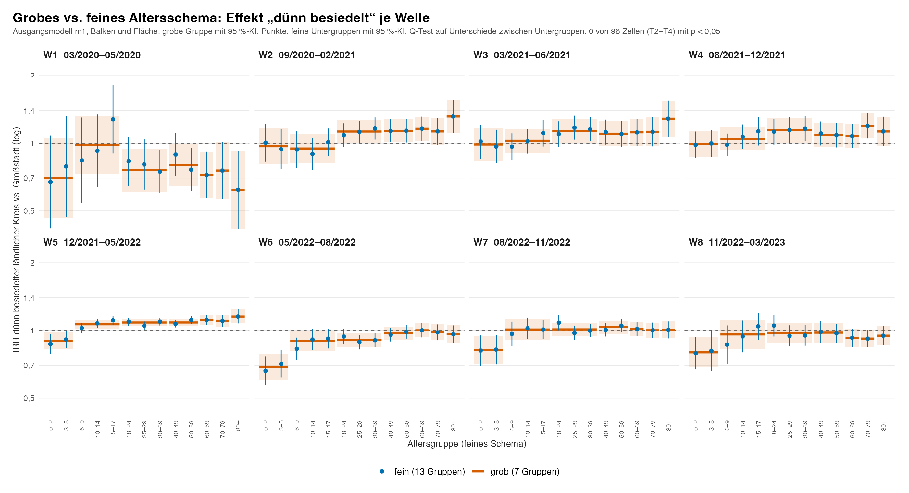

**Was die Abbildung zeigt** ([`15_compare_schemes.R`](../../Scripts/modellauswahl/15_compare_schemes.R)): für den Effekt „dünn besiedelt vs. Großstadt“ (m1) je Welle die grobe Gruppe (Balken/Fläche mit 95 %-KI) und ihre feinen Untergruppen (Punkte mit 95 %-KI). Die Punkte liegen fast immer innerhalb des groben Bandes und auf derselben Seite von 1; nur in W1 streuen sie stark (kleine Fallzahlen).

**Ergebnisse** (96 Zellen = 8 Wellen × 4 geteilte Gruppen × 3 Kreistyp-Terme; [`scheme_compare_*.csv`](../../results/modellauswahl/tables/scheme_compare_summary.csv)):
- Cochran-Q-Test auf Unterschiede innerhalb einer groben Gruppe: **0 von 96** signifikant (erwartet durch Zufall ≈ 5; kleinster p-Wert 0,07).
- In keiner Zelle ist eine Untergruppe signifikant in die Gegenrichtung; präzisionsgewichtetes Mittel der Untergruppen vs. grober Schätzer **r = 0,996**.
- Spanne der feinen log-IRR innerhalb einer groben Gruppe: Median 0,057, max. 0,42 (6–17 in W1, Typ 4: 0,84–1,28).
- „Verdeckt“: in 8 Zellen grob nicht signifikant, aber eine Untergruppe knapp signifikant (z. B. W6, 6–17, Typ 3: grob 0,93, fein 0,83–0,97) – gleiche Richtung. „Verdünnt“ (grob signifikant, keine Untergruppe) kommt nicht vor.
- Deskriptiv wechselt das Verhältnis Kreistyp/Bundeswert in 20 von 128 Zellen innerhalb einer groben Gruppe die Seite von 1, fast immer nahe 1.

**Vorschlag (zur Bestätigung durch die Gruppe):** grobes Schema für das Hauptmodell (genauere Schätzer, weniger Tests); fein nur als Robustheit; feinere Altersauflösung liefert der GAM mit Einzeljahren.
**Vorsicht:** Der Q-Test behandelt die Untergruppen als unabhängig – sie stammen aber aus denselben Kreisen und sind positiv korreliert, deshalb findet er Unterschiede **zu selten**. Eine externe Prüfung mit Kreis-Bootstrap-Kovarianz fand z. B. für W5, Typ 3, 18–39 (fein 1,10 / 1,05 / 1,10, grob 1,09, Q-Test p = 0,13) p ≈ 6·10⁻⁷ (nicht selbst nachgerechnet). „0 von 96“ heißt also nur „nicht nachgewiesen“, nicht „gleich“. Für Aussagen über Untergruppen bräuchte es einen Test mit gemeinsamer Kovarianz.

---

## 5. Zeitliche Einheit: Wellen statt Wochen

### 5.1 Welleneinteilung W1–W8 (Vorschlag vom 21.11.2026, zur Bestätigung durch die Gruppe)

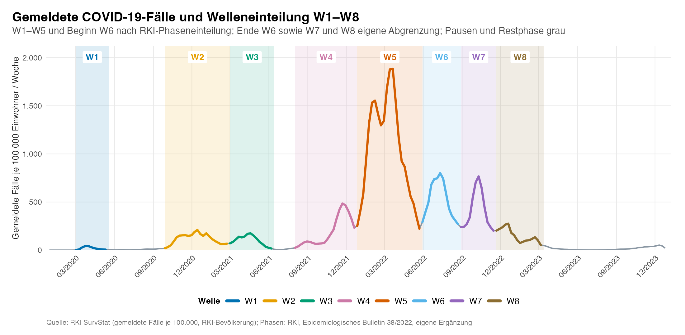

**Was die Abbildung zeigt:** die bundesweite Wocheninzidenz 2020–2023 (gemeldete Fälle je 100.000 und Woche); farbig die acht Wellen der Hauptanalyse, grau die Pausen (Sommer 2020, Sommer 2021) und die Restphase 2023. Man sieht, wie unterschiedlich die Wellen sind: W5 (Omikron BA.1/BA.2) dominiert mit Spitzen um 1.900, W1 ist im selben Maßstab kaum sichtbar, W8 hat zwei kleine Gipfel (Dezember ca. 275, Februar ca. 135).

| Phase | Zeitraum | Wochen | Charakter | Grenzen | kum. Inzidenz je 100.000 |
|---|---|---:|---|---|---:|
| V20 | 30.12.2019–24.02.2020 | 9 | sporadische Fälle | eigen | – |
| **W1** | 02.03.–11.05.2020 | 11 | Wildtyp (RKI KW 10–20/2020) | RKI | 212 |
| S20 | 18.05.–21.09.2020 | 19 | Sommerplateau 2020 | RKI | – |
| **W2** | 28.09.2020–22.02.2021 | 22 | zweite Welle | RKI | 2.597 |
| **W3** | 01.03.–07.06.2021 | 15 | Alpha | RKI | 1.524 |
| S21 | 14.06.–26.07.2021 | 7 | Sommerplateau 2021 | RKI | – |
| **W4** | 02.08.–20.12.2021 | 21 | Delta | RKI | 3.896 |
| **W5** | 27.12.2021–23.05.2022 | 22 | Omikron BA.1/BA.2 | RKI | 22.901 |
| **W6** | 30.05.–22.08.2022 | 13 | Omikron BA.5, Sommer | RKI-Beginn, Ende eigen | 6.840 |
| **W7** | 29.08.–14.11.2022 | 12 | Herbst 2022, endet am Minimum Ende November | eigen | 4.931 |
| **W8** | 21.11.2022–06.03.2023 | 16 | Winter 2022/23, zwei Gipfel | eigen | 2.408 |
| R23 | 13.03.–25.12.2023 | 42 | Restphase, sehr niedrig, Meldeverhalten unsicher | eigen | – |

- W1–W5 und Beginn W6 nach RKI (Epidemiologisches Bulletin 38/2022, Tab. 1); das Ende der RKI-Phase „sechste Welle“ ist nicht definiert → Ende W6, W7 und W8 **eigene Grenzen** an den Minima der bundesweiten Wocheninzidenz.
- W1–W8 = 132 von 209 Wochen, **98 % der Fälle** (38,12 von 38,88 Mio.); W5 allein 19,3 Mio. Pausen und Restphase sind nicht in der Hauptanalyse.
- **Geändert (21.11.):** Die erste, rein datengetriebene Einteilung (Minima der geglätteten Inzidenz; Grenzen 0–2 Wochen anders) wurde durch die RKI-Grenzen ersetzt. Die Rangkorrelationen zwischen Kreisinzidenz und Strukturmerkmalen änderten sich dabei im Median um 0,004 (95 %: 0,024, max. 0,065), beim Kreistyp kein Vorzeichenwechsel.
- **Geändert (21.11.):** Der Winter 2022/23 war zunächst Teil der Restphase. 76 % ihrer Fälle (ca. 2,0 von 2,6 Mio.) fielen auf diese 15–16 Wochen, die kumulative Inzidenz (ca. 2.400) liegt in der Größenordnung von W2 (2.597) → eigene Welle **W8**.
- Quelle: [`08_waves.R`](../../Scripts/modellauswahl/08_waves.R), [`10_plot_rki_phases.R`](../../Scripts/modellauswahl/10_plot_rki_phases.R), [`waves_summary.csv`](../../results/modellauswahl/tables/waves_summary.csv). Basis aller Modelle ist [`covid_wave_kreis.rds`](../../data_processed/modellauswahl/covid_wave_kreis.rds): kumulative Fälle je Kreis × Welle × Altersgruppe, Nenner = mittlere Wochenbevölkerung der Welle (`cuminc` mit RKI-, `cuminc_gen` mit GENESIS-Nenner).

### 5.2 Warum Wellen und nicht Wochen?

Die Wochendaten liegen vor, und ein Wochenmodell (z. B. Poisson mit gemeinsamem Wocheneffekt δ_t, wie in [`reports/Modellwahl.md`](../Modellwahl.md) skizziert) ist ein naheliegender Ansatz. Wir schlagen aus folgenden Gründen die **Welle** als Einheit vor (Vorschlag zur Bestätigung durch die Gruppe):

1. **Der Stadt–Land-Effekt wechselt zwischen den Wellen das Vorzeichen** ([fig06](#62-stadtland-roh)): In W1 liegen dünn besiedelte Kreise in allen Altersgruppen unter dem Bundeswert (0,74–0,86), in W4 bei Erwachsenen 17–30 % darüber, ab W5 sind die kleinen Kinder dort niedriger. Ein Wochenmodell mit **einem** Kreistyp-Effekt (und Kreistyp × Alter) plus gemeinsamem Wocheneffekt mittelt genau diese Unterschiede weg – der geschätzte Effekt wäre ein von W5 dominierter Durchschnitt (W5 hat die Hälfte aller Fälle). Um die Unterschiede abzubilden, bräuchte es Kreistyp × Alter × Zeit; mit 209 Wochen wären das 209 × 3 × 7 = 4.389 Interaktionsparameter, die man nicht mehr interpretieren kann. Die Wellen sind die natürliche Zusammenfassung: jede hat eine eigene Variante, ein eigenes Testregime und eigene Maßnahmen.
2. **Die Wochendaten sind dünn** (neu berechnet am 26.11.2026 aus `covid_agegrp.rds`, grobes Schema, nur Wochen in W1–W8):

   | | Zellen Kreis × Woche × Altersgruppe | ohne Fall | < 5 Fälle |
   |---|---:|---:|---:|
   | alle Wellen W1–W8 | 369.600 | 6,8 % | 20,8 % |
   | **W1** | | **40,7 %** | **73,4 %** |
   | W2 / W3 / W4 | | 5,8 / 6,6 / 7,0 % | 24,3 / 27,0 / 25,5 % |
   | W5 / W6 / W7 | | 0,1 / 0,3 / 0,5 % | 1,8 / 3,3 / 4,9 % |
   | W8 | | 4,0 % | 20,1 % |
   | nach Altersgruppe (ohne Fall) | | 0–5: 14,3 %, 80+: 9,7 %, 18–59: ≈ 2 % | |

   Gerade die Gruppen der Kernaussage (0–5, 80+) und die erste Welle wären wochenweise von Nullen geprägt. Auf Wellenebene (22.400 Zeilen) ist das Problem viel kleiner (W1, 0–5: 71 von 400 Kreisen ohne Fall).
3. **Zeitliche Abhängigkeit, Meldeverzug, Feiertage:** Aufeinanderfolgende Wochen desselben Kreises sind stark abhängig, die Meldewoche ist nicht die Infektionswoche, und Feiertage verschieben Meldungen. Ein Wochenmodell bräuchte dafür eine eigene Struktur (AR-Terme, glatte Zeittrends je Kreis), sonst sind die Standardfehler zu klein. Die kumulative Inzidenz einer Welle ist dagegen unempfindlich gegen Verschiebungen um ein, zwei Wochen.
4. **Das, was die Aggregation wegwirft (das Timing), haben wir eigens geprüft** (5.3): Die Unterschiede zwischen den Kreistypen liegen vor allem im **Niveau**, kaum im Zeitpunkt.
5. **„Verläufe“ bleiben testbar:** Ob sich das Stadt–Land-Muster über die Wellen ändert, wird in einem Modell über alle Wellen als **ein** Test geprüft (Option D, Abschnitt 11.4).
6. **Zeit:** Ein belastbares Wochenmodell mit Autokorrelation war bis zur Abschlusspräsentation (Ende Januar) nicht realistisch und hätte mit dem Rest der Analyse (kumulative Inzidenz) wenig gemeinsam. Das Protokoll stellt die Wahl „vollständige Zeitverläufe oder einzelne Wellen“ ausdrücklich der Gruppe frei.

**Kosten dieser Wahl (ehrlich):**
- Dynamik innerhalb einer Welle geht verloren.
- Die bundesweit gleichen Wellengrenzen werden auf alle Kreise und Altersgruppen angewendet. In W3 liegen 27 % der Kreise schon in Woche 1 über der 50-%-Schwelle (W6: 15 %), der Wellenanfang ist dort teilweise abgeschnitten.
- Der W8-Test hängt laut einer externen Prüfung vom genauen Wellenende ab (letzte Woche eine Woche früher/später: p = 0,020 / 0,050; nicht selbst nachgerechnet).

**Für alle, die mit Wochenmodellen weiterarbeiten:** Prüft (a) ob der Kreistyp-Effekt mit der Zeit interagieren darf, (b) die Autokorrelation der Residuen innerhalb eines Kreises, (c) den Anteil der Nullen in kleinen Altersgruppen und in W1, (d) ob W5 das Ergebnis dominiert.

### 5.3 Was dabei verloren geht und wie wir es geprüft haben

[`20_wave_arrival.R`](../../Scripts/modellauswahl/20_wave_arrival.R), Teil 8.

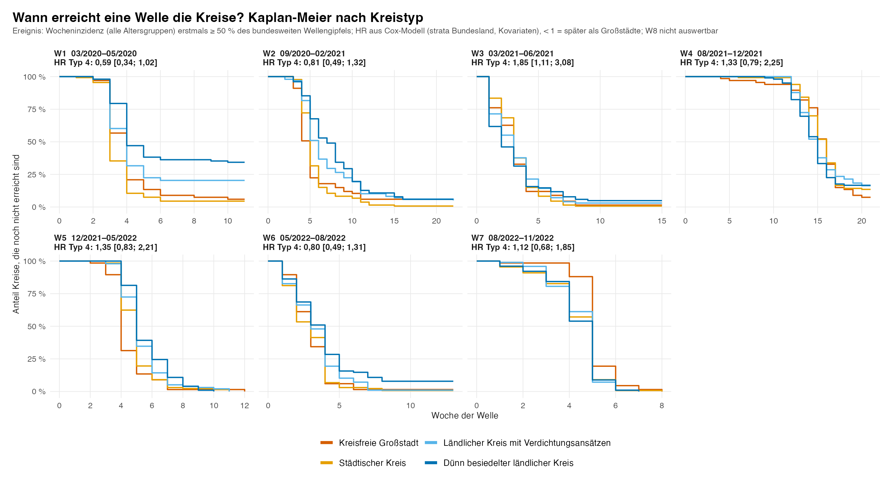

**Was die Abbildung zeigt:** je Welle den Anteil der Kreise (y), deren Wocheninzidenz (alle Altersgruppen) die Schwelle „50 % des bundesweiten Wellengipfels“ bis zur Woche x **noch nicht** erreicht hat, getrennt nach Kreistyp. Darüber die Hazard Ratio „dünn besiedelt vs. Großstadt“ aus einem Cox-Modell (strata Bundesland, gleiche Kovariaten, Bindungen nach Efron; HR < 1 = später erreicht). Die Kurven liegen meist eng beieinander. Deutlichstes Beispiel ist W2 (Median Großstadt Woche 5, dünn besiedelt Woche 7). Die waagrechten Enden in W1 sind Kreise, die die Schwelle nie erreichen (niedriges Niveau – dort vermischen sich Niveau und Timing). W8 ist nicht auswertbar (bundesweit schon in Woche 1 bei 74 % des Gipfels).

| Welle | Median-Woche Großstadt / Typ 4 | HR Typ 4 (50 %) [95 %-KI] | HR Typ 4 (25 %-Schwelle) | PH-Test global p | Altersgruppen gleich? p |
|---|---|---|---|---|---|
| W1 | 4 / 4 | 0,59 [0,34; 1,02] | 0,48* | 0,36 | 0,021 |
| W2 | 5 / 7 | 0,81 [0,49; 1,32] | 0,80 | 0,021 | 0,004 |
| W3 | 3 / 2 | 1,85* [1,11; 3,08] | – | 0,36 | 0,77 |
| W4 | 16 / 15 | 1,33 [0,79; 2,25] | 0,73 | 0,20 | 0,006 |
| W5 | 4 / 5 | 1,35 [0,83; 2,21] | 0,60* | 0,0001 | 0,056 |
| W6 | 3 / 4 | 0,80 [0,49; 1,31] | – | 0,017 | 0,006 |
| W7 | 5 / 5 | 1,12 [0,68; 1,85] | – | 0,27 | 0,011 |

**Ergebnis:**
- Median-Ankunft je Kreistyp höchstens **2 Wochen** verschieden; signifikant nur W3 (HR 1,85, ländlich *früher*, aber viele Kreise schon in Woche 1 über der Schwelle).
- Die Ergebnisse hängen **stark von der Schwelle ab**: log-HR bei 50 % und 25 % korrelieren nur mit r = 0,49. Bei 25 % werden ländliche Kreise in W1 und W5 signifikant später erreicht – die Wellen „kommen“ dort später an, der Gipfel aber nicht unbedingt.
- **Proportionale Hazards** in W2, W5, W6 verletzt (Schoenfeld) → HR dort nur als Mittel über die Zeit lesbar.
- Je Altersgruppe ([fig25](../../results/modellauswahl/figures/fig25_ankunft_cox_alter.png); Altersgruppen gestapelt, strata Bundesland × Altersgruppe, robuste SE): Jüngere (0–5, 6–17, 18–39) werden in ländlichen Kreisen in W1, W2, W6 später erreicht (HR 0,45–0,58), Ältere in W5 früher (60+: HR 1,95–2,23).

**Folgerung:** kein durchgängiges Muster „ländliche Kreise später“; die Raumunterschiede liegen vor allem im **Niveau** → die kumulative Inzidenz je Welle ist eine angemessene Zielgröße. Die Ankunftszeit-Analyse gehört wegen Schwellenabhängigkeit und PH-Verletzung **in den Anhang**.

---

## 6. Deskriptive Befunde

Skripte [`09_urban_rural.R`](../../Scripts/modellauswahl/09_urban_rural.R) und [`11_figures.R`](../../Scripts/modellauswahl/11_figures.R); Details in [`phase2_deskriptiv.md`](phase2_deskriptiv.md). Alles ohne Unsicherheitsmaße und nicht adjustiert – nur zur Orientierung. Abbildungen gibt es für fig02, fig04–fig09 zusätzlich im feinen Schema (`*_fine.png`).

### 6.1 Altersprofil je Welle

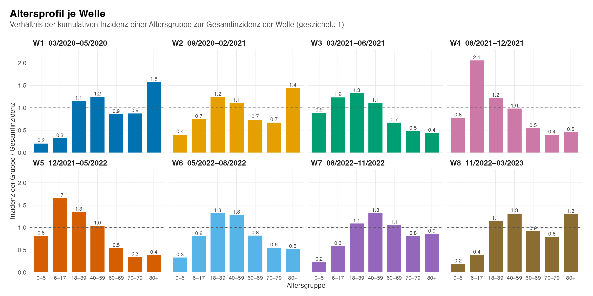

**Was die Abbildung zeigt:** je Welle das Verhältnis der kumulativen Inzidenz einer Altersgruppe zur Gesamtinzidenz der Welle (gestrichelt = 1).
- **W1/W2:** 80+ am höchsten (rund das 1,5-Fache), Kinder am niedrigsten – vermutlich auch Teststrategie (gezielte Tests bei Älteren und Symptomatischen).
- **W3–W5:** 6–17-Jährige deutlich darüber (W4 Faktor 2,05, W5 1,7), 70+ niedrig – zeitlich passend zur Schultestpflicht; Dr. Klima hat auf dieses Artefakt hingewiesen.
- **W6/W7:** 18–59 am höchsten, 0–5 am niedrigsten. In der Restphase 2023 liegt 80+ weit vorn (2.597 vs. 337 bei 0–5), vermutlich Testen nach Risikogruppen.

**Bedeutung für die Modellwahl:** Das Altersprofil ändert sich stark von Welle zu Welle → die Altersgruppe muss in jedem Modell mit allen anderen Termen interagieren (Abschnitt 9, Schritt 5).

### 6.2 Stadt–Land, roh

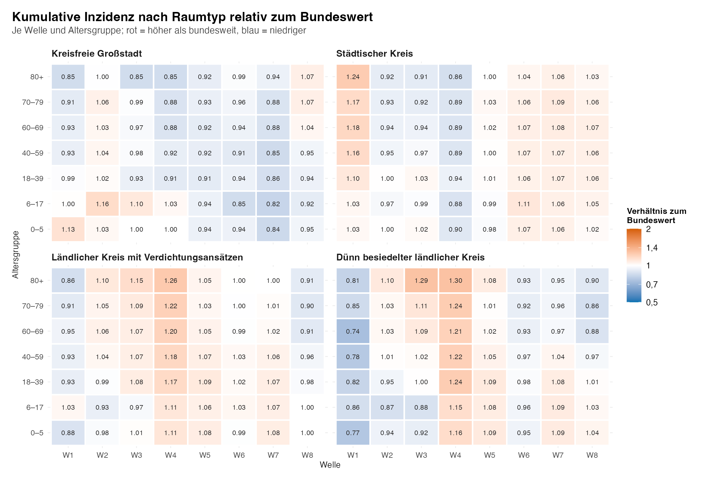

**Was die Abbildung zeigt:** vier Heatmaps (eine je BBSR-Kreistyp); jede Zelle ist die kumulative Inzidenz einer Altersgruppe (y) in einer Welle (x) im Kreistyp, geteilt durch den Bundeswert. Rot = höher, blau = niedriger als bundesweit; die Zahl steht in der Zelle.

**Lesart:**
- **W1:** Großstädte bei Jüngeren über dem Bundeswert (0–5: 1,13), dünn besiedelte Kreise in allen Gruppen darunter (0,74–0,86).
- **W4 (Delta):** umgekehrt – ländliche Kreise (Typ 3/4) bei Erwachsenen 17–30 % über dem Bundeswert (Typ 4, 80+: 1,30), Großstädte 8–15 % darunter.
- **W5:** ländlichere Kreise bei 6–59 leicht darüber (1,05–1,10), Großstädte 6–9 % darunter.
- **W6:** Verhältnisse nahe 1 (0,85–1,11), Großstädte bei 6–17 15 % darunter.
- **W7:** Großstädte in allen Altersgruppen 6–18 % unter dem Bundeswert.

Das Muster ist **weder über die Wellen noch über die Altersgruppen stabil** – genau das, wonach die Fragestellung fragt, und der Grund, warum das Modell Kreistyp × Altersgruppe je Welle braucht. Die Wochenverläufe der vier Kreistypen liegen auf Bundesebene eng beieinander ([fig05](../../results/modellauswahl/figures/fig05_woche_kreistyp_alter.png); y-Achse seit 26.11.2026 pseudo-logarithmisch, damit Wochen ohne Fälle sichtbar bleiben, z. B. Kinder Anfang 2020 und Mitte 2023); die Unterschiede stecken in den kumulativen Werten.

**Kreisart (Stadtkreis vs. Landkreis, Verhältnis der kumulativen Inzidenz):** > 1 bei Kindern und Jugendlichen in W1/W2 (W1, 0–5: 1,17; W2, 6–17: 1,23), in W4 bei Erwachsenen < 1 (0,85–0,92), ab W5 in allen Gruppen < 1 (6–17: W5 0,93, W6 0,81, W7 0,78) ([`urban_kreisart_wave_age.csv`](../../results/modellauswahl/tables/urban_kreisart_wave_age.csv)).

### 6.3 Rangkorrelationen mit Strukturmerkmalen

[fig07](../../results/modellauswahl/figures/fig07_korrelation_welle_alter.png) zeigt die Spearman-Korrelation zwischen Kreisinzidenz und jedem Strukturmerkmal je Welle × Altersgruppe ([`corr_wave_age_struct.csv`](../../results/modellauswahl/tables/corr_wave_age_struct.csv)):
- Mit dem Raumtyp selbst meist schwach (|ρ| ≤ 0,2); Ausnahmen W5 (18–39: ρ = 0,43 für Kreistyp, ländlicher = höher), W8 bei 60+ (−0,23 bis −0,29, städtischer = höher), W1 (bis −0,20).
- **Ost/West** ist stark mit den Inzidenzen verknüpft und **wechselt das Vorzeichen**: W1 −0,3 bis −0,5, W4 +0,4 bis +0,5, W6 −0,4 bis −0,6.
- Soziale Indikatoren (SGB-II, Arbeitslose) korrelieren in W1 und W5 negativ (bis −0,6), in W8 dagegen positiv (0,22–0,48).

### 6.4 Kontrolle des Bundeslands

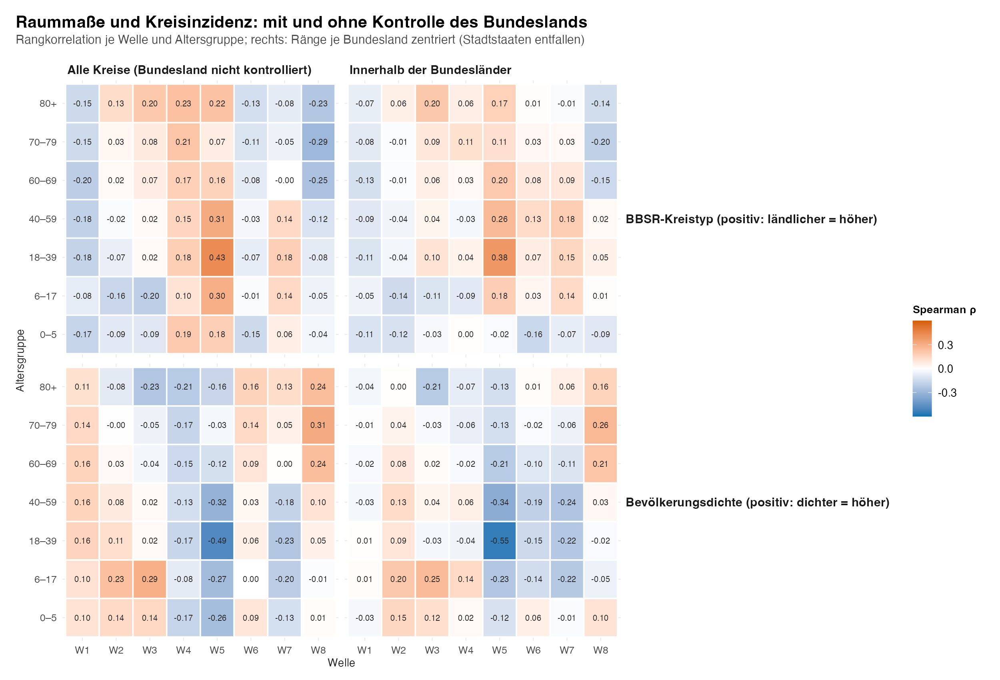

**Was die Abbildung zeigt:** Spearman-Rangkorrelation zwischen Kreisinzidenz und Raummaß je Welle × Altersgruppe; oben Kreistyp (positiv = ländlicher höher), unten Bevölkerungsdichte (positiv = dichter höher). Links über alle Kreise, rechts **innerhalb der Bundesländer** (Ränge global, dann je Land zentriert; Stadtstaaten entfallen).

**Lesart:** Ein Teil der rohen Zusammenhänge ist Länder-Effekt, ein Teil bleibt ([`corr_within_state.csv`](../../results/modellauswahl/tables/corr_within_state.csv)):

| Welle / Alter | ρ gesamt | ρ innerhalb Land |
|---|---|---|
| W4, 80+ | 0,23 | 0,06 |
| W4, 18–39 | 0,18 | 0,05 |
| W5, 18–39 | 0,43 | 0,38 |
| W5, 0–5 | 0,18 | −0,02 |
| W8, 70–79 | −0,29 | −0,20 |

**Vorschlag (21.11.2026, zur Bestätigung durch die Gruppe): Ost/West entfällt, das Bundesland (16 Länder) wird kontrolliert.** Ost/West hängt stark mit der Inzidenz zusammen (Verhältnis der mittleren kumulativen Inzidenz Ost/West: W1 0,4–0,5, W4 1,7–2,0, W6 0,5–0,7) **und** mit dem Kreistyp (Anteil östlicher Kreise: Typ 1 13 %, Typ 2 5 %, Typ 3 24 %, Typ 4 35 %) – ein klassischer Confounder. Das Bundesland fängt zusätzlich Landespolitik (Schulregeln, Testregime) und Meldeunterschiede auf.

---

## 7. Urbanisierungsmaß: Kreistyp statt Lage, Dichte, Kreisart oder Cluster

### 7.1 Die Kandidaten

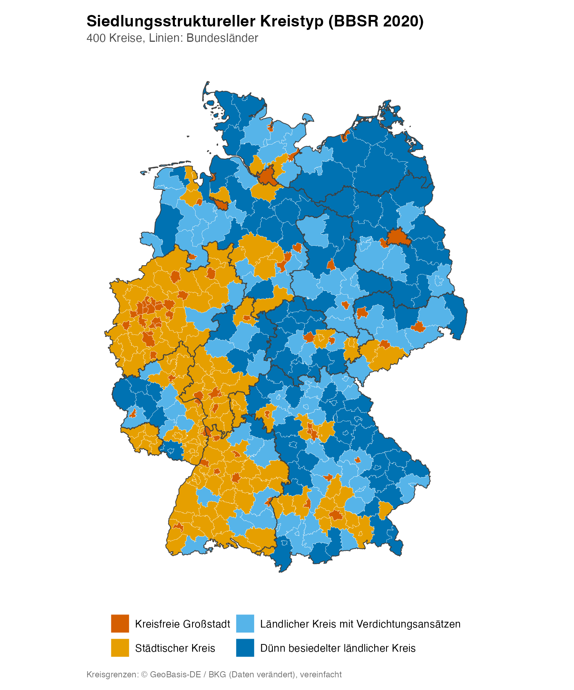

**Was die Karte zeigt:** die 400 Kreise nach BBSR-Siedlungsstrukturellem Kreistyp 2020, Linien = Ländergrenzen. Der Kreistyp ist selbst räumlich geklumpt (viel Typ 4 im Osten und Norden) – ein Grund, warum Bundesland und räumliche Struktur kontrolliert werden müssen. Definition der Kreistypen: [`reports/Siedlungsstrukturelle_Kreistypen.md`](../Siedlungsstrukturelle_Kreistypen.md).

| Kreistyp (BBSR 2020) | Kreise | Lage (BBSR 2020) | Kreise |
|---|---:|---|---:|
| 1 kreisfreie Großstadt | 67 | 1 sehr zentral | 106 |
| 2 städtischer Kreis | 133 | 2 zentral | 145 |
| 3 ländlich mit Verdichtungsansätzen | 98 | 3 peripher | 131 |
| 4 dünn besiedelt ländlich | 102 | 4 sehr peripher | **18** |

(Häufigkeiten für die 400 Kreise der Analyse; in der Rohdatei wegen Eisenach Typ 4 = 103, Lage 3 = 132.)

| Maß | Art | Rolle | Begründung |
|---|---|---|---|
| **BBSR-Kreistyp** (4 Stufen) | amtlich, kategorial | **Hauptmaß** | misst Siedlungsstruktur, interpretierbar, klare Kontraste „Typ t vs. Großstadt“ |
| log(Bevölkerungsdichte) | stetig | Robustheit | kein Informationsverlust, passt teils besser (7.3) |
| BBSR-Raumtyp Lage (4 Stufen) | amtlich, kategorial | Zusatz/Sensitivität | misst Zentralität, nicht Urbanisierung (7.2) |
| Kreisart (Stadtkreis/Landkreis) | Verwaltungsstatus | nur deskriptiv | 7.4 |
| Dichte-Quartile | kategorial | **verworfen** | Informationsverlust gegenüber stetiger Dichte |
| Clustertypologie | datengetrieben | **verworfen** | 7.5 |

**Zusammenhang der Maße** (Spearman, 400 Kreise):

| | log(Dichte) | Kreistyp | Lage | Stadtkreis |
|---|---|---|---|---|
| log(Dichte) | 1 | −0,81 | −0,78 | 0,74 |
| Kreistyp | | 1 | 0,78 | −0,49 |
| Lage | | | 1 | |

Die Maße sind stark kollinear. **Sie gehören deshalb nicht ungeprüft gemeinsam in ein Modell**, und ihre Effekte sind nicht scharf voneinander zu trennen.

### 7.2 Warum Kreistyp und nicht Lage („Location Type“)?

Der Raumtyp Lage beruht auf der in bis zu zwei Stunden Fahrzeit erreichbaren Tagesbevölkerung (deskriptive Auswertung nach Lage im Gruppen-Repo: [`results/locationtype_comparison/`](../../results/locationtype_comparison/)). Gründe gegen Lage als Hauptmaß:

1. **Inhaltlich:** Lage misst **Erreichbarkeit/Zentralität**, nicht den Urbanisierungsgrad, nach dem das Protokoll fragt. Ein ländlicher Kreis am Rand einer Metropole ist „zentral“, aber dünn besiedelt.
2. **Ungleich besetzt:** „Sehr peripher“ hat nur **18 Kreise**. Für 7 Altersgruppen × 8 Wellen ergäbe das sehr unsichere Kontraste (in W1 hatten bei 0–5 schon 71 von 400 Kreisen keinen Fall).
3. **Überlappung mit dem Kreistyp:** Großstädte (Typ 1) liegen nur in Lage 1–2, Typ 4 überwiegend in Lage 3–4 (ρ = 0,78).
4. **Gemeinsam im Modell nicht trennbar:** Modell m3 = m1 + Lage ([fig11](#stufe-1-getrennte-nb-modelle-je-welle--altersgruppe-m1-teil-1), blaue Dreiecke). Die AIC-Summe sinkt nur leicht (272.488 vs. 272.624 über 56 Zellen, also im Schnitt ca. 2,4 je Zelle), einzelne Kreistyp-Effekte kippen aber stark (W3, 80+, Typ 4: 1,29 → etwa 1,03); insgesamt korrelieren die Koeffizienten mit r = 0,93. Das ist das typische Bild bei Kollinearität: Der Effekt wird zwischen zwei fast gleichen Variablen hin- und hergeschoben.

→ **Lage bleibt Zusatz/Sensitivität**, nicht zweites Hauptmaß. (Ein Modell mit Lage *anstelle* des Kreistyps wurde nicht eigens gerechnet – wer das nachholen will: in `00_setup.R` / `12_models_wave_age.R` `kt` durch `lage` ersetzen.)

### 7.3 Warum Kreistyp und nicht Bevölkerungsdichte?

Das ist die **ehrlich offene** Frage – die Daten liefern keinen klaren Sieger:

| Vergleich | Ergebnis | Quelle |
|---|---|---|
| getrennte NB-Modelle: m2 (log-Dichte) vs. m1 (Kreistyp), AIC-Summe über 56 Zellen | Dichte etwas besser (272.523 vs. 272.624) | Teil 1, [`model_nb_fit.csv`](../../results/modellauswahl/tables/model_nb_fit.csv) |
| GAM mit Einzelalter: lineare Dichte vs. Kreistyp (cAIC) | Dichte besser in W1, W3, W6, W7, W8 (ΔAIC 26–82); Kreistyp besser in W2, W4, W5 (46–106) | Teil 6, [`gam_surface_tests.csv`](../../results/modellauswahl/tables/gam_surface_tests.csv) |
| frühere Fassung (vor 24.11., nicht altersspezifisch adjustiert) | Kreistyp besser in W1–W6 – **gilt nicht mehr** | Teil 6 |
| flexible Fläche Alter × Dichte (`s(Dichte) + ti(Alter, Dichte)`) | in allen Wellen am besten: gegenüber linearer Dichte um 18 (W1) bis 593 (W5), gegenüber Kreistyp um 48 bis 487 | Teil 6 |
| Woher der Vorteil der Fläche kommt | Dichte-Haupteffekt fast linear (edf 1,0–2,7); die Wechselwirkung mit dem Alter ist flexibel (edf 27–72 von 98). Bei festem Alter weicht die Fläche kaum von einer Geraden ab (Median 0,008–0,018 log-IRR) | Teil 6 |
| Kontrast dicht/dünn: Fläche vs. linear | nur 0,008–0,021 log-IRR Unterschied (max. 0,06 in W1) | [`gam_surface_contrast.csv`](../../results/modellauswahl/tables/gam_surface_contrast.csv) |
| Richtung der Effekte | gleich: wo dünn besiedelte Kreise höher liegen, sinkt die Inzidenz mit der Dichte und umgekehrt | Teil 1, fig12 |

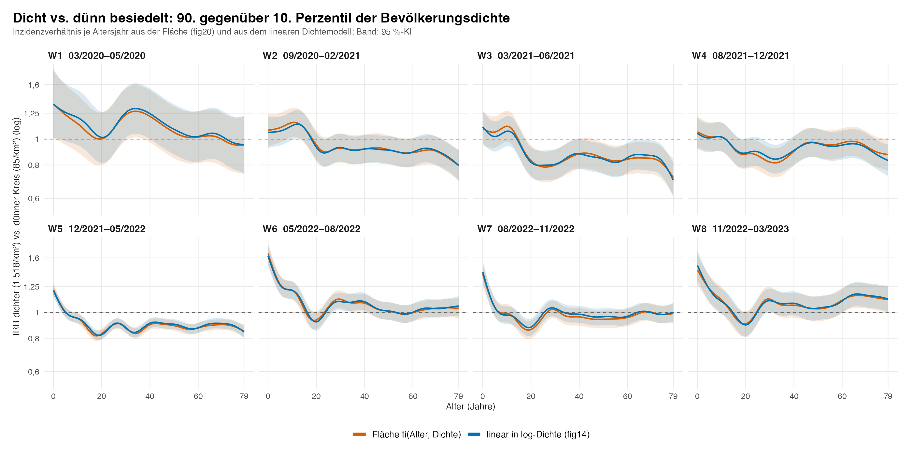

**Was die Abbildung zeigt** ([`18_gam_age_density.R`](../../Scripts/modellauswahl/18_gam_age_density.R)): je Welle das Inzidenzverhältnis eines **dichten** Kreises (90. Perzentil, 1.518 Einw./km²) gegenüber einem **dünn besiedelten** (10. Perzentil, 85 Einw./km²) über das Alter 0–79 – einmal aus der flexiblen Fläche (orange), einmal aus dem linearen Dichtemodell (blau), mit 95 %-KI. Beide Kurven liegen praktisch aufeinander → **die Form der Dichte-Beziehung ist für die Kernaussage egal**. Inhaltlich:
- **Jüngste Kinder** in dichten Kreisen höher, vor allem in W6–W8 (Alter 0: 1,39–1,66; Alter 5: 1,04–1,27) und in W1 (1,36) – das ist dasselbe Muster wie „0–5 in dünn besiedelten Kreisen niedriger“ im Hauptmodell.
- **W2–W4:** Erwachsene und Ältere in dichten Kreisen niedriger (W3: 55 Jahre 0,83, 79 Jahre 0,72), Schulkinder leicht höher (W3: 10 Jahre 1,12).
- **W5:** ab dem Jugendalter niedriger (0,83–0,90). **W8:** Ältere höher (70 Jahre 1,15).

Die ganze Fläche zeigt [fig20](../../results/modellauswahl/figures/fig20_gam_dichte_alter_flaeche.png) (Alter × Dichte, Referenz = Kreis mit Median-Dichte). Die Dichte-Effekte aus den getrennten Modellen ([fig12](../../results/modellauswahl/figures/fig12_modell_dichte_irr.png), IRR je 1 SD log-Dichte): in W2–W5 bei Erwachsenen und Älteren 0,83–0,97 (z. B. W3, 80+: 0,83*), bei 0–5 in W6 1,12* und W8 1,08*. GAM-Version: [fig14](../../results/modellauswahl/figures/fig14_gam_dichte_alter.png).

**Warum trotzdem Kreistyp als Hauptmaß:**
1. **Interpretierbar und kommunizierbar:** „Dünn besiedelte Kreise haben bei 0–5-Jährigen in W8 eine um 21 % niedrigere Inzidenz als Großstädte“ versteht jeder; „je Standardabweichung log-Dichte“ nicht.
2. **Amtliche Typologie**, die Stadtstatus und Siedlungsdichte kombiniert und auch in anderen Arbeiten verwendet wird.
3. **Der Kern-Test bleibt einfach:** Kreistyp × Alter hat feste 18 Kontraste je Welle.
4. **Die Muster hängen nicht an der Kategorisierung:** Dichte (linear und als Fläche) zeigt dieselben Muster; sie dient deshalb als Robustheitsprüfung.

**Vorsicht beim AIC-Vorteil der Fläche:** Die Dichte ist ein Kreismerkmal; eine sehr flexible Fläche kann auch kreisspezifische Altersprofile aufnehmen, die nur zufällig mit der Dichte zusammenhängen (die edf steigen mit k weiter). Räumliche Autokorrelation ist in diesen GAM nicht modelliert.

**Status:** Frage an Finn („Kreistyp oder Dichte?“). Wer die Dichte als Hauptmaß bevorzugt, hat gute Argumente (passt in 5 von 8 Wellen besser).

### 7.4 Warum nicht Kreisart (Stadtkreis/Landkreis)?

„Stadtkreis“ ist ein **Verwaltungsstatus**: 39 der 106 kreisfreien Städte sind laut BBSR keine Großstädte (Typ 2–4), und Kreistyp und Stadtkreis korrelieren nur mit −0,49. Die Kreisart misst also etwas anderes als Urbanisierung (wie Dr. Klima im Kickoff angesprochen hat) und wird nur deskriptiv berichtet (6.2).

### 7.5 Datengetriebene Typologie (Clusteranalyse) – verworfen

[`21_cluster_typology.R`](../../Scripts/modellauswahl/21_cluster_typology.R), Teil 9. Idee: Vielleicht trennt eine aus allen Strukturmerkmalen gebildete Typologie die Kreise besser als der BBSR-Kreistyp.

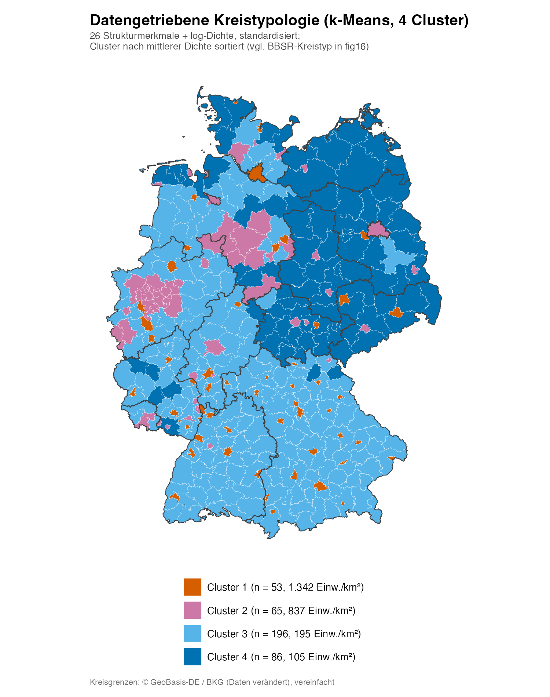

**Was die Karte zeigt:** vier k-Means-Cluster (50 Starts) aus 26 Strukturmerkmalen + log-Dichte (standardisiert, euklidische Distanz), nach mittlerer Dichte sortiert:

| Cluster | n | Profil | Anteil BBSR-Typ 1 |
|---|---:|---|---|
| 1 dicht und wohlhabend | 53 | 1.342 Einw./km², SGB-II 66 je 1.000, viele Einpendler, Hochschulreife 40 % | 64 % |
| 2 dicht und benachteiligt | 65 | 837 Einw./km², SGB-II 99, Arbeitslose 6,8 % (u. a. Ruhrgebiet, Bremen, Berlin) | 48 % |
| 3 ländlich bis suburban, West/Süd | 196 | 195 Einw./km², SGB-II 36 | |
| 4 ländlich, alt, überwiegend Ost | 86 | 105 Einw./km², 65+ 27 %, 72 % in den östlichen Ländern | |

**Warum verworfen:**
- **Kaum Clusterstruktur:** Silhouette k-Means 0,26 (k = 2), 0,21 (k = 3), 0,22 (k = 4), ≤ 0,16 für größere k; Ward mit k = 4 nur 0,12. Die Kreise bilden ein Kontinuum.
- k-Means und Ward stimmen bei k = 4 nur mäßig überein (adjustierter Rand-Index 0,46).
- **Geringe Übereinstimmung mit BBSR** (ARI 0,20): Die Cluster trennen eher **soziale Lage und Ost/West** als Urbanisierung.
- **Im Modell** (AIC-Summe über 56 Zellen): Kreistyp 272.624, **4 Cluster 272.780 – schlechter als gar kein Raummaß (272.707)**; 2 Cluster 272.616, also gleichauf mit dem Kreistyp.

---

## 8. Der Weg zum Modellvorschlag A1 (Stufe 1–6)

Die Datenstruktur ist für alle Modelle gleich: y = kumulative Fälle je Kreis k × Altersgruppe a (× Welle w), Offset log(mittlere Bevölkerung der Welle). Warum Zählmodell, Offset und negativ-binomial: siehe [Abschnitt 9](#9-der-modellvorschlag-a1-schritt-für-schritt).

### Stufe 1: getrennte NB-Modelle je Welle × Altersgruppe („m1“, Teil 1)

[`12_models_wave_age.R`](../../Scripts/modellauswahl/12_models_wave_age.R) (ca. 7 s). 8 Wellen × 7 Altersgruppen = **56 Modelle** (fein: 104), je 400 Kreise, `MASS::glm.nb`. Referenz des Kreistyps: Großstadt. Kovariaten z-standardisiert.

| Modell | Prädiktoren | Rolle |
|---|---|---|
| m0 | Kreistyp + Bundesland | nur Bundesland |
| **m1** | Kreistyp + Bundesland + SGB-II + Anteil 65+ + log(Übernachtungen) | Ausgangsmodell |
| m1_nokt | m1 ohne Kreistyp | Likelihood-Ratio-Test des Kreistyps (3 Parameter) |
| m2 | log(Dichte) statt Kreistyp | Robustheit Raummaß |
| m3 | m1 + BBSR-Lage | Zusatz |
| m1_gen | m1 mit GENESIS-Nenner | Sensitivität Nenner |

**Kovariatenwahl (vorläufig):** SGB-II und Arbeitslosenquote korrelieren mit ρ = 0,94, Anteil 65+ und Anteil 18–39 mit −0,83 → je ein Vertreter; Tourismus als Merkmal mit geringer Korrelation zu den anderen. **Keine begründete Modellselektion.**

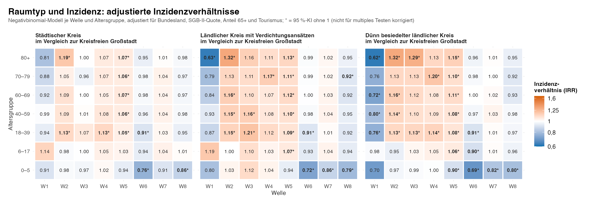

**Was die Abbildung zeigt:** Heatmaps der adjustierten IRR (Typ 2, 3, 4 gegenüber Großstadt) je Welle (x) × Altersgruppe (y) aus den 56 getrennten Modellen; * = 95 %-KI ohne 1 (unkorrigiert).

**Ergebnisse m1 (Typ 4 vs. Großstadt):**
- W1 niedriger, besonders 80+ (0,62*), 60–69 (0,72*), 18–39 (0,76*); 0–5 0,70 (n. s., wenige Fälle).
- W2, W3 bei Erwachsenen und Älteren höher (18–39: 1,13*; 80+: 1,32* in W2, 1,29* in W3).
- W4: 70–79 1,20*, 18–39 1,14*.
- W5: in allen Gruppen ab 6–17 höher (1,06*–1,15*), 0–5 niedriger (0,90*).
- W6: 0–5 deutlich niedriger (0,69*), 18–39 0,91*. W7, W8: meist um 1, 0–5 niedriger (0,82*, 0,80*).
- Städtische Kreise (Typ 2) liegen meist näher bei den Großstädten (0,8–1,2).
- LR-Test des Kreistyps (p < 0,05, von 7 Altersgruppen): W3 6, W5 6, W1 4, W6 2, W2/W4/W7/W8 je 1 – bei 56 Tests wären rund 3 Treffer allein durch Zufall zu erwarten.
- Kovariaten (je 1 SD): SGB-II in W1 < 1 (0,75–0,87 bei Erwachsenen), in W2–W3 > 1 (1,04–1,16, am stärksten bei 6–17); Anteil 65+ meist ≈ 1; Tourismus in W3 0,91–0,93.

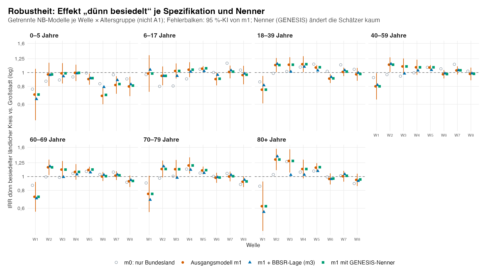

**Was die Abbildung zeigt:** je Altersgruppe (Panel) und Welle den Effekt „dünn besiedelt vs. Großstadt“ in vier Spezifikationen. Orange = **Ausgangsmodell m1** (getrennte NB-Modelle, nicht A1; mit 95 %-KI); grau = nur Bundesland (m0), blau = m1 + Lage (m3), grün = m1 mit GENESIS-Nenner. (Bis 26.11.2026 hieß m1 in der Legende noch „Hauptmodell“; korrigiert.)
- Grün liegt immer direkt neben orange → **Nenner unkritisch** (Δ log-IRR im Mittel 0,002).
- Grau weicht oft deutlich ab → **Adjustierung wichtig** (Korrelation m0 vs. m1 nur 0,49, mittlere |Δ| 0,094).
- Blau weicht in einzelnen Zellen stark ab (W3, 80+) → **Kollinearität Kreistyp–Lage**.

**Weitere Prüfungen:**

| Prüfung | Ergebnis |
|---|---|
| AIC-Summe über 56 Zellen | m3 272.488 < m2 272.523 < m1 272.624 < m1_nokt 272.707 < m0 273.454 |
| Überdispersion θ | klein in W1 (1,6–5,6), groß in W5 (29–157): Kreise streuen in W1 am stärksten |
| Pearson-Dispersion | 1,00–1,45 (Median 1,10) – NB-Varianz passt je Zelle |
| Ausreißer | je Zelle im Median 4 Kreise mit \|Pearson-Residuum\| > 3 |
| Einfluss einzelner Kreise | kein Kreis verschiebt einen Kreistyp-Koeffizienten um mehr als 0,55 SE (fein 0,84); am häufigsten einflussreich: Rostock, Greiz, Flensburg, Weimar |
| Stadtstaaten | Hamburg und Berlin bestimmen mit dem Bundesland-Effekt ihren eigenen Wert vollständig (Hebelwert 1) |
| cluster-robuste SE nach Bundesland | im Median 2 % größer; Anteil signifikanter Typ-4-Koeffizienten 43 % → 27 % (nur 16 Cluster, mit Vorsicht) |
| Konvergenz | alle Zellen × Spezifikationen ohne Warnung |

Diagnosen: [`model_nb_diag.csv`](../../results/modellauswahl/tables/model_nb_diag.csv), Koeffizienten: [`model_nb_coef.csv`](../../results/modellauswahl/tables/model_nb_coef.csv), Anpassung/LR-Tests: [`model_nb_fit.csv`](../../results/modellauswahl/tables/model_nb_fit.csv).

**Problem, das zur nächsten Stufe führt:** Die Kernfrage F2 („ist der Kreistyp-Effekt bei 0–5 anders als bei 80+?“) wird mit den vorliegenden getrennten Fits **nicht direkt getestet**: Alle 7 Modelle einer Welle verwenden dieselben 400 Kreise, die Schätzer sind abhängig, und ihre Kovarianz liefern die getrennten Fits nicht. Nachholen ließe sich der Test z. B. mit einem gestapelten Modell oder einem Kreis-Bootstrap über alle 7 Modelle (Abschnitt 13, „nicht gerechnet“); das gemeinsame Modell löst es direkt. Außerdem sind die Residuen räumlich autokorreliert (Stufe 3).

### Stufe 2: GAM mit Einzelalter (Ergänzung, Teil 2)

[`13_gam_age.R`](../../Scripts/modellauswahl/13_gam_age.R) (ca. 2 min, mit Bootstrap ca. 20 min). Dr. Klima wünscht Ansätze ohne feste Altersgruppen; hier ist der Kreistyp-Effekt eine **glatte Funktion des Alters 0–79**. Je Welle ein NB-GAM (`mgcv::bam`, fREML) auf 32.000 Zeilen (400 Kreise × 80 Einzeljahre):

`Fälle ~ Kreistyp + Alter (Faktor, 80 Stufen) + s(Alter, by = Kreistyp) + Bundesland + s(Alter, by = Bundesland) + s(Alter, by = SGB-II) + s(Alter, by = 65+) + s(Alter, by = Tourismus) + Kreis-Zufallseffekt + offset(log Bevölkerung)`

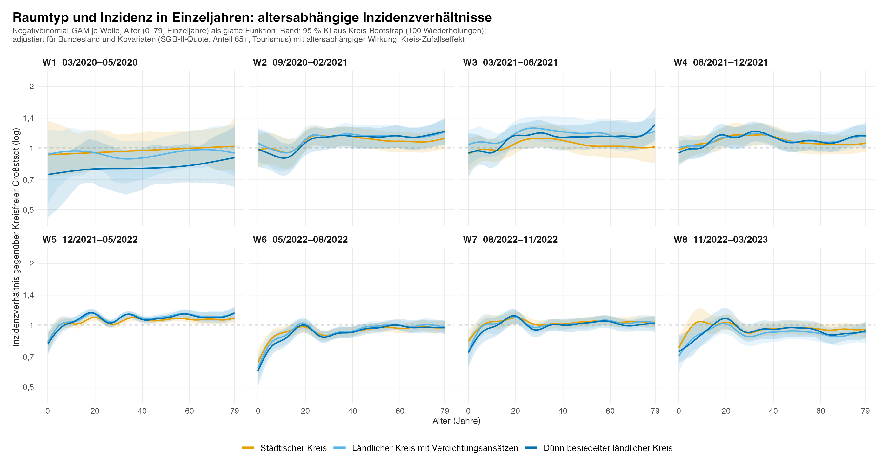

**Was die Abbildung zeigt:** je Welle die Inzidenzverhältnisse der Kreistypen gegenüber der Großstadt über das Alter 0–79 (Linien), mit 95 %-Bändern aus einem **Kreis-Bootstrap** (100 Wiederholungen, Kreise innerhalb der Bundesländer neu gezogen). Typisch: W5–W8 starten bei Alter 0 deutlich unter 1 und steigen bis zum Jugendalter auf etwa 1; in W2–W4 liegen Erwachsene und Ältere über 1; W1 ist fast flach und sehr unsicher.

Typ 4 gegenüber Großstadt, IRR an ausgewählten Altersjahren ([`gam_age_curves.csv`](../../results/modellauswahl/tables/gam_age_curves.csv)):

| Welle | 0 | 10 | 20 | 30 | 40 | 60 | 79 | KI ohne 1 (Modell) | KI ohne 1 (Bootstrap) |
|---|---|---|---|---|---|---|---|---|---|
| W1 | 0,74 | 0,77 | 0,79 | 0,79 | 0,80 | 0,82 | 0,90 | niedriger bei 54 Altersjahren | niedriger bei 24 |
| W2 | 0,99 | 0,89 | 1,06 | 1,13 | 1,14 | 1,14 | 1,21 | höher bei 47 | höher bei 14 |
| W3 | 0,94 | 0,95 | 1,15 | 1,18 | 1,13 | 1,14 | 1,30 | höher bei 41 | höher bei 12 |
| W4 | 0,94 | 1,00 | 1,15 | 1,19 | 1,13 | 1,07 | 1,15 | höher bei 25 | höher bei 32 |
| W5 | 0,81 | 1,03 | 1,14 | 1,07 | 1,06 | 1,13 | 1,15 | höher bei 64, niedriger bei 5 | höher bei 63, niedriger bei 3 |
| W6 | 0,60 | 0,84 | 1,00 | 0,88 | 0,92 | 1,00 | 0,97 | niedriger bei 32 (0–40) | niedriger bei 33 |
| W7 | 0,73 | 0,98 | 1,11 | 0,95 | 1,00 | 1,04 | 1,02 | niedriger bei 6, höher bei 5 | niedriger bei 5, höher bei 3 |
| W8 | 0,74 | 0,91 | 1,08 | 0,92 | 0,95 | 0,93 | 0,94 | niedriger bei 15 | niedriger bei 15 |

**Variiert der Effekt mit dem Alter?** W2–W8 ja (Wald-Test p ≈ 0; ΔAIC zugunsten des altersabhängigen Effekts 260 in W8 bis 1.073 in W5). W1 kaum (Typ 4 p = 0,098, ΔAIC nur 12) – passt zum Hauptmodell (W1: p = 0,72).

**Korrekturen auf dem Weg** (alle in Teil 2 dokumentiert):
1. **Alters-Haupteffekt als Faktor** statt `s(Alter, k = 25)`: Der Glätter war ausgeschöpft (edf 23–24 von 24; mit k = 40/60 stieg die edf auf 35/54), das Altersprofil hat Sprünge an Schulaltersgrenzen. Als Faktor AIC deutlich besser (W5 um ca. 2.600); Kurven ändern sich um ≤ 0,003.
2. **Doppelter Dichteterm entfernt:** Ein `by`-Glätter mit numerischer Variable wird in `mgcv` nicht zentriert und enthält den linearen Effekt schon; der zusätzliche lineare Term war nicht identifizierbar (die edf im Wald-Test sprang je nach Rechenweg um genau 1).
3. **Adjustierung angeglichen (24.11.):** Vorher wirkten Bundesland und Kovariaten im GAM in allen Altersjahren gleich, im Gruppenmodell aber altersspezifisch. Übereinstimmung GAM ↔ Gruppenmodelle nur r = 0,70 (bzw. 0,74 zum Hauptmodell). Nach der Angleichung (`GAM_COV` in `00_setup.R`: `s(age, by = state)` und `s(age, by = z_*)`) **r = 0,90 bzw. 0,93**, mittlere |Δ| 0,021. Die Raumtyp-Kurven änderten sich deutlich (Typ 4: mittlere |Änderung| 0,059, max. 0,33); neu sind vor allem die niedrigen Werte der kleinen Kinder ab W5. **Lehre:** Altersspezifische Länderunterschiede (z. B. Schultests) „sickern“ sonst in die Kreistyp-Kurven.
4. **Bootstrap statt modellbasierter Bänder:** Verhältnis Bootstrap-/Modell-SE Typ 2 1,09, Typ 3 1,14, Typ 4 1,14 (je Welle 0,93–1,26, am größten in W1–W3); Signifikanzurteil stimmt bei 91 % der Punkte überein. Bei Typ 4 sinkt die Zahl der Altersjahre mit KI ohne 1 deutlich (W1 24 statt 54, W2 14 statt 47, W3 12 statt 41). → In fig13 die Bootstrap-Bänder verwenden.

**Rolle:** Ergänzung zum Hauptmodell. Grenzen: 80+ fehlt (Sammelgruppe), ein gemeinsames θ über alle Altersjahre, flexible Kurven (edf 9,5–13,5 von 14) an den Rändern (Alter 0, 79) unsicher, kein räumlicher Effekt.

### Stufe 3: räumliche Struktur (Teil 4)

[`16_spatial.R`](../../Scripts/modellauswahl/16_spatial.R) (ca. 50 s).
- **Nachbarschaft:** Kreise mit gemeinsamer Grenze; weil sich die vereinfachten Grenzen nicht exakt berühren, gelten Flächen als benachbart, die sich nach 100 m Puffer schneiden (1–12 Nachbarn, Median 5; Kontrolle: mit 50 m ändert sich die Nachbarzahl bei 2 Kreisen, mit 500 m bei 23). Gewichte zeilenstandardisiert.
- **Moran's I:** Permutationstest mit 999 Permutationen, je Welle × Altersgruppe.
- **m1 + MRF:** m1 plus Markov-Random-Field-Effekt über die Nachbarschaft (`mgcv`, `bs = "mrf"`, Rang 100, REML).

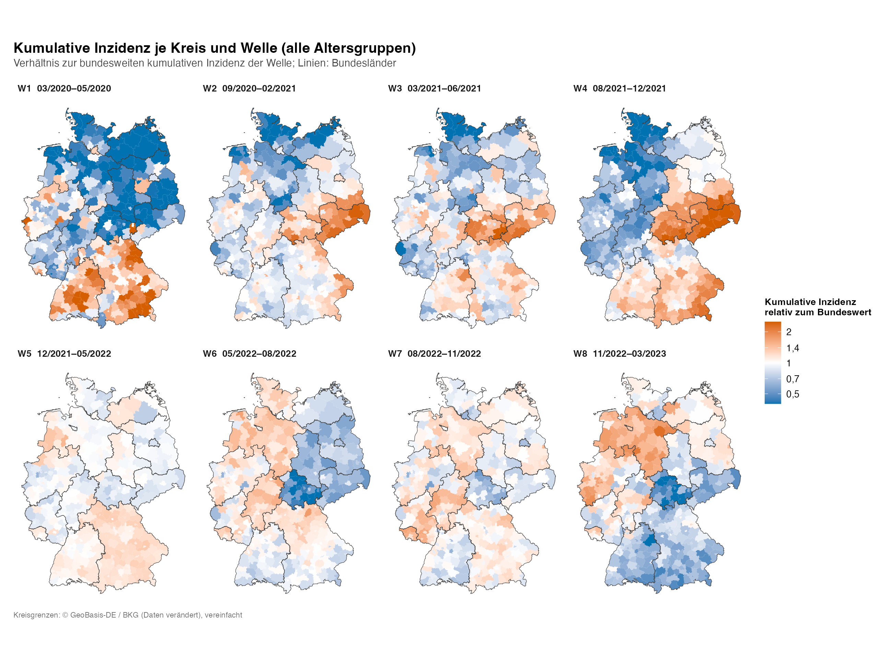

**Was die Karten zeigen:** je Welle die kumulative Inzidenz jedes Kreises relativ zum Bundeswert (alle Altersgruppen). Die Inzidenz ist stark **räumlich geclustert**: Moran's I 0,28–0,88 (Median 0,62), in allen 56 Zellen signifikant; am stärksten in W4 (Median 0,83; Ost-Süd-Muster), am schwächsten in W7 (0,41).

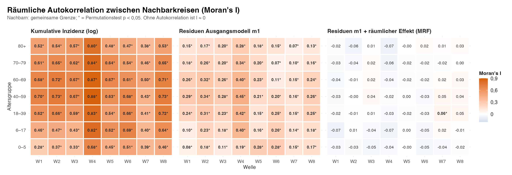

**Was die Abbildung zeigt:** Moran's I je Welle × Altersgruppe als Heatmap (* = Permutationstest p < 0,05; ohne Autokorrelation I ≈ 0) – für die Inzidenz, die Residuen von m1 und m1 + MRF.
- **Residuen von m1** sind autokorreliert: I = 0,07–0,45 (Median 0,20), alle 56 Zellen signifikant; am meisten in W4 (bis 0,45 bei 40–59). Bundesland und Kovariaten erklären nur einen Teil der räumlichen Struktur → Standardfehler eher zu klein.
- **Mit MRF** verschwindet die Autokorrelation: I = −0,07–0,06, 1 von 56 Zellen knapp signifikant.
- **Kreistyp-Effekte bleiben stabil** ([`spatial_model_coef.csv`](../../results/modellauswahl/tables/spatial_model_coef.csv)): r = 0,954, mittlere |Δ| 0,033, max. 0,15 (W1, 80+, Typ 3: 0,63 → 0,73); kein signifikanter Koeffizient wechselt das Vorzeichen; SE im Median +3 %; signifikant 54 → 63 (Typ 4: 24 → 32). „Ländlich höher“ in W2–W4 wird mit MRF eher **stärker** (W3, 70–79, Typ 4: 1,13 → 1,27) → kein Hinweis darauf, dass die Kreistyp-Effekte nur räumliche Cluster sind.

### Stufe 4: ein gemeinsames Modell aller Altersgruppen (gemeinsames θ + MRF, Teil 5)

[`17_joint_age_models.R`](../../Scripts/modellauswahl/17_joint_age_models.R) (ca. 55 s) – **Arbeitsvorschlag vom 21. bis 24.11.2026**, jetzt Sensitivitätsanalyse für den räumlichen Effekt.

Je Welle ein NB-Modell mit allen 7 Altersgruppen (2.800 Zeilen), `mgcv::bam`, REML:
`cases ~ Altersgruppe + Altersgruppe:Kreistyp + Altersgruppe:Bundesland + Altersgruppe:(SGB-II + 65+ + Tourismus) + s(ags, bs = "re") + s(ags, bs = "mrf") + offset(log Bevölkerung)`

Die Abhängigkeit wird auf drei Ebenen modelliert: **(1) Altersgruppen desselben Kreises** (unstrukturierter Kreis-Effekt), **(2) Kreise desselben Landes** (Bundesland), **(3) Nachbarkreise** (MRF) – zusammen eine BYM-artige Zerlegung. Damit wird F2 erstmals **direkt getestet** (Wald-Test, 18 Kontraste).

Vergleichsmodelle: `const` (ein Kreistyp-Effekt für alle Altersgruppen), `int_re` (Bundesland als Zufallseffekt), `int_nosp` (ohne MRF), `gee` (GEE, Quasi-Poisson, Sandwich-SE geclustert nach Kreis).

| Welle | Wald-Test (df 18) p | nur Typ 4 (df 6) p | ΔAIC const − int | ΔAIC Land RE − FE | ΔAIC ohne − mit MRF | Moran's I Kreis-Residuen mit / ohne MRF | θ | SD Kreis-Effekt |
|---|---|---|---|---|---|---|---|---|
| W1 | 0,27 | 0,23 | −15,1 | −43,6 | 6,0 | 0,02 / 0,14* | 18 | 0,38 |
| W2 | 5·10⁻⁷ | 1·10⁻⁹ | 26,4 | −16,1 | 6,4 | 0,01 / 0,22* | 55 | 0,19 |
| W3 | 3·10⁻¹³ | 6·10⁻⁷ | 60,7 | −17,0 | 2,7 | 0,04 / 0,15* | 84 | 0,21 |
| W4 | 2·10⁻⁵ | 3·10⁻⁴ | 17,5 | −15,3 | 8,7 | −0,02 / 0,17* | 106 | 0,16 |
| W5 | 1·10⁻¹⁶ | 5·10⁻²¹ | 79,0 | −11,0 | 4,2 | 0,02 / 0,21* | 193 | 0,08 |
| W6 | 2·10⁻³⁰ | 2·10⁻³³ | 146,6 | −6,2 | 2,3 | 0,10* / 0,22* | 183 | 0,14 |
| W7 | 2·10⁻⁷ | 1·10⁻⁹ | 29,3 | −6,6 | 0,9 | 0,09* / 0,14* | 199 | 0,14 |
| W8 | 0,002 | 0,003 | 3,7 | −5,1 | 3,6 | 0,09* / 0,20* | 112 | 0,16 |

Lesart: ΔAIC const − int > 0 → altersspezifischer Kreistyp-Effekt passt besser; ΔAIC RE − FE < 0 → Bundesland als Zufallseffekt passt besser; ΔAIC ohne − mit MRF > 0 → Raumeffekt verbessert das Modell.

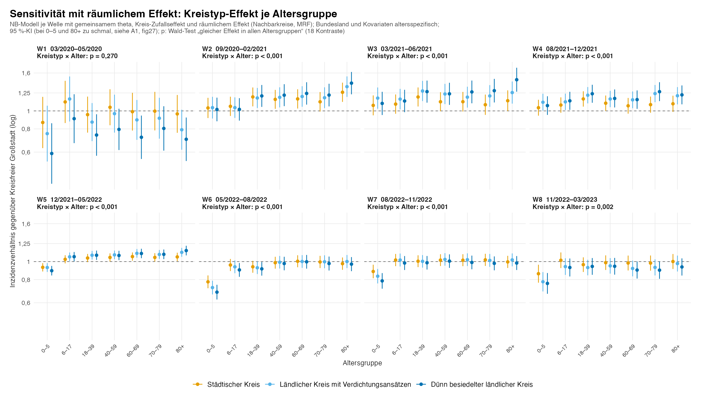

**Was die Abbildung zeigt:** gleicher Aufbau wie fig27 (Panel je Welle, x = Altersgruppe, y = IRR gegenüber Großstadt), aber aus diesem Vorgängermodell. Die Muster sind dieselben (Typ 4: 0–5 in W1 0,59 und ab W5 0,68–0,89; 80+ in W2 1,41, W3 1,47; 70–79 in W4 1,27); die Intervalle bei 0–5 und 80+ sind schmaler als in A1 – und genau das war das Problem (siehe unten).

**Nebenergebnisse, die weiter gelten:**

| Vergleich (log-IRR, 168 Koeffizienten) | Korrelation | mittlere \|Δ\| | SE-Verhältnis |
|---|---|---|---|
| getrennte Modelle (Stufe 1) | 0,93 | 0,042 | 1,01 |
| ohne räumlichen Effekt | 0,97 | 0,033 | 1,01 |
| Bundesland als Zufallseffekt | 0,99 | 0,015 | 1,00 |
| GEE | 0,83 | 0,058 | 1,09 |

- **Bundesland fest oder zufällig:** für die Kreistyp-Effekte unkritisch (r = 0,99); cAIC bevorzugt den Zufallseffekt (105 Parameter weniger).
- **GEE:** Wald-Test in W2–W8 p ≤ 0,006, W1 0,30 → die Aussage hängt weder an der Normalverteilung der Zufallseffekte noch an der NB-Verteilung.
- **MRF-Rang** 100/200/399: Kreistyp-Koeffizienten ±0,03, AIC < 5; der volle Rang überkorrigiert teils (W2: Moran's I = −0,11).
- **Kontrolle:** ML-Schätzung mit `gam` statt `bam` ergibt in W4 dieselben Kreistyp-Koeffizienten (±0,002).
- Mit MRF sind 75 von 168 Koeffizienten signifikant, ohne 55.

**In diesem Vorgängermodell** führten fünf Arten, die Abhängigkeit zu behandeln, zu derselben Richtung der Effekte: GLMM mit Kreis-Effekt + MRF, GLMM ohne MRF, GEE (robust nach Kreis), getrennte Modelle mit cluster-robusten SE, Kreis-Bootstrap im GAM. Die Tests sind dabei aber **verschieden** gebaut (Wald-Test im gemeinsamen Modell, robuste SE, Bootstrap-Bänder über das Einzelalter) und daher nicht eins zu eins vergleichbar. Im gemeinsamen Modell mit gemeinsamem θ war Kreistyp × Alter in W2–W8 signifikant, in W1 nicht. **Für A1 gilt das nicht mehr:** Dort ist der Test nur in W2–W6 Holm-signifikant, W7 nicht (0,11) und W8 spezifikationsabhängig (0,040; [10](#10-ergebnisse-von-a1-vorläufig)). Vermutlich kam ein Teil der früheren Signifikanz von den zu schmalen Intervallen bei 0–5 und 80+ (siehe unten).

**Problem (Diagnose am 24.11.2026): ein θ für alle Altersgruppen passt nicht.** NB-Pearson-Dispersion (Σr²/n) je Altersgruppe und Welle in diesem Modell:

| Altersgruppe | W1 | W2 | W3 | W4 | W5 | W6 | W7 | W8 |
|---|---|---|---|---|---|---|---|---|
| **0–5** | 1,46 | 2,51 | 2,73 | 2,78 | **3,41** | 2,89 | 2,64 | 1,72 |
| 6–17 | 1,30 | 1,41 | 0,89 | 0,65 | 0,38 | 1,31 | 1,52 | 1,82 |
| 18–39 | 0,81 | 0,45 | 0,50 | 0,69 | 0,42 | 0,55 | 0,63 | 0,69 |
| 40–59 | 0,38 | 0,30 | 0,42 | 0,32 | 0,26 | 0,32 | 0,42 | 0,51 |
| 60–69 | 0,60 | 0,37 | 0,57 | 0,49 | 0,46 | 0,51 | 0,47 | 0,36 |
| 70–79 | 0,75 | 0,60 | 1,01 | 0,96 | 0,73 | 0,91 | 0,67 | 0,74 |
| **80+** | 2,59 | 2,13 | 2,06 | 2,01 | 1,61 | 1,71 | 2,10 | 2,23 |

Die Dispersion sollte ≈ 1 sein. Je Welle hatten 35–54 Beobachtungen ein |Pearson-Residuum| > 3, fast alle bei 0–5 und 80+. Das gemeinsame θ ist ein Kompromiss: Die echte Streuung bei 0–5 und 80+ ist größer als angenommen → **Konfidenzintervalle dort zu schmal, Sterne zu zahlreich**, bei Erwachsenen zu konservativ. Das betrifft genau die Kernaussage (kleine Kinder vs. Erwachsene, Ältere). (Der Kreis-Zufallseffekt war außerdem in 7 von 8 Wellen nicht normalverteilt, Shapiro p < 0,05 – für die festen Effekte weniger wichtig.)

### Stufe 5: θ je Altersgruppe **und** Raumeffekt – was nicht ging

Ziel war ein Modell mit eigenem θ je Altersgruppe **und** räumlichem Effekt. Mit `mgcv`/`glmmTMB` (getestet am 24.11.2026):

| Versuch | Ergebnis |
|---|---|
| `mgcv` | kennt nur **ein** θ je Modell |
| **A2:** `mgcv`, Poisson + altersgruppenspezifischer Beobachtungs-Zufallseffekt + MRF | nach **11 Minuten noch keine einzige Welle fertig** → abgebrochen |
| **A1s:** `glmmTMB` + exponentielle räumliche Kovarianz über die Kreisschwerpunkte | W4 3,5 min, **Hessematrix nicht positiv definit**, Moran's I unverändert (0,16 → 0,16) → verworfen |
| `glmmTMB` mit MRF | gibt es nicht |
| **A3:** GEE (schon in Stufe 4) | robust gegenüber der Dispersion, aber ohne Kreis-Effekt und cAIC, Quasi-Poisson gewichtet große Kreise stärker → nur Robustheitsprüfung |
| **A1c:** `glmmTMB` mit gemeinsamem θ | reproduziert `int_nosp` (r = 0,9999, SE-Verhältnis 1,00) → Umsetzung korrekt |

**Abwägung:** Eigenes θ je Altersgruppe ändert die Standardfehler um **15–30 %** (0–5 ×1,27, 80+ ×1,17, Erwachsene ×0,84–0,88), der räumliche Effekt nur um **1–3 %** (Stufe 3/4), und die Kreistyp-Effekte kaum (r = 0,97). Drei Optionen wurden diskutiert:
- **I (derzeitiger Vorschlag):** A1 als Hauptmodell (θ je Gruppe, kein MRF); MRF-Modell und GEE als Robustheit. Grund: Das Problem mit der größeren Wirkung auf die Schlüsse (Dispersion) ist gelöst; der Raumeffekt zeigte keine Konfundierung. Kosten: Restautokorrelation.
- **II:** MRF-Modell als Hauptmodell, A1 als Robustheit – Kosten: KI bei 0–5 und 80+ zu schmal, genau bei der Kernaussage.
- **III:** beides mit Stan/INLA – am 25.11. mit INLA umgesetzt (Abschnitt 11.3): Schlüsse bis auf W8 gleich.

### Stufe 6: Modellvorschlag A1 (Teil 10)

[`22_main_model_tmb.R`](../../Scripts/modellauswahl/22_main_model_tmb.R) (ca. 3–4 min, `glmmTMB` 1.1.15). Seit 24.11.2026 der Vorschlag aus diesem Teilprojekt; **in der Gruppe noch nicht entschieden** ([0.5](#05-was-die-gruppe-entscheiden-muss)). Vollständige Erklärung im nächsten Abschnitt.

---

## 9. Der Modellvorschlag A1 Schritt für Schritt

Die Schritte 1–4 erklären die Bausteine an einem **Lehrbeispiel** (nur W5, nur 18–39, einfache Modelle ohne Zufallseffekte; eigens gerechnet am 26.11.2026, nicht in den Projekttabellen). Ab Schritt 5 geht es um A1 selbst.

### Eine Zeile der Daten

Eine Zeile = **ein Kreis × eine Altersgruppe × eine Welle** ([`covid_wave_kreis.rds`](../../data_processed/modellauswahl/covid_wave_kreis.rds)). Beispiel W5:

| Kreis | Kreistyp | Altersgruppe | Fälle | Bevölkerung | Inzidenz je 100.000 |
|---|---|---|---:|---:|---:|
| München (09162) | T1 Großstadt | 0–5 | 18.046 | 92.822 | 19.441 |
| Eichsfeld (16061) | T4 dünn besiedelt | 0–5 | 1.481 | 5.591 | 26.492 |
| München (09162) | T1 Großstadt | 80+ | 6.815 | 88.175 | 7.729 |
| Eichsfeld (16061) | T4 dünn besiedelt | 80+ | 755 | 7.654 | 9.860 |

Zwei Probleme, die das Modell lösen muss: (1) **sehr unterschiedliche Größen** (92.822 vs. 5.591 Personen) – die Inzidenz eines kleinen Kreises schwankt zufällig viel stärker; (2) **Konfundierung** – Eichsfeld liegt in Thüringen, ein Rohvergleich mischt Stadt–Land mit Ost–West bzw. Bundesland.

### Schritt 1: Zählmodell mit Offset

```
y ~ Poisson(μ)                          Var(y) = μ
log(μ) = log(Bevölkerung) + β0 + β1·x
```

- **Offset `log(Bevölkerung)`** mit festem Koeffizienten 1: umgestellt `log(μ / Bevölkerung) = β0 + β1·x` → modelliert wird die **Inzidenz**, große Kreise tragen mehr Information bei. Eine lineare Regression auf die Inzidenz würde einen Kreis mit 5.000 und einen mit 500.000 Einwohnern gleich behandeln.
- **Log-Link:** Effekte wirken multiplikativ; `exp(β)` ist das **Inzidenzverhältnis (IRR)**: 1 = kein Unterschied, > 1 höher, < 1 niedriger als die Referenz.
- Lehrbeispiel (nur Kreistyp): `exp(β0)` = 0,282 → Großstädte hatten in W5 bei 18–39 rund 28.200 Fälle je 100.000; Typ 4 hat IRR 1,20 (noch ohne Adjustierung).

### Schritt 2: Überdispersion → negativ-binomial

Poisson verlangt Varianz = Mittelwert. Prüfgröße: **Pearson-Dispersion** = Σ(Pearson-Residuen²)/Freiheitsgrade ≈ 1. Im Lehrbeispiel ist sie **192**: Die Kreise streuen 192-mal stärker, als Poisson erlaubt (lokale Ausbrüche, Testintensität …). Folge: Schätzer brauchbar, **Standardfehler viel zu klein**.

| Lehrbeispiel, Koeffizient Typ 4 | Standardfehler |
|---|---:|
| Poisson | 0,001 |
| negativ-binomial | 0,017 |

Faktor ≈ 14 ≈ √192 – mit Poisson wäre fast alles „signifikant“. **NB2:** `Var(y) = μ + μ²/θ`; θ groß → fast Poisson, θ klein → starke Zusatzstreuung (jede Zeile schwankt um etwa ±√(1/θ) um die Vorhersage). Lehrbeispiel: θ = 84, Pearson-Dispersion **1,02**, also etwa ±11 % Schwankung je Kreis.

### Schritt 3: Kreistyp als Faktor mit Referenz

4 Stufen → 3 Dummy-Variablen, Referenz **T1 Großstadt**. Jeder Kreistyp-Koeffizient ist ein Vergleich „Typ t gegenüber Großstadt“.

### Schritt 4: Adjustierung (Bundesland, Kovariaten)

**Konfundierung:** Von den 75 östlichen Kreisen sind 48 % dünn besiedelt (Typ 4), von den 325 westlichen nur 20 %; gleichzeitig unterscheidet sich die Inzidenz zwischen Ost und West je Welle stark.

- **Bundesland als fester Effekt** (16 Stufen): Der Kreistyp-Effekt wird **nur innerhalb der Länder** geschätzt. Nebenwirkung: In Hamburg, Bremen, Berlin (nur Typ 1) und im Saarland (nur Typ 2) gibt es innerhalb des Landes keinen Kreistyp-Kontrast – diese 10 Kreise (25 % der Großstadtbevölkerung) tragen nichts zum Kreistyp-Effekt bei.
- **Kovariaten (vorläufig),** Mittelwerte 2020–2023, z-standardisiert (`exp(δ)` = IRR je +1 SD): `z_sgb2` (SGB-II-Empfänger je 1.000, soziale Lage), `z_p65` (Anteil 65+, Altersstruktur), `z_ltour` (log Übernachtungen je Einwohner, Tourismus; Achtung Tourismus 2020).

**Die Adjustierung verändert den Effekt deutlich** (Lehrbeispiel, NB):

| Modell | IRR Typ 4 vs. Großstadt | 95 %-KI |
|---|---:|---|
| nur Kreistyp | 1,18 | 1,14–1,22 |
| + Bundesland | 1,15 | 1,11–1,18 |
| + 3 Kovariaten | **1,08** | 1,04–1,13 |

Mehr Adjustierung ist aber nicht automatisch besser (Mediatoren → Überadjustierung, Abschnitt 12).

### Schritt 5: alles altersspezifisch (Interaktionen)

Die Frage „unterscheidet sich der Zusammenhang zwischen Altersgruppen?“ verlangt, dass **jede Altersgruppe ihre eigenen Kreistyp-Effekte** hat: `grp:kt` → β_{a,t}, 7 × 3 = **21 Kreistyp-Koeffizienten je Welle**. Auch Bundesland und Kovariaten wirken je Altersgruppe verschieden (`grp:state`, `grp:(z_sgb2 + z_p65 + z_ltour)`): Wäre der Bundesland-Effekt für alle Altersgruppen gleich, eine landesweite Schultest-Strategie wirkte aber nur bei Kindern, würde der Rest in die Kreistyp × Alter-Interaktion „durchsickern“ (genau das ist im GAM passiert, Stufe 2).

Feste Koeffizienten je Welle: 7 (Altersgruppe) + 21 (Kreistyp) + 105 (Bundesland) + 21 (Kovariaten) = **154**.

**Wichtige Beobachtung:** Wenn *alles* mit der Altersgruppe interagiert und es keinen Zufallseffekt gibt, zerfällt ein gemeinsames Modell mit eigenem θ je Altersgruppe mathematisch in **7 getrennte Modelle** (m1) mit denselben Schätzern. Auch A1 liegt nahe an m1 (r = 0,973, mittlere |Δ| 0,014). Der Gewinn des gemeinsamen Modells liegt beim **Testen** → Schritt 6.

### Schritt 6: ein Modell für alle Altersgruppen – der Kreis-Faktor

Die 7 Zeilen eines Kreises sind **nicht unabhängig**: Ein Kreis mit vielen Ausbrüchen oder viel Testen liegt meist in mehreren Altersgruppen über dem Erwarteten. Die getrennten Fits liefern deshalb keine Kovarianz zwischen den Altersgruppen, mit der man direkt testen könnte, ob z. B. 0,90 (0–5) und 1,15 (80+) verschieden sind. A1 modelliert die Abhängigkeit mit **einem gemeinsamen Kreis-Faktor** (reduzierter Rang 1):

```
Kreis-Anteil im linearen Prädiktor:   λ_a · u_k        u_k ~ N(0, 1)
```

- `u_k`: wie stark Kreis k insgesamt über (> 0) oder unter (< 0) dem Erwarteten liegt;
- `λ_a`: **Ladung** der Altersgruppe a (= SD des Kreis-Effekts in dieser Altersgruppe); in R `rr(0 + grp | ags, d = 1)`.
- Geschätzte SD (|λ_a|): W1 0,34–0,63, W5 0,07–0,11, W8 0,10–0,27 ([`main_dispersion.csv`](../../results/modellauswahl/tables/main_dispersion.csv), Spalte `sd_kreis`).

| Variante | Problem |
|---|---|
| `(1 \| Kreis)`: ein Kreis-Effekt, gleich groß für alle Altersgruppen | zu starr; Rang 1 ist nach AIC besser (W2 −27, W5 −167); die Kreistyp-Koeffizienten ändern sich aber nur um ≤ 0,002 |
| eigener, unabhängiger Kreis-Effekt je Altersgruppe (`diag(0 + grp \| ags)`) | je Welle nur **eine** Zeile pro Kreis × Altersgruppe → nicht von der NB-Überdispersion unterscheidbar (**nicht identifizierbar**) |
| **Rang 1 (A1)** | verbindet die Altersgruppen eines Kreises, mit eigener Stärke je Altersgruppe |

Damit ist A1 ein **GLMM** (feste Effekte aus Schritt 3–5 + Zufallseffekt aus Schritt 6).

### Schritt 7: eigenes θ je Altersgruppe

Diagnose am Vorgängermodell: siehe Tabelle in Stufe 4 (0–5 bis 3,41, 80+ bis 2,59, 40–59 bis 0,26). **Lösung:** Dispersionsformel `~ 0 + grp`, also θ_a je Altersgruppe.
- LR-Test „θ in allen Altersgruppen gleich“ (df 6): 403–1.584 je Welle; AIC 391–1.574 besser.
- Geschätzte θ_a: 0–5 4,4–37; 80+ 4,0–82; 18–39 26–876; 40–59 308–4.480 bzw. festgehalten.
- **Randregel:** Bei 40–59 läuft θ in W4–W6 gegen sehr große Werte (kaum Überdispersion über den Kreis-Faktor hinaus); dann ist die Hessematrix nicht positiv definit und es gibt keine Standardfehler. Regel: θ > 10⁴ wird auf 10⁴ festgehalten und das Modell neu angepasst. **10⁴ ist eine numerische Obergrenze, nicht „gleich Poisson“:** Das Verhältnis Varianz / Poisson-Varianz = 1 + μ/θ liegt bei den großen Fallzahlen noch deutlich über 1 (W5, 40–59: Median 2,07; externe Prüfung). Die Kreistyp-Koeffizienten ändern sich durch die Grenze um ≤ 0,001 (extern mit Grenze 10⁶ geprüft: ≤ 0,00024, kein KI-Wechsel). Der LR-Test „θ gleich“ (df 6) ist in diesen Wellen nur eine grobe Näherung (ein Parameter auf dem Rand); ein formaler Test bräuchte einen parametrischen Bootstrap mit derselben Randregel.
- **Optimierer:** `iter.max = 5000`, `eval.max = 10000`; mit dem Standard (300) bricht `glmmTMB` ohne Konvergenz ab.
- **Nicht ganzzahlige Fallzahlen:** Die NB-Loglikelihood nutzt `lgamma` und ist stetig; die Warnung von `glmmTMB` wird unterdrückt.

### Das vollständige Modell

```
y_ka ~ NB(μ_ka, θ_a)

log μ_ka = log Bev_ka                 Offset
         + α_a                        Niveau der Altersgruppe
         + β_{a,Typ(k)}               Kreistyp-Effekt je Altersgruppe (Referenz Großstadt)
         + γ_{a,Land(k)}              Bundesland je Altersgruppe
         + δ_a' x_k                   SGB-II, 65+, Tourismus je Altersgruppe
         + λ_a · u_k                  Kreis-Faktor, u_k ~ N(0, 1)
```

```r
glmmTMB(cases ~ grp + grp:kt + grp:state + grp:(z_sgb2 + z_p65 + z_ltour)
                + rr(0 + grp | ags, d = 1) + offset(log(pop_rki)),
        dispformula = ~ 0 + grp, family = nbinom2, data = d,
        control = glmmTMBControl(optCtrl = list(iter.max = 5000, eval.max = 10000)))
```

**Kontrolle:** Mit gemeinsamem θ und `(1 | Kreis)` reproduziert dasselbe Skript das Vorgängermodell ohne MRF (Kreistyp-Koeffizienten r = 0,9999, SE-Verhältnis 1,00).

### Der Haupttest

- H₀: β_{a,t} = β_{0–5,t} für alle 6 übrigen Altersgruppen a und alle 3 Typen t → **18 Kontraste**, Wald-Test (χ², df 18); zusätzlich je Typ einzeln (df 6).
- **Holm-Korrektur** über die 8 Wellen (8 globale Tests).
- Er prüft **nicht**, ob der Kreistyp überhaupt mit der Inzidenz zusammenhängt, sondern nur, ob der Effekt **zwischen den Altersgruppen verschieden** ist.

---

## 10. Ergebnisse von A1 (vorläufig)


**Wie man die Abbildung liest:** ein Panel je Welle (mit Zeitraum); x = Altersgruppe; y = Inzidenzverhältnis gegenüber der kreisfreien Großstadt (log-Skala, gestrichelt = 1 = kein Unterschied); drei Farben = Typ 2 (städtisch, gelb), Typ 3 (ländlich mit Verdichtung, hellblau), Typ 4 (dünn besiedelt, dunkelblau); Striche = 95 %-KI (unkorrigiert). In der Panel-Überschrift: Wald-Test Kreistyp × Alter (18 Kontraste) mit Holm-p. **Ein Punkt bei 0,8** heißt: In dieser Welle und Altersgruppe ist die Inzidenz in Kreisen dieses Typs 20 % niedriger als in Großstädten **im selben Bundesland und bei gleichen Kovariaten**. Der **Unterschied zwischen zwei Altersgruppen** ist das Verhältnis der IRR, z. B. W5, Typ 4: 80+ 1,15 / 0–5 0,90 ≈ 1,28. **Wichtig:** Die Striche sind unkorrigierte 95 %-KI **einzelner** IRR. Der Test in der Überschrift prüft dagegen gemeinsam für alle drei Kreistypen, ob der Effekt in allen Altersgruppen gleich ist; er sagt nicht, *welche* Altersgruppen sich unterscheiden. Dafür braucht es eigene Kontrasttests. Berechnet ist bisher nur einer (Tabelle unten).

**Explorativer Kontrast 80+ gegen 0–5** (Typ 4 „dünn besiedelt“, A1). Er ist in [`25_rank2_tmb.R`](../../Scripts/modellauswahl/25_rank2_tmb.R) mitberechnet: [`rank2_alt_jung.csv`](../../results/modellauswahl/tables/rank2_alt_jung.csv), Zeilen `model = A1`, auch für Typ 2/3 und für Rang 2. Gezeigt wird das Verhältnis IRR(80+) / IRR(0–5) mit unkorrigiertem 95 %-KI aus der gemeinsamen Kovarianz in A1:

| | W1 | W2 | W3 | W4 | W5 | W6 | W7 | W8 |
|---|---|---|---|---|---|---|---|---|
| 80+ / 0–5 | 1,08 [0,67; 1,76] | 1,36\* [1,12; 1,64] | 1,30\* [1,08; 1,56] | 1,13 [0,98; 1,30] | 1,28\* [1,16; 1,41] | 1,40\* [1,24; 1,57] | 1,22\* [1,08; 1,39] | 1,20\* [1,02; 1,40] |

Lesart: > 1 heißt, der Stadt–Land-Unterschied fällt bei 80+ „ländlicher“ aus als bei 0–5. In 6 von 8 Wellen schließt das KI die 1 aus. Das ist **ein einzelner, nachträglich gewählter Kontrast ohne Korrektur für multiples Testen** und ersetzt nicht den Haupttest (18 Kontraste, Holm). Er zeigt nur, dass das Paar mit dem sichtbarsten Unterschied auch einzeln getestet deutlich ausfällt. Andere Paare (z. B. 0–5 gegen 18–39) sind nicht gerechnet. Mit zwei Kreis-Faktoren sind die Verhältnisse bis auf W1 (1,15) identisch.

**Was man sieht:**
- **W1:** große Unsicherheit (wenige Fälle, 71 Kreise ohne Fall bei 0–5), ländliche Kreise eher niedriger, aber **kein Altersunterschied** (p = 0,72).
- **W2–W4:** Erwachsene und Ältere in ländlichen Kreisen höher (80+ in W2/W3 1,30/1,31), Kinder nahe 1.
- **W5:** fast alle Altersgruppen ab 6 Jahren in ländlichen Kreisen leicht höher (1,06–1,15), **0–5 niedriger** (0,90); schmale KI, weil W5 sehr viele Fälle hat.
- **W6–W8:** Erwachsene nahe 1, **0–5 in ländlichen Kreisen deutlich niedriger** (0,69–0,82).
- Die Punktschätzer der drei Typen zeigen meist **in dieselbe Richtung**: Typ 2–4 liegen in 47 von 56 Zellen (Welle × Altersgruppe) auf derselben Seite der Großstadt. Eine strikt geordnete Abstufung Großstadt < Typ 2 < Typ 3 < Typ 4 (bzw. umgekehrt) gibt es aber nur in 17 von 56 Zellen. Von einem durchgängigen Stadt–Land-**Gradienten** kann man deshalb nicht sprechen (nachgezählt am 26.11.2026 aus [`main_kt_coef.csv`](../../results/modellauswahl/tables/main_kt_coef.csv), ohne Unsicherheit).

**Tests je Welle** ([`main_tests.csv`](../../results/modellauswahl/tables/main_tests.csv); Option III aus [`inla_tests.csv`](../../results/modellauswahl/tables/inla_tests.csv), seriell; Rang 2 aus [`rank2_tests.csv`](../../results/modellauswahl/tables/rank2_tests.csv)). Die Spalte „LR θ je Altersgruppe“ ist in W4–W6 (θ am Rand festgehalten) nur eine grobe Näherung an χ²₆:

| Welle | χ² (df 18) | p | Holm (8 Wellen) | LR θ je Altersgruppe | Moran's I Kreis-Residuen (p) | θ festgehalten | Holm mit Raumeffekt (Option III) | Holm mit zwei Kreis-Faktoren (Rang 2) |
|---|---:|---:|---:|---:|---|---|---:|---:|
| W1 | 14,1 | 0,72 | 0,72 | 403 | 0,04 (0,084) | – | 0,72 | 0,56 |
| W2 | 40,1 | 0,0020 | 0,0081 | 1.150 | 0,08 (0,013) | – | 0,011 | 0,12 |
| W3 | 70,7 | 3,5·10⁻⁸ | 2,5·10⁻⁷ | 792 | 0,12 (0,001) | – | 9,4·10⁻⁷ | 7,1·10⁻⁶ |
| W4 | 56,6 | 7,1·10⁻⁶ | 4,3·10⁻⁵ | 919 | 0,09 (0,005) | 40–59 | 3,5·10⁻⁴ | 4,1·10⁻⁵ |
| W5 | 45,0 | 4,1·10⁻⁴ | 0,0021 | 1.584 | 0,24 (0,001) | 40–59 | 0,011 | 0,0015 |
| W6 | 92,8 | 4,6·10⁻¹² | 3,7·10⁻¹¹ | 809 | 0,21 (0,001) | 40–59 | 1,4·10⁻¹⁰ | 1,3·10⁻¹¹ |
| W7 | 28,7 | 0,053 | 0,11 | 682 | 0,16 (0,001) | – | 0,13 | 0,12 |
| W8 | 33,8 | 0,013 | **0,040** | 732 | 0,11 (0,002) | – | **0,13** | **0,024** |

→ In A1 Holm-signifikant in **W2–W6**, W1 und W7 nicht; mit Bonferroni ebenfalls nur W2–W6. **W8 ist spezifikationsabhängig** (in A1 knapp unter 0,05; INLA ohne Raumeffekt 0,075, mit BYM2 0,13, mit zwei Kreis-Faktoren 0,024; laut externer Prüfung auch abhängig vom Wellenende). **W2** ist mit zwei Kreis-Faktoren nicht signifikant (0,12, abhängig vom lokalen Optimum; [11.5](#115-kandidat-a1-mit-zwei-kreis-faktoren-rang-2)). In den übrigen Spezifikationen ist W2 signifikant.

**Typ 4 („dünn besiedelt“) gegenüber Großstadt, IRR** (\* = 95 %-KI ohne 1, unkorrigiert; Typ 2 und 3: [`main_kt_coef.csv`](../../results/modellauswahl/tables/main_kt_coef.csv), Spalten `irr`, `lo`, `hi`):

| Altersgruppe | W1 | W2 | W3 | W4 | W5 | W6 | W7 | W8 |
|---|---|---|---|---|---|---|---|---|
| 0–5 | 0,63\* | 0,96 | 1,01 | 1,00 | 0,90\* | 0,69\* | 0,82\* | 0,79\* |
| 6–17 | 0,97 | 0,96 | 1,03 | 1,05 | 1,06\* | 0,90\* | 1,01 | 0,95 |
| 18–39 | 0,78\* | 1,12\* | 1,15\* | 1,15\* | 1,08\* | 0,91\* | 1,01 | 0,96 |
| 40–59 | 0,82 | 1,13\* | 1,12 | 1,08 | 1,08\* | 0,97 | 1,03 | 0,96 |
| 60–69 | 0,78\* | 1,15\* | 1,14 | 1,06 | 1,11\* | 0,99 | 1,01 | 0,92 |
| 70–79 | 0,82 | 1,14 | 1,15 | 1,18\* | 1,10\* | 0,97 | 1,00 | 0,92 |
| 80+ | 0,68 | 1,30\* | 1,31\* | 1,13 | 1,15\* | 0,96 | 1,00 | 0,95 |

Insgesamt 54 von 168 Kreistyp-Koeffizienten signifikant (95 %, unkorrigiert).

**Gegenüber dem Vorgängermodell (gemeinsames θ + MRF):** 0–5 in W2–W4 jetzt nahe 1 (0,96–1,01; vorher 1,02–1,10); 80+ in W2/W3 kleiner (1,30/1,31 statt 1,41/1,47); 80+ in W4 nicht mehr signifikant (1,13); W7 und W8 nicht mehr Bonferroni-signifikant (vorher W2–W8).

**Antworten auf die Teilfragen (vorläufig, rein beschreibend):**
- **F1:** Ja, adjustiert gibt es Kreistyp-Unterschiede; sie sind meist moderat (IRR 0,6–1,3).
- **F2:** Der Kreistyp-Effekt **unterscheidet sich zwischen den Altersgruppen** in W2–W6 (A1, Holm; W3–W6 in allen geprüften Spezifikationen, W2 nicht mit zwei Kreis-Faktoren), W8 spezifikationsabhängig, W1 und W7 nicht. Am deutlichsten sichtbar (Punktschätzer) sind die Unterschiede zwischen **kleinen Kindern und Erwachsenen** und bei den **Älteren in W2/W3**; Der explorative Kontrast 80+ gegen 0–5 (Typ 4) schließt in 6 von 8 Wellen die 1 aus (unkorrigiert, Tabelle oben); weitere Paare sind nicht getestet.
- **F3:** Das Altersmuster ändert sich über die Wellen (Erwachsene in ländlichen Kreisen höher in W2–W4, dann nahe 1; 0–5 niedriger ab W5). Formal bestätigt in Option D (Typ × Alter × Welle, p ≈ 10⁻¹⁶).
- **Deutung** (Kita/Schule, Testen in Pflegeheimen, Kontaktmuster, Testverhalten) formulieren wir als Gruppe; mit diesen Daten ist sie nicht prüfbar.

---

## 11. Modellgüte, Robustheit und Alternativen (Option D, Option III)

### 11.1 Passt A1 zu den Daten?

| Prüfung | Ergebnis | Bewertung |
|---|---|---|
| θ je Altersgruppe nötig? | LR-Test (df 6) 403–1.584 je Welle | ja, deutlich; in W4–W6 (θ(40–59) am Rand festgehalten) ist die χ²₆-Verteilung nur näherungsweise gültig – die LR-Werte zeigen die Verbesserung, den p-Wert dort vorsichtig lesen |
| Pearson-Dispersion | 0,85–1,08 in allen Altersgruppen außer 40–59 (0,31–0,56) | **zu prüfen**, siehe unten |
| Modell- vs. robuste SE (GEE, Cluster Kreis) | robust/A1: 0–5 1,00 · 80+ 1,00 · übrige 1,09–1,13 | bei Erwachsenen A1-SE ca. 10 % kleiner |
| SE gegenüber Vorgängermodell | Vorgänger/A1: 0–5 0,79, 80+ 0,80, 18–59 1,15–1,18 | Vorgänger war bei 0–5/80+ zu optimistisch |
| räumliche Autokorrelation der Kreis-Residuen | Moran's I 0,04–0,24, signifikant in W2–W8 | **teilweise ein Problem** → Option III |
| Randfälle | θ(40–59) sehr groß in W4–W6 | auf 10⁴ festgehalten (numerische Obergrenze, nicht Poisson), Effekte ±0,001 |

**Pearson-Dispersion je Altersgruppe in A1** (vorher siehe Stufe 4; [`main_dispersion.csv`](../../results/modellauswahl/tables/main_dispersion.csv)):

| Altersgruppe | W1 | W2 | W3 | W4 | W5 | W6 | W7 | W8 |
|---|---|---|---|---|---|---|---|---|
| 0–5 | 1,03 | 1,05 | 1,06 | 1,05 | 0,99 | 1,00 | 1,03 | 1,02 |
| 6–17 | 1,08 | 1,04 | 0,99 | 0,95 | 0,96 | 0,99 | 0,97 | 1,02 |
| 18–39 | 0,98 | 0,89 | 0,85 | 0,88 | 0,92 | 0,88 | 0,86 | 0,88 |
| 40–59 | 0,55 | 0,51 | 0,50 | 0,31 | 0,38 | 0,34 | 0,56 | 0,40 |
| 60–69 | 0,91 | 0,86 | 0,91 | 0,96 | 0,88 | 0,96 | 0,88 | 0,90 |
| 70–79 | 0,92 | 1,00 | 1,04 | 1,08 | 0,98 | 1,03 | 0,98 | 1,02 |
| 80+ | 0,97 | 1,00 | 1,05 | 1,03 | 1,00 | 1,02 | 1,02 | 1,06 |

**Warum ist 40–59 so niedrig?** Plausible Erklärung: Der Kreis-Faktor u_k wird vor allem aus den großen Fallzahlen der 40- bis 59-Jährigen geschätzt; er „passt“ sich an diese Gruppe an, deshalb sind ihre Residuen (gegeben u_k) klein. Dazu passt, dass θ(40–59) in W4–W6 gegen sehr große Werte läuft (kaum Streuung über den Kreis-Faktor hinaus). **Das ist bisher eine Erklärung, keine Prüfung.** Offen ist eine Diagnose mit simulierten Residuen (z. B. Paket DHARMa) oder ein parametrischer Bootstrap: Liegt die beobachtete Dispersion von 40–59 im Bereich dessen, was A1 selbst erzeugt?

**Schätzer im Vergleich:** A1 vs. Vorgänger mit MRF r = 0,972 (mittlere |Δ| 0,034); A1 vs. GEE r = 0,846; A1 vs. m1 r = 0,973. Strukturmerkmale zeitkonstant: Rangkorrelation 2020 vs. 2023 für SGB-II 0,986, 65+ 0,988, Tourismus 0,967.

### 11.2 Robustheit der Kreistyp-Effekte (Übersicht)

| Prüfung | Vergleich | Ergebnis |
|---|---|---|
| Nenner | RKI vs. GENESIS (m1) | Δ log-IRR im Mittel 0,002 (max. 0,016) |
| Fälle ohne Alter | mit vs. ohne Verteilung (m1) | Δ im Mittel 0,0008 (max. 0,0088) |
| Altersschema | grob vs. fein (m1) | r = 0,996; Q-Test 0 von 96, aber konservativ |
| Raumeffekt | m1 vs. m1 + MRF; A1 vs. gemeinsames θ + MRF | r = 0,954 (25 von 168 KI wechseln); r = 0,972 |
| Raumeffekt **und** θ je Gruppe | A1 vs. BYM2 (INLA, Option III) | r = 0,93–1,00 (18 von 168 KI wechseln); Holm gleich außer W8 (0,040 → 0,13) |
| zweiter Kreis-Faktor | A1 vs. Rang 2 (Skript 25) | r = 0,998, mittlere \|Δ\| 0,003 (1 von 168 KI wechselt); Holm gleich außer W2 (0,0081 → 0,12, lokale Optima) und W8 (0,040 → 0,024) |
| Inferenz | A1 vs. GEE | SE-Verhältnis 0–5 und 80+ 1,00, übrige 1,09–1,13 |
| Urbanisierungsmaß | lineare Dichte vs. Dichte-Fläche (GAM) | Kontrast dicht/dünn Δ 0,008–0,021 |
| Alter stetig | GAM über Gruppen gemittelt vs. A1 | r = 0,93 |
| **Kovariaten** | 3 bisherige vs. alle 26 Merkmale (m1) | **r = 0,68**, signifikant 54 → 24 |

„(m1)“ = am Ausgangsmodell geprüft, für A1 nicht wiederholt. „KI wechseln“ = das 95 %-Intervall schließt 1 in einem Modell aus, im anderen nicht. **Zusammengefasst:** stabil gegenüber Nenner, fehlenden Altersangaben und Raumeffekt; ähnliche Richtung bei Altersschema und Dichte, aber einzelne Intervalle, Untergruppen und W8 ändern sich; **empfindlich gegenüber der Kovariatenwahl** (Abschnitt 12).

### 11.3 Option III: A1 mit räumlichem Kreis-Effekt (INLA)

[`24_spatial_theta_inla.R`](../../Scripts/modellauswahl/24_spatial_theta_inla.R) (INLA 25.10.19), Teil 12 – löst den Zielkonflikt aus Stufe 5: INLA erlaubt eine eigene NB-Likelihood (eigenes θ) je Altersgruppe **und** einen räumlich strukturierten Kreis-Faktor.

> **Reproduzierbarkeit:** Mit mehreren Rechenfäden war INLA nicht reproduzierbar (DIC/WAIC änderten sich zwischen identischen Läufen). Seit 26.11.2026 läuft Skript 24 seriell (`INLA_THREADS=1:1`) mit festem Seed je Welle × Modell. Ein zweiter serieller Lauf (im Gruppen-Repo) war in 5 von 8 Wellen identisch; in W1, W3 und W8 wich das DIC um bis zu 50 ab, Testschlüsse, φ und das Vorzeichen des DIC/WAIC-Vergleichs blieben gleich ([3.3](#33-reproduzierbarkeit-geprüft)). **Alle Zahlen unten stammen aus dem seriellen Lauf.** Gegenüber der früheren Fassung sind Koeffizienten und Tests praktisch gleich, der DIC/WAIC-Vergleich aber nicht.

- **Modell:** feste Effekte wie A1; Kreis-Faktor wie A1 mit Ladung je Altersgruppe (0–5 Ladung 1, übrige als `copy` mit frei geschätzter Ladung). Varianten: `iid` (= A1 in INLA, Kontrolle) und `bym2` (Mischung aus räumlichem ICAR-Teil und unstrukturiertem Teil; φ = räumlicher Anteil, Riebler et al. 2016).
- **Priors:** feste Effekte N(0, 1000); Kreis-SD PC-Prior P(SD > 1) = 0,01; φ PC-Prior P(φ < 0,5) = 2/3; Ladungen N(1, 10); θ INLA-Standard (hält θ(40–59) endlich, keine Randregel nötig).
- **Fallzahlen gerundet** (INLA verlangt ganze Zahlen; Fehler ≤ 0,5 je Zelle).
- **Test:** Wald-artig aus 2.000 Posterior-Ziehungen (18 Kontraste), Holm – eine Näherung, kein Bayes-Faktor. Modellvergleich über DIC/WAIC und Moran's I.

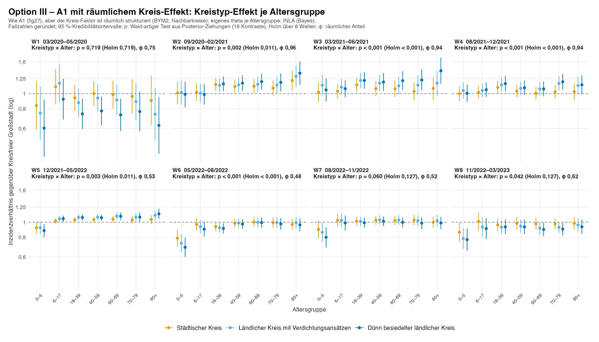

**Was die Abbildung zeigt:** gleicher Aufbau wie fig27, aber mit räumlichem Kreis-Faktor; Intervalle = 95 %-Kredibilitätsintervalle; in der Überschrift zusätzlich φ. Die Muster sind fast identisch mit fig27.

| Welle | p (BYM2) | Holm (BYM2) | Holm (A1) | ΔDIC BYM2 − iid | ΔWAIC | φ (95 %-KrI) | Moran's I iid → BYM2 |
|---|---|---|---|---|---|---|---|
| W1 | 0,72 | 0,72 | 0,72 | −11 | −18 | 0,75 (0,57–0,89) | 0,04 → 0,00 |
| W2 | 0,0021 | 0,011 | 0,0081 | −31 | −32 | 0,96 (0,88–1,00) | 0,08 → 0,06 |
| W3 | 1,3·10⁻⁷ | 9,4·10⁻⁷ | 2,5·10⁻⁷ | +10 | +4 | 0,94 (0,84–0,99) | 0,13 → 0,10 |
| W4 | 5,9·10⁻⁵ | 3,5·10⁻⁴ | 4,3·10⁻⁵ | −41 | −32 | 0,94 (0,86–0,99) | 0,09 → 0,07 |
| W5 | 0,0026 | 0,011 | 0,0021 | +88 | +51 | 0,53 (0,32–0,75) | 0,24 → 0,26 |
| W6 | 1,8·10⁻¹¹ | 1,4·10⁻¹⁰ | 3,7·10⁻¹¹ | +36 | −49 | 0,48 (0,02–0,97) | 0,21 → 0,21 |
| W7 | 0,060 | 0,13 | 0,11 | −9 | −7 | 0,52 (0,29–0,80) | 0,16 → 0,15 |
| W8 | 0,042 | 0,13 | 0,040 | +93 | +19 | 0,62 (0,43–0,85) | 0,11 → 0,12 |

- **Kontrolle:** `iid` reproduziert A1 (r = 1,000, mittlere |Δ| 0,001, Posterior-SD/ML-SE 1,02–1,04).
- **DIC/WAIC geben kein klares Bild:** BYM2 ist nach DIC besser in W1, W2, W4, W7 und schlechter in W3, W5, W6, W8, nach WAIC besser in W1, W2, W4, W6, W7. In der früheren, mehrfädigen Fassung stand hier „BYM2 besser in W2–W6 und W8“ – **diese Aussage gilt nicht mehr**. Für dieses Modell sind DIC/WAIC ohnehin wenig verlässlich (θ(40–59) kaum identifiziert, gerundete Fallzahlen). **Für die Entscheidung über Option III deshalb andere Gründe heranziehen** (Tests, Koeffizienten, Restautokorrelation, Aufwand).
- **Räumlicher Anteil φ:** In W2–W4 ist der Kreis-Faktor fast rein räumlich (φ 0,94–0,96), ab W5 etwa zur Hälfte (0,48–0,62); in W6 ist φ kaum bestimmt (KrI 0,02–0,97).
- **Kreistyp-Effekte:** r = 0,93–1,00 zu A1, mittlere |Δ| 0,008–0,034; Posterior-SD/SE(A1) je Welle im Median 0,88–1,06. 58 von 168 signifikant (A1 54), 18 KI wechseln. Typ 4: 0–5 W1 0,60, W5–W8 0,69–0,88 (alle KrI ohne 1); 80+ W2/W3 1,35/1,40; in W1 bei Erwachsenen und 80+ niedriger (0,63–0,78).
- **Restliche Autokorrelation sinkt kaum** (außer in W1; Moran's I in der Tabelle). Der Kreis-Faktor selbst ist räumlich stark strukturiert, die restliche Autokorrelation steckt aber in **altersspezifischen** Abweichungen. In der früheren Fassung waren das in W5 vor allem 0–5 (I = 0,32) und 6–17 (0,27); diese Einzelwerte wurden seriell nicht neu ausgewertet. Ein gemeinsamer Kreis-Faktor kann das nicht auffangen; dafür bräuchte es einen eigenen räumlichen Effekt für Kinder (z. B. zweiter BYM2-Faktor). **Kinder haben eigene räumliche Muster** – selbst ein Diskussionspunkt (siehe auch 11.5).
- **Kosten:** Bayes-Näherung, Rundung, Prior-Abhängigkeit (θ(40–59) Posterior-Median bis über 100.000), seriell ca. 5–15 Minuten, INLA nicht auf CRAN.

### 11.4 Option D: ein Modell über alle Wellen

[`23_cross_wave_tmb.R`](../../Scripts/modellauswahl/23_cross_wave_tmb.R) (ca. 20–35 min, `glmmTMB`), Teil 11 – beantwortet F3 formal. In A1 gibt es 8 getrennte Modelle; ob sich der Stadt–Land-Unterschied *zwischen* den Wellen ändert, wird dort nur durch Vergleich der Abbildungen beurteilt.

**Modell:** alle 8 Wellen × 7 Altersgruppen × 400 Kreise = 22.400 Zeilen, NB2 mit ML; Zelle = Altersgruppe × Welle (56):
`cases ~ 0 + Zelle + Zelle:Kreistyp + Bundesland + Zelle:(SGB-II + 65+ + Tourismus) + rr(0 + Altersgruppe | Kreis, d = 1) + Σ_w rr(0 + Altersgruppe:[Welle = w] | Kreis, d = 1) + (1 | Land:Welle) + (1 | Land:Altersgruppe) + (1 | Land:Altersgruppe:Welle) + offset`, Dispersion `~ 0 + Zelle`.
- Kreistyp und Kovariaten je Zelle frei (wie A1, Koeffizienten direkt vergleichbar).
- Kreis: **dauerhafter** Faktor u_k (gleich in allen Wellen, Ladung je Altersgruppe) + **welle-spezifischer** Faktor v_kw (Ladung je Altersgruppe **und** Welle = die Kreis-Struktur von A1).
- Bundesland: fest + zufällig je Welle, Altersgruppe und Altersgruppe × Welle (fest je Zelle wären 840 Parameter) – der wichtigste Unterschied zu A1.
- θ je Zelle (56), Randregel wie A1.
- **Strukturwahl:** AIC gegenüber `(1 | Kreis:Welle)`: Ladungen nur je Altersgruppe −55, je Altersgruppe und Welle −2.149. Mit gleichen Ladungen über die Wellen waren die SE gegenüber A1 stark verzerrt (Verhältnis 0,73 in W1, 2,19 in W5), weil die Kreis-Streuung in W1 viel größer ist als in W5.

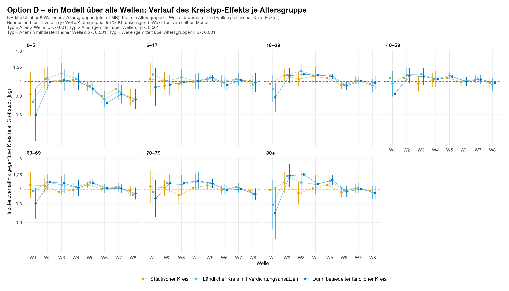

**Was die Abbildung zeigt:** anders sortiert als fig27 – ein Panel je **Altersgruppe**, x = Welle, Linien verbinden die Effekte eines Kreistyps über die Zeit. So sieht man die **Verläufe** direkt: bei 0–5 von W1 (0,60) über ≈ 1 in W2–W4 zurück auf 0,72–0,90 in W5–W8; bei 80+ der Buckel in W2/W3 (1,23/1,25); bei Erwachsenen „höher in W2–W4, dann ≈ 1“. Die Tests stehen im Untertitel.

| Test im selben Modell | Frage | χ² | df | p |
|---|---|---:|---:|---:|
| Typ × Alter × Welle | Ändert sich das Altersmuster über die Wellen? | 304 | 126 | 1,0·10⁻¹⁶ |
| Typ × Alter (gemittelt über Wellen) | Gibt es im Mittel ein Altersmuster? | 49,3 | 18 | 9,6·10⁻⁵ |
| Typ × Alter (in mindestens einer Welle) | ersetzt die 8 Tests + Holm aus A1 | 410 | 144 | 2,5·10⁻²⁷ |
| Typ × Welle (gemittelt über Altersgruppen) | Ändert sich der mittlere Kreistyp-Effekt? | 48,0 | 21 | 6,9·10⁻⁴ |

Je Welle (df 18, Holm) im Vergleich zu A1 ([`crosswave_tests.csv`](../../results/modellauswahl/tables/crosswave_tests.csv)):

| Welle | W1 | W2 | W3 | W4 | W5 | W6 | W7 | W8 |
|---|---|---|---|---|---|---|---|---|
| Holm (D) | 0,39 | 0,023 | 1,4·10⁻⁸ | 3,9·10⁻⁴ | 0,0013 | 6,3·10⁻¹¹ | 0,10 | 0,018 |
| Holm (A1) | 0,72 | 0,0081 | 2,5·10⁻⁷ | 4,3·10⁻⁵ | 0,0021 | 3,7·10⁻¹¹ | 0,11 | 0,040 |

- **Kreis-Abweichungen sind überwiegend welle-spezifisch:** dauerhafter Faktor u_k verbessert das Modell klar (LR 1.250, AIC −1.240), ist aber klein (SD 0,03–0,09; am größten bei 70–79/80+ und 0–5); welle-spezifisch W1 0,35–0,65, W2–W4 0,17–0,31, W5 0,07–0,09, W6–W8 0,07–0,27. Ein Kreis, der in einer Welle über dem Erwarteten liegt, tut das in der nächsten kaum.
- **Bundesland** (SD log-Skala): × Welle 0,27, × Altersgruppe 0,06, × Altersgruppe × Welle 0,07 – die Länder unterscheiden sich vor allem je Welle ([`crosswave_varcomp.csv`](../../results/modellauswahl/tables/crosswave_varcomp.csv)).
- **Kreistyp-Koeffizienten vs. A1:** r = 0,93–1,00, mittlere |Δ| 0,002–0,043, SE-Verhältnis 0,99–1,06 – aber nur **33 statt 54 signifikant**. Grund: Bundesland × Altersgruppe × Welle ist hier zufällig (teilweise gepoolt), dadurch gehen auch Vergleiche **zwischen** Ländern in den Kreistyp-Effekt ein (in A1 nur innerhalb). „Bundesland fest oder zufällig“ ist in D also eine **inhaltliche** Entscheidung, keine reine Technik.
- **Kosten:** ca. 12 Minuten je Anpassung (im Wiederholungslauf am 26.11. bei paralleler Last 35 Minuten für das ganze Skript); empfindliche Optimierung (Startwerte aus einer früheren Anpassung führten in ein lokales Optimum, Zielfunktion um 687 schlechter).

**Einschätzung aus diesem Teilprojekt (keine Entscheidung):** A1 als Hauptmodell vorschlagen (einfach, schnell, Bundesland je Zelle fest), GAM als Ergänzung; D, III und Rang 2 (11.5) als Alternativen für die Gruppenentscheidung und die Diskussion mit Finn.

### 11.5 Kandidat: A1 mit zwei Kreis-Faktoren (Rang 2)

[`25_rank2_tmb.R`](../../Scripts/modellauswahl/25_rank2_tmb.R) (ca. 25 min, `glmmTMB`), neu am 26.11.2026 nach der zweiten externen Prüfung. Tabellen: [`rank2_tests.csv`](../../results/modellauswahl/tables/rank2_tests.csv), [`rank2_starts.csv`](../../results/modellauswahl/tables/rank2_starts.csv), [`rank2_kt_coef.csv`](../../results/modellauswahl/tables/rank2_kt_coef.csv), [`rank2_alt_jung.csv`](../../results/modellauswahl/tables/rank2_alt_jung.csv), [`rank2_resid_cor.csv`](../../results/modellauswahl/tables/rank2_resid_cor.csv).

**Warum:** A1 erklärt die gemeinsame Abweichung eines Kreises über alle sieben Altersgruppen mit **einem** Faktor u_k ([9, Schritt 6](#schritt-6-ein-modell-für-alle-altersgruppen--der-kreis-faktor)). Nach A1 korrelieren die Pearson-Residuen derselben Kreise aber noch zwischen benachbarten Altersgruppen:
- 0–5 mit 6–17: 0,24–0,71 je Welle;
- 70–79 mit 80+: 0,41–0,63 je Welle.

Laut externer Prüfung liegt der Wert für A1 in W2 (0–5 mit 6–17: 0,71) weit außerhalb dessen, was A1 selbst in Simulationen erzeugt (95 %-Bereich −0,11 bis 0,08). Ein Faktor kann zwei verschiedene Muster (z. B. „Kinder“ und „Ältere“) nicht gleichzeitig abbilden.

**Modell:** wie A1 (feste Effekte, Offset, θ je Altersgruppe, Randregel), nur `rr(0 + grp | ags, d = 2)` statt `d = 1`.
- **Startwerte:** Das Rang-2-Modell hat lokale Optima. Je Welle werden deshalb 5 Startwerte gerechnet (Standardstart + 4 Zufallsladungen mit festen Seeds).
- **Wahl der Lösung:** die mit der höchsten Loglikelihood unter den Lösungen mit Konvergenz und positiv definiter Hessematrix, **nicht nach p-Wert**.
- **Kontrolle:** Das Skript rechnet A1 mit und prüft, dass es `main_kt_coef.csv` reproduziert.

| Welle | ΔAIC (A1 − Rang 2) | Holm A1 | Holm Rang 2 | θ am Rand (Rang 2) |
|---|---:|---:|---:|---|
| W1 | 228 | 0,72 | 0,56 | 70–79 |
| W2 | 421 | 0,0081 | **0,12** (Standardstart: 0,017) | – |
| W3 | 276 | 2,5·10⁻⁷ | 7,1·10⁻⁶ | 6–17 |
| W4 | 260 | 4,3·10⁻⁵ | 4,1·10⁻⁵ | 40–59, 70–79 |
| W5 | 314 | 0,0021 | 0,0015 | 60–69 |
| W6 | 409 | 3,7·10⁻¹¹ | 1,3·10⁻¹¹ | 70–79 |
| W7 | 334 | 0,11 | 0,12 | 70–79 |
| W8 | 327 | 0,040 | **0,024** | 40–59, 70–79 |

**Ergebnisse:**
- **Anpassung:** Rang 2 ist nach AIC in allen Wellen deutlich besser (228–421). Mit zwei Faktoren erreichen aber mehr Altersgruppen die θ-Grenze 10⁴, und die Fallzahlen sind nicht ganzzahlig. Der AIC-Vergleich ist deshalb eine Näherung.
- **Kreistyp-Effekte praktisch gleich:** r = 0,998, mittlere |Δ| 0,003 (max. 0,055); SE-Verhältnis im Median 1,00; signifikant 54 → 55 (1 Koeffizient wechselt). Das Verhältnis der Typ-4-IRR „80+ zu 0–5“ ist bis auf W1 (1,08 → 1,15) identisch.
- **Tests:** Holm < 5 % in W3–W6 und W8; W1, W7 nicht. **W2 hängt vom lokalen Optimum ab.** Zwei Lösungen konvergieren mit positiv definiter Hessematrix (Abstand der Loglikelihood 14,7). Die bessere ergibt Wald-p 0,039 (Holm 0,12), die des Standardstarts 0,004 (Holm 0,017). In den anderen Wellen kommen alle 5 Starts zur selben Lösung.
- **Residualkorrelation:** Der zweite Faktor nimmt nicht gezielt die Kinder-Korrelation auf. 0–5 mit 6–17 wird in W2/W3 negativ (−0,59/−0,52), bleibt in W5 bei 0,52; 70–79 mit 80+ sinkt in allen Wellen, in 5 von 8 sogar unter 0. Bedingte Residuen sind auch bei richtigem Modell nicht unkorreliert. Ein Urteil bräuchte eine Simulationsreferenz für Rang 2, die noch fehlt.

**Einordnung (keine Entscheidung):** Rang 2 passt deutlich besser, ändert die Aussagen über die Kreistyp-Effekte aber kaum. Der Preis:
- lokale Optima (mehrere Starts nötig, W2-Test instabil);
- mehr Parameter am θ-Rand;
- ca. 25 Minuten Rechenzeit.

Für die Gruppe stellt sich die Frage, ob Rang 2 das Hauptmodell wird oder A1 bleibt und Rang 2 als Sensitivitätsanalyse berichtet wird ([0.5](#05-was-die-gruppe-entscheiden-muss)).

---

## 12. Kovariaten: offene Baustelle

[`19_covariates_pca_cv.R`](../../Scripts/modellauswahl/19_covariates_pca_cv.R) (ca. 25 s), Teil 7. In A1 (und in m1) stehen **vorläufig** SGB-II je 1.000 Einwohner, Anteil 65+ und log(Übernachtungen je Einwohner). Das ist **keine begründete Auswahl**.

### 12.1 Hauptkomponenten

Grundlage: 26 Strukturmerkmale (Mittelwerte 2020–2023, ohne die Raummaße), standardisiert; 12 fehlende Werte durch den Median des Landes ersetzt (bundesweit, wenn das ganze Land fehlt: öffentlich Beschäftigte in den Stadtstaaten, Schutzsuchende im Saarland).

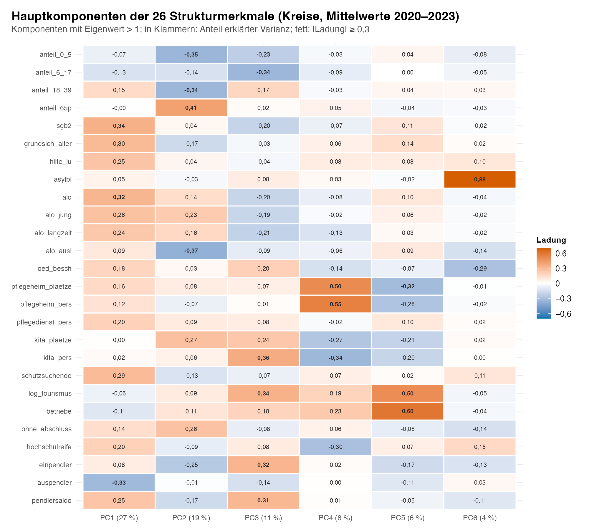

**Was die Abbildung zeigt:** die Ladungen der 6 Hauptkomponenten mit Eigenwert > 1 (fett: |Ladung| ≥ 0,3; in Klammern der Varianzanteil).

| PC | Varianz | höchste Ladungen | Deutung |
|---|---|---|---|
| PC1 | 27 % | SGB-II +0,34, Arbeitslose +0,32, Grundsicherung im Alter +0,30, Schutzsuchende +0,29, Auspendler −0,33 | soziale Lage / Benachteiligung |
| PC2 | 19 % | Anteil 65+ +0,41, Anteil 0–5 −0,35, Anteil 18–39 −0,34, ausländische Arbeitslose −0,37 | Altersstruktur (alt vs. jung) |
| PC3 | 11 % | Kita-Personal +0,36, Anteil 6–17 −0,34, Tourismus +0,34, Einpendler +0,32, Pendlersaldo +0,31 | Zentralität / Einpendler |
| PC4 | 8 % | Pflegeheim-Personal +0,55, Pflegeheimplätze +0,50 | stationäre Pflege |
| PC5 | 6 % | Betriebe +0,60, Tourismus +0,50 | Gewerbe / Tourismus |
| PC6 | 4 % | Asylbewerberleistungen +0,88 | Einzelmerkmal |

### 12.2 Kreuzvalidierung der Kovariatensätze

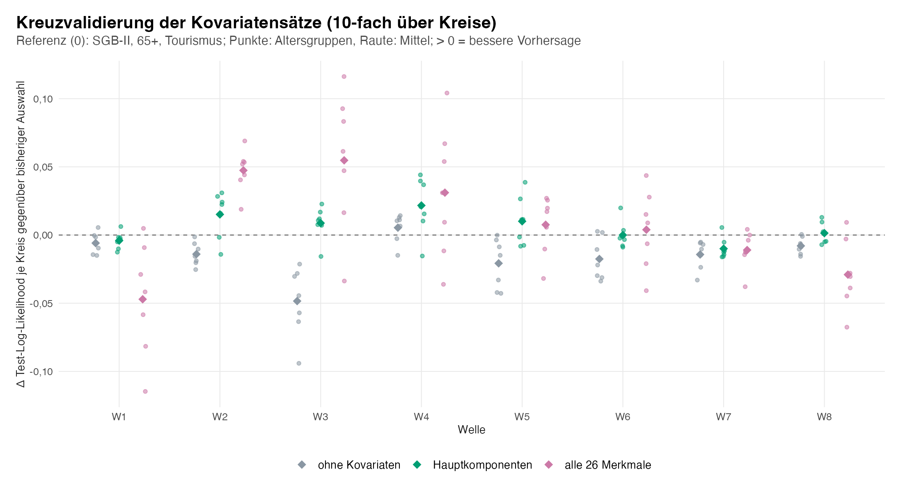

**Was die Abbildung zeigt:** 10-fache Kreuzvalidierung über Kreise (Folds je Bundesland zugeteilt, Hamburg und Berlin immer im Training), m1 in allen 56 Zellen; y = Differenz der mittleren NB-Test-Log-Likelihood je Kreis zur bisherigen Auswahl S1; Punkte = Altersgruppen, Raute = Mittel; > 0 = bessere Vorhersage.

| Satz | Δ Test-Log-Lik je Kreis | besser als S1 | AIC-Summe | r der Kreistyp-Effekte mit S1 | mittlere / max. \|Δ\| | signifikant (von 168) |
|---|---:|---|---:|---:|---|---:|
| S0 ohne Kovariaten | −0,015 | 9 von 56 | 273.454 | 0,49 | 0,094 / 0,39 | 60 |
| S1 bisherige 3 | 0 | – | 272.624 | 1 | – | 54 |
| S2 6 Hauptkomponenten | +0,005 | 29 von 56 | 272.198 | 0,89 | 0,045 / 0,22 | 36 |
| S3 alle 26 Merkmale | +0,007 | 30 von 56 | 271.078 | 0,68 | 0,075 / 0,35 | 24 |

S3 gewinnt in W2–W4 (+0,03 bis +0,055) und verliert in W1, W7, W8 (Überanpassung). Das AIC bevorzugt S3, die Kreuzvalidierung kaum.

### 12.3 Folgerung

- Mehr Kovariaten verbessern die Vorhersage kaum, **ändern die Kreistyp-Effekte aber stark**: Je mehr Merkmale, desto kleiner und seltener signifikant.
- Einige Merkmale messen selbst Urbanisierung (Einpendler, Pendlersaldo, Kita-Personal in PC3). Liegen sie auf dem Weg „Urbanisierung → Merkmal → Inzidenz“ (**Mediatoren**), nimmt ihre Adjustierung dem Kreistyp einen Teil des Effekts, den wir messen wollen (**Überadjustierung**).
- Weil wir einen **Effekt** schätzen und nicht vorhersagen wollen, beantworten CV, AIC oder Lasso die falsche Frage; außerdem sind KI nach Selektion zu schmal.
- **Vorschlag:** Confounder inhaltlich über einen **DAG** festlegen (soziale Lage und Altersstruktur, also PC1/PC2 oder deren stärkste Einzelmerkmale); Mobilitäts-/Zentralitätsmerkmale nicht als Confounder; S2/S3 als Sensitivität. Ideen für zusätzliche Merkmale: Einkommen (73111), Siedlungs- und Verkehrsfläche (33111), Zensus-Raster, altersspezifisch passende Merkmale (Kita-Plätze je Kind für 0–5, Pflegeheimplätze je 65+ für 80+), Werte von 2019.
- **Nächster Schritt:** Alle Zahlen in 12.2 stammen aus m1. Nach der Festlegung in der Gruppe sollte A1 selbst mit zwei bis drei inhaltlich begründeten Kovariatensätzen gerechnet und verglichen werden (Kreistyp-Effekte und Haupttest).

---

## 13. Was nicht funktioniert hat

Damit niemand dieselben Wege noch einmal geht:

| Versuch | Problem | Konsequenz | Quelle |
|---|---|---|---|
| Ost/West als Kontrollvariable | zu grob; wechselt je Welle das Vorzeichen und hängt mit dem Kreistyp zusammen | durch **Bundesland** ersetzt | Phase 2, fig09 |
| Dichte-Quartile | Informationsverlust | stetige log-Dichte | Phase 2 |
| rein datengetriebene Wellengrenzen | schwer begründbar | RKI-Grenzen (+ eigene ab Sommer 2022); Effekt auf Ergebnisse vernachlässigbar | Phase 2 |
| Winter 2022/23 als Teil der Restphase | 76 % der Restphasen-Fälle dort | eigene Welle W8 | Phase 2 |
| Fälle ohne Alter weglassen | einzelne Kreise bis 16 % unterschätzt | proportional verteilen | Phase 1 |
| Eisenach stillschweigend | 2020er Raten ca. 25 % verzerrt bzw. Kreis fiel heraus | ausdrücklich mit Wartburgkreis zusammengelegt | Phase 1 |
| 56 getrennte Modelle (m1) als einziges Modell | Altersunterschied (F2) mit den getrennten Fits nicht direkt getestet (Kovarianz fehlt), Schätzer abhängig | gemeinsames Modell aller Altersgruppen | Teil 1, 5 |
| gemeinsames θ für alle Altersgruppen (mgcv + MRF) | Dispersion 0–5 bis 3,41, 80+ bis 2,59, 40–59 bis 0,26 → KI bei der Kernaussage zu schmal | θ je Altersgruppe (A1) | Teil 5, 10 |
| mgcv Poisson + Beobachtungs-RE je Altersgruppe + MRF (A2) | nach 11 min keine Welle fertig | abgebrochen | Teil 10 |
| glmmTMB + exponentielle räumliche Kovarianz (A1s) | Hessematrix nicht positiv definit, Moran's I unverändert | verworfen; Raumeffekt über INLA (III) | Teil 10 |
| `diag(0 + grp \| ags)` (eigener Kreis-Effekt je Altersgruppe) | nicht identifizierbar (1 Zeile je Kreis × Altersgruppe) | Rang-1-Faktor `rr(…, d = 1)` | Teil 10 |
| glmmTMB mit Standard-Optimierer | keine Konvergenz | `iter.max = 5000` | Teil 10 |
| θ(40–59) frei schätzen | → ∞ in W4–W6, keine SE | Randregel θ ≤ 10⁴ | Teil 10 |
| GAM mit `s(Alter, k = 25)` | Glätter ausgeschöpft | Alter als Faktor | Teil 2 |
| GAM mit nicht altersspezifischer Adjustierung | Länderunterschiede je Alter sickern in die Kurven (r nur 0,70–0,74) | `s(age, by = state)` usw. → r = 0,90–0,93 | Teil 2 |
| GAM-Dichtemodell mit zusätzlichem linearen Dichteterm | doppelt, nicht identifizierbar | entfernt | Teil 2 |
| modellbasierte GAM-Bänder | zu schmal (bis Faktor 1,26) | Kreis-Bootstrap | Teil 2 |
| Clustertypologie als Raummaß | keine Clusterstruktur, schlechter als kein Raummaß | verworfen | Teil 9 |
| Ankunftszeit (Cox) als Hauptanalyse | schwellenabhängig (r = 0,49), PH verletzt | nur Anhang | Teil 8 |
| Kovariatenselektion nach CV/AIC | beantwortet die falsche Frage, Überadjustierung | DAG (offen) | Teil 7 |
| feines Altersschema als Hauptschema | keine zusätzliche Information nachweisbar | nur Robustheit | Teil 3 |
| Option D mit gleichen Ladungen über alle Wellen | SE gegenüber A1 stark verzerrt (0,73 in W1, 2,19 in W5) | Ladungen je Welle | Teil 11 |
| Option D mit Startwerten aus früherer Anpassung | schlechteres lokales Optimum (−687) | Neuanpassung | Teil 11 |
| MRF mit vollem Rang | überkorrigiert (W2: Moran's I −0,11) | Rang 100 | Teil 5 |
| BYM2 gegen restliche Autokorrelation | sinkt kaum: altersspezifisch (Kinder) | bleibt Einschränkung | Teil 12 |
| INLA mit mehreren Rechenfäden | DIC/WAIC ändern sich zwischen identischen Läufen (W5/BYM2: DIC 37.634 vs. 37.787; Vergleich BYM2 vs. iid in 5 von 8 Wellen mit anderem Vorzeichen) | seriell (`INLA_THREADS=1:1`) + R-Seed je Welle × Modell → weitgehend reproduzierbar (Rest-Abweichungen in W1, W3, W8) | 3.3, Skript 24 |
| DIC/WAIC als Kriterium für Option III | auch seriell kein klares Bild (DIC und WAIC widersprechen sich teils); für dieses Modell wenig verlässlich | Entscheidung über III mit anderen Gründen | 11.3 |
| Rang-2-Modell mit nur einem Startwert | lokale Optima (W2: zwei Lösungen, Abstand der Loglikelihood 15, Wald-p 0,004 bzw. 0,039) | 5 Startwerte, Wahl nach Loglikelihood | 11.5, Skript 25 |
| `13_gam_age.R` im Pipeline-Lauf ohne `BOOT_B` | ersetzte die gespeicherten Bootstrap-Bänder still durch modellbasierte | `BOOT_B` Pflicht, sonst Abbruch | 3.2 |
| fig05 mit Log-Achse ab 1 | Wochen ohne Fälle fielen still aus der Abbildung | Pseudo-log-Achse | 6.2 |
| Inzidenz-Kontrolle mit allen Fällen | die RKI-Inzidenz enthält die Fälle ohne Alter nicht → Kontrolle unscharf | Kontrolle mit den Fällen mit Altersangabe; Abbruch, wenn das 1., 50. oder 99. Perzentil des Verhältnisses um > 0,1 % von 1 abweicht (Quantilprüfung) | 4.1 |
| **nicht gerechnet:** Lasso, GEE mit austauschbarer Korrelation | `glmnet`/`geepack` nicht installiert | Ersatz: PCA/CV, GEE unabhängig | Phase 3 |
| **nicht gerechnet:** Untererfassungsmodell (Bayes, Statistik V) | braucht Test-/Hospitalisierungs-/Sterbedaten je Kreis × Alter | Ausblick | Phase 3 |
| **nicht gerechnet:** Wochen-Zeitreihenmodell | siehe Abschnitt 5.2 | Wellen | – |
| **nicht gerechnet:** Lage anstelle des Kreistyps; getrennte Modelle + Kreis-Bootstrap für den Alters-Test | Zeit | möglich, ca. ½ Tag | – |

---

## 14. Annahmen und Einschränkungen

| Annahme / Einschränkung | Wo sie wirkt | geprüft? |
|---|---|---|
| **Ökologische Analyse:** Aussagen über Kreise, nicht über Personen | ganze Analyse | – |
| Kreis als Einheit, Gebietsstand 2023 (Berlin = 1 Kreis, Eisenach im Wartburgkreis) | ganze Analyse | ja |
| **Gemeldete** Inzidenz ≠ Infektionen; Meldewoche ≈ Infektionswoche; Testverhalten in allen Kreistypen vergleichbar | Ergebnis | **nicht prüfbar** mit diesen Daten |
| bundesweit gleiche Wellengrenzen für alle Kreise und Altersgruppen | Welle als Einheit | Ankunft je Kreistyp ≤ 2 Wochen verschieden; W3 Anfang teils abgeschnitten |
| kumulative Inzidenz je Welle beschreibt den „Verlauf“ | Zielgröße | Timing separat geprüft (Cox), Verläufe über Wellen in Option D |
| Strukturmerkmale zeitkonstant (Mittel 2020–2023, enthält Pandemiejahre) | Kovariaten | Rangkorrelation 2020 vs. 2023 ≥ 0,967; sauberer wären Werte 2019 |
| Tourismus 2020 fehlt für 25 Kreise → Mittel zu hoch | Kovariate | benannt, nicht korrigiert |
| Fälle ohne Alter wie die übrigen Fälle der Kreis-Woche verteilt | Fallzahlen | Sensitivität: Δ ≤ 0,0088 |
| RKI-Nenner (ab 2022 +1,5 % ggü. GENESIS) | Offset | Sensitivität: Δ ≤ 0,016 |
| Kreistyp, Lage und Dichte stark kollinear (\|ρ\| ≈ 0,8) | Raummaß | Effekte nicht scharf trennbar |
| Stadtstaaten und Saarland ohne Kreistyp-Kontrast innerhalb des Landes | Bundesland fest | 10 Kreise, 25 % der Großstadtbevölkerung tragen nichts bei |
| restliche räumliche Autokorrelation in A1 (Moran's I bis 0,24) | SE | Option III: Schlüsse bis auf W8 gleich |
| Rang-1-Kreis-Faktor: alle Altersgruppen eines Kreises weichen in dieselbe Richtung ab | Kreis-Effekt | altersspezifische Muster (Kinder) bleiben im Residuum; mit zwei Faktoren (11.5) AIC deutlich besser, Kreistyp-Effekte fast gleich |
| Randregel θ(40–59) ≤ 10⁴ | W4–W6 | Effekte ±0,001 |
| Sterne an einzelnen Koeffizienten unkorrigiert (168 Koeffizienten) | Darstellung | globale Tests mit Holm |
| 80+ ist eine Sammelgruppe | GAM | im GAM nicht enthalten |
| Kovariatensatz vorläufig | alles | **empfindlich** (in m1: r = 0,68 mit allen 26 Merkmalen; für A1 noch nicht geprüft) |

---

## 15. Offene Fragen

**In der Gruppe (vor der Zwischenpräsentation)**
0. **Modellentscheidung**, in drei getrennten Schritten ([0.5](#05-was-die-gruppe-entscheiden-muss)):
   - Hauptanalyse innerhalb einer Welle: A1 oder Rang 2?
   - Verläufe über die Wellen: formal mit Option D oder nur beschreibend?
   - Raumeffekt: Option III im Anhang oder im Hauptteil?
   
   Danach den Kovariatensatz festlegen (Punkt 4) und das gewählte Modell mit wenigen inhaltlich begründeten Kovariatensätzen vergleichen (bisher nur an m1 geprüft).
1. **W2 und W8:** Vorschlag: als „spezifikationsabhängig“ berichten, nicht als signifikant. W8: A1 0,040, INLA ohne Raumeffekt 0,075, mit BYM2 0,13, Rang 2 0,024. W2: signifikant außer mit Rang 2 (0,12, lokale Optima).
2. **Pearson-Dispersion 40–59:** Die Erklärung (Kreis-Faktor aus dieser Gruppe geschätzt) ist plausibel, aber nicht geprüft → Diagnose mit simulierten Residuen nachholen ([11.1](#111-passt-a1-zu-den-daten)).
3. **Robustheit:** Wie formulieren wir Altersschema und Raumeffekt, ohne „stabil“ zu überziehen?
4. **Kovariaten-DAG:** Welche Merkmale beeinflussen Urbanisierung **und** Inzidenz (Confounder), welche liegen dazwischen (Mediatoren, z. B. Pendler, Kita)?
5. **Deutung der Muster** (0–5 niedriger in ländlichen Kreisen ab W5; 80+ höher in W2/W3; Erwachsene höher in W2–W4) und was davon mit unseren Daten überhaupt prüfbar ist.
6. Wie passen diese Ergebnisse zu den anderen Teilprojekten im Repo (Kreistyp × Alter × Zeit, Location Type, Variablenanalyse, Wochenmodelle)?

**An Finn**
1. **Kovariaten:** Confounder über einen DAG statt über CV/AIC? Pendler/Kita als Mediatoren ausschließen? Werte von 2019 nachladen?
2. **Urbanisierungsmaß:** Kreistyp (interpretierbar) oder Dichte (lineare Dichte passt in 5 von 8 Wellen besser, eine flexible Dichte-Fläche in allen)?
3. **Bundesland und Raum:** Bundesland fest oder zufällig (in D: 54 → 33 Signifikanzen)? Lohnt sich III, wenn sich nur W8 ändert und DIC/WAIC kein klares Bild geben? Braucht es einen zweiten Kreis-Faktor (Rang 2: AIC deutlich besser, Effekte fast gleich, aber lokale Optima)?
4. **Multiples Testen:** globaler Test je Welle + Holm, ein Test über alle Wellen (D), oder nur Muster statt Einzelsterne?
5. **Wellen:** getrennte Modelle je Welle (A1) oder ein Modell über alle Wellen (D)?

**Daten, die noch fehlen:** Einkommen (GENESIS 73111), Bodennutzung (33111) und Zensus-Raster als feinere Urbanisierungsmaße, IAB-Maßnahmentabelle (optional), Strukturwerte 2019.

---

## 16. Glossar

| Begriff | Bedeutung hier |
|---|---|
| **Offset** | Term mit festem Koeffizienten 1, hier log(Bevölkerung) → das Modell beschreibt die Inzidenz |
| **IRR** (Inzidenzverhältnis) | exp(Koeffizient); Faktor gegenüber der Referenz (Großstadt) |
| **Überdispersion** | Varianz größer als bei Poisson (Varianz = Mittelwert) |
| **θ** (NB-Dispersionsparameter) | Var = μ + μ²/θ; groß = fast Poisson, klein = viel Zusatzstreuung |
| **Pearson-Dispersion** | Σ(Pearson-Residuen²)/Freiheitsgrade; ≈ 1 bei passender Varianzannahme |
| **fester Effekt** | Parameter, der für jede Stufe einzeln geschätzt wird (z. B. 16 Bundesländer) |
| **Zufallseffekt** | Abweichung je Einheit (Kreis), als Zufallsvariable modelliert; geschätzt wird ihre Streuung |
| **GLMM** | generalisiertes lineares gemischtes Modell = GLM + Zufallseffekte |
| **GAM** | generalisiertes additives Modell; Effekte als glatte Funktionen (hier des Alters) |
| **Ladung, reduzierter Rang** | ein gemeinsamer Kreis-Faktor u_k, der in jeder Altersgruppe mit eigenem Gewicht λ_a wirkt |
| **Konfundierung / Confounder** | Variable, die mit Kreistyp und Inzidenz zusammenhängt und den Vergleich verzerrt |
| **Mediator, Überadjustierung** | Variable auf dem Weg vom Kreistyp zur Inzidenz; ihre Adjustierung entfernt einen Teil des gesuchten Effekts |
| **Wald-Test** | Test mehrerer Kontraste gleichzeitig aus Schätzern und deren Kovarianzmatrix (χ²) |
| **LR-Test** | Vergleich zweier verschachtelter Modelle über die Log-Likelihood |
| **AIC / cAIC** | Modellvergleich: Anpassung minus Strafe für Parameterzahl; kleiner = besser (cAIC: konditional, für Modelle mit Zufallseffekten) |
| **DIC / WAIC** | bayesianische Gegenstücke zum AIC (Option III) |
| **Kreis-Faktor, Rang 1 / Rang 2** | gemeinsame Abweichung eines Kreises über die Altersgruppen; Rang 1 (A1): ein Faktor mit Ladung je Altersgruppe, Rang 2: zwei Faktoren (11.5) |
| **Lokales Optimum** | Lösung, an der der Optimierer stehen bleibt, obwohl es eine mit höherer Likelihood gibt; dagegen helfen mehrere Startwerte |
| **Holm-Korrektur** | schrittweise Korrektur für mehrere Tests; weniger konservativ als Bonferroni |
| **Moran's I** | Maß für räumliche Autokorrelation; 0 = keine, > 0 = Nachbarn ähnlich |
| **MRF / BYM2** | räumliche Zufallseffekte über die Nachbarschaft der Kreise; BYM2 = räumlicher + unstrukturierter Anteil, φ = räumlicher Anteil |
| **GEE** | Schätzung ohne Zufallseffekte, Standardfehler robust gegen Abhängigkeit innerhalb der Kreise |
| **Kreis-Bootstrap** | Kreise (innerhalb der Bundesländer) mit Zurücklegen neu ziehen und das Modell neu schätzen → realistische Unsicherheit |
| **Hazard Ratio (HR)** | im Cox-Modell: Verhältnis der „Ankunftsraten“; < 1 = später erreicht |
| **Silhouette, ARI** | Güte einer Clusterung (Silhouette) bzw. Übereinstimmung zweier Einteilungen (adjustierter Rand-Index) |
| **Laplace-Näherung** | Näherung, mit der `glmmTMB` (und INLA) über die Zufallseffekte integriert |

---

## 17. Anhang: Abbildungen, Tabellen, Skripte

### Abbildungen ([`results/modellauswahl/figures/`](../../results/modellauswahl/figures/))

| Datei | Inhalt | Abschnitt |
|---|---|---|
| `fig01_national_gesamt.png` = `fig08_rki_phasen.png` | bundesweite Wocheninzidenz mit Wellen W1–W8 | 5.1 |
| `fig02_national_altersgruppen.png` | Wocheninzidenz je Altersgruppe | 6 |
| `fig03_alter_zeit_heatmap.png` | Einzelalter × Woche | 6 |
| `fig04_altersprofil_je_welle.png` | Altersprofil je Welle | 6.1 |
| `fig05_woche_kreistyp_alter.png` | Wochenverlauf je Kreistyp × Altersgruppe (Pseudo-log-Achse, Wochen ohne Fälle sichtbar) | 6.2 |
| `fig06_verhaeltnis_kreistyp_welle_alter.png` | Kreistyp relativ zum Bundeswert | 6.2 |
| `fig07_korrelation_welle_alter.png` | Rangkorrelationen mit allen Strukturmerkmalen | 6.3 |
| `fig09_raummass_im_bundesland.png` | Raummaße mit/ohne Bundesland-Kontrolle | 6.4 |
| `fig10_modell_raumtyp_irr.png` | m1: adjustierte IRR | 8, Stufe 1 |
| `fig11_modell_robustheit.png` | m0/m1/m3/m1_gen im Vergleich | 8, Stufe 1 |
| `fig12_modell_dichte_irr.png` | m2: IRR je SD log-Dichte | 7.3 |
| `fig13_gam_raumtyp_alter.png` | GAM: Kreistyp-Effekt über das Einzelalter | 8, Stufe 2 |
| `fig14_gam_dichte_alter.png` | GAM: Dichte-Effekt über das Einzelalter | 7.3 |
| `fig15_altersschema_grob_fein.png` | grobes vs. feines Altersschema | 4.4 |
| `fig16_karte_kreistyp.png` | Karte BBSR-Kreistyp | 7.1 |
| `fig17_karte_inzidenz_welle.png` | Karten der Inzidenz je Welle | 8, Stufe 3 |
| `fig18_moran_autokorrelation.png` | Moran's I | 8, Stufe 3 |
| `fig19_gemeinsames_modell_kreistyp_alter.png` | Vorgängermodell (gemeinsames θ + MRF) | 8, Stufe 4 |
| `fig20_gam_dichte_alter_flaeche.png` | Fläche Alter × Dichte | 7.3 |
| `fig21_gam_dichte_kontrast.png` | dicht vs. dünn je Altersjahr | 7.3 |
| `fig22_pca_ladungen.png` | Hauptkomponenten | 12.1 |
| `fig23_kv_kovariatensaetze.png` | Kreuzvalidierung Kovariatensätze | 12.2 |
| `fig24_ankunft_kaplan_meier.png` | Ankunftszeit nach Kreistyp | 5.3 |
| `fig25_ankunft_cox_alter.png` | Ankunftszeit je Altersgruppe (Cox) | 5.3 |
| `fig26_karte_cluster.png` | Clustertypologie | 7.5 |
| **`fig27_hauptmodell_kreistyp_alter.png`** | **Modellvorschlag A1** | 10 |
| `fig28_gesamtmodell_verlauf_kreistyp.png` | Option D | 11.4 |
| `fig29_inla_bym2_kreistyp_alter.png` | Option III | 11.3 |
| `pop_check_rel_diff.png` | RKI- vs. GENESIS-Bevölkerung | 4.2 |
| `*_fine.png` | dieselben Abbildungen im feinen Altersschema | 4.4 |

### Tabellen ([`results/modellauswahl/tables/`](../../results/modellauswahl/tables/))

| Datei | Inhalt |
|---|---|
| `main_kt_coef.csv` | **A1:** Kreistyp-Effekte je Welle × Altersgruppe (log-IRR, SE, IRR, KI), daneben MRF- (`est_mrf`, `se_mrf`) und GEE-Schätzer (`est_gee`, `se_gee`) |
| `main_tests.csv` | **A1:** Wald-Tests, Holm/Bonferroni, LR-Test θ, Moran's I |
| `main_dispersion.csv` | **A1:** θ, Pearson-Dispersion, SD des Kreis-Faktors je Altersgruppe |
| `crosswave_kt_coef.csv`, `crosswave_tests.csv`, `crosswave_varcomp.csv` | Option D |
| `inla_kt_coef.csv`, `inla_tests.csv`, `inla_hyper.csv` | Option III (seriell gerechnet, Spalte `threads`; Stand des Arbeitsordners vom 26.11.2026, siehe 3.3) |
| `rank2_tests.csv`, `rank2_starts.csv`, `rank2_kt_coef.csv`, `rank2_alt_jung.csv`, `rank2_resid_cor.csv` | Rang 2: Tests und AIC gegenüber A1, alle Startwerte, Koeffizienten, Verhältnis 80+/0–5, Residualkorrelationen |
| `joint_kt_coef.csv`, `joint_tests.csv` | Vorgängermodell (gemeinsames θ + MRF), ohne MRF, Bundesland zufällig, GEE |
| `model_nb_coef{,_fine}.csv`, `model_nb_fit{,_fine}.csv`, `model_nb_diag{,_fine}.csv` | getrennte Modelle m0–m3, m1_gen |
| `gam_age_curves.csv`, `gam_age_tests.csv` | GAM-Kurven und Tests (inkl. Bootstrap-Spalten) |
| `gam_surface_grid.csv`, `gam_surface_contrast.csv`, `gam_surface_tests.csv` | Dichte-Fläche |
| `waves_summary.csv`, `rki_phases.csv` | Welleneinteilung |
| `urban_kreistyp_wave_age{,_fine}.csv`, `urban_kreisart_wave_age{,_fine}.csv` | deskriptive Verhältnisse |
| `corr_wave_age_struct{,_fine}.csv`, `corr_within_state{,_fine}.csv` | Rangkorrelationen |
| `variable_audit.csv`, `struct_na_summary.csv`, `struct_kreis_year.csv`, `kreis_key.csv` | Strukturmerkmale, Kreisschlüssel |
| `pop_check_national.csv`, `pop_check_agegroup.csv`, `pop_check_kreis_2022.csv`, `pop_sensitivity_impact.csv` | Bevölkerungsnenner |
| `sens_age_unknown_coef.csv`, `sens_age_unknown_kreis.csv` | Fälle ohne Altersangabe |
| `scheme_compare_model.csv`, `scheme_compare_summary.csv`, `scheme_compare_descr.csv` | grob vs. fein |
| `spatial_moran.csv`, `spatial_model_coef.csv` | Moran's I, m1 vs. m1 + MRF |
| `pca_loadings.csv`, `pca_variance.csv`, `cv_covariate_sets.csv`, `cv_kt_sensitivity.csv` | Kovariaten |
| `arrival_km.csv`, `arrival_cox.csv`, `arrival_cox_age.csv`, `arrival_summary.csv` | Ankunftszeit |
| `cluster_silhouette.csv`, `cluster_profile.csv`, `cluster_vs_bbsr.csv`, `cluster_model_aic.csv` | Clustertypologie |

### Bereinigte Daten ([`data_processed/modellauswahl/`](../../data_processed/modellauswahl/))

| Datei | Inhalt |
|---|---|
| `kreis_key.rds`, `key_rki_to_ags.rds` | 400 Kreise, Zuordnung RKI → AGS |
| `covid_long.rds` | Kreis × Einzelalter × Woche (6,77 Mio. Zeilen): `cases`, `cases_obs`, `pop`, `inc` |
| `covid_age_unknown.rds` | Fälle ohne Altersangabe (Rohwerte) |
| `covid_agegrp.rds` | Kreis × Woche × Altersgruppe, grob und fein, RKI- und GENESIS-Nenner |
| `covid_wave_kreis{,_fine}.rds` | **Modellbasis:** Kreis × Welle × Altersgruppe (kumulative Fälle, Bevölkerung, Inzidenz) |
| `covid_wave_age.rds` | Kreis × Einzelalter × Welle (GAM-Basis) |
| `waves.rds`, `rki_phases.rds` | Welleneinteilung |
| `struct_kreis_year.rds`, `struct_kreis_const.rds` | Strukturmerkmale je Kreis × Jahr bzw. Mittelwerte + Typologien |
| `pop_genesis_adj.rds` | GENESIS-skalierter Sensitivitäts-Nenner |
| `kreis_geo.rds`, `kreis_nb.rds` | Kreisgeometrie und Nachbarschaft |
| `kreis_cluster.rds` | Clusterzuordnung |
| `model_nb{,_fine}.rds`, `joint_models.rds`, `main_models.rds`, `crosswave_model.rds`, `inla_models.rds`, `rank2_models.rds`, `gam_age_curves.rds` (mit Protokoll der Bootstrap-Wiederholungen) | gespeicherte Modelle/Ergebnisse |

### Skripte

Ausführungsreihenfolge in [`run_all.R`](../../Scripts/modellauswahl/run_all.R) (`11_figures.R` läuft zuletzt). Gemeinsame Konstanten (Pfade, Altersgruppen `AGE_SCHEMES`, Bundesländer, GENESIS-Einleser `read_gen()`, Kovariaten `model_covariates()`, Formel `F_M1`, GAM-Adjustierung `GAM_COV`, 26 Strukturmerkmale `STRUCT_VARS`) in [`00_setup.R`](../../Scripts/modellauswahl/00_setup.R).

| Skript | Was es tut | Ausgabe |
|---|---|---|
| `01_kreis_key.R` | Kreisschlüssel, Berlin zusammengefasst → 400 Kreise | `kreis_key.rds`, `key_rki_to_ags.rds` |
| `02_clean_covid.R` | RKI-Fälle und Bevölkerung, Fälle ohne Alter verteilen, Kontrolle gegen die RKI-Inzidenz (Abbruch, wenn ein Perzentil um > 0,1 % abweicht) | `covid_long.rds`, `covid_age_unknown.rds` |
| `03_audit_structural.R` | Abdeckung der Strukturdateien | `variable_audit.csv` |
| `04_clean_structural.R` | Strukturindikatoren je Kreis × Jahr und Mittelwert | `struct_kreis_year.rds`, `struct_kreis_const.rds` |
| `05_check_population.R` | RKI- vs. GENESIS-Bevölkerung | `pop_check_*.csv`, `pop_check_rel_diff.png` |
| `06_pop_sensitivity.R` | GENESIS-skalierter Sensitivitäts-Nenner | `pop_genesis_adj.rds` |
| `07_agegroups.R` | grobe und feine Altersgruppen | `covid_agegrp.rds` |
| `08_waves.R` | Welleneinteilung | `waves.rds`, `waves_summary.csv` |
| `09_urban_rural.R` | kumulative Inzidenz je Kreis × Welle × Altersgruppe, Stadt-Land-Tabellen, Rangkorrelationen | `covid_wave_kreis{,_fine}.rds` |
| `10_plot_rki_phases.R` | RKI-Phasentabelle | `rki_phases.rds` |
| `12_models_wave_age.R` | getrennte NB-Modelle m0–m3, m1_gen | `model_nb_*.csv` |
| `13_gam_age.R` | GAM mit Einzelalter (`BOOT_B=100` für Bootstrap; Zahl der erfolgreichen Wiederholungen wird gespeichert) | `gam_age_curves.*` |
| `14_sens_age_unknown.R` | Sensitivität Fälle ohne Alter | `sens_age_unknown_*.csv` |
| `15_compare_schemes.R` | grob vs. fein | `scheme_compare_*.csv` |
| `16_spatial.R` | Geometrie, Nachbarschaft, Moran's I, m1 + MRF | `spatial_*.csv`, `kreis_geo.rds`, `kreis_nb.rds` |
| `17_joint_age_models.R` | Vorgängermodell (gemeinsames θ + MRF), Bundesland FE/RE, GEE | `joint_*.csv` |
| `18_gam_age_density.R` | Dichte × Alter als Fläche | `gam_surface_*.csv` |
| `19_covariates_pca_cv.R` | PCA und Kreuzvalidierung der Kovariaten | `pca_*.csv`, `cv_*.csv` |
| `20_wave_arrival.R` | Ankunftszeit (Kaplan-Meier, Cox) | `arrival_*.csv` |
| `21_cluster_typology.R` | Clustertypologie | `cluster_*.csv`, `kreis_cluster.rds` |
| **`22_main_model_tmb.R`** | **Modellvorschlag A1** (glmmTMB, ca. 3–4 min) | `main_*.csv`, `main_models.rds` |
| `23_cross_wave_tmb.R` | Option D (glmmTMB, ca. 20–35 min) | `crosswave_*.csv` |
| `24_spatial_theta_inla.R` | Option III (INLA, seriell über `INLA_THREADS=1:1`) | `inla_*.csv` |
| `25_rank2_tmb.R` | Kandidat Rang 2 (glmmTMB, 5 Startwerte, ca. 25 min) | `rank2_*.csv`, `rank2_models.rds` |
| `11_figures.R` | alle Abbildungen (zuletzt) | `fig01`–`fig29` |
