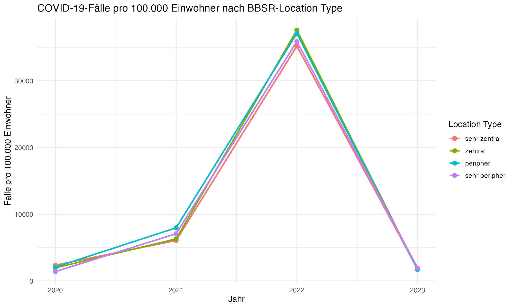
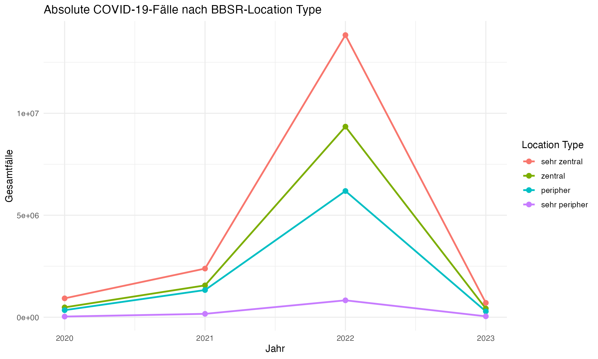
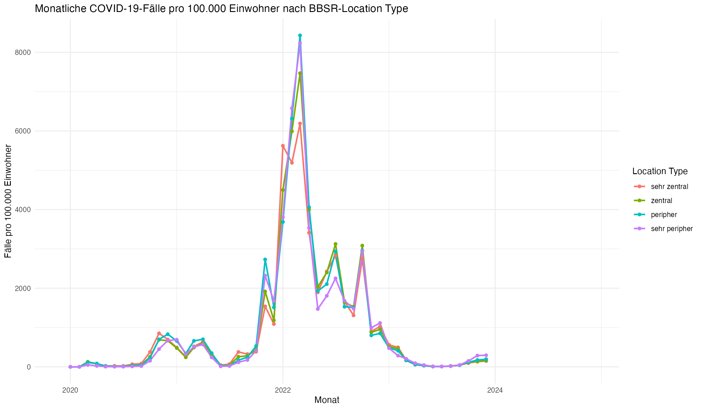

---
output:
  pdf_document: default
  html_document: default
---
# Vergleich der BBSR-Location Types und COVID-19-Fallzahlen

## 1. Fragestellung

Die Analyse untersucht, ob und wie sich die COVID-19-Fallzahlen je nach BBSR-Location Type unterscheiden. Dabei wird zwischen vier Lagegruppen unterschieden:

- sehr zentral
- zentral
- peripher
- sehr peripher

Ziel ist es, sowohl absolute Fallzahlen als auch bevölkerungsstandardisierte Vergleiche zu betrachten und dabei die zeitliche Entwicklung über die Jahre nachvollziehbar zu machen.

## 2. Definition der Location Types

Die Zuordnung der Kreise zu den Location Types basiert auf der BBSR-Raumgliederung. Die Grundlage ist die potenziell erreichbare Tagesbevölkerung innerhalb einer Fahrzeit von bis zu zwei Stunden. Dabei werden entferntere Gemeinden entsprechend ihrer Fahrzeit geringer gewichtet. Anschließend werden die Zentralitätswerte im bundesweiten Vergleich in vier Kategorien eingeteilt.

Die vier Typen bedeuten im Wesentlichen:

- sehr zentral: Kreise im Kern starker Ballungsräume mit hoher Bevölkerungsdichte, starker zentralörtlicher Funktion und hoher Anbindung.
- zentral: Kreise mit klarer regionaler Zentralität, aber weniger starkem Städtekern als sehr zentrale Bereiche.
- peripher: räumlich eher am Rand großer Zentren mit geringerer zentraler Funktion und längeren Wegen zu größeren urbanen Zentren.
- sehr peripher: stark ländlich geprägte, dünn besiedelte und räumlich abgelegene Gebiete mit geringer zentraler Anbindung.

Quelle: BBSR Raumgliederungen / Raumtyp nach Lage (Location Type), Referenztabellen zu Raumabgrenzungen. Die genaue Quelle: https://www.bbsr.bund.de/BBSR/DE/forschung/raumbeobachtung/Raumabgrenzungen/deutschland/kreise/Raumtypen2010_krs/Raumtypen2010_Kreise.html

## 3. Datengrundlage

Für die Analyse wurden folgende Daten verwendet:

- BBSR-Location Types je Kreis aus `raumgliederungen_kreis_2023.rds`
- wöchentliche COVID-19-Fälle je Kreis aus `rki_weekly_long.rds`
- Bevölkerungsdaten je Kreis und Jahr aus `population_kreis.rds`

Die Verbindung erfolgt über den Kreiscode (`geo_code`). Damit lassen sich die Fallzahlen mit dem jeweiligen Location Type und der Bevölkerungsgröße verknüpfen.

## 4. Plots aus der Analyse

### 4.1 Jahresvergleich: Fälle pro 100.000 Einwohner nach Location Type

Der erste zentrale Plot zeigt den zeitlichen Verlauf der betroffenen Fallraten je Location Type. Dabei werden die Fallzahlen auf die Bevölkerungsgröße standardisiert, damit die Gruppen vergleichbar sind.

Interpretation:

- Für alle Location Types ist ein starker Anstieg bis 2022 erkennbar.
- Im Jahr 2023 fällt die Rate deutlich zurück.
- Die Unterschiede zwischen den Gruppen sind nicht immer einheitlich; gerade in der relativen Betrachtung ist die Rangfolge je nach Jahr nicht immer durchgängig dieselbe.
- Ein reiner Vergleich der absoluten Fallzahlen wäre verzerrt, da sehr zentrale Regionen meist deutlich mehr Einwohner haben.

### 4.2 Absolute Fallzahlen nach Location Type und Jahr

Der zweite Plot zeigt die absoluten Gesamtfälle pro Jahr und Location Type.

Interpretation:

- Sehr zentrale Kreise weisen in jeder Periode die höchsten absoluten Fallzahlen auf.
- Das ist teilweise auch eine Folge der größeren Bevölkerungsbasis.
- Trotzdem zeigt sich ein klarer zeitlicher Verlauf: starke Zunahme bis 2022, danach Rückgang im Jahr 2023.

### 4.3 Monatliche Schätzung neben dem Jahresvergleich

Zusätzlich wurde eine monatliche Übersichtsbetrachtung ergänzt. Dabei werden die wöchentlichen RKI-Fälle auf Monatswerte aggregiert und mit der jährlichen Bevölkerungszahl als Näherungswert für alle Monate eines Jahres verglichen.

Interpretation:

- Die monatliche Darstellung zeigt die zeitliche Dynamik der Pandemiewellen sehr gut.
- Die Peaks in 2021 und 2022 werden deutlich sichtbar.
- Diese monatliche Rate ist eine grobe Schätzung und kein exakter monatlicher Inzidenzwert, da die Bevölkerungsdaten nur jährlich vorliegen.
- Für eine strengere epidemiologische Analyse wären monatliche Bevölkerungsdaten oder ein Modell auf Wochen-/Kreisebene geeigneter.

## 5. Zentrale Ergebnisse

### Absolute Fallzahlen

Zusammengefasst zeigen sich die folgenden Muster für alle Jahre:

sehr zentral > zentral > peripher > sehr peripher

Die absolute Fallzahl ist in sehr zentralen Regionen stets am höchsten, aber dieser Befund ist meist durch die Bevölkerungsgröße zu erklären.

### Relative Fallzahlen pro 100.000 Einwohner

Nach Standardisierung auf die Bevölkerungsgröße zeigt sich ebenfalls ein starker Anstieg bis 2022 und ein Rückgang im Jahr 2023. Die Unterschiede zwischen den Location Types sind jedoch in manchen Jahren kleiner als bei den absoluten Zahlen. Das bedeutet:

- Die Lage wirkt nicht automatisch als alleiniger Treiber der Fallzahl.
- Die zeitliche Phase der Pandemie ist ebenfalls sehr wichtig.
- Die Interpretation sollte immer absolute und relative Werte gemeinsam betrachten.

## 6. Interpretation des Zusammenhangs

Der Vergleich zeigt, dass die COVID-19-Fallzahlen von der Lagegruppe mit beeinflusst werden, aber nicht nur durch den Location Type erklärt werden. Die stärksten Unterschiede treten in den Pandemiewellen auf, besonders im Jahr 2022. In dieser Perspektive ist die räumliche Lage ein wichtiger deskriptiver Faktor, aber nicht der einzige. Zum Beispiel können auch Test- und Meldeverhalten, soziale Struktur, regionale Mobilität oder andere kontextuelle Faktoren mitwirken.

## 7. Statistische Modellierung

Zusätzlich wurde ein möglicher statistischer Ansatz geprüft:

- Eine einfache lineare Regression kann als erster Überblick genutzt werden.
- Für echte Zählwerte ist jedoch ein Poisson-Modell mit Bevölkerungs-Offset sinnvoller.

Das ist vor allem dann angemessen, wenn Fallzahlen als Zählwerte modelliert werden und die Bevölkerungsgröße berücksichtigt werden muss.

### 7.1 Lineares Modell

Das lineare Modell wurde als grober erster Überblick auf der Jahresbasis geschätzt. Die Ergebnisse zeigen, dass die erklärende Variable `year_centered` und die Location Type-Kategorien nur sehr geringe Erklärungsleistung liefern. Das R-Quadrat ist sehr niedrig und die p-Werte im Bereich von 0,94 bis 0,98 deuten darauf hin, dass der lineare Ansatz für diese Daten nur begrenzt geeignet ist.

### 7.2 Poisson-Modell

Das Poisson-Modell ist für die vorliegende Fragestellung besser passend, weil die COVID-Fallzahlen echte Zählwerte sind und die Bevölkerungsgröße über einen Offset berücksichtigt wird. Die Ergebnisse zeigen deutlich signifikante Effekte für die Zeitvariable und die Location Type-Kategorien. Das Modell ist hier deshalb der sinnvollere statistische Ansatz als die lineare Regression.

Die vollständige Modellzusammenfassung ist in [model_summaries.txt](model_summaries.txt) gespeichert.

## 8. Fazit

Die Analyse zeigt:

- sehr zentrale Regionen haben in absoluten Zahlen die höchste Belastung,
- die Unterschiede in den relativen Raten sind je nach Jahr und Phase viel weniger,
- der Verlauf über die Zeit ist in allen Location Types ähnlich,

Damit ist die Frage nach dem Zusammenhang zwischen Location Type und COVID-19-Fallzahlen mit einem klaren deskriptiven Muster beantwortet: Es gibt einen Unterschied in der Belastung je nach Lagegruppe, aber die zeitliche Entwicklung und die Bevölkerungsstandardisierung sind für die Interpretation ebenso wichtig wie die Lage selbst.